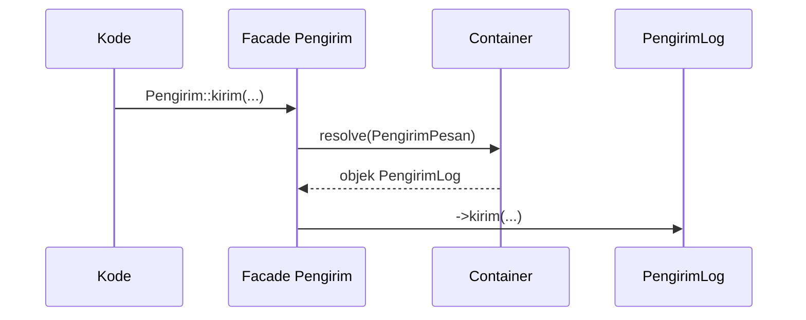

# Facades

Kamu sudah memakai Facade sejak awal: `Route::get(...)`, `Cache::get(...)`, `Log::info(...)`, `Auth::user()`. Tampak seperti pemanggilan method statis, padahal di baliknya adalah objek dari container. Sub bab ini membongkar cara kerjanya, kelebihan, dan jebakannya.

## Tujuan Pembelajaran

- [ ] Menjelaskan Facade sebagai "proxy statis" ke objek di container.
- [ ] Menjelaskan alur `Cache::get()` sampai ke objek sebenarnya.
- [ ] Membuat Facade sendiri untuk layanan aplikasi.
- [ ] Memakai `Facade::fake()` dan `shouldReceive` secara konsep untuk pengujian.
- [ ] Membandingkan Facade, helper, dan injeksi.

## Prasyarat

- [Service Container](07-01-service-container.md), [Contracts dan Interface](07-04-contracts-and-interfaces.md).

## Pengantar

`Log::info('x')` terlihat statis, namun tidak ada method statis `info` di class `Log`. Laravel menerjemahkannya menjadi pemanggilan pada objek yang diambil dari container.

## Penjelasan Konsep

### Cara kerja

Menurut dokumentasi, Facade adalah class yang menyediakan antarmuka statis ke objek di container. Class dasar `Illuminate\Support\Facades\Facade` memakai *magic method* `__callStatic()` untuk meneruskan panggilan ke objek yang dikembalikan oleh `getFacadeAccessor()`.

```php
class Cache extends Facade
{
    protected static function getFacadeAccessor(): string
    {
        return 'cache';
    }
}
```

Pemanggilan `Cache::get('kunci')` → mengambil binding `cache` dari container → memanggil `->get('kunci')` pada objeknya.

### Kelebihan dan kekurangan

| Aspek | Penilaian |
|---|---|
| Ringkas dan mudah dibaca | Kelebihan |
| Bisa di-*fake* saat uji | Kelebihan |
| Ketergantungan tidak terlihat di constructor | Kekurangan |
| Mudah membuat class "serba tahu" | Kekurangan |

### Facade sendiri

File: `app/Facades/Pengirim.php`

```php
<?php

namespace App\Facades;

use App\Contracts\PengirimPesan;
use Illuminate\Support\Facades\Facade;

/**
 * @method static void kirim(string $tujuan, string $isi)
 */
class Pengirim extends Facade
{
    protected static function getFacadeAccessor(): string
    {
        return PengirimPesan::class;
    }
}
```

Accessor boleh berupa nama class, sehingga Facade meneruskan ke implementasi yang terikat pada interface itu. Komentar `@method` membantu editor melengkapi kode.

Pemakaian: `Pengirim::kirim('ani@contoh.test', 'Halo');`.

### Pengujian

Facade bawaan menyediakan `fake`, misalnya `Mail::fake()`, `Queue::fake()`, `Event::fake()`, yang mengganti implementasi dengan perekam. Untuk Facade sendiri, `Pengirim::shouldReceive('kirim')->once()` (berbasis Mockery) dapat dipakai. Pengujian dibahas lengkap di Level 08.

### Facade, helper, atau injeksi?

| Kebutuhan | Pilihan |
|---|---|
| Skrip singkat, route, command | Facade/helper |
| Class bisnis yang harus mudah diuji dan jelas ketergantungannya | Injeksi contract |

### Keamanan

Tidak ada risiko khusus, tetapi perhatikan bahwa Facade menyembunyikan ketergantungan sehingga mudah tanpa sadar memakai layanan sensitif (mis. `Auth`, `DB`) di tempat yang tidak semestinya, misalnya di model.

## Cara Kerja



## Contoh Praktik

Kamu membuat Facade `Pengirim`, memakainya di route, dan membandingkannya dengan versi injeksi.

## Penjelasan Kode

Kode ada di bagian konsep. Perhatikan bahwa Facade tidak menyimpan logika; ia hanya "pintu".

## Implementasi Langkah demi Langkah

### Langkah 1: buat Facade

Simpan `app/Facades/Pengirim.php`.

### Langkah 2: route percobaan

```php-inline
use App\Facades\Pengirim;

Route::get('/uji-facade', function () {
    Pengirim::kirim('ani@contoh.test', 'Dari facade');

    return 'ok';
});
```

### Langkah 3: jalankan dan periksa log

```bash
curl -s http://127.0.0.1:8000/uji-facade
tail -n 2 storage/logs/laravel.log
```

### Langkah 4: telusuri sumber

Buka `vendor/laravel/framework/src/Illuminate/Support/Facades/Cache.php` dan temukan `getFacadeAccessor`.

### Langkah 5: bersihkan dan catat

Hapus route percobaan, lalu:

```bash
git add app
git commit -m "Tambah facade pengirim"
```

## Eksekusi dan Verifikasi

| Langkah | Hasil |
|---|---|
| 3 | Respons `ok`; log memuat "Pesan ke ani@contoh.test: Dari facade" |
| 4 | Accessor bernilai `'cache'` |

## Hasil yang Diharapkan

Diturunkan dari dokumentasi; belum dijalankan penulis.

## Kesalahan Umum dan Pemecahan Masalah

| Gejala | Penyebab | Cara mengenali | Solusi | Pencegahan |
|---|---|---|---|---|
| `Class "Pengirim" not found` | Lupa `use` | Galat class | Tambah `use App\Facades\Pengirim` | Impor eksplisit |
| `A facade root has not been set` | Accessor tak terikat | Galat | Ikat accessor di provider | Gunakan nama interface yang terikat |
| `Call to undefined method` | Method tidak ada di objek | Galat | Periksa kontrak | Tulis `@method` akurat |
| Class membengkak dengan banyak Facade | Kemudahan pakai | Ketergantungan tersembunyi | Suntik via constructor | Review ketergantungan |

## Latihan Praktik

### Latihan dasar

**D1. Telusuri Facade**
- *Masalah:* ingin tahu objek di balik `Log`.
- *Persyaratan:* buka file Facade `Log` dan sebutkan accessornya.
- *Perilaku yang diharapkan:* nama binding ditemukan.
- *Tujuan belajar:* memahami proxy.

### Latihan implementasi

**I1. Dua gaya**
- *Masalah:* membandingkan gaya.
- *Persyaratan:* tulis fungsi yang sama dengan Facade dan dengan injeksi contract; tuliskan satu kelebihan masing-masing.
- *Perilaku yang diharapkan:* perbandingan jelas.
- *Tujuan belajar:* memilih gaya.

### Latihan tantangan

**T1. Real-time facade**
- *Masalah:* ingin Facade untuk class tanpa membuat class Facade.
- *Persyaratan:* baca dokumentasi *real-time facades* (awalan `Facades\`) dan jelaskan cara kerjanya.
- *Perilaku yang diharapkan:* penjelasan benar.
- *Tujuan belajar:* variasi Facade.
- *Catatan:* kerjakan mandiri; tidak ada kunci jawaban.

## Uji Pemahaman

1. Apa fungsi `getFacadeAccessor()`?
2. Method magic apa yang dipakai Facade?
3. Apa risiko memakai terlalu banyak Facade dalam satu class?
4. Kapan injeksi lebih baik?

??? success "Kunci jawaban singkat"
    1. Mengembalikan nama binding di container.
    2. `__callStatic()`.
    3. Ketergantungan tidak terlihat dan class membengkak.
    4. Pada logika bisnis yang perlu jelas dan mudah diuji.

## Ringkasan

- Facade = proxy statis ke objek di container.
- Ringkas dan bisa di-*fake*, tetapi menyembunyikan ketergantungan.
- Pilih Facade untuk kode tipis, injeksi untuk logika bisnis.

Selanjutnya: *Repository Pattern*.

## Referensi Resmi

- [Laravel: Facades](https://laravel.com/docs/13.x/facades)
