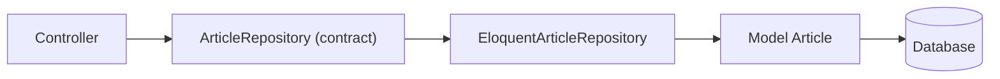

# Repository Pattern

*Repository* adalah lapisan yang menyembunyikan **cara data diambil** (Eloquent, API eksternal, cache) di balik contract. Pola ini sering dipakai, tetapi juga sering disalahgunakan pada Laravel karena Eloquent sendiri sudah berlaku seperti repository. Sub bab ini mengajarkan kapan pola ini membantu dan kapan tidak.

## Tujuan Pembelajaran

- [ ] Menjelaskan tujuan Repository Pattern.
- [ ] Membuat contract repository dan implementasi Eloquent.
- [ ] Mengikat repository di provider dan memakainya lewat DI.
- [ ] Menilai kapan pola ini berguna dan kapan berlebihan.
- [ ] Menghindari kebocoran detail Eloquent dari repository.

## Prasyarat

- [Dependency Injection](07-03-dependency-injection.md), [Contracts dan Interface](07-04-contracts-and-interfaces.md), model `Article` dari Level 04.

## Pengantar

Query artikel terbit tersebar di controller, command, dan job. Perubahan aturan ("terbit" juga mengecualikan arsip) memaksa mengubah banyak tempat. Repository memusatkan query bernama sehingga aturan hidup di satu tempat.

## Penjelasan Konsep

### Struktur

```text
app/Contracts/ArticleRepository.php        (interface)
app/Repositories/EloquentArticleRepository.php
app/Providers/RepositoryServiceProvider.php (binding)
```

### Contract

File: `app/Contracts/ArticleRepository.php`

```php
<?php

namespace App\Contracts;

use App\Models\Article;
use Illuminate\Contracts\Pagination\LengthAwarePaginator;

interface ArticleRepository
{
    public function paginatePublished(int $perPage = 15): LengthAwarePaginator;

    public function findPublishedBySlug(string $slug): ?Article;
}
```

### Implementasi

File: `app/Repositories/EloquentArticleRepository.php`

```php
<?php

namespace App\Repositories;

use App\Contracts\ArticleRepository;
use App\Models\Article;
use Illuminate\Contracts\Pagination\LengthAwarePaginator;

class EloquentArticleRepository implements ArticleRepository
{
    public function paginatePublished(int $perPage = 15): LengthAwarePaginator
    {
        return Article::query()
            ->published()
            ->with('user:id,name')
            ->latest('published_at')
            ->paginate(min($perPage, 50));
    }

    public function findPublishedBySlug(string $slug): ?Article
    {
        return Article::query()->published()->where('slug', $slug)->first();
    }
}
```

`published()` adalah scope dari Level 04. Batas `min($perPage, 50)` mencegah permintaan halaman raksasa. Binding parameter dilakukan Eloquent sehingga aman dari SQL injection.

### Binding

```php
// app/Providers/RepositoryServiceProvider.php, di register()
$this->app->bind(ArticleRepository::class, EloquentArticleRepository::class);
```

Daftarkan provider dengan `make:provider RepositoryServiceProvider`.

### Pemakaian

```php
public function __construct(private ArticleRepository $articles) {}

public function index()
{
    return view('articles.index', ['articles' => $this->articles->paginatePublished()]);
}
```

### Kapan berguna?

| Situasi | Repository membantu? |
|---|---|
| Query kompleks dipakai di banyak tempat | Ya |
| Sumber data bisa berganti (DB, API, cache) | Ya |
| CRUD sederhana satu tempat | Tidak, Eloquent cukup |
| Membungkus setiap method Eloquent satu-satu | Tidak, hanya menambah kode |

### Kebocoran abstraksi

Jika repository mengembalikan `Builder` Eloquent, pemakai kembali terikat pada Eloquent dan manfaatnya hilang. Kembalikan hasil (koleksi, paginator, model) atau DTO, bukan query builder.

### Keamanan

Repository adalah tempat tepat untuk menegakkan batas data (mis. hanya artikel terbit untuk publik), tetapi **bukan** pengganti Policy: otorisasi tetap di Policy/Gate pada lapisan HTTP.

## Cara Kerja



## Contoh Praktik

Kamu memindahkan query artikel terbit dari `ArticleController` ke repository, mengikatnya, dan memverifikasi halaman daftar tetap sama.

## Penjelasan Kode

Controller kini bergantung pada `ArticleRepository` saja. Mengganti ke implementasi cache nanti cukup mengubah binding.

## Implementasi Langkah demi Langkah

### Langkah 1: buat contract dan implementasi

Simpan dua berkas di atas.

### Langkah 2: buat provider dan daftarkan binding

```bash
php artisan make:provider RepositoryServiceProvider
```

### Langkah 3: ubah controller

Suntikkan `ArticleRepository` dan ganti query langsung dengan `paginatePublished()`.

### Langkah 4: verifikasi

```bash
php artisan serve
curl -s http://127.0.0.1:8000/artikel | head -c 300
```

(Sesuaikan path dengan route daftar artikelmu.)

### Langkah 5: catat di Git

```bash
git add app
git commit -m "Pindahkan query artikel ke repository"
```

## Eksekusi dan Verifikasi

| Langkah | Hasil |
|---|---|
| 4 | Halaman daftar tampil sama seperti sebelum refactor |

## Hasil yang Diharapkan

Perilaku tidak berubah; yang berubah hanya lokasi query. Belum dijalankan penulis.

## Kesalahan Umum dan Pemecahan Masalah

| Gejala | Penyebab | Cara mengenali | Solusi | Pencegahan |
|---|---|---|---|---|
| Interface tak teresolusi | Binding belum didaftarkan | `BindingResolutionException` | Daftarkan provider | Cek `bootstrap/providers.php` |
| Repository mengembalikan `Builder` | Abstraksi bocor | Pemakai memanggil `->where` | Kembalikan hasil | Review kontrak |
| Satu repository per tabel otomatis | Kebiasaan | Banyak kelas kosong | Buat hanya bila perlu | Kriteria kapan berguna |
| Query N+1 | Tidak ada `with` | Banyak query | Eager loading | Debugbar / log query |

## Latihan Praktik

### Latihan dasar

**D1. Perlukah repository?**
- *Masalah:* menilai kasus.
- *Persyaratan:* untuk (a) `Article::find($id)` di satu controller dan (b) query laporan rumit di tiga tempat, tentukan perlu atau tidak.
- *Perilaku yang diharapkan:* (a) tidak, (b) ya.
- *Tujuan belajar:* menilai manfaat.

### Latihan implementasi

**I1. Method pencarian**
- *Masalah:* pencarian judul dipakai dua tempat.
- *Persyaratan:* tambah `search(string $q): LengthAwarePaginator` yang aman terhadap `%`/`_` (escape) dan terbatas panjang.
- *Perilaku yang diharapkan:* hasil benar tanpa error.
- *Tujuan belajar:* memusatkan query.

### Latihan tantangan

**T1. Dekorator cache**
- *Masalah:* ingin cache tanpa mengubah pemakai.
- *Persyaratan:* rancang `CachedArticleRepository` yang membungkus implementasi Eloquent dan mengikatnya; jelaskan invalidasi saat artikel diubah.
- *Perilaku yang diharapkan:* rancangan benar.
- *Tujuan belajar:* menambah perilaku lewat abstraksi.
- *Catatan:* kerjakan mandiri; tidak ada kunci jawaban.

## Uji Pemahaman

1. Apa tujuan repository?
2. Mengapa tidak mengembalikan `Builder`?
3. Kapan repository berlebihan?
4. Apakah repository menggantikan Policy?

??? success "Kunci jawaban singkat"
    1. Menyembunyikan cara data diambil di balik contract.
    2. Pemakai kembali terikat pada Eloquent.
    3. Untuk CRUD sederhana yang hanya membungkus Eloquent.
    4. Tidak; otorisasi tetap di Policy/Gate.

## Ringkasan

- Repository memusatkan query bernama di balik contract.
- Bermanfaat untuk query kompleks atau sumber data bergantian; berlebihan untuk CRUD sederhana.
- Jangan bocorkan `Builder`; tetap pakai Policy untuk otorisasi.

Selanjutnya: *Service Layer Pattern*.

## Referensi Resmi

- [Laravel: Eloquent, Query Scopes](https://laravel.com/docs/13.x/eloquent#query-scopes)
- [Laravel: Service Container](https://laravel.com/docs/13.x/container)
