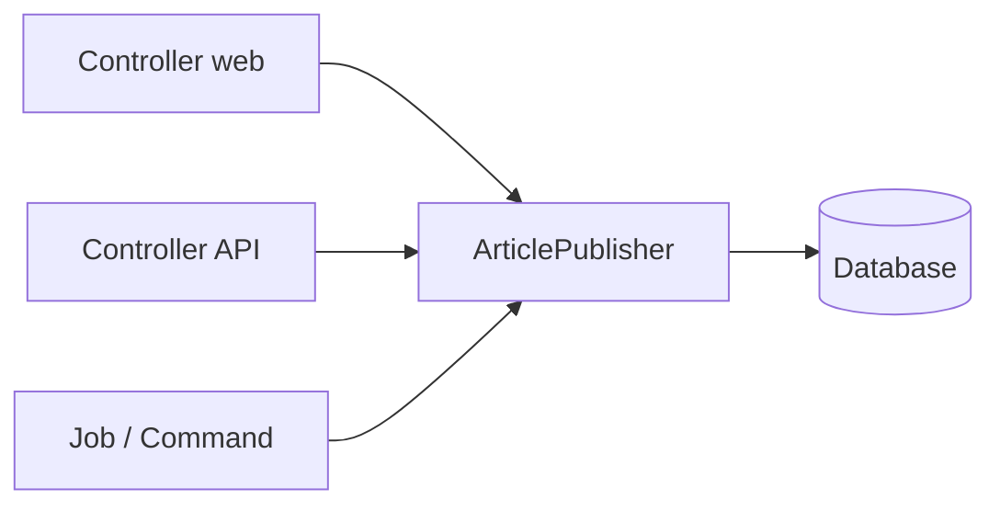

# Service Layer Pattern

Controller sebaiknya tipis: menerima request, memanggil logika, mengembalikan respons. Logika bisnis (membuat artikel, memberi slug, memicu pemberitahuan) layak berada di **service class** yang dapat dipakai ulang oleh controller web, API, command, dan job.

## Tujuan Pembelajaran

- [ ] Menjelaskan masalah "controller gemuk".
- [ ] Membuat service class dengan satu tanggung jawab.
- [ ] Menyuntikkan service ke controller dan memakainya di tempat lain.
- [ ] Menggunakan transaksi database di service.
- [ ] Membedakan service, repository, dan Action.

## Prasyarat

- [Dependency Injection](07-03-dependency-injection.md), [Repository Pattern](07-06-repository-pattern.md), Level 04 (transaksi).

## Pengantar

`ArticleController@store` (web) dan `Api\V1\ArticleController@store` (API) membuat artikel dengan aturan yang sama (slug unik, status, pemilik). Menyalin logika ke dua tempat menjamin cepat atau lambat keduanya berbeda.

## Penjelasan Konsep

### Service class

File: `app/Services/ArticlePublisher.php`

```php
<?php

namespace App\Services;

use App\Models\Article;
use App\Models\User;
use Illuminate\Support\Facades\DB;
use Illuminate\Support\Str;

class ArticlePublisher
{
    public function create(User $author, array $data): Article
    {
        return DB::transaction(function () use ($author, $data) {
            $article = new Article($data);
            $article->slug = $this->uniqueSlug($data['title']);
            $article->user()->associate($author);
            $article->save();

            return $article;
        });
    }

    private function uniqueSlug(string $title): string
    {
        $base = Str::slug($title);
        $slug = $base;
        $i = 2;

        while (Article::withTrashed()->where('slug', $slug)->exists()) {
            $slug = $base.'-'.$i++;
        }

        return $slug;
    }
}
```

`DB::transaction` membuat semua langkah berhasil atau dibatalkan bersama. `associate` mengisi pemilik dari argumen (bukan dari input). `withTrashed()` mencegah slug bentrok dengan artikel yang di-soft-delete. Catatan: pemeriksaan-lalu-simpan tetap bisa balapan; kolom `slug` harus tetap `unique` di database.

### Pemakaian

```php-inline
public function store(StoreArticleRequest $request, ArticlePublisher $publisher)
{
    $article = $publisher->create($request->user(), $request->validated());

    return redirect()->route('articles.show', $article);
}
```

Controller API memakai service yang sama dan hanya berbeda pada respons (`201` + Resource).

### Service, repository, atau Action?

| Konsep | Fokus |
|---|---|
| Repository | Cara **mengambil** data |
| Service | Aturan bisnis yang mengoordinasikan beberapa langkah |
| Action (satu class satu tugas) | Varian service dengan satu method `handle`/`__invoke` |

Pilih satu gaya per proyek dan konsisten. Service yang tumbuh menjadi puluhan method sebaiknya dipecah.

### Batas yang sehat

| Di controller | Di service |
|---|---|
| Validasi request, otorisasi HTTP, bentuk respons | Aturan bisnis, transaksi, koordinasi |
| Mengenal `Request` | Tidak mengenal `Request`; menerima data biasa |

### Keamanan

- Service menerima data **yang sudah divalidasi**; jangan percaya mentah-mentah dari pemanggil lain.
- Otorisasi tetap dipicu di lapisan HTTP (`authorize`, Policy); bila service dipanggil dari job/command, pastikan pemanggil sah.

## Cara Kerja



## Contoh Praktik

Kamu memindahkan logika pembuatan artikel dari controller ke `ArticlePublisher`, lalu memakainya di controller API dan command Artisan.

## Penjelasan Kode

Service menerima `User` dan array tervalidasi, mengembalikan `Article`. Tidak ada `Request`, `redirect`, atau JSON di dalamnya.

## Implementasi Langkah demi Langkah

### Langkah 1: buat service

Simpan `app/Services/ArticlePublisher.php`.

### Langkah 2: ubah controller web

Suntikkan service di `store` seperti contoh di atas.

### Langkah 3: ubah controller API

Panggil service yang sama; kembalikan `ArticleResource` dengan status `201`.

### Langkah 4: verifikasi dua jalur

```bash
curl -s -X POST -H "Accept: application/json" -H "Content-Type: application/json" \
  -H "Authorization: Bearer <TOKEN>" \
  -d '{"title":"Dari service","body":"Isi"}' http://127.0.0.1:8000/api/v1/articles
```

Buat juga artikel lewat formulir web dan bandingkan slug yang dihasilkan.

### Langkah 5: catat di Git

```bash
git add app
git commit -m "Pindahkan pembuatan artikel ke ArticlePublisher"
```

## Eksekusi dan Verifikasi

| Langkah | Hasil |
|---|---|
| 4 | `201` dan slug `dari-service`; judul sama kedua menghasilkan `dari-service-2` |

## Hasil yang Diharapkan

Diturunkan dari kode; belum dijalankan penulis.

## Kesalahan Umum dan Pemecahan Masalah

| Gejala | Penyebab | Cara mengenali | Solusi | Pencegahan |
|---|---|---|---|---|
| Service memakai `Request` | Batas kabur | Sulit dipakai di command | Terima data biasa | Tinjau signature |
| Satu "service dewa" | Semua logika dikumpulkan | Puluhan method | Pecah per tanggung jawab | Satu class satu alasan berubah |
| Slug bentrok saat bersamaan | Pemeriksaan lalu simpan | `UniqueConstraintViolationException` | Kolom `unique` + ulangi | Constraint di DB |
| Pemilik dari input | `user_id` di data | Artikel atas nama orang lain | Gunakan `associate` | Jangan taruh di `$fillable` |

## Latihan Praktik

### Latihan dasar

**D1. Pisahkan tanggung jawab**
- *Masalah:* controller 80 baris.
- *Persyaratan:* tandai bagian yang tetap di controller dan yang pindah ke service.
- *Perilaku yang diharapkan:* validasi/respons tetap; aturan bisnis pindah.
- *Tujuan belajar:* batas lapisan.

### Latihan implementasi

**I1. Method `update`**
- *Masalah:* pembaruan artikel juga memperbarui slug bila judul berubah dan belum terbit.
- *Persyaratan:* tambahkan method dengan aturan itu dalam transaksi.
- *Perilaku yang diharapkan:* slug artikel terbit tidak berubah.
- *Tujuan belajar:* aturan bisnis di service.

### Latihan tantangan

**T1. Service vs Action**
- *Masalah:* tim berselisih gaya.
- *Persyaratan:* tulis argumen untuk masing-masing dan pilih satu untuk proyek ini.
- *Perilaku yang diharapkan:* alasan jelas.
- *Tujuan belajar:* konsistensi arsitektur.
- *Catatan:* kerjakan mandiri; tidak ada kunci jawaban.

## Uji Pemahaman

1. Mengapa controller harus tipis?
2. Mengapa service tidak mengenal `Request`?
3. Apa fungsi `DB::transaction`?
4. Apa beda service dan repository?

??? success "Kunci jawaban singkat"
    1. Agar logika dapat dipakai ulang dan mudah diuji.
    2. Agar bisa dipakai dari controller, command, dan job.
    3. Semua langkah berhasil atau dibatalkan bersama.
    4. Repository mengambil data; service mengoordinasikan aturan bisnis.

## Ringkasan

- Pindahkan aturan bisnis ke service agar dipakai ulang dan teruji.
- Controller tipis; service menerima data tervalidasi.
- Gunakan transaksi dan constraint database untuk konsistensi.

Selanjutnya: *Events dan Listeners*.

## Referensi Resmi

- [Laravel: Database Transactions](https://laravel.com/docs/13.x/database#database-transactions)
- [Laravel: Controllers](https://laravel.com/docs/13.x/controllers)
