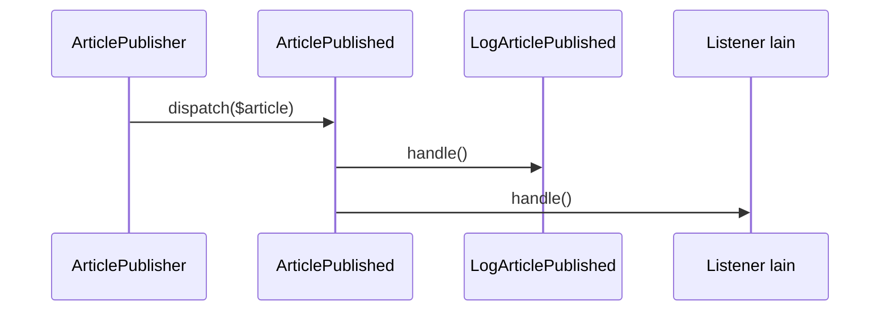

# Events dan Listeners

Saat sebuah artikel diterbitkan, banyak hal bisa terjadi: kirim pemberitahuan, bersihkan cache, catat audit. Jika semuanya ditulis di service pembuat artikel, service itu mengenal terlalu banyak urusan. **Event** memungkinkan satu kejadian diumumkan dan banyak **listener** meresponsnya secara terpisah.

## Tujuan Pembelajaran

- [ ] Menjelaskan pola observer yang melandasi event.
- [ ] Membuat event dan listener dengan Artisan.
- [ ] Memahami penemuan otomatis listener (*event discovery*).
- [ ] Mengirim (*dispatch*) event dan mengamati listener berjalan.
- [ ] Membedakan listener sinkron dan antre.
- [ ] Menghindari jebakan (event berlebihan, listener bergantung urutan).

## Prasyarat

- [Service Layer Pattern](07-07-service-layer-pattern.md), [Dependency Injection](07-03-dependency-injection.md).

## Pengantar

Aturan baru: ketika artikel terbit, penulisnya mendapat catatan log, lalu nanti email. Daripada menambah baris di `ArticlePublisher` setiap kali ada kebutuhan baru, service cukup mengumumkan `ArticlePublished`.

## Penjelasan Konsep

### Event dan listener

| Konsep | Peran |
|---|---|
| Event | Class data kecil yang menyatakan "sesuatu telah terjadi" |
| Listener | Class dengan `handle()` yang bereaksi terhadap event |
| Dispatch | Mengumumkan event |

Satu event dapat memiliki banyak listener; pengirim tidak tahu siapa yang mendengar.

### Membuat

```bash
php artisan make:event ArticlePublished
php artisan make:listener LogArticlePublished --event=ArticlePublished
```

File: `app/Events/ArticlePublished.php`

```php
<?php

namespace App\Events;

use App\Models\Article;
use Illuminate\Foundation\Events\Dispatchable;
use Illuminate\Queue\SerializesModels;

class ArticlePublished
{
    use Dispatchable, SerializesModels;

    public function __construct(public Article $article) {}
}
```

`Dispatchable` menyediakan `ArticlePublished::dispatch($article)`. `SerializesModels` menyimpan hanya ID model bila event diantrekan.

File: `app/Listeners/LogArticlePublished.php`

```php
<?php

namespace App\Listeners;

use App\Events\ArticlePublished;
use Illuminate\Support\Facades\Log;

class LogArticlePublished
{
    public function handle(ArticlePublished $event): void
    {
        Log::info('Artikel terbit', [
            'article_id' => $event->article->id,
            'user_id' => $event->article->user_id,
        ]);
    }
}
```

### Penemuan otomatis

Menurut dokumentasi, Laravel secara otomatis menemukan listener dengan memindai direktori `Listeners`; method `handle` atau `__invoke` yang type-hint-nya sebuah event didaftarkan untuk event itu. Jika listener berada di direktori lain, gunakan `withEvents(discover: [...])` di `bootstrap/app.php`. Di produksi, cache dengan `php artisan event:cache` (atau `optimize`), dan `event:clear` untuk menghapusnya.

### Mengirim event

Di `ArticlePublisher`, setelah penyimpanan berhasil:

```php
ArticlePublished::dispatch($article);
```

**Penting:** bila `dispatch` terjadi di dalam transaksi, listener bisa berjalan sebelum data ter-*commit*. Letakkan `dispatch` setelah transaksi selesai, atau gunakan interface `ShouldDispatchAfterCommit` pada event.

### Listener antre

Menambahkan `implements ShouldQueue` pada listener membuatnya dijalankan oleh queue worker, bukan di request (dibahas di bab Jobs dan Queues):

```php
class KirimNotifikasiArtikel implements ShouldQueue
```

### Peringatan desain

| Jebakan | Akibat |
|---|---|
| Event untuk segala hal | Alur sulit dilacak |
| Listener bergantung urutan eksekusi | Rapuh |
| Listener sinkron lambat | Request jadi lambat |
| Logika inti ditaruh di listener | Perilaku wajib "tersembunyi" |

Gunakan event untuk efek samping yang dapat dipisahkan, bukan untuk langkah wajib alur utama.

### Keamanan

Jangan menaruh data sensitif (kata sandi, token) pada properti event; event bisa diserialisasi ke antrean dan muncul di log kegagalan.

## Cara Kerja



## Contoh Praktik

Kamu membuat event dan listener log, mengirim event setelah artikel dibuat, dan memeriksa log.

## Penjelasan Kode

Event hanya membawa data. Listener melakukan reaksi. `ArticlePublisher` hanya mengumumkan.

## Implementasi Langkah demi Langkah

### Langkah 1: buat event dan listener

Gunakan dua perintah `make:` di atas dan isi seperti contoh.

### Langkah 2: kirim dari service

Tambahkan `ArticlePublished::dispatch($article);` setelah `DB::transaction(...)` mengembalikan artikel (ubah service agar menyimpan hasil transaksi ke variabel, dispatch, lalu return).

### Langkah 3: lihat listener terdaftar

```bash
php artisan event:list
```

### Langkah 4: picu dan periksa

Buat artikel (web atau API), lalu:

```bash
tail -n 3 storage/logs/laravel.log
```

### Langkah 5: catat di Git

```bash
git add app
git commit -m "Tambah event ArticlePublished dan listener log"
```

## Eksekusi dan Verifikasi

| Langkah | Hasil |
|---|---|
| 3 | `ArticlePublished` terdaftar dengan `LogArticlePublished@handle` |
| 4 | Log memuat "Artikel terbit" dengan `article_id` |

## Hasil yang Diharapkan

Diturunkan dari dokumentasi; belum dijalankan penulis.

## Kesalahan Umum dan Pemecahan Masalah

| Gejala | Penyebab | Cara mengenali | Solusi | Pencegahan |
|---|---|---|---|---|
| Listener tidak jalan | Tidak ditemukan / cache event lama | Tidak ada di `event:list` | Periksa direktori & type-hint; `event:clear` | Jalankan `event:list` |
| Listener jalan dua kali | Terdaftar manual dan otomatis | Log ganda | Hapus registrasi manual | Pilih satu cara |
| Listener membaca data lama | Dispatch sebelum commit | Data belum ada | Dispatch setelah transaksi | `ShouldDispatchAfterCommit` |
| Request lambat | Listener berat sinkron | Waktu respons naik | `ShouldQueue` | Ukur durasi |
| Galat serialisasi | Properti tak dapat diserialisasi | Gagal saat antre | Kirim ID, bukan objek berat | `SerializesModels` |

## Latihan Praktik

### Latihan dasar

**D1. Lihat daftar**
- *Masalah:* ingin tahu event terdaftar.
- *Persyaratan:* jalankan `php artisan event:list` dan jelaskan satu baris.
- *Perilaku yang diharapkan:* event dipetakan ke listener.
- *Tujuan belajar:* mengenali pemetaan.

### Latihan implementasi

**I1. Listener kedua**
- *Masalah:* ingin juga menyegarkan cache beranda.
- *Persyaratan:* buat listener `ClearHomeCache` yang menghapus kunci cache `home.latest`.
- *Perilaku yang diharapkan:* dua listener berjalan.
- *Tujuan belajar:* satu event banyak reaksi.

### Latihan tantangan

**T1. Event atau panggilan langsung?**
- *Masalah:* tim ingin event untuk semua hal.
- *Persyaratan:* tulis tiga kriteria memilih event vs panggilan langsung.
- *Perilaku yang diharapkan:* kriteria beralasan.
- *Tujuan belajar:* menghindari penggunaan berlebihan.
- *Catatan:* kerjakan mandiri; tidak ada kunci jawaban.

## Uji Pemahaman

1. Apa beda event dan listener?
2. Bagaimana listener ditemukan?
3. Mengapa dispatch sebaiknya setelah commit?
4. Apa fungsi `ShouldQueue` pada listener?

??? success "Kunci jawaban singkat"
    1. Event menyatakan kejadian; listener bereaksi.
    2. Dipindai dari direktori `Listeners` berdasarkan type-hint `handle`.
    3. Agar listener melihat data yang sudah tersimpan.
    4. Listener dijalankan oleh queue worker.

## Ringkasan

- Event memisahkan "apa yang terjadi" dari "apa yang dilakukan sesudahnya".
- Listener ditemukan otomatis; lihat dengan `event:list`.
- Dispatch setelah commit; antrekan listener yang lambat.

Selanjutnya: *Jobs dan Queues*.

## Referensi Resmi

- [Laravel: Events](https://laravel.com/docs/13.x/events)
