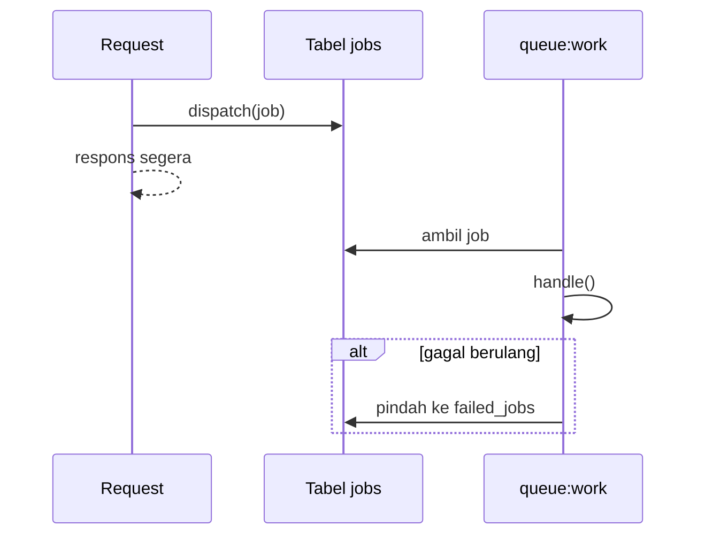

# Jobs dan Queues

Mengirim email, mengubah ukuran gambar, atau memanggil API luar bisa makan waktu detik. Jika dikerjakan di dalam request, pengguna menunggu. **Queue** memindahkan pekerjaan itu ke latar belakang: request cukup memasukkan **job** ke antrean dan langsung merespons, sementara **worker** mengerjakannya.

## Tujuan Pembelajaran

- [ ] Menjelaskan konsep antrean, job, dan worker.
- [ ] Mengonfigurasi koneksi antrean `database`.
- [ ] Membuat job dengan `make:job` dan men-*dispatch*-nya.
- [ ] Menentukan jumlah percobaan, jeda, dan batas waktu dengan atribut.
- [ ] Menangani job gagal dan tabel `failed_jobs`.
- [ ] Menjelaskan data apa yang pantas dimasukkan ke job.

## Prasyarat

- [Events dan Listeners](07-08-events-and-listeners.md), Level 04 (migrasi, Eloquent).

## Pengantar

Saat artikel terbit, kita ingin memberi tahu pelanggan. Dengan 5.000 pelanggan, pengiriman sinkron membuat penulis menunggu menit. Dengan antrean, penulis langsung melihat "Terbit" dan pengiriman berjalan di belakang.

## Penjelasan Konsep

### Komponen

| Komponen | Peran |
|---|---|
| Job | Class kecil berisi pekerjaan (`handle()`) |
| Queue | Tempat job menunggu (tabel `jobs`, Redis, dsb.) |
| Worker | Proses `php artisan queue:work` yang mengambil dan menjalankan job |

Proyek memakai `QUEUE_CONNECTION=database` (bawaan skeleton). Menurut dokumentasi, tabel `jobs` biasanya sudah ada di migrasi bawaan; jika belum, `php artisan make:queue-table` lalu `migrate`.

### Membuat job

```bash
php artisan make:job SendArticleDigest
```

File: `app/Jobs/NotifyArticleSubscribers.php`

```php
<?php

namespace App\Jobs;

use App\Models\Article;
use Illuminate\Contracts\Queue\ShouldQueue;
use Illuminate\Foundation\Queue\Queueable;
use Illuminate\Queue\Attributes\Backoff;
use Illuminate\Queue\Attributes\Timeout;
use Illuminate\Queue\Attributes\Tries;
use Illuminate\Support\Facades\Log;

#[Tries(3)]
#[Backoff([10, 60])]
#[Timeout(60)]
class NotifyArticleSubscribers implements ShouldQueue
{
    use Queueable;

    public function __construct(public Article $article) {}

    public function handle(): void
    {
        Log::info('Memproses pemberitahuan', ['article_id' => $this->article->id]);
    }
}
```

| Bagian | Fungsi |
|---|---|
| `implements ShouldQueue` | Menandai job berjalan di antrean |
| `Queueable` | Trait opsi antrean (`onQueue`, `delay`, dll.) |
| `#[Tries(3)]` | Maksimal tiga percobaan |
| `#[Backoff([10, 60])]` | Jeda 10 dtk lalu 60 dtk antar percobaan |
| `#[Timeout(60)]` | Batas 60 detik per percobaan |
| Properti `Article` | Model diserialisasi sebagai ID lalu dimuat ulang saat dijalankan |

Atribut `Tries`, `Backoff`, `Timeout` berasal dari `Illuminate\Queue\Attributes` (Laravel 13). Batas waktu job memerlukan ekstensi PCNTL dan harus lebih pendek dari `retry_after` koneksi.

### Men-*dispatch*

```php-inline
NotifyArticleSubscribers::dispatch($article);                    // segera ke antrean
NotifyArticleSubscribers::dispatch($article)->delay(now()->plus(minutes: 10));
NotifyArticleSubscribers::dispatch($article)->onQueue('notifikasi');
NotifyArticleSubscribers::dispatch($article)->afterCommit();     // setelah transaksi commit
```

`dispatchSync` menjalankan job langsung (tanpa antrean), berguna untuk pengembangan.

### Job gagal

Jika `handle()` melempar pengecualian, job dikembalikan ke antrean hingga batas percobaan. Setelah itu job dicatat di tabel `failed_jobs`. Definisikan `failed(Throwable $e)` pada job untuk membersihkan atau memberi tahu.

```bash
php artisan queue:failed
php artisan queue:retry all
```

### Apa yang boleh masuk job?

| Boleh | Hindari |
|---|---|
| ID/model kecil | Objek besar, koneksi, file handle |
| Data yang boleh tampil di tabel `jobs` | Kata sandi, token (tersimpan di antrean dan log gagal) |

Job harus **idempoten** bila mungkin: dijalankan dua kali tidak merusak (pengiriman bisa diulang saat gagal).

## Cara Kerja



## Contoh Praktik

Kamu membuat `NotifyArticleSubscribers`, mengirimnya dari listener `ArticlePublished` (dijadikan `ShouldQueue`), menjalankan worker, dan melihat job diproses.

## Penjelasan Kode

Pemakaian pada listener: listener yang `implements ShouldQueue` otomatis dijalankan worker; di dalamnya panggil `NotifyArticleSubscribers::dispatch($event->article)` bila pekerjaan lain perlu dipisah.

## Implementasi Langkah demi Langkah

### Langkah 1: pastikan koneksi

Di `.env`: `QUEUE_CONNECTION=database`. Lalu:

```bash
php artisan migrate
```

### Langkah 2: buat job

Buat `NotifyArticleSubscribers` seperti di atas.

### Langkah 3: dispatch dari service

Setelah transaksi di `ArticlePublisher`: `NotifyArticleSubscribers::dispatch($article)->afterCommit();`.

### Langkah 4: buat artikel dan lihat antrean

Buat artikel, lalu periksa tabel:

```bash
php artisan tinker --execute="echo DB::table('jobs')->count();"
```

### Langkah 5: jalankan worker

```bash
php artisan queue:work --once
tail -n 2 storage/logs/laravel.log
```

### Langkah 6: simulasikan gagal

Sementara lempar `throw new \RuntimeException('uji');` di `handle()`, jalankan worker tiga kali (`--once`), lalu:

```bash
php artisan queue:failed
```

Hapus pengecualian dan `php artisan queue:retry all`.

### Langkah 7: catat di Git

```bash
git add app
git commit -m "Tambah job NotifyArticleSubscribers"
```

## Eksekusi dan Verifikasi

| Langkah | Hasil |
|---|---|
| 4 | Jumlah job ≥ 1 |
| 5 | Log memuat "Memproses pemberitahuan"; jumlah job berkurang |
| 6 | `queue:failed` menampilkan satu job gagal |

## Hasil yang Diharapkan

Diturunkan dari dokumentasi; belum dijalankan penulis. Format keluaran `queue:failed` bergantung versi.

## Kesalahan Umum dan Pemecahan Masalah

| Gejala | Penyebab | Cara mengenali | Solusi | Pencegahan |
|---|---|---|---|---|
| Job tidak diproses | Worker tidak berjalan | Jumlah `jobs` naik | Jalankan `queue:work` | Supervisor di produksi |
| Kode lama dijalankan | Worker memuat kode sekali | Perubahan tak berlaku | `php artisan queue:restart` | Restart saat deploy |
| `ModelNotFoundException` | Model dihapus sebelum job jalan | Job gagal | `#[DeleteWhenMissingModels]` | Tangani model hilang |
| Job jalan sebelum data tersimpan | Dispatch di dalam transaksi | Data tak ditemukan | `->afterCommit()` | Dispatch setelah commit |
| Email terkirim ganda | Job tidak idempoten, dicoba ulang | Duplikasi | Rancang idempoten | Tandai status terkirim |
| Job menggantung | Timeout ≥ `retry_after` | Job diproses ganda | Timeout lebih kecil dari `retry_after` | Konfigurasi konsisten |

## Latihan Praktik

### Latihan dasar

**D1. Antrean kosong?**
- *Masalah:* ingin tahu isi antrean.
- *Persyaratan:* hitung baris tabel `jobs` sebelum dan sesudah dispatch.
- *Perilaku yang diharapkan:* bertambah satu per job.
- *Tujuan belajar:* memahami penyimpanan antrean.

### Latihan implementasi

**I1. Antrean bernama**
- *Masalah:* pemberitahuan harus punya jalur sendiri.
- *Persyaratan:* kirim ke `notifikasi` dan jalankan `queue:work --queue=notifikasi,default`.
- *Perilaku yang diharapkan:* job diproses berurutan sesuai prioritas.
- *Tujuan belajar:* prioritas antrean.

**I2. Penanganan gagal**
- *Masalah:* ingin tahu saat job akhirnya gagal.
- *Persyaratan:* tambahkan `failed(\Throwable $e)` yang mencatat error ke log.
- *Perilaku yang diharapkan:* log tercatat setelah percobaan habis.
- *Tujuan belajar:* observabilitas job.

### Latihan tantangan

**T1. Idempotensi**
- *Masalah:* job email bisa dijalankan dua kali.
- *Persyaratan:* rancang mekanisme agar pelanggan tidak menerima email ganda.
- *Perilaku yang diharapkan:* rancangan benar.
- *Tujuan belajar:* ketahanan pengulangan.
- *Catatan:* kerjakan mandiri; tidak ada kunci jawaban.

## Uji Pemahaman

1. Mengapa memakai antrean?
2. Apa tugas worker?
3. Mengapa `afterCommit` penting?
4. Apa itu job idempoten?
5. Mengapa tidak menaruh token di properti job?

??? success "Kunci jawaban singkat"
    1. Request tidak menunggu pekerjaan lambat.
    2. Mengambil job dari antrean dan menjalankannya.
    3. Agar job melihat data yang sudah ter-commit.
    4. Dijalankan berulang tetap menghasilkan efek yang sama.
    5. Tersimpan di antrean dan log kegagalan.

## Ringkasan

- Queue memindahkan pekerjaan lambat ke latar belakang.
- Job menyatakan pekerjaan; worker menjalankannya; `failed_jobs` menampung kegagalan.
- Gunakan atribut `Tries`, `Backoff`, `Timeout`, `afterCommit`, dan desain idempoten.

Selanjutnya: *Queue Workers*.

## Referensi Resmi

- [Laravel: Queues](https://laravel.com/docs/13.x/queues)
