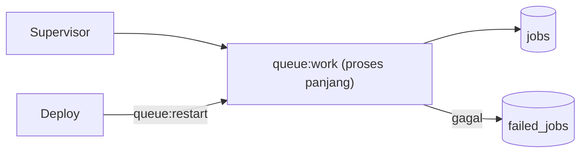

# Queue Workers

Job hanya berjalan bila ada **worker**. Sub bab ini membahas cara menjalankan, mengatur, dan menjaga worker tetap hidup, termasuk jebakan utama: worker adalah proses panjang yang menyimpan kode di memori.

## Tujuan Pembelajaran

- [ ] Menjalankan worker dengan `queue:work` dan opsi pentingnya.
- [ ] Membedakan `queue:work` dan `queue:listen`.
- [ ] Menjelaskan mengapa `queue:restart` diperlukan saat deploy.
- [ ] Mengatur prioritas antrean, `--tries`, `--timeout`, `--sleep`, `--max-time`.
- [ ] Menjelaskan peran Supervisor untuk menjaga worker (konsep; praktik di Level 10).
- [ ] Memantau dan menangani job gagal.

## Prasyarat

- [Jobs dan Queues](07-09-jobs-and-queues.md).

## Pengantar

Kamu mengubah isi job, tetapi worker yang sudah berjalan masih memakai versi lama. Pelajari cara kerja proses panjang agar tidak terkejut.

## Penjelasan Konsep

### Perintah utama

```bash
php artisan queue:work
```

| Opsi | Fungsi |
|---|---|
| `--queue=high,default` | Urutan prioritas antrean |
| `--tries=3` | Percobaan bawaan (kalah oleh `#[Tries]` pada job) |
| `--timeout=60` | Batas waktu job |
| `--sleep=3` | Jeda saat antrean kosong |
| `--max-jobs=1000` / `--max-time=3600` | Berhenti setelah batas, agar di-*restart* supervisor dan memori bersih |
| `--once` | Proses satu job lalu berhenti |

### `queue:work` vs `queue:listen`

`queue:work` memuat aplikasi sekali dan cepat, tetapi tidak melihat perubahan kode. `queue:listen` memuat ulang kode tiap job (lebih lambat) dan nyaman saat pengembangan. Di produksi pakai `queue:work`.

### Deploy

Karena worker menyimpan aplikasi di memori, setelah deploy jalankan:

```bash
php artisan queue:restart
```

Perintah ini memberi sinyal worker agar berhenti dengan anggun setelah job sekarang selesai; supervisor memulainya kembali dengan kode baru. Pengaturan ini memakai cache untuk menyimpan sinyal, jadi pastikan driver cache yang bekerja.

### Menjaga worker tetap hidup

Worker bisa berhenti (galat fatal, kehabisan memori). Di produksi, pakai manajer proses seperti **Supervisor** agar otomatis dihidupkan ulang. Konfigurasinya dibahas di Level 10 (Deployment).

### Memori dan status

Karena proses panjang, hindari menyimpan status global yang menumpuk, dan ingat bahwa singleton hidup lintas job. Tutup koneksi/resource besar setelah dipakai.

### Memantau

```bash
php artisan queue:failed          # daftar job gagal
php artisan queue:retry all       # ulangi
php artisan queue:flush           # hapus semua yang gagal
```

Menurut dokumentasi, tersedia juga `queue:monitor` untuk memeriksa ukuran antrean. Laravel Horizon (khusus Redis) menyediakan dasbor; ia di luar cakupan sub bab ini.

### Keamanan

- Jalankan worker dengan pengguna sistem terbatas, bukan root.
- `queue:flush` dan `queue:retry` mengubah/menghapus data; pastikan hanya operator berwenang yang menjalankannya.
- Log job gagal dapat memuat payload; jangan menyimpan data sensitif di job.

## Cara Kerja



## Contoh Praktik

Kamu menjalankan worker dengan dua antrean berprioritas, melihat efek perubahan kode tanpa restart, lalu memakai `queue:restart`.

## Penjelasan Kode

Tidak ada kode aplikasi baru; kamu mengubah pesan log di job untuk mengamati perilaku worker.

## Implementasi Langkah demi Langkah

### Langkah 1: jalankan worker

Terminal 1:

```bash
php artisan queue:work --queue=notifikasi,default --tries=3 --sleep=1
```

### Langkah 2: kirim job

Buat artikel di terminal lain/web; amati worker mencetak job diproses.

### Langkah 3: ubah kode job

Ubah teks log di `NotifyArticleSubscribers`, kirim job lagi: teks **lama** masih tampil.

### Langkah 4: restart

```bash
php artisan queue:restart
php artisan queue:work --queue=notifikasi,default
```

Kirim job lagi: teks baru tampil.

### Langkah 5: coba `queue:listen`

```bash
php artisan queue:listen
```

Ubah teks lagi tanpa restart; pada `listen` perubahan langsung terbaca.

### Langkah 6: batasi umur worker

Jalankan dengan `--max-jobs=2` dan lihat worker berhenti sendiri.

## Eksekusi dan Verifikasi

| Langkah | Hasil |
|---|---|
| 3 | Teks lama masih tampil |
| 4 | Teks baru tampil |
| 5 | Perubahan langsung terbaca |
| 6 | Worker keluar setelah dua job |

## Hasil yang Diharapkan

Perilaku diturunkan dari dokumentasi; belum dijalankan penulis.

## Kesalahan Umum dan Pemecahan Masalah

| Gejala | Penyebab | Cara mengenali | Solusi | Pencegahan |
|---|---|---|---|---|
| Perubahan kode tak berlaku | Worker memori lama | Output lama | `queue:restart` | Otomatiskan di deploy |
| Worker berhenti sendiri | Galat fatal / memori habis | Proses hilang | Supervisor + `--max-time` | Pantau proses |
| `queue:restart` tak berefek | Cache driver `array` | Worker tidak berhenti | Pakai cache nyata | `CACHE_STORE=database/redis` |
| Antrean menumpuk | Worker kurang | `jobs` bertambah | Tambah worker | Pantau panjang antrean |
| Job gagal terus | Bug / sumber luar mati | `failed_jobs` bertambah | Perbaiki lalu `retry` | Peringatan kegagalan |

## Latihan Praktik

### Latihan dasar

**D1. Opsi worker**
- *Masalah:* paham opsi.
- *Persyaratan:* jelaskan fungsi `--sleep`, `--max-time`, dan `--once`.
- *Perilaku yang diharapkan:* jawaban benar.
- *Tujuan belajar:* mengenali opsi.

### Latihan implementasi

**I1. Dua prioritas**
- *Masalah:* pemberitahuan penting harus lebih dulu.
- *Persyaratan:* kirim job ke `high` dan `default`, jalankan `--queue=high,default`, buktikan `high` selesai lebih dulu.
- *Perilaku yang diharapkan:* urutan sesuai.
- *Tujuan belajar:* prioritas.

### Latihan tantangan

**T1. Rencana deploy aman**
- *Masalah:* deploy tidak boleh memutus job yang sedang berjalan.
- *Persyaratan:* tulis langkah deploy yang melibatkan `queue:restart`, migrasi kompatibel, dan pemantauan.
- *Perilaku yang diharapkan:* rencana lengkap.
- *Tujuan belajar:* operasi produksi.
- *Catatan:* kerjakan mandiri; tidak ada kunci jawaban.

## Uji Pemahaman

1. Mengapa worker tidak melihat perubahan kode?
2. Apa beda `work` dan `listen`?
3. Apa fungsi `queue:restart`?
4. Mengapa perlu Supervisor?

??? success "Kunci jawaban singkat"
    1. Aplikasi dimuat sekali di memori.
    2. `work` cepat tanpa muat ulang; `listen` memuat ulang tiap job.
    3. Memberi sinyal worker berhenti anggun agar dimulai ulang dengan kode baru.
    4. Menghidupkan ulang worker bila berhenti.

## Ringkasan

- Worker adalah proses panjang; restart setelah deploy.
- Atur prioritas, percobaan, timeout, dan batas umur.
- Gunakan Supervisor dan pemantauan di produksi.

Selanjutnya: *Task Scheduling*.

## Referensi Resmi

- [Laravel: Running the Queue Worker](https://laravel.com/docs/13.x/queues#running-the-queue-worker)
- [Laravel: Supervisor Configuration](https://laravel.com/docs/13.x/queues#supervisor-configuration)
