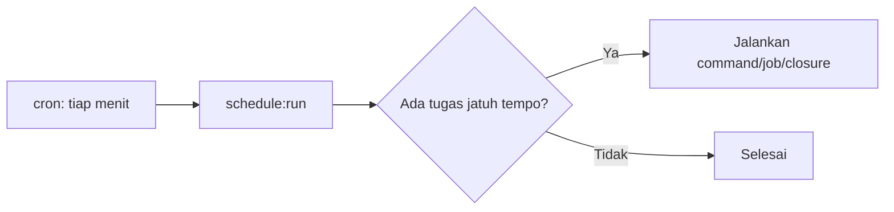

# Task Scheduling

Tugas berkala (membersihkan token kedaluwarsa, mengirim ringkasan mingguan) dahulu memerlukan banyak entri cron. Laravel menyederhanakannya: kamu mendefinisikan jadwal **di kode** dan server cukup memiliki **satu** entri cron.

## Tujuan Pembelajaran

- [ ] Mendefinisikan jadwal di `routes/console.php`.
- [ ] Menjadwalkan command, job, dan closure.
- [ ] Memilih frekuensi dan pembatasan (`withoutOverlapping`, `onOneServer`).
- [ ] Menjalankan `schedule:run`, `schedule:work`, dan `schedule:list`.
- [ ] Menyiapkan entri cron tunggal di server (konsep).

## Prasyarat

- [Jobs dan Queues](07-09-jobs-and-queues.md), Artisan dasar.

## Pengantar

Kita ingin menghapus token API kedaluwarsa tiap malam dan mengirim ringkasan artikel populer tiap Senin pagi, tanpa membuka server tiap kali.

## Penjelasan Konsep

### Mendefinisikan jadwal

Menurut dokumentasi, jadwal didefinisikan di `routes/console.php`.

File: `routes/console.php`

```php
<?php

use App\Jobs\NotifyArticleSubscribers;
use Illuminate\Support\Facades\Schedule;

Schedule::command('sanctum:prune-expired --hours=24')->daily();

Schedule::call(function () {
    \Illuminate\Support\Facades\Log::info('Detak jadwal');
})->everyMinute();
```

`sanctum:prune-expired` adalah command bawaan Sanctum yang menghapus token kedaluwarsa. Untuk job: `Schedule::job(new NamaJob)->weeklyOn(1, '08:00');`.

### Frekuensi

| Method | Arti |
|---|---|
| `everyMinute()` | Tiap menit |
| `hourly()` / `daily()` | Tiap jam / tengah malam |
| `dailyAt('13:00')` | Jam tertentu |
| `weeklyOn(1, '8:00')` | Senin 08:00 |
| `cron('* * * * *')` | Ekspresi cron bebas |

### Pembatasan

```php-inline
Schedule::command('laporan:buat')
    ->daily()
    ->withoutOverlapping()   // jangan jalan bila run sebelumnya belum selesai
    ->onOneServer();          // hanya satu server (butuh cache terpusat)
```

`onOneServer` memerlukan driver cache bersama (`database`, `redis`, dsb.).

### Menjalankan

```bash
php artisan schedule:list     # melihat jadwal
php artisan schedule:run      # menjalankan yang jatuh tempo (dipanggil cron tiap menit)
php artisan schedule:work     # simulasi cron saat pengembangan lokal
```

### Cron di server

Satu entri saja, dipanggil tiap menit:

```text
* * * * * cd /path/ke/proyek && php artisan schedule:run >> /dev/null 2>&1
```

Detail pemasangan server dibahas di Level 10.

### Zona waktu

Jadwal mengikuti `config('app.timezone')`. Atur sesuai kebutuhan atau gunakan `->timezone('Asia/Jakarta')` per tugas.

### Keamanan

- Tugas terjadwal berjalan dengan hak pengguna cron; jangan root.
- Hindari tugas yang menerima input luar.
- Log hasil agar kegagalan terlihat (`->appendOutputTo(storage_path('logs/jadwal.log'))`).

## Cara Kerja



## Contoh Praktik

Kamu mendefinisikan dua tugas, melihatnya di `schedule:list`, dan memantau pelaksanaannya dengan `schedule:work`.

## Penjelasan Kode

Closure sederhana mencatat log tiap menit sehingga eksekusi terbukti.

## Implementasi Langkah demi Langkah

### Langkah 1: tambahkan jadwal

Isi `routes/console.php` seperti di atas.

### Langkah 2: lihat daftar

```bash
php artisan schedule:list
```

### Langkah 3: jalankan simulasi

```bash
php artisan schedule:work
```

Biarkan satu–dua menit.

### Langkah 4: periksa log

```bash
tail -n 3 storage/logs/laravel.log
```

### Langkah 5: hapus tugas uji

Hapus closure `everyMinute` agar log tidak penuh, lalu:

```bash
git add routes
git commit -m "Tambah jadwal pembersihan token"
```

## Eksekusi dan Verifikasi

| Langkah | Hasil |
|---|---|
| 2 | Daftar memuat command dan closure dengan waktu berikutnya |
| 4 | Log memuat "Detak jadwal" tiap menit |

## Hasil yang Diharapkan

Diturunkan dari dokumentasi; belum dijalankan penulis.

## Kesalahan Umum dan Pemecahan Masalah

| Gejala | Penyebab | Cara mengenali | Solusi | Pencegahan |
|---|---|---|---|---|
| Jadwal tak jalan di server | Cron tak terpasang | Tidak ada eksekusi | Pasang entri cron | Verifikasi dengan log |
| Jam salah | Zona waktu berbeda | Eksekusi bergeser | Atur `app.timezone` | Konfigurasi eksplisit |
| Tugas tumpang tindih | Run lambat | Dua instance | `withoutOverlapping()` | Gunakan pembatasan |
| Jalan ganda di banyak server | Tak ada `onOneServer` | Eksekusi ganda | `onOneServer()` + cache bersama | Rancang multi-server |
| Command tidak ditemukan | Salah nama | Galat | `php artisan list` | Salin nama persis |

## Latihan Praktik

### Latihan dasar

**D1. Terjemahkan frekuensi**
- *Masalah:* membaca jadwal.
- *Persyaratan:* jelaskan `->weeklyOn(1, '8:00')` dan `->hourly()`.
- *Perilaku yang diharapkan:* Senin 08:00; tiap jam.
- *Tujuan belajar:* membaca frekuensi.

### Latihan implementasi

**I1. Command sendiri**
- *Masalah:* butuh pembersihan draf lama.
- *Persyaratan:* buat command `drafts:prune` yang menghapus draf berumur > 90 hari (soft delete) dan jadwalkan harian.
- *Perilaku yang diharapkan:* muncul di `schedule:list`.
- *Tujuan belajar:* command + jadwal.

### Latihan tantangan

**T1. Multi-server**
- *Masalah:* aplikasi berjalan di tiga server.
- *Persyaratan:* jelaskan risiko eksekusi ganda dan solusinya.
- *Perilaku yang diharapkan:* penjelasan benar.
- *Tujuan belajar:* penjadwalan terdistribusi.
- *Catatan:* kerjakan mandiri; tidak ada kunci jawaban.

## Uji Pemahaman

1. Mengapa hanya satu entri cron?
2. Apa fungsi `withoutOverlapping`?
3. Beda `schedule:run` dan `schedule:work`?
4. Mengapa `onOneServer` butuh cache bersama?

??? success "Kunci jawaban singkat"
    1. Laravel menentukan tugas jatuh tempo dari jadwal di kode.
    2. Mencegah run baru bila run sebelumnya belum selesai.
    3. `run` sekali (dipanggil cron); `work` berulang untuk pengembangan lokal.
    4. Server berkoordinasi lewat kunci bersama.

## Ringkasan

- Jadwal di `routes/console.php`; server cukup satu entri cron.
- Pakai `withoutOverlapping` dan `onOneServer` bila perlu.
- Uji lokal dengan `schedule:work`/`schedule:list`.

Selanjutnya: *Cache Management*.

## Referensi Resmi

- [Laravel: Task Scheduling](https://laravel.com/docs/13.x/scheduling)
