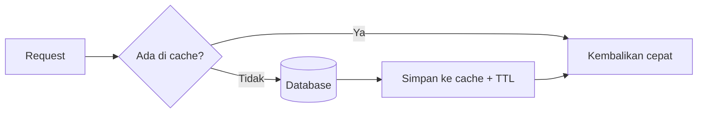

# Cache Management

Menghitung ulang hal yang sama pada setiap permintaan, seperti artikel populer atau jumlah komentar, memboroskan database. **Cache** menyimpan hasil sementara agar permintaan berikutnya cepat. Cache juga berbahaya: data basi dan kebocoran antar pengguna adalah kesalahan klasik.

## Tujuan Pembelajaran

- [ ] Memilih driver cache (`database`, `file`, `redis`, `array`).
- [ ] Memakai `Cache::get/put/remember/forget/increment`.
- [ ] Menentukan TTL dan strategi invalidasi.
- [ ] Menyusun kunci cache yang aman dan tidak bentrok.
- [ ] Memakai atomic lock untuk mencegah pekerjaan ganda.
- [ ] Menjelaskan `Cache::flexible` (stale-while-revalidate) secara konsep.

## Prasyarat

- [Jobs dan Queues](07-09-jobs-and-queues.md), Level 04 (Eloquent).

## Pengantar

Beranda menampilkan 5 artikel terbaru dan dihitung ulang ribuan kali per menit meski datanya jarang berubah. Cache menyimpan hasilnya 10 menit dan menghapusnya saat artikel baru terbit.

## Penjelasan Konsep

### Driver

| Driver | Catatan |
|---|---|
| `database` | Bawaan skeleton; tabel `cache`; mudah, lambat dibanding memori |
| `file` | Berkas di `storage/framework/cache`; satu server |
| `redis` | Cepat dan terpusat (bab berikut) |
| `array` | Hanya selama proses; dipakai di uji |

Atur dengan `CACHE_STORE` di `.env`.

### Operasi dasar

```php
use Illuminate\Support\Facades\Cache;

Cache::put('kunci', 'nilai', now()->plus(minutes: 10)); // simpan
$v = Cache::get('kunci', 'bawaan');                      // ambil
Cache::forget('kunci');                                  // hapus

$terbaru = Cache::remember('home.latest', 600, function () {
    return Article::published()->latest('published_at')->take(5)->get();
});

Cache::increment('hitung.unduh');
```

`remember` mengambil dari cache; bila tidak ada, menjalankan closure, menyimpan, dan mengembalikannya. TTL dalam detik atau objek waktu.

### Invalidasi

Cache yang tidak pernah dihapus menampilkan data basi. Dua strategi:

| Strategi | Cara |
|---|---|
| Kedaluwarsa (TTL) | Biarkan habis sendiri; sederhana |
| Hapus saat berubah | `Cache::forget('home.latest')` di listener `ArticlePublished` |

### Kunci

- Gunakan awalan bermakna: `articles:popular`, `user:{id}:stats`.
- Jangan masukkan data pribadi ke kunci yang sama untuk semua pengguna.
- **Jangan** men-cache respons yang bergantung pada pengguna pada kunci umum, karena data pengguna A bisa tampil pada pengguna B.

### Atomic lock

```php
Cache::lock('buat-laporan', 120)->get(function () {
    // hanya satu proses yang masuk
});
```

Lock membutuhkan driver yang mendukung (`database`, `redis`, dll.). Berguna untuk mencegah pekerjaan berat berjalan ganda.

### `flexible`

Menurut dokumentasi, `Cache::flexible('kunci', [5, 10], fn () => ...)` menyajikan nilai "agak basi" sambil menyegarkannya di latar belakang setelah jendela pertama, sehingga pengguna jarang menunggu. Cocok untuk data yang tidak harus real-time.

### Perintah

```bash
php artisan cache:clear     # kosongkan cache aplikasi
```

Hati-hati: `cache:clear` juga menghapus data yang disimpan di store yang sama (mis. token reset kata sandi bila memakai store default).

### Keamanan

- Jangan simpan rahasia/kata sandi di cache.
- Validasi data yang kamu masukkan dalam kunci (hindari kunci tak terbatas dari input pengguna, yang dapat menghabiskan penyimpanan).

## Cara Kerja



## Contoh Praktik

Kamu men-cache daftar artikel terbaru beranda 10 menit dan menghapusnya saat artikel terbit.

## Penjelasan Kode

File: `app/Services/HomeData.php`

```php
<?php

namespace App\Services;

use App\Models\Article;
use Illuminate\Support\Facades\Cache;

class HomeData
{
    public function latest()
    {
        return Cache::remember('home.latest', 600, fn () =>
            Article::published()->with('user:id,name')->latest('published_at')->take(5)->get()
        );
    }

    public function forget(): void
    {
        Cache::forget('home.latest');
    }
}
```

Listener `ClearHomeCache` memanggil `forget()` saat `ArticlePublished`.

## Implementasi Langkah demi Langkah

### Langkah 1: pastikan store

`CACHE_STORE=database` lalu `php artisan migrate` (tabel cache).

### Langkah 2: buat `HomeData` dan pakai di controller beranda

### Langkah 3: ukur query

Aktifkan log query sementara atau gunakan debugbar; muat beranda dua kali.

### Langkah 4: invalidasi

Buat listener `ClearHomeCache` (`event:list` untuk memeriksa), terbitkan artikel baru, muat beranda: artikel baru tampil.

### Langkah 5: periksa cache lewat tinker

```bash
php artisan tinker --execute="var_dump(Cache::has('home.latest'));"
```

### Langkah 6: catat di Git

```bash
git add app
git commit -m "Cache daftar artikel terbaru beranda"
```

## Eksekusi dan Verifikasi

| Langkah | Hasil |
|---|---|
| 3 | Muat pertama menjalankan query; kedua tidak |
| 4 | Artikel baru tampil setelah invalidasi |
| 5 | `bool(true)` setelah beranda dimuat |

## Hasil yang Diharapkan

Diturunkan dari dokumentasi; belum dijalankan penulis.

## Kesalahan Umum dan Pemecahan Masalah

| Gejala | Penyebab | Cara mengenali | Solusi | Pencegahan |
|---|---|---|---|---|
| Data basi | Tak ada invalidasi | Perubahan tak tampil | `forget` di listener | Daftar kunci & pemicu |
| Data pengguna bocor | Kunci umum untuk data pribadi | Pengguna lain melihat data | Kunci per pengguna | Review kunci |
| `cache:clear` menghapus reset password | Store sama | Tautan reset tak valid | Store terpisah | Konfigurasi store |
| Lock tak bekerja | Driver `array`/`null` | Pekerjaan ganda | Driver yang mendukung lock | Konfigurasi |
| Cache tak terbaca di uji | Driver `array` | Selalu miss | Sengaja | Pahami driver per lingkungan |

## Latihan Praktik

### Latihan dasar

**D1. TTL**
- *Masalah:* memilih TTL.
- *Persyaratan:* usulkan TTL untuk (a) daftar kategori, (b) jumlah pembaca real-time, (c) profil pengguna; beri alasan.
- *Perilaku yang diharapkan:* (a) panjang, (b) sangat pendek/tanpa cache, (c) sedang dengan invalidasi.
- *Tujuan belajar:* menimbang kesegaran vs performa.

### Latihan implementasi

**I1. Penghitung bacaan**
- *Masalah:* hitung kunjungan artikel tanpa query tiap kali.
- *Persyaratan:* `Cache::increment("article:{$id}:views")` dan job terjadwal yang memindahkan ke database tiap jam.
- *Perilaku yang diharapkan:* kolom `views` ter-update berkala.
- *Tujuan belajar:* menulis tertunda.

### Latihan tantangan

**T1. Stampede**
- *Masalah:* cache populer kedaluwarsa dan 1.000 permintaan menghitung ulang bersamaan.
- *Persyaratan:* jelaskan masalahnya dan dua solusi (lock, `flexible`).
- *Perilaku yang diharapkan:* penjelasan benar.
- *Tujuan belajar:* keandalan cache.
- *Catatan:* kerjakan mandiri; tidak ada kunci jawaban.

## Uji Pemahaman

1. Apa fungsi `Cache::remember`?
2. Mengapa invalidasi penting?
3. Mengapa kunci cache tidak boleh sama untuk data pribadi?
4. Apa itu atomic lock?

??? success "Kunci jawaban singkat"
    1. Ambil dari cache; bila kosong, hitung, simpan, dan kembalikan.
    2. Agar data tidak basi.
    3. Pengguna lain dapat melihat data orang lain.
    4. Kunci yang menjamin hanya satu proses mengerjakan sesuatu.

## Ringkasan

- Cache mempercepat tetapi memerlukan TTL, invalidasi, dan kunci yang aman.
- `remember` adalah pola utama; lock mencegah pekerjaan ganda.
- Jangan simpan rahasia atau data pribadi pada kunci umum.

Selanjutnya: *Redis Integration*.

## Referensi Resmi

- [Laravel: Cache](https://laravel.com/docs/13.x/cache)
