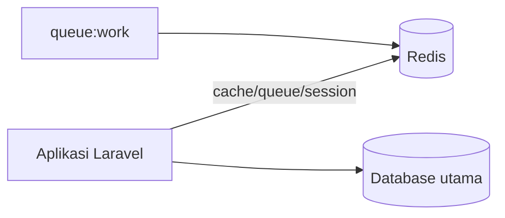

# Redis Integration

Redis adalah penyimpan data di memori yang sangat cepat. Di Laravel ia dipakai untuk cache, antrean, sesi, dan rate limiting, serta menjadi tulang punggung fitur real-time. Redis adalah **dependensi tambahan** (server + klien PHP) dan sudah disetujui untuk kurikulum ini.

!!! warning "Belum dijalankan penulis"
    Penulis materi tidak menjalankan Redis maupun PHP pada lingkungan ini. Perintah dan konfigurasi diturunkan dari dokumentasi Laravel 13.x dan Redis resmi. Verifikasi di mesinmu.

## Tujuan Pembelajaran

- [ ] Menjelaskan apa itu Redis dan kapan memakainya.
- [ ] Memasang Redis lokal (mis. via Docker) dan klien PHP (`phpredis` atau `predis`).
- [ ] Mengonfigurasi `REDIS_*` serta mengganti `CACHE_STORE`, `QUEUE_CONNECTION`, `SESSION_DRIVER`.
- [ ] Memakai facade `Redis` secara langsung.
- [ ] Mengamankan Redis (jangan ekspos ke publik, kata sandi).
- [ ] Menjelaskan kompromi dibanding driver `database`.

## Prasyarat

- [Cache Management](07-12-cache-management.md), [Jobs dan Queues](07-09-jobs-and-queues.md).
- Docker (opsional) atau Redis terpasang secara lokal.

## Pengantar

Antrean `database` bekerja, tetapi setiap job membebani database utama. Redis menangani ribuan operasi per detik di memori, memisahkan beban cache/antrean dari database aplikasi.

## Penjelasan Konsep

### Klien PHP

Menurut dokumentasi, ada dua pilihan: ekstensi **PhpRedis** (C, lebih cepat; dipasang lewat PECL atau paket OS) atau paket Composer **Predis** (murni PHP, tanpa ekstensi). Nilai bawaan `REDIS_CLIENT=phpredis`.

Memakai Predis berarti menambah paket Composer:

```bash
composer require predis/predis
```

Lalu `REDIS_CLIENT=predis`. Jika PhpRedis sudah terpasang, tidak perlu paket tambahan.

### Menjalankan Redis lokal

Dengan Docker:

```bash
docker run --name redis-belajar -p 127.0.0.1:6379:6379 -d redis:7
docker exec -it redis-belajar redis-cli ping
```

Perintah kedua seharusnya menjawab `PONG`. `127.0.0.1:6379` membatasi akses ke mesinmu saja.

### Konfigurasi

File `.env`:

```text
REDIS_CLIENT=phpredis
REDIS_HOST=127.0.0.1
REDIS_PORT=6379
REDIS_PASSWORD=null

CACHE_STORE=redis
QUEUE_CONNECTION=redis
SESSION_DRIVER=redis
```

Konfigurasi koneksi ada di `config/database.php` bagian `redis` (koneksi `default` dan `cache` memakai database Redis berbeda). Ubah satu per satu agar mudah mencari masalah.

### Facade `Redis`

```php
use Illuminate\Support\Facades\Redis;

Redis::set('nama', 'Ani');
$nama = Redis::get('nama');
Redis::incr('pengunjung');
```

### Redis untuk apa?

| Fungsi | Alasan memilih Redis |
|---|---|
| Cache | Cepat; mendukung lock dan tag |
| Antrean | Throughput tinggi; dasar Horizon |
| Sesi | Terpusat antar server |
| Rate limiting | Hitungan atomik cepat |
| Broadcasting | Bus pesan untuk fitur real-time |

### Keamanan

- **Jangan** mengekspos port Redis ke internet. Mengikat ke `127.0.0.1` atau jaringan privat, dan aktifkan autentikasi (`requirepass`/ACL) di server nyata.
- Isi `REDIS_PASSWORD` dari `.env`; jangan di-*commit*.
- Redis menyimpan data di memori; data tak persisten bila tidak dikonfigurasi (RDB/AOF). Jangan menjadikannya satu-satunya sumber data penting.
- Set `REDIS_PREFIX` unik bila beberapa aplikasi berbagi satu server Redis.

### Kompromi

| | `database` | `redis` |
|---|---|---|
| Pemasangan | Tidak ada | Server + klien |
| Kecepatan | Cukup | Sangat tinggi |
| Operasional | Satu sistem | Satu sistem tambahan untuk dijaga |

Untuk aplikasi kecil, `database` sering cukup.

## Cara Kerja



## Contoh Praktik

Kamu menjalankan Redis dengan Docker, mengganti cache lalu antrean ke Redis, dan membuktikan bahwa data tersimpan di Redis.

## Penjelasan Kode

Tidak ada kelas baru: perubahan terutama konfigurasi `.env`. Satu uji kecil lewat tinker:

```bash
php artisan tinker --execute="Cache::put('uji', 'halo', 60); echo Cache::get('uji');"
docker exec redis-belajar redis-cli keys '*uji*'
```

## Implementasi Langkah demi Langkah

### Langkah 1: jalankan Redis

Gunakan perintah Docker di atas dan pastikan `PONG`.

### Langkah 2: pastikan klien PHP

```bash
php -m | grep -i redis
```

Jika tidak ada, pasang PhpRedis atau `composer require predis/predis` dan set `REDIS_CLIENT=predis`.

### Langkah 3: ganti cache

Set `CACHE_STORE=redis`, lalu `php artisan config:clear` dan jalankan uji tinker.

### Langkah 4: ganti antrean

Set `QUEUE_CONNECTION=redis`, buat artikel, jalankan `php artisan queue:work`.

### Langkah 5: periksa isi Redis

```bash
docker exec redis-belajar redis-cli dbsize
```

### Langkah 6: catat di Git

Hanya `composer.json`/`composer.lock` bila menambah Predis. Jangan commit `.env`.

```bash
git add composer.json composer.lock
git commit -m "Gunakan Redis untuk cache dan antrean"
```

## Eksekusi dan Verifikasi

| Langkah | Hasil |
|---|---|
| 1 | `PONG` |
| 3 | `halo` dicetak; `redis-cli keys` menampilkan kunci berawalan |
| 4 | Job diproses oleh worker |

## Hasil yang Diharapkan

Diturunkan dari dokumentasi; belum dijalankan penulis.

## Kesalahan Umum dan Pemecahan Masalah

| Gejala | Penyebab | Cara mengenali | Solusi | Pencegahan |
|---|---|---|---|---|
| `Class "Redis" not found` | PhpRedis tak terpasang | Galat saat boot | Pasang ekstensi / pakai Predis | `php -m` |
| `Connection refused` | Redis tidak berjalan / port salah | Galat koneksi | Jalankan Redis; cek host/port | `redis-cli ping` |
| `NOAUTH Authentication required` | Kata sandi tidak diisi | Galat auth | Isi `REDIS_PASSWORD` | Samakan konfigurasi |
| Perubahan `.env` tak berlaku | Konfigurasi ter-cache | Nilai lama | `config:clear` | Bersihkan cache |
| Redis terbuka ke internet | Port dipublikasikan | Peringatan keamanan | Bind lokal + autentikasi + firewall | Audit port |
| Data hilang saat restart | Tanpa persistensi | Cache kosong | Pahami: cache boleh hilang | Jangan simpan data kritis |

## Latihan Praktik

### Latihan dasar

**D1. Ping**
- *Masalah:* memastikan Redis hidup.
- *Persyaratan:* jalankan `redis-cli ping` di kontainer.
- *Perilaku yang diharapkan:* `PONG`.
- *Tujuan belajar:* verifikasi layanan.

### Latihan implementasi

**I1. Sesi di Redis**
- *Masalah:* sesi harus terpusat.
- *Persyaratan:* set `SESSION_DRIVER=redis`, masuk, dan temukan kunci sesi lewat `redis-cli`.
- *Perilaku yang diharapkan:* kunci sesi ada.
- *Tujuan belajar:* sesi terpusat.

### Latihan tantangan

**T1. Redis atau database?**
- *Masalah:* proyek kecil ragu menambah Redis.
- *Persyaratan:* tulis kriteria (beban, jumlah server, kemampuan operasional) dan rekomendasi.
- *Perilaku yang diharapkan:* alasan jelas.
- *Tujuan belajar:* menimbang kompleksitas.
- *Catatan:* kerjakan mandiri; tidak ada kunci jawaban.

## Uji Pemahaman

1. Apa itu Redis?
2. Apa beda PhpRedis dan Predis?
3. Mengapa tidak mengekspos port Redis?
4. Bisakah data Redis hilang? Mengapa?

??? success "Kunci jawaban singkat"
    1. Penyimpan data di memori yang cepat.
    2. PhpRedis ekstensi C; Predis paket PHP murni.
    3. Tanpa proteksi, siapa pun dapat membaca/mengubah data.
    4. Ya, bila tanpa persistensi atau saat restart.

## Ringkasan

- Redis mempercepat cache, antrean, sesi, dan rate limiting.
- Butuh server dan klien PHP; amankan dan jangan ekspos.
- Untuk aplikasi kecil, driver `database` tetap sah.

Selanjutnya: *Mail Configuration*.

## Referensi Resmi

- [Laravel: Redis](https://laravel.com/docs/13.x/redis)
- [Redis: Security](https://redis.io/docs/latest/operate/oss_and_stack/management/security/)
