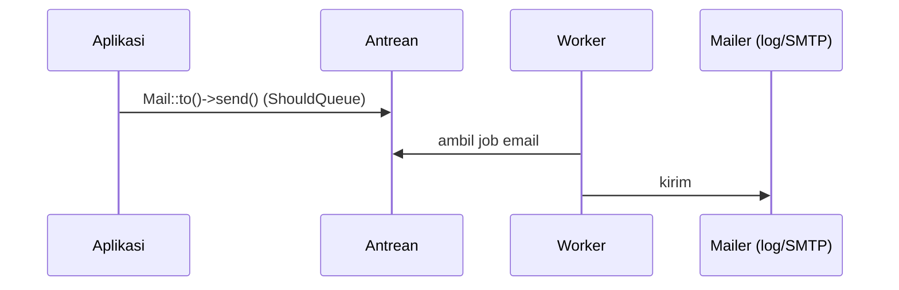

# Mail Configuration

Email dipakai untuk verifikasi akun, reset kata sandi, dan pemberitahuan. Laravel menyediakan API terpadu untuk banyak penyedia (SMTP, Mailgun, Postmark, Resend, SES). Sub bab ini mengajarkan konfigurasi aman, membuat *mailable*, mengirim lewat antrean, dan mengujinya tanpa mengirim email sungguhan.

## Tujuan Pembelajaran

- [ ] Mengonfigurasi mailer lewat `.env` (`log`, SMTP, penyedia).
- [ ] Membuat Mailable dengan `make:mail` (`Envelope`, `Content`).
- [ ] Mengirim dengan `Mail::to()->send()` dan `queue()`.
- [ ] Menguji tampilan email dengan mailer `log` dan `Mail::fake()` (konsep).
- [ ] Mengamankan kredensial dan mencegah penyalahgunaan (header injection, spam).

## Prasyarat

- [Jobs dan Queues](07-09-jobs-and-queues.md), Blade (Level 03).

## Pengantar

Saat artikel terbit, pelanggan menerima email berjudul "Artikel baru: ..." berisi ringkasan dan tautan. Selama pengembangan, jangan pernah mengirim email ke alamat nyata.

## Penjelasan Konsep

### Mailer di pengembangan

Di `.env` pengembangan gunakan mailer `log` agar email ditulis ke `storage/logs/laravel.log`:

```text
MAIL_MAILER=log
MAIL_FROM_ADDRESS="noreply@contoh.test"
MAIL_FROM_NAME="${APP_NAME}"
```

Untuk SMTP uji, alat seperti Mailpit/Mailtrap (menangkap email, tidak mengirim keluar) cocok. Contoh SMTP:

```text
MAIL_MAILER=smtp
MAIL_HOST=127.0.0.1
MAIL_PORT=1025
MAIL_USERNAME=null
MAIL_PASSWORD=null
```

Kredensial penyedia nyata (kata sandi SMTP, kunci API) hanya di `.env` server dan tidak di-*commit*.

### Mailable

```bash
php artisan make:mail ArticlePublishedMail --markdown=mail.article-published
```

File: `app/Mail/ArticlePublishedMail.php`

```php
<?php

namespace App\Mail;

use App\Models\Article;
use Illuminate\Bus\Queueable;
use Illuminate\Contracts\Queue\ShouldQueue;
use Illuminate\Mail\Mailable;
use Illuminate\Mail\Mailables\Content;
use Illuminate\Mail\Mailables\Envelope;
use Illuminate\Queue\SerializesModels;

class ArticlePublishedMail extends Mailable implements ShouldQueue
{
    use Queueable, SerializesModels;

    public function __construct(public Article $article) {}

    public function envelope(): Envelope
    {
        return new Envelope(subject: 'Artikel baru: '.$this->article->title);
    }

    public function content(): Content
    {
        return new Content(
            markdown: 'mail.article-published',
            with: ['url' => route('articles.show', $this->article)],
        );
    }
}
```

| Bagian | Fungsi |
|---|---|
| `Envelope` | Subjek, pengirim, penerima tambahan |
| `Content` | Tampilan Markdown/Blade dan data |
| `implements ShouldQueue` | Email dikirim lewat antrean |

File: `resources/views/mail/article-published.blade.php`

```blade
<x-mail::message>
# {{ $article->title }}

{{ \Illuminate\Support\Str::limit(strip_tags($article->body), 160) }}

<x-mail::button :url="$url">
Baca selengkapnya
</x-mail::button>
</x-mail::message>
```

Blade `{{ }}` meng-*escape* keluaran, sehingga judul tidak dapat menyuntik HTML.

### Mengirim

```php
use App\Mail\ArticlePublishedMail;
use Illuminate\Support\Facades\Mail;

Mail::to($user)->send(new ArticlePublishedMail($article));
```

Karena Mailable `ShouldQueue`, `send` otomatis mengantrekannya; `Mail::to(...)->queue(...)` juga tersedia untuk Mailable biasa.

### Keamanan dan etika

- Jangan menyusun header/alamat dari input mentah; validasi sebagai email.
- Sediakan cara berhenti berlangganan untuk email massal.
- Hati-hati kebocoran: jangan menyertakan token atau data pribadi yang tak perlu di body.
- Batasi pengiriman (rate limiting) pada fitur yang dapat dipicu pengguna (mis. "kirim ulang verifikasi").

## Cara Kerja



## Contoh Praktik

Kamu membuat `ArticlePublishedMail`, mengirimnya ke satu pengguna dengan mailer `log`, menjalankan worker, dan membaca email di log.

## Penjelasan Kode

Tampilan Markdown memakai komponen `x-mail::message` dan `x-mail::button`. Data `url` diteruskan lewat `with`; `$article` tersedia karena properti publik.

## Implementasi Langkah demi Langkah

### Langkah 1: atur mailer log

Set `MAIL_MAILER=log` di `.env`, lalu `php artisan config:clear`.

### Langkah 2: buat mailable dan tampilan

Jalankan `make:mail` lalu isi berkas.

### Langkah 3: kirim lewat tinker

```bash
php artisan tinker --execute="Mail::to('ani@contoh.test')->send(new App\Mail\ArticlePublishedMail(App\Models\Article::first()));"
```

### Langkah 4: jalankan worker

```bash
php artisan queue:work --once
```

### Langkah 5: baca hasil

```bash
tail -n 60 storage/logs/laravel.log
```

### Langkah 6: catat di Git

```bash
git add app resources
git commit -m "Tambah mailable ArticlePublishedMail"
```

## Eksekusi dan Verifikasi

| Langkah | Hasil |
|---|---|
| 3 | Job email masuk antrean |
| 5 | Log memuat subjek "Artikel baru: ..." dan isi email |

## Hasil yang Diharapkan

Diturunkan dari dokumentasi; belum dijalankan penulis. Bentuk keluaran log bergantung versi.

## Kesalahan Umum dan Pemecahan Masalah

| Gejala | Penyebab | Cara mengenali | Solusi | Pencegahan |
|---|---|---|---|---|
| Email tidak terkirim | Worker tidak jalan | Job menumpuk | Jalankan `queue:work` | Pantau antrean |
| Perubahan `.env` tak berlaku | Konfigurasi ter-cache | Nilai lama | `config:clear` | Bersihkan cache |
| `Connection refused` SMTP | Host/port salah | Galat koneksi | Periksa Mailpit/penyedia | `telnet host port` |
| Email nyata terkirim saat uji | Mailer produksi aktif di lokal | Penerima asli menerima | Pakai `log`/Mailpit | `.env` terpisah |
| Kredensial bocor | `.env` ter-commit | Rahasia di Git | Cabut dan putar kunci | `.gitignore` & pemindaian |
| Tampilan email rusak | CSS tak didukung klien email | Layout berantakan | Pakai komponen Markdown | Uji di beberapa klien |

## Latihan Praktik

### Latihan dasar

**D1. Mailer berbeda**
- *Masalah:* paham mailer.
- *Persyaratan:* sebutkan mailer yang tepat untuk lokal, uji, dan produksi.
- *Perilaku yang diharapkan:* `log`/Mailpit, `array`, penyedia nyata.
- *Tujuan belajar:* konfigurasi per lingkungan.

### Latihan implementasi

**I1. Lampiran**
- *Masalah:* email perlu lampiran PDF.
- *Persyaratan:* baca dokumentasi `attachments()` dan tambahkan lampiran dari `storage`.
- *Perilaku yang diharapkan:* lampiran tercantum di log.
- *Tujuan belajar:* lampiran aman (path tepercaya, bukan input pengguna).

### Latihan tantangan

**T1. Email massal**
- *Masalah:* 5.000 pelanggan.
- *Persyaratan:* rancang pengiriman (antrean, chunk, rate limit penyedia, berhenti berlangganan).
- *Perilaku yang diharapkan:* rancangan lengkap.
- *Tujuan belajar:* skala email.
- *Catatan:* kerjakan mandiri; tidak ada kunci jawaban.

## Uji Pemahaman

1. Mengapa memakai mailer `log` saat pengembangan?
2. Apa fungsi `Envelope` dan `Content`?
3. Mengapa email sebaiknya diantrekan?
4. Di mana kredensial SMTP disimpan?

??? success "Kunci jawaban singkat"
    1. Agar tidak mengirim email nyata.
    2. Subjek/pengirim dan isi/tampilan.
    3. Request tidak menunggu pengiriman.
    4. Di `.env` server, tidak di Git.

## Ringkasan

- Atur mailer per lingkungan; `log`/Mailpit untuk lokal.
- Mailable mendefinisikan `Envelope` dan `Content`; antrekan pengiriman.
- Jaga kredensial, validasi alamat, dan batasi pengiriman.

Selanjutnya: *Notifications*.

## Referensi Resmi

- [Laravel: Mail](https://laravel.com/docs/13.x/mail)
