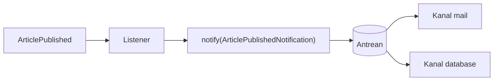

# Notifications

*Notification* adalah pesan singkat kepada pengguna lewat satu atau beberapa **kanal**: email, database (notifikasi di dalam aplikasi), broadcast, SMS, Slack, dan lain-lain. Dibanding Mailable, notification mengabstraksikan kanal sehingga satu class bisa mengirim ke banyak tempat.

## Tujuan Pembelajaran

- [ ] Membedakan Mailable dan Notification.
- [ ] Membuat notification dengan `make:notification` dan `via()`.
- [ ] Mengirim lewat `$user->notify()` dan `Notification::send()`.
- [ ] Menyimpan notifikasi ke database dan menampilkannya.
- [ ] Mengantrekan notification.
- [ ] Menandai notifikasi sebagai sudah dibaca.

## Prasyarat

- [Mail Configuration](07-14-mail-configuration.md), [Jobs dan Queues](07-09-jobs-and-queues.md).
- Model `User` dengan trait `Notifiable` (bawaan).

## Pengantar

Saat artikel diterbitkan, pengikut penulis mendapat email dan sekaligus notifikasi di lonceng aplikasi. Satu class `ArticlePublishedNotification` menangani keduanya.

## Penjelasan Konsep

### Mailable vs Notification

| | Mailable | Notification |
|---|---|---|
| Kanal | Email saja | Banyak kanal |
| Penerima | Alamat email | Objek `notifiable` (mis. `User`) |
| Cocok untuk | Email kompleks/transaksional | Pemberitahuan multikanal |

### Membuat

```bash
php artisan make:notification ArticlePublishedNotification
```

File: `app/Notifications/ArticlePublishedNotification.php`

```php
<?php

namespace App\Notifications;

use App\Models\Article;
use Illuminate\Bus\Queueable;
use Illuminate\Contracts\Queue\ShouldQueue;
use Illuminate\Notifications\Messages\MailMessage;
use Illuminate\Notifications\Notification;

class ArticlePublishedNotification extends Notification implements ShouldQueue
{
    use Queueable;

    public function __construct(public Article $article) {}

    public function via(object $notifiable): array
    {
        return ['mail', 'database'];
    }

    public function toMail(object $notifiable): MailMessage
    {
        return (new MailMessage)
            ->subject('Artikel baru: '.$this->article->title)
            ->greeting('Halo '.$notifiable->name)
            ->line('Ada artikel baru yang mungkin kamu suka.')
            ->action('Baca artikel', route('articles.show', $this->article));
    }

    public function toArray(object $notifiable): array
    {
        return [
            'article_id' => $this->article->id,
            'title' => $this->article->title,
        ];
    }
}
```

| Bagian | Fungsi |
|---|---|
| `via()` | Daftar kanal |
| `toMail()` | Isi untuk kanal email |
| `toArray()` | Data untuk kanal database |
| `ShouldQueue` | Pengiriman lewat antrean |

### Kanal database

Siapkan tabel:

```bash
php artisan make:notifications-table
php artisan migrate
```

Menurut dokumentasi, perintah ini membuat migrasi tabel `notifications`.

### Mengirim

```php-inline
$user->notify(new ArticlePublishedNotification($article));

use Illuminate\Support\Facades\Notification;
Notification::send($subscribers, new ArticlePublishedNotification($article));
```

Untuk banyak penerima, `Notification::send` dengan notification antre menghasilkan satu job per penerima/kanal.

### Menampilkan dan menandai dibaca

```php-inline
$user->unreadNotifications;                    // belum dibaca
$user->notifications;                          // semua
$user->unreadNotifications->markAsRead();      // tandai dibaca
```

Contoh controller `NotificationController@index` yang menampilkan `auth()->user()->notifications()->paginate(15)`. Selalu ambil dari relasi milik pengguna yang login agar pengguna tidak melihat notifikasi orang lain (IDOR).

### Keamanan

- Isi `toArray()` tersimpan di database; jangan menaruh rahasia.
- Tampilkan dengan `{{ }}` agar ter-*escape*.
- Batasi pemicu notifikasi dari input pengguna (spam).

## Cara Kerja



## Contoh Praktik

Kamu membuat notification dua kanal, mengirimnya ke satu pengguna, menjalankan worker, melihat email di log dan baris di tabel `notifications`.

## Penjelasan Kode

`$notifiable->name` dari objek penerima. `route(...)` menghasilkan URL absolut yang dibangun dari `APP_URL`; pastikan `APP_URL` benar agar tautan email tepat.

## Implementasi Langkah demi Langkah

### Langkah 1: tabel notifications

```bash
php artisan make:notifications-table
php artisan migrate
```

### Langkah 2: buat notification

Jalankan `make:notification` dan isi seperti contoh.

### Langkah 3: kirim

```bash
php artisan tinker --execute="App\Models\User::first()->notify(new App\Notifications\ArticlePublishedNotification(App\Models\Article::first()));"
```

### Langkah 4: proses antrean

```bash
php artisan queue:work --stop-when-empty
```

### Langkah 5: periksa

```bash
php artisan tinker --execute="echo App\Models\User::first()->notifications()->count();"
tail -n 40 storage/logs/laravel.log
```

### Langkah 6: halaman notifikasi

Buat route `GET /notifikasi` yang menampilkan notifikasi pengguna login dan tombol "Tandai dibaca" (`POST`, terlindungi CSRF).

### Langkah 7: catat di Git

```bash
git add app database routes resources
git commit -m "Tambah notification artikel terbit"
```

## Eksekusi dan Verifikasi

| Langkah | Hasil |
|---|---|
| 5 | Jumlah notifikasi 1; log memuat email |
| 6 | Notifikasi tampil; setelah ditandai, tidak lagi "belum dibaca" |

## Hasil yang Diharapkan

Diturunkan dari dokumentasi; belum dijalankan penulis.

## Kesalahan Umum dan Pemecahan Masalah

| Gejala | Penyebab | Cara mengenali | Solusi | Pencegahan |
|---|---|---|---|---|
| `Table notifications doesn't exist` | Migrasi belum dijalankan | Galat SQL | `migrate` | Jalankan migrasi |
| Tak ada email | Worker tidak jalan | Job menumpuk | Jalankan worker | Pantau |
| Tautan email salah | `APP_URL` salah | URL `localhost` | Perbaiki `APP_URL` | Konfigurasi per lingkungan |
| `Call to undefined method notify()` | Tanpa trait `Notifiable` | Galat | Tambah trait | Model `User` bawaan sudah ada |
| Pengguna lihat notifikasi orang lain | Query tidak dibatasi | IDOR | Selalu lewat relasi pengguna | Review controller |

## Latihan Praktik

### Latihan dasar

**D1. Pilih kanal**
- *Masalah:* menentukan kanal.
- *Persyaratan:* tentukan kanal untuk (a) reset sandi, (b) komentar baru, (c) laporan mingguan.
- *Perilaku yang diharapkan:* alasan masuk akal.
- *Tujuan belajar:* memilih kanal.

### Latihan implementasi

**I1. Preferensi pengguna**
- *Masalah:* pengguna ingin mematikan email.
- *Persyaratan:* tambah kolom `notify_email` dan buat `via()` menyesuaikan.
- *Perilaku yang diharapkan:* email tidak dikirim bila dimatikan.
- *Tujuan belajar:* `via()` dinamis.

### Latihan tantangan

**T1. Lonceng real-time**
- *Masalah:* ingin lonceng terbarui tanpa muat ulang.
- *Persyaratan:* jelaskan bagaimana kanal `broadcast` dan Echo (bab Broadcasting) dapat dipakai.
- *Perilaku yang diharapkan:* penjelasan benar.
- *Tujuan belajar:* menghubungkan bab.
- *Catatan:* kerjakan mandiri; tidak ada kunci jawaban.

## Uji Pemahaman

1. Apa beda Notification dan Mailable?
2. Apa fungsi `via()`?
3. Bagaimana menandai notifikasi dibaca?
4. Mengapa mengambil notifikasi lewat relasi pengguna login?

??? success "Kunci jawaban singkat"
    1. Notification multikanal; Mailable khusus email.
    2. Menentukan kanal pengiriman.
    3. `markAsRead()`.
    4. Agar tidak melihat notifikasi orang lain.

## Ringkasan

- Notification mengirim pesan multikanal dari satu class.
- Kanal database menyimpan notifikasi untuk ditampilkan.
- Antrekan, batasi, dan amankan akses.

Selanjutnya: *File Storage*.

## Referensi Resmi

- [Laravel: Notifications](https://laravel.com/docs/13.x/notifications)
