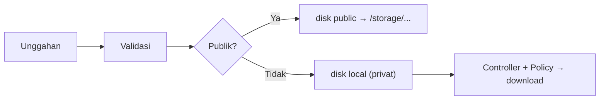

# File Storage

Unggahan pengguna, ekspor laporan, dan berkas sementara perlu disimpan. Laravel mengabstraksikan penyimpanan lewat **disk**: kode yang sama dapat menulis ke folder lokal atau layanan awan. Sub bab ini menekankan **konsep dan keamanan** penyimpanan; sub bab berikutnya mendalami API filesystem.

## Tujuan Pembelajaran

- [ ] Membedakan disk `local`, `public`, dan penyimpanan awan (konsep).
- [ ] Menjelaskan `storage/app`, `storage/app/public`, dan `php artisan storage:link`.
- [ ] Menyimpan berkas dengan `store()`/`Storage::put` ke disk yang tepat.
- [ ] Menentukan berkas publik vs privat.
- [ ] Menyajikan berkas privat lewat controller berotorisasi.
- [ ] Menerapkan praktik penamaan dan validasi yang aman.

## Prasyarat

- Unggah berkas aman dari Level 05, [Notifications](07-15-notifications.md).

## Pengantar

Penulis mengekspor "Laporan artikel bulanan" sebagai CSV. Laporan ini berisi data internal, jadi tidak boleh bisa diunduh siapa saja lewat URL yang bisa ditebak.

## Penjelasan Konsep

### Disk

| Disk | Lokasi | Dapat diakses via URL? |
|---|---|---|
| `local` | `storage/app/private` | Tidak (privat) |
| `public` | `storage/app/public` | Ya, setelah `storage:link` |
| `s3` dll. | Layanan awan | Bergantung konfigurasi |

Konfigurasi di `config/filesystems.php`; disk bawaan dipilih lewat `FILESYSTEM_DISK`. Pada Laravel terbaru disk `local` menunjuk ke `storage/app/private`; periksa `config/filesystems.php` proyekmu.

### Tautan simbolik

Berkas di `storage/app/public` hanya terlihat dari web bila dibuat tautan ke `public/storage`:

```bash
php artisan storage:link
```

### Menyimpan

```php-inline
use Illuminate\Support\Facades\Storage;

Storage::disk('local')->put('laporan/2026-11.csv', $isiCsv);       // privat
$path = $request->file('gambar')->store('gambar', 'public');        // publik, nama acak
```

`store()` membuat nama acak yang aman. Hindari memakai nama berkas asli dari pengguna.

### Publik atau privat?

| Jenis | Disk | Penyajian |
|---|---|---|
| Gambar sampul artikel | `public` | URL langsung `Storage::url($path)` |
| Laporan internal, dokumen pribadi | `local` | Unduhan lewat controller dengan Policy |

### Penyajian privat

```php-inline
public function unduh(string $nama)
{
    $this->authorize('unduh-laporan');   // Gate/Policy

    abort_unless(Storage::disk('local')->exists("laporan/{$nama}"), 404);

    return Storage::disk('local')->download("laporan/{$nama}");
}
```

Waspada **path traversal**: `$nama` harus divalidasi (hanya pola nama aman) atau diambil dari ID di database, bukan dipercaya mentah-mentah (mis. `../../.env`).

### Keamanan

- Validasi jenis dan ukuran unggahan (aturan `image`, `mimes`, `max`).
- Jangan simpan unggahan di `public/` langsung dan jangan izinkan eksekusi skrip di folder unggahan.
- Berkas privat tidak boleh di disk `public`.
- Jangan percaya nama/ekstensi dari klien.

## Cara Kerja



## Contoh Praktik

Kamu membuat command yang menulis laporan CSV ke disk privat dan endpoint unduhan terotorisasi.

## Penjelasan Kode

File: `app/Http/Controllers/ReportController.php`

```php
<?php

namespace App\Http\Controllers;

use Illuminate\Support\Facades\Storage;
use Illuminate\Support\Str;

class ReportController extends Controller
{
    public function download(string $nama)
    {
        abort_unless(auth()->user()?->role?->value === 'admin', 403);
        abort_unless(preg_match('/^[a-z0-9\-]+\.csv$/', $nama) === 1, 404);

        $path = "laporan/{$nama}";
        abort_unless(Storage::disk('local')->exists($path), 404);

        return Storage::disk('local')->download($path);
    }
}
```

`preg_match` hanya mengizinkan nama aman dan menolak `../`. Pemeriksaan peran menunjukkan prinsip; di proyek, gunakan Gate/Policy yang sudah ada.

## Implementasi Langkah demi Langkah

### Langkah 1: buat laporan

```bash
php artisan tinker --execute="Storage::disk('local')->put('laporan/uji.csv', \"id,judul\n1,Halo\n\"); echo 'ok';"
```

### Langkah 2: route berotorisasi

```php-inline
Route::get('/laporan/{nama}', [\App\Http\Controllers\ReportController::class, 'download'])
    ->middleware('auth');
```

### Langkah 3: uji

Sebagai admin, buka `/laporan/uji.csv` (terunduh). Sebagai penulis biasa: `403`. Coba `/laporan/..%2F.env`: `404`.

### Langkah 4: berkas publik

```bash
php artisan storage:link
```

Simpan satu gambar ke disk `public` dan buka `Storage::url($path)`.

### Langkah 5: catat di Git

Jangan commit isi `storage/app` maupun tautan `public/storage`.

```bash
git add app routes
git commit -m "Tambah unduhan laporan berotorisasi"
```

## Eksekusi dan Verifikasi

| Langkah | Hasil |
|---|---|
| 3 | Admin: berkas terunduh; non-admin: `403`; traversal: `404` |
| 4 | Gambar dapat dibuka via `/storage/...` |

## Hasil yang Diharapkan

Diturunkan dari dokumentasi; belum dijalankan penulis.

## Kesalahan Umum dan Pemecahan Masalah

| Gejala | Penyebab | Cara mengenali | Solusi | Pencegahan |
|---|---|---|---|---|
| 404 pada `/storage/...` | `storage:link` belum | Berkas ada tapi 404 | Jalankan `storage:link` | Langkah deploy |
| Berkas privat bisa diakses publik | Disimpan di `public` | URL langsung terbuka | Pindah ke disk `local` | Klasifikasi berkas |
| Path traversal | Nama dari input dipakai mentah | `../` lolos | Validasi/ID database | Pola nama ketat |
| Gambar lama menimpa | Nama berkas sama | Berkas tertimpa | Nama acak (`store`) | Jangan pakai nama klien |
| Tautan simbolik tak ada di server | Tak ikut deploy | 404 di produksi | `storage:link` saat deploy | Skrip deploy |

## Latihan Praktik

### Latihan dasar

**D1. Publik atau privat**
- *Masalah:* klasifikasi.
- *Persyaratan:* klasifikasikan avatar, faktur pelanggan, ekspor CSV admin, gambar sampul.
- *Perilaku yang diharapkan:* avatar/sampul publik; faktur/CSV privat.
- *Tujuan belajar:* memilih disk.

### Latihan implementasi

**I1. Hapus berkas lama**
- *Masalah:* mengganti gambar sampul meninggalkan berkas yatim.
- *Persyaratan:* hapus berkas lama saat sampul diganti/artikel dihapus (`Storage::disk('public')->delete`).
- *Perilaku yang diharapkan:* tak ada berkas yatim.
- *Tujuan belajar:* siklus hidup berkas.

### Latihan tantangan

**T1. URL bertanda tangan sementara**
- *Masalah:* berkas privat perlu dibagikan sementara.
- *Persyaratan:* baca `URL::temporarySignedRoute` dan rancang tautan unduhan kedaluwarsa.
- *Perilaku yang diharapkan:* rancangan benar.
- *Tujuan belajar:* akses terbatas waktu.
- *Catatan:* kerjakan mandiri; tidak ada kunci jawaban.

## Uji Pemahaman

1. Apa beda disk `local` dan `public`?
2. Untuk apa `storage:link`?
3. Apa itu path traversal?
4. Mengapa tidak memakai nama berkas dari klien?

??? success "Kunci jawaban singkat"
    1. `local` privat; `public` dapat diakses lewat URL setelah tautan.
    2. Membuat tautan dari `public/storage` ke `storage/app/public`.
    3. Memakai `../` untuk keluar dari folder yang dimaksud.
    4. Dapat berbahaya, bentrok, atau menimpa berkas.

## Ringkasan

- Pilih disk sesuai sifat berkas; privat lewat controller berotorisasi.
- Validasi nama dan jenis; cegah path traversal.
- Jalankan `storage:link` pada setiap lingkungan.

Selanjutnya: *Laravel Filesystem*.

## Referensi Resmi

- [Laravel: File Storage](https://laravel.com/docs/13.x/filesystem)
