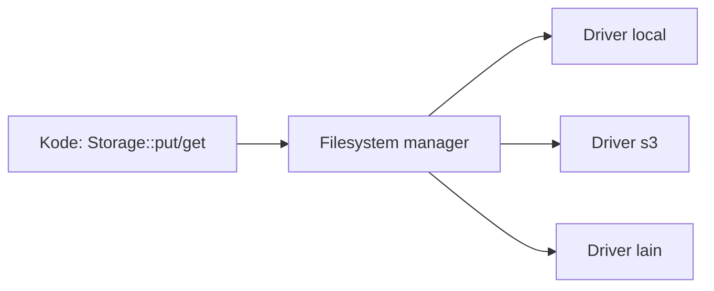

# Laravel Filesystem

Sub bab sebelumnya membahas *kapan* dan *di mana* menyimpan berkas. Di sini kamu mempelajari **API `Storage`** secara menyeluruh: membaca, menulis, menyalin, memindahkan, menghapus, mendaftar isi folder, mengunggah, serta mengelola visibilitas dan URL sementara.

## Tujuan Pembelajaran

- [ ] Membaca konfigurasi `config/filesystems.php`.
- [ ] Memakai `Storage::disk()` dan disk bawaan.
- [ ] Melakukan operasi berkas: `put`, `get`, `exists`, `copy`, `move`, `delete`, `append`.
- [ ] Mendaftar berkas dan folder: `files`, `allFiles`, `directories`.
- [ ] Menyimpan unggahan dengan `store`, `storeAs`, `putFile`.
- [ ] Menangani metadata (`size`, `lastModified`, `mimeType`) dan URL sementara.
- [ ] Menguji dengan `Storage::fake()` (konsep).

## Prasyarat

- [File Storage](07-16-file-storage.md).

## Pengantar

Aplikasi perlu membuat ekspor CSV, memindahkan berkas ke arsip, dan membersihkan ekspor lama. Semua ini dilakukan dengan satu API yang sama untuk disk apa pun.

## Penjelasan Konsep

### Konfigurasi

Menurut dokumentasi, driver `local` menulis relatif terhadap `root` yang secara bawaan adalah `storage/app/private`. Disk `public` menulis ke `storage/app/public`.

### Operasi dasar

```php-inline
use Illuminate\Support\Facades\Storage;

Storage::put('ekspor/a.txt', 'isi');                 // tulis (disk bawaan)
Storage::disk('public')->put('x.txt', 'isi');         // disk tertentu
$isi = Storage::get('ekspor/a.txt');                  // baca
Storage::exists('ekspor/a.txt');                      // bool
Storage::missing('ekspor/b.txt');                     // bool
Storage::append('ekspor/log.txt', 'baris');           // tambah
Storage::copy('ekspor/a.txt', 'arsip/a.txt');
Storage::move('ekspor/a.txt', 'arsip/a2.txt');
Storage::delete('arsip/a2.txt');
```

### Daftar isi

```php-inline
Storage::files('ekspor');           // berkas langsung di folder
Storage::allFiles('ekspor');        // rekursif
Storage::directories('ekspor');
Storage::makeDirectory('baru');
Storage::deleteDirectory('baru');   // hati-hati: menghapus rekursif
```

### Metadata dan URL

```php-inline
Storage::size('ekspor/a.txt');
Storage::lastModified('ekspor/a.txt');
Storage::mimeType('ekspor/a.txt');
Storage::disk('public')->url('x.txt');
Storage::temporaryUrl('berkas.pdf', now()->plus(minutes: 5)); // disk yang mendukung
```

`temporaryUrl` tersedia untuk disk `local` dan `s3` menurut dokumentasi (periksa konfigurasi `serve` untuk `local`).

### Unggahan

```php-inline
$path = $request->file('gambar')->store('gambar', 'public');            // nama acak
$path = $request->file('gambar')->storeAs('gambar', 'sampul-1.jpg', 'public');
$path = Storage::putFile('gambar', $request->file('gambar'));
```

Selalu validasi dulu (`image`, `max`). Simpan `path` yang dikembalikan di database.

### Visibilitas

`Storage::put('x', 'isi', 'public')` dan `Storage::setVisibility('x', 'private')` mengatur izin berkas. Visibilitas `public`/`private` pada driver lokal diterjemahkan menjadi izin berkas (0644/0600) sesuai konfigurasi.

### Pengujian

`Storage::fake('public')` mengganti disk dengan folder sementara; kamu lalu menegaskan berkas ada dengan `Storage::disk('public')->assertExists($path)`. Dibahas di Level 08.

### Keamanan

- Jangan membangun path dari input pengguna tanpa validasi.
- `deleteDirectory` pada path dinamis berbahaya; validasi dan batasi ke folder tertentu.
- Jangan membaca seluruh berkas besar ke memori; gunakan `readStream`/`download` untuk berkas besar.

## Cara Kerja



## Contoh Praktik

Kamu membuat command Artisan yang membuat ekspor CSV artikel ke disk privat dan menghapus ekspor yang lebih tua dari 7 hari.

## Penjelasan Kode

File: `app/Console/Commands/ExportArticles.php` (dibuat dengan `php artisan make:command ExportArticles`)

```php
<?php

namespace App\Console\Commands;

use App\Models\Article;
use Illuminate\Console\Command;
use Illuminate\Support\Facades\Storage;

class ExportArticles extends Command
{
    protected $signature = 'articles:export';

    protected $description = 'Ekspor artikel terbit ke CSV dan bersihkan ekspor lama';

    public function handle(): int
    {
        $baris = ["id,judul"];

        Article::published()->orderBy('id')->each(function ($a) use (&$baris) {
            $baris[] = $a->id.',"'.str_replace('"', '""', $a->title).'"';
        });

        $nama = 'ekspor/artikel-'.now()->format('Ymd-His').'.csv';
        Storage::put($nama, implode("\n", $baris));
        $this->info("Tersimpan: {$nama}");

        foreach (Storage::files('ekspor') as $berkas) {
            if (Storage::lastModified($berkas) < now()->subDays(7)->getTimestamp()) {
                Storage::delete($berkas);
            }
        }

        return self::SUCCESS;
    }
}
```

Kutip ganda dalam judul digandakan sesuai aturan CSV. **Catatan keamanan CSV:** judul yang diawali `=`, `+`, `-`, atau `@` dapat dieksekusi sebagai rumus di spreadsheet (*CSV injection*); untuk ekspor nyata, awali sel seperti itu dengan tanda kutip tunggal.

## Implementasi Langkah demi Langkah

### Langkah 1: buat command

```bash
php artisan make:command ExportArticles
```

Isi dengan kode di atas.

### Langkah 2: jalankan

```bash
php artisan articles:export
```

### Langkah 3: periksa berkas

```bash
ls storage/app/private/ekspor
```

### Langkah 4: uji pembersihan

Ubah ambang menjadi `now()` sementara dan jalankan ulang; berkas lama terhapus. Kembalikan ke 7 hari.

### Langkah 5: jadwalkan (opsional)

`Schedule::command('articles:export')->dailyAt('01:00');` di `routes/console.php`.

### Langkah 6: catat di Git

```bash
git add app routes
git commit -m "Tambah command ekspor artikel"
```

## Eksekusi dan Verifikasi

| Langkah | Hasil |
|---|---|
| 2 | `Tersimpan: ekspor/artikel-....csv` |
| 3 | Berkas CSV ada |
| 4 | Berkas lama hilang |

## Hasil yang Diharapkan

Diturunkan dari dokumentasi; belum dijalankan penulis.

## Kesalahan Umum dan Pemecahan Masalah

| Gejala | Penyebab | Cara mengenali | Solusi | Pencegahan |
|---|---|---|---|---|
| Berkas tidak ditemukan | Disk/path salah | `exists` false | Periksa `root` disk | Cetak path penuh |
| Izin ditolak | Pemilik folder salah | `Permission denied` | Perbaiki izin `storage` | Atur saat deploy |
| Memori habis pada berkas besar | `get` memuat semua | Galat memori | Gunakan stream | Hindari `get` besar |
| `deleteDirectory` terlalu luas | Path dinamis | Data hilang | Validasi path | Batasi folder |
| Spreadsheet menjalankan rumus | CSV injection | Sel berawalan `=` | Awali dengan `'` | Sanitasi ekspor |

## Latihan Praktik

### Latihan dasar

**D1. Operasi berkas**
- *Masalah:* mencoba API.
- *Persyaratan:* di tinker, buat, baca, salin, pindah, dan hapus satu berkas.
- *Perilaku yang diharapkan:* tiap langkah berhasil.
- *Tujuan belajar:* operasi dasar.

### Latihan implementasi

**I1. Arsip bulanan**
- *Masalah:* ekspor lama dipindah ke arsip.
- *Persyaratan:* pindahkan ekspor > 7 hari ke `arsip/{tahun}/` alih-alih menghapus.
- *Perilaku yang diharapkan:* struktur folder terbentuk.
- *Tujuan belajar:* `move`, `makeDirectory`.

### Latihan tantangan

**T1. Disk awan**
- *Masalah:* pindah ke S3.
- *Persyaratan:* jelaskan perubahan konfigurasi, paket yang diperlukan (adapter Flysystem S3), dan apa yang tidak berubah di kode.
- *Perilaku yang diharapkan:* penjelasan benar.
- *Tujuan belajar:* abstraksi disk.
- *Catatan:* kerjakan mandiri; tidak ada kunci jawaban.

## Uji Pemahaman

1. Apa fungsi `Storage::disk()`?
2. Beda `files` dan `allFiles`?
3. Mengapa menyimpan `path` di database?
4. Apa itu CSV injection?

??? success "Kunci jawaban singkat"
    1. Memilih disk tertentu.
    2. `files` satu level; `allFiles` rekursif.
    3. Untuk menemukan berkas lagi tanpa menyimpannya di tabel.
    4. Sel berawalan karakter rumus dieksekusi spreadsheet.

## Ringkasan

- `Storage` memberi API seragam untuk banyak disk.
- Gunakan metode berkas, daftar, metadata, dan unggahan dengan validasi.
- Waspadai path dinamis, berkas besar, dan CSV injection.

Selanjutnya: *Logging*.

## Referensi Resmi

- [Laravel: File Storage](https://laravel.com/docs/13.x/filesystem)
