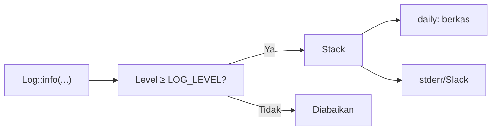

# Logging

Saat aplikasi salah di produksi, log adalah satu-satunya saksi. Laravel memakai konsep **channel** untuk menentukan ke mana log dikirim (berkas, harian, stderr, Slack, dsb.) dan **level** untuk menandai tingkat keparahan. Log yang baik membantu diagnosis; log yang buruk membocorkan rahasia atau menenggelamkan sinyal dalam noise.

## Tujuan Pembelajaran

- [ ] Menjelaskan channel, stack, dan level log.
- [ ] Mengonfigurasi `LOG_CHANNEL`, `LOG_STACK`, dan `LOG_LEVEL`.
- [ ] Menulis log dengan level yang tepat dan konteks.
- [ ] Memakai `Log::withContext` dan `Log::channel`.
- [ ] Menghindari pencatatan data sensitif.
- [ ] Membaca log dan menautkannya dengan `request_id`.

## Prasyarat

- [Penanganan Error API](../level-06/06-11-api-error-handling.md) dan [Queue Workers](07-10-queue-workers.md).

## Pengantar

Pelanggan mengeluh email tidak sampai. Tanpa log kamu menebak; dengan log yang memuat `article_id`, `user_id`, dan hasil pengiriman, penyebabnya ditemukan dalam menit.

## Penjelasan Konsep

### Level

Mengikuti RFC 5424, dari paling ringan ke paling parah: `debug`, `info`, `notice`, `warning`, `error`, `critical`, `alert`, `emergency`.

| Level | Contoh |
|---|---|
| `debug` | Detail untuk pengembangan |
| `info` | Peristiwa normal penting ("Artikel terbit") |
| `warning` | Hal tak biasa tapi tertangani (percobaan ulang) |
| `error` | Operasi gagal (email gagal) |
| `critical` | Komponen kritis rusak |

`LOG_LEVEL` menetapkan level minimum yang dicatat; produksi biasanya `warning` atau `info`, bukan `debug`.

### Channel

Diatur di `config/logging.php`.

| Channel | Perilaku |
|---|---|
| `single` | Satu berkas |
| `daily` | Berkas per hari (dengan retensi) |
| `stack` | Menggabungkan beberapa channel |
| `stderr` | Ke stderr (cocok untuk kontainer) |
| `slack` | Kirim ke Slack (level tinggi) |

Contoh `.env` untuk harian:

```text
LOG_CHANNEL=stack
LOG_STACK=daily
LOG_LEVEL=info
```

### Menulis log

```php-inline
use Illuminate\Support\Facades\Log;

Log::info('Artikel terbit', ['article_id' => $article->id, 'user_id' => $article->user_id]);
Log::warning('Percobaan ulang pengiriman', ['percobaan' => 2]);
Log::error('Email gagal dikirim', ['article_id' => $article->id, 'galat' => $e->getMessage()]);
```

Argumen kedua adalah *konteks* terstruktur. Untuk menambah konteks ke semua log berikutnya dalam satu permintaan, gunakan `Log::withContext([...])` (mis. di middleware):

```php-inline
Log::withContext(['request_id' => $request->header('X-Request-Id') ?? (string) \Illuminate\Support\Str::uuid()]);
```

Pilih channel tertentu dengan `Log::channel('slack')->critical('...')`.

### Apa yang tidak boleh dicatat

- Kata sandi, token, nomor kartu, isi `Authorization`, data pribadi berlebihan.
- Seluruh isi `$request->all()` (dapat memuat sandi).

Log sering dibaca banyak orang dan dikirim ke layanan pihak ketiga. Anggap semua isi log bisa bocor.

### Rotasi dan retensi

Channel `daily` menyimpan sejumlah hari (`days`), lalu menghapus yang lama. Tanpa rotasi, berkas log tumbuh tanpa batas dan memenuhi disk.

### Keamanan

- `storage/logs` tidak boleh dapat diakses publik.
- Batasi akses log dan layanan agregasi.
- Mode debug yang aktif (`APP_DEBUG=true`) di produksi menampilkan jejak galat ke pengunjung; selalu `false`.

## Cara Kerja



## Contoh Praktik

Kamu menambah middleware yang menaruh `request_id` ke konteks log, mencatat peristiwa penting di service dan listener, dan mengganti channel ke `daily`.

## Penjelasan Kode

File: `app/Http/Middleware/AddRequestContext.php`

```php
<?php

namespace App\Http\Middleware;

use Closure;
use Illuminate\Http\Request;
use Illuminate\Support\Facades\Log;
use Illuminate\Support\Str;
use Symfony\Component\HttpFoundation\Response;

class AddRequestContext
{
    public function handle(Request $request, Closure $next): Response
    {
        $id = (string) Str::uuid();
        Log::withContext(['request_id' => $id]);

        $response = $next($request);
        $response->headers->set('X-Request-Id', $id);

        return $response;
    }
}
```

Id dibuat di server (bukan dipercaya dari klien) dan dikembalikan di header agar pengguna dapat melaporkannya. Daftarkan sebagai middleware global/`web`/`api` di `bootstrap/app.php`.

## Implementasi Langkah demi Langkah

### Langkah 1: atur channel

Set `LOG_CHANNEL=stack`, `LOG_STACK=daily`, `LOG_LEVEL=info` lalu `config:clear`.

### Langkah 2: middleware

Buat middleware di atas dan daftarkan ke grup `web` dan `api` lewat `->appendToGroup` / `$middleware->web(append: [...])`.

### Langkah 3: catat peristiwa

Tambah `Log::info` di listener `ArticlePublished` (sudah ada dari 07.08) dengan konteks.

### Langkah 4: picu dan baca

Buat artikel, lalu:

```bash
ls storage/logs
tail -n 5 storage/logs/laravel-$(date +%F).log
```

### Langkah 5: periksa header

```bash
curl -s -i http://127.0.0.1:8000 | grep -i x-request-id
```

### Langkah 6: catat di Git

```bash
git add app bootstrap config
git commit -m "Tambah konteks request_id pada log"
```

## Eksekusi dan Verifikasi

| Langkah | Hasil |
|---|---|
| 4 | Berkas `laravel-YYYY-MM-DD.log` memuat `request_id` |
| 5 | Header `X-Request-Id` ada |

## Hasil yang Diharapkan

Diturunkan dari dokumentasi; belum dijalankan penulis.

## Kesalahan Umum dan Pemecahan Masalah

| Gejala | Penyebab | Cara mengenali | Solusi | Pencegahan |
|---|---|---|---|---|
| Log tidak muncul | Level di bawah `LOG_LEVEL` | Tidak tercatat | Turunkan level | Periksa konfigurasi |
| Log harian tak terbentuk | Channel masih `single` | Satu berkas | Set `LOG_STACK=daily` | `config:clear` |
| Disk penuh | Tanpa rotasi | Berkas besar | `daily` + `days` | Pantau disk |
| Sandi muncul di log | Mencatat seluruh request | Rahasia di log | Catat field terpilih | Review kode |
| `Permission denied` menulis log | Izin `storage/logs` | Galat 500 | Perbaiki izin | Atur saat deploy |
| Terlalu berisik | `debug` di produksi | Log penuh | Naikkan level | `LOG_LEVEL=warning/info` |

## Latihan Praktik

### Latihan dasar

**D1. Pilih level**
- *Masalah:* menentukan level.
- *Persyaratan:* pilih level untuk (a) pengguna masuk, (b) email gagal setelah 3 percobaan, (c) variabel debug.
- *Perilaku yang diharapkan:* (a) info, (b) error, (c) debug.
- *Tujuan belajar:* memilih level.

### Latihan implementasi

**I1. Channel khusus**
- *Masalah:* log audit dipisah.
- *Persyaratan:* buat channel `audit` (berkas `storage/logs/audit.log`) dan catat login/gagal login dengan `Log::channel('audit')`.
- *Perilaku yang diharapkan:* entri terpisah, tanpa sandi.
- *Tujuan belajar:* channel kustom.

### Latihan tantangan

**T1. Redaksi data sensitif**
- *Masalah:* tim khawatir kebocoran di log.
- *Persyaratan:* rancang aturan (daftar field terlarang, pemeriksaan review, pemindaian) dan jelaskan cara menegakkannya.
- *Perilaku yang diharapkan:* rancangan jelas.
- *Tujuan belajar:* higienis log.
- *Catatan:* kerjakan mandiri; tidak ada kunci jawaban.

## Uji Pemahaman

1. Sebutkan urutan level log.
2. Apa fungsi `LOG_LEVEL`?
3. Mengapa `request_id` berguna?
4. Mengapa `APP_DEBUG` harus `false` di produksi?

??? success "Kunci jawaban singkat"
    1. debug, info, notice, warning, error, critical, alert, emergency.
    2. Level minimum yang dicatat.
    3. Menghubungkan semua log satu permintaan dan laporan pengguna.
    4. Jejak galat dan konfigurasi dapat bocor.

## Ringkasan

- Log memakai channel dan level; atur lewat `.env`.
- Tulis log berkonteks dan hindari data sensitif.
- Gunakan rotasi dan jangan jalankan `APP_DEBUG` di produksi.

Selanjutnya: *Broadcasting*.

## Referensi Resmi

- [Laravel: Logging](https://laravel.com/docs/13.x/logging)
