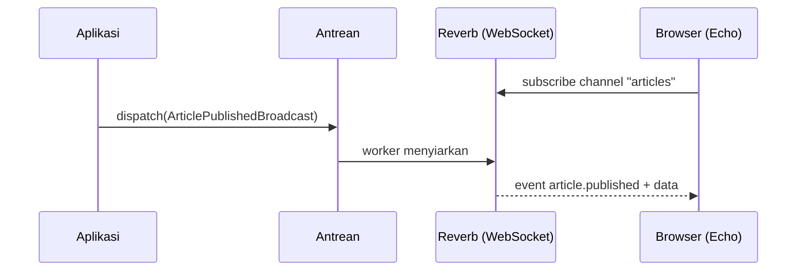

# Broadcasting

HTTP biasa bersifat tanya-jawab: browser bertanya, server menjawab. Untuk fitur seperti "artikel baru muncul tanpa muat ulang" atau notifikasi langsung, server perlu **mendorong** data ke browser. *Broadcasting* Laravel menyiarkan event sisi server lewat WebSocket sehingga klien JavaScript (Laravel Echo) dapat mendengarkannya.

!!! warning "Belum dijalankan penulis"
    Penulis tidak menjalankan Reverb, Node, atau PHP di lingkungan ini. Instruksi diturunkan dari dokumentasi Laravel 13.x. Laravel Reverb sudah disetujui sebagai dependensi untuk kurikulum ini, tetapi verifikasi di mesinmu.

## Tujuan Pembelajaran

- [ ] Menjelaskan alur broadcasting: event → driver → WebSocket → Echo.
- [ ] Memasang broadcasting dengan `php artisan install:broadcasting` (Reverb).
- [ ] Membuat event yang `ShouldBroadcast` dan menentukan `broadcastOn()`.
- [ ] Membedakan channel publik, privat, dan presence.
- [ ] Mengotorisasi channel privat di `routes/channels.php`.
- [ ] Menjalankan server Reverb dan worker antrean.

## Prasyarat

- [Events dan Listeners](07-08-events-and-listeners.md), [Queue Workers](07-10-queue-workers.md), Node/npm untuk Vite.

## Pengantar

Penulis menerbitkan artikel; pengunjung yang sedang membuka beranda melihat daftar bertambah otomatis. Tanpa broadcasting, browser harus *polling* (bertanya berulang) yang boros.

## Penjelasan Konsep

### Alur

1. Event Laravel yang `implements ShouldBroadcast` di-*dispatch*.
2. Event diantrekan lalu disiarkan oleh driver (Reverb) ke channel.
3. Klien yang berlangganan channel lewat Echo menerima data.

### Memasang

```bash
php artisan install:broadcasting
```

Menurut dokumentasi, perintah ini menanyakan layanan (Reverb, Pusher, Ably, Mercure), membuat `config/broadcasting.php` dan `routes/channels.php`, serta memasang Echo; opsi `--reverb` memilih Reverb langsung. Ini menambah paket (Reverb di sisi PHP, `laravel-echo` dan `pusher-js` di sisi JavaScript). Nilai `REVERB_APP_ID`, `REVERB_APP_KEY`, `REVERB_APP_SECRET` ditulis ke `.env`. **Rahasia (`REVERB_APP_SECRET`) tidak boleh di-*commit*.**

### Jenis channel

| Channel | Siapa boleh mendengar | Kelas |
|---|---|---|
| Publik | Siapa saja | `Channel` |
| Privat | Pengguna terotorisasi | `PrivateChannel` |
| Presence | Privat + daftar siapa yang online | `PresenceChannel` |

### Event siaran

File: `app/Events/ArticlePublishedBroadcast.php`

```php
<?php

namespace App\Events;

use App\Models\Article;
use Illuminate\Broadcasting\Channel;
use Illuminate\Contracts\Broadcasting\ShouldBroadcast;
use Illuminate\Contracts\Events\ShouldDispatchAfterCommit;
use Illuminate\Foundation\Events\Dispatchable;

class ArticlePublishedBroadcast implements ShouldBroadcast, ShouldDispatchAfterCommit
{
    use Dispatchable;

    public function __construct(public Article $article) {}

    public function broadcastOn(): Channel
    {
        return new Channel('articles');
    }

    public function broadcastWith(): array
    {
        return [
            'id' => $this->article->id,
            'title' => $this->article->title,
            'slug' => $this->article->slug,
        ];
    }

    public function broadcastAs(): string
    {
        return 'article.published';
    }
}
```

| Bagian | Fungsi |
|---|---|
| `broadcastOn()` | Channel tujuan |
| `broadcastWith()` | Data yang dikirim (batasi!) |
| `broadcastAs()` | Nama event di sisi klien |
| `ShouldDispatchAfterCommit` | Siarkan setelah transaksi commit |

**Batasi `broadcastWith`** ke data yang aman dipublikasikan. Semua properti publik dikirim bila tidak didefinisikan, dan channel publik bisa didengar siapa pun.

### Channel privat

```php-inline
public function broadcastOn(): PrivateChannel
{
    return new PrivateChannel('users.'.$this->article->user_id);
}
```

File: `routes/channels.php`

```php
<?php

use App\Models\User;
use Illuminate\Support\Facades\Broadcast;

Broadcast::channel('users.{id}', function (User $user, int $id) {
    return $user->id === $id;
});
```

Callback harus mengembalikan `true` hanya untuk pengguna yang berhak. Tanpa itu, siapa pun dapat menebak nama channel.

### Menjalankan

```bash
php artisan reverb:start
php artisan queue:work
```

Siaran berjalan lewat antrean, jadi worker wajib aktif (kecuali memakai `ShouldBroadcastNow`).

### Keamanan

- Channel publik hanya untuk data publik.
- Selalu otorisasi channel privat/presence.
- Jangan menyiarkan data pribadi atau rahasia.
- Lindungi `REVERB_APP_SECRET`; gunakan TLS (`wss`) di produksi.
- Batasi jumlah koneksi/asal yang diizinkan di konfigurasi Reverb.

## Cara Kerja



## Contoh Praktik

Kamu memasang Reverb, membuat event siaran, menjalankan server dan worker, lalu (di sub bab berikutnya) menerima event di browser.

## Penjelasan Kode

Event di atas menyiarkan judul dan slug saja. Dispatch-nya dari listener atau service: `ArticlePublishedBroadcast::dispatch($article);`.

## Implementasi Langkah demi Langkah

### Langkah 1: pasang

```bash
php artisan install:broadcasting --reverb
npm install
```

Periksa `git status` untuk melihat berkas yang ditambahkan/diubah dan pastikan `.env` tidak di-*stage*.

### Langkah 2: buat event

Simpan `ArticlePublishedBroadcast`.

### Langkah 3: jalankan layanan

Tiga terminal:

```bash
php artisan reverb:start
php artisan queue:work
npm run dev
```

### Langkah 4: picu

```bash
php artisan tinker --execute="App\Events\ArticlePublishedBroadcast::dispatch(App\Models\Article::first());"
```

### Langkah 5: lihat aktivitas Reverb

Terminal Reverb dapat menampilkan koneksi dan pesan (gunakan `--debug` bila perlu).

### Langkah 6: catat di Git

```bash
git add app routes config package.json package-lock.json composer.json composer.lock resources
git commit -m "Pasang broadcasting dengan Reverb dan event siaran artikel"
```

## Eksekusi dan Verifikasi

| Langkah | Hasil |
|---|---|
| 3 | Reverb mendengarkan di port yang ditampilkan |
| 4 | Job siaran diproses worker tanpa galat |

## Hasil yang Diharapkan

Diturunkan dari dokumentasi; belum dijalankan penulis.

## Kesalahan Umum dan Pemecahan Masalah

| Gejala | Penyebab | Cara mengenali | Solusi | Pencegahan |
|---|---|---|---|---|
| Tidak ada siaran | Worker tidak jalan | Job menumpuk | Jalankan `queue:work` | Pantau antrean |
| Klien tak terhubung | Variabel `VITE_REVERB_*` salah / Vite tak di-restart | Galat WebSocket di konsol | Periksa `.env`, restart `npm run dev` | Samakan host/port |
| `403` pada auth channel | Callback `routes/channels.php` false | Galat otorisasi | Perbaiki aturan | Uji dengan dua pengguna |
| Data sensitif tersiar | `broadcastWith` tak didefinisikan | Properti berlebih terkirim | Definisikan data | Review event |
| Port bentrok | Port 8080 terpakai | Gagal start | `--port=` lain | Periksa port |
| Rahasia ter-commit | `.env` di Git | Rahasia di repo | Cabut dan putar kunci | `.gitignore` |

## Latihan Praktik

### Latihan dasar

**D1. Pilih channel**
- *Masalah:* menentukan jenis channel.
- *Persyaratan:* pilih untuk (a) pengumuman umum, (b) notifikasi pribadi, (c) daftar editor yang sedang online.
- *Perilaku yang diharapkan:* publik, privat, presence.
- *Tujuan belajar:* memilih jenis channel.

### Latihan implementasi

**I1. Channel pribadi**
- *Masalah:* penulis ingin tahu saat artikelnya disetujui.
- *Persyaratan:* siarkan ke `users.{id}` dengan otorisasi di `routes/channels.php`.
- *Perilaku yang diharapkan:* pengguna lain tidak bisa berlangganan.
- *Tujuan belajar:* otorisasi channel.

### Latihan tantangan

**T1. Model ancaman**
- *Masalah:* data tersiar ke publik.
- *Persyaratan:* daftar tiga risiko broadcasting dan mitigasinya.
- *Perilaku yang diharapkan:* daftar beralasan.
- *Tujuan belajar:* berpikir keamanan.
- *Catatan:* kerjakan mandiri; tidak ada kunci jawaban.

## Uji Pemahaman

1. Mengapa broadcasting lebih baik dari polling?
2. Apa beda channel publik dan privat?
3. Apa fungsi `broadcastWith()`?
4. Mengapa worker perlu berjalan?

??? success "Kunci jawaban singkat"
    1. Server mendorong data; tidak ada permintaan berulang.
    2. Privat butuh otorisasi; publik dapat didengar siapa saja.
    3. Menentukan data yang disiarkan.
    4. Siaran diproses lewat antrean.

## Ringkasan

- Broadcasting mendorong event ke browser lewat WebSocket.
- Gunakan channel privat dengan otorisasi untuk data pribadi.
- Batasi data siaran dan jaga rahasia.

Selanjutnya: *Real-Time Events*.

## Referensi Resmi

- [Laravel: Broadcasting](https://laravel.com/docs/13.x/broadcasting)
- [Laravel: Reverb](https://laravel.com/docs/13.x/reverb)
