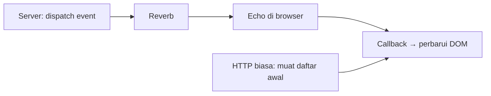

# Real-Time Events

Sub bab sebelumnya menyiarkan event dari server. Sekarang kamu menerimanya di browser dengan **Laravel Echo**, memperbarui halaman tanpa muat ulang, dan menangani kasus nyata: koneksi putus, event ganda, dan data yang harus tetap divalidasi di server.

!!! warning "Belum dijalankan penulis"
    Kode JavaScript dan konfigurasi Echo diturunkan dari dokumentasi Laravel 13.x. Penulis belum menjalankan Reverb atau browser di lingkungan ini.

## Tujuan Pembelajaran

- [ ] Mengonfigurasi Echo di `resources/js`.
- [ ] Berlangganan channel publik dan privat, lalu menangani event.
- [ ] Memperbarui DOM dengan aman (`textContent`).
- [ ] Menangani koneksi terputus dan mencegah duplikasi.
- [ ] Menjelaskan bahwa real-time melengkapi, bukan menggantikan, pengambilan data biasa.

## Prasyarat

- [Broadcasting](07-19-broadcasting.md), dasar JavaScript dan Vite.

## Pengantar

Beranda menampilkan daftar artikel terbaru. Saat artikel baru terbit, judulnya muncul di puncak daftar secara langsung.

## Penjelasan Konsep

### Echo

Menurut dokumentasi, `install:broadcasting` mengonfigurasi Echo di `resources/js/echo.js` (Reverb memakai `pusher-js` sebagai protokol). Konfigurasi umum:

```js
import Echo from 'laravel-echo';
import Pusher from 'pusher-js';
window.Pusher = Pusher;

window.Echo = new Echo({
    broadcaster: 'reverb',
    key: import.meta.env.VITE_REVERB_APP_KEY,
    wsHost: import.meta.env.VITE_REVERB_HOST,
    wsPort: import.meta.env.VITE_REVERB_PORT ?? 80,
    wssPort: import.meta.env.VITE_REVERB_PORT ?? 443,
    forceTLS: (import.meta.env.VITE_REVERB_SCHEME ?? 'https') === 'https',
    enabledTransports: ['ws', 'wss'],
});
```

Variabel `VITE_*` terbaca di JavaScript publik. Hanya **kunci publik** (`APP_KEY` Reverb) yang boleh ada di sana; **jangan pernah** menaruh `REVERB_APP_SECRET` di variabel `VITE_*`.

### Mendengarkan event

```js
window.Echo.channel('articles')
    .listen('.article.published', (e) => {
        const li = document.createElement('li');
        const a = document.createElement('a');
        a.textContent = e.title;                       // aman dari XSS
        a.href = '/artikel/' + encodeURIComponent(e.slug);
        li.appendChild(a);
        document.getElementById('daftar-artikel').prepend(li);
    });
```

Titik di depan `.article.published` berarti nama dari `broadcastAs()` dipakai apa adanya (tanpa awalan namespace).

### Channel privat

```js
window.Echo.private(`users.${userId}`)
    .listen('.article.approved', (e) => { /* ... */ });
```

Echo memanggil endpoint otorisasi (`/broadcasting/auth`) otomatis; hasilnya ditentukan callback di `routes/channels.php`.

### Pola yang sehat

| Prinsip | Alasan |
|---|---|
| Muat data awal lewat HTTP biasa, real-time hanya untuk pembaruan | Pengguna yang baru membuka halaman tetap lengkap |
| Event membawa data minimal; ambil detail via API bila perlu | Data basi dan data sensitif lebih terkendali |
| Cegah duplikasi (cek `id` sudah ada) | Reconnect dapat memicu pengiriman ulang pada skenario tertentu |
| Anggap data siaran tak tepercaya di sisi tampilan | Hindari `innerHTML` |

### Koneksi

Echo mencoba menyambung ulang saat putus. Untuk menjaga konsistensi, setelah tersambung ulang muat ulang daftar dari server agar tidak ada pembaruan terlewat.

### Keamanan

- Jangan mengandalkan klien untuk keputusan keamanan.
- Event publik dapat dibaca siapa saja; jangan kirim draf atau data pribadi.
- Gunakan `wss` (TLS) di produksi.

## Cara Kerja



## Contoh Praktik

Kamu menambah daftar artikel di beranda yang diperbarui langsung saat event `article.published` tiba.

## Penjelasan Kode

Skrip di atas membuat elemen dengan `createElement`, mengisi teks dengan `textContent`, dan menaruh di awal daftar. `encodeURIComponent` melindungi URL dari karakter khusus.

## Implementasi Langkah demi Langkah

### Langkah 1: pastikan Echo

Periksa `resources/js/echo.js` dan impor di `resources/js/app.js`.

### Langkah 2: siapkan markup

Di tampilan beranda: `<ul id="daftar-artikel">...</ul>` berisi artikel awal dari server.

### Langkah 3: tambah skrip pendengar

Letakkan kode `Echo.channel('articles').listen(...)` di `resources/js/app.js` (atau berkas khusus).

### Langkah 4: jalankan semuanya

```bash
php artisan reverb:start
php artisan queue:work
npm run dev
php artisan serve
```

### Langkah 5: picu event

Buka beranda di browser, lalu di terminal lain:

```bash
php artisan tinker --execute="App\Events\ArticlePublishedBroadcast::dispatch(App\Models\Article::first());"
```

Entri baru muncul di puncak daftar tanpa muat ulang.

### Langkah 6: uji putus

Hentikan Reverb, picu event (tidak tampil), nyalakan lagi, muat ulang daftar manual atau tambahkan pemuatan ulang saat tersambung.

### Langkah 7: catat di Git

```bash
git add resources
git commit -m "Tampilkan artikel baru secara real-time dengan Echo"
```

## Eksekusi dan Verifikasi

| Langkah | Hasil |
|---|---|
| 5 | Judul muncul di puncak daftar tanpa muat ulang |
| 6 | Event saat Reverb mati tidak tampil; pemuatan ulang memulihkan |

## Hasil yang Diharapkan

Diturunkan dari dokumentasi; belum dijalankan penulis. Pesan konsol dapat berbeda per versi Echo.

## Kesalahan Umum dan Pemecahan Masalah

| Gejala | Penyebab | Cara mengenali | Solusi | Pencegahan |
|---|---|---|---|---|
| Tidak ada pesan | Nama event salah (lupa titik) | Callback tak terpanggil | Gunakan `.article.published` | Samakan dengan `broadcastAs` |
| Galat WebSocket | Reverb mati / host-port salah | Konsol merah | Jalankan Reverb; periksa `VITE_*` | Restart Vite setelah ubah `.env` |
| `403` auth | Callback channel false | Panggilan `/broadcasting/auth` 403 | Periksa aturan | Uji dengan pengguna berbeda |
| Daftar ganda | Subscribe dipanggil berulang | Entri duplikat | Berlangganan sekali; cek `id` | Satu titik inisialisasi |
| XSS dari judul | `innerHTML` | Skrip tereksekusi | `textContent` | Jangan `innerHTML` untuk data luar |
| Rahasia terpapar | `VITE_REVERB_APP_SECRET` | Rahasia di bundel | Hapus; putar kunci | Hanya kunci publik di `VITE_*` |

## Latihan Praktik

### Latihan dasar

**D1. Nama event**
- *Masalah:* callback tidak terpanggil.
- *Persyaratan:* jelaskan peran titik pada `.article.published` dan hubungannya dengan `broadcastAs()`.
- *Perilaku yang diharapkan:* penjelasan benar.
- *Tujuan belajar:* penamaan event.

### Latihan implementasi

**I1. Hitung pembaca online**
- *Masalah:* tampilkan jumlah pengunjung.
- *Persyaratan:* gunakan presence channel (`Echo.join`) dan tampilkan `here`, `joining`, `leaving`.
- *Perilaku yang diharapkan:* angka berubah saat tab dibuka/ditutup.
- *Tujuan belajar:* presence channel.

### Latihan tantangan

**T1. Konsistensi setelah putus**
- *Masalah:* event terlewat saat offline.
- *Persyaratan:* rancang strategi pemulihan (muat ulang, `since_id`, ETag) dan bandingkan.
- *Perilaku yang diharapkan:* rancangan masuk akal.
- *Tujuan belajar:* keandalan klien real-time.
- *Catatan:* kerjakan mandiri; tidak ada kunci jawaban.

## Uji Pemahaman

1. Apa fungsi Echo?
2. Mengapa memuat data awal lewat HTTP?
3. Mengapa `textContent` dipakai?
4. Mengapa rahasia tidak boleh ada di `VITE_*`?

??? success "Kunci jawaban singkat"
    1. Berlangganan channel dan menerima event di browser.
    2. Pengunjung baru tetap mendapat data lengkap.
    3. Mencegah XSS dari data siaran.
    4. Variabel `VITE_*` masuk ke JavaScript publik.

## Ringkasan

- Echo menerima event siaran dan memicu pembaruan UI.
- Gabungkan pemuatan HTTP awal dengan pembaruan real-time.
- Perlakukan data siaran sebagai tak tepercaya; jaga rahasia.

Selanjutnya: *Localization dan Translation*.

## Referensi Resmi

- [Laravel: Broadcasting, Client Side Installation](https://laravel.com/docs/13.x/broadcasting#client-side-installation)
- [Laravel: Reverb](https://laravel.com/docs/13.x/reverb)
