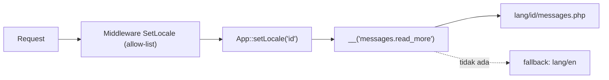

# Localization dan Translation

Aplikasi yang dipakai pembaca dari banyak negara perlu menampilkan teks dalam bahasa mereka. *Localization* (l10n) Laravel menyediakan berkas terjemahan, helper `__()`, pluralisasi, dan pergantian bahasa per permintaan. Sub bab ini juga membahas jebakan: format tanggal/angka, dan **jangan** memakai input pengguna sebagai locale mentah.

## Tujuan Pembelajaran

- [ ] Menjelaskan locale, fallback locale, dan berkas bahasa.
- [ ] Mempublikasikan direktori `lang` dengan `lang:publish`.
- [ ] Memakai kunci pendek (`messages.welcome`) dan kunci string (JSON).
- [ ] Mengganti placeholder dan memakai pluralisasi (`trans_choice`).
- [ ] Menentukan locale per permintaan lewat middleware dengan allow-list.
- [ ] Menerjemahkan pesan validasi dan memformat tanggal sesuai locale.

## Prasyarat

- Blade (Level 03), validasi (Level 05), [Logging](07-18-logging.md) tidak wajib.

## Pengantar

Blog ini ditulis berbahasa Indonesia, tetapi sebagian pembaca lebih nyaman berbahasa Inggris. Teks antarmuka ("Baca selengkapnya", "Masuk") tidak boleh ditulis keras di tampilan.

## Penjelasan Konsep

### Locale

Bahasa bawaan aplikasi ada di `config/app.php` (`locale`) dan dapat diatur lewat `APP_LOCALE` di `.env`. Menurut dokumentasi, ada juga `fallback_locale` (`APP_FALLBACK_LOCALE`) yang dipakai bila terjemahan tidak ditemukan.

```text
APP_LOCALE=id
APP_FALLBACK_LOCALE=en
```

### Berkas bahasa

Direktori `lang` tidak ada secara bawaan di skeleton. Publikasikan:

```bash
php artisan lang:publish
```

Struktur:

```text
lang/
  en/messages.php
  id/messages.php
  en.json
  id.json
```

File: `lang/id/messages.php`

```php
<?php

return [
    'welcome' => 'Selamat datang, :name',
    'read_more' => 'Baca selengkapnya',
    'comments' => '{0} Belum ada komentar|{1} Satu komentar|[2,*] :count komentar',
];
```

File: `lang/en/messages.php`

```php
<?php

return [
    'welcome' => 'Welcome, :name',
    'read_more' => 'Read more',
    'comments' => '{0} No comments yet|{1} One comment|[2,*] :count comments',
];
```

### Memakai terjemahan

```php
__('messages.welcome', ['name' => 'Ani']);
trans_choice('messages.comments', 5);
```

Di Blade: `{{ __('messages.read_more') }}`. Kunci JSON memakai string asli sebagai kunci: `__('Baca selengkapnya')` dengan `lang/en.json` berisi `{"Baca selengkapnya": "Read more"}`. Hindari kunci pendek yang bentrok dengan nama berkas (mis. `__('messages')`).

Placeholder memakai awalan `:`; huruf besar pada placeholder (`:NAME`) membuat nilai kapital. `trans_choice` memilih bentuk jamak berdasarkan angka; `:count` menampilkan angkanya.

### Ganti locale per permintaan

File: `app/Http/Middleware/SetLocale.php`

```php
<?php

namespace App\Http\Middleware;

use Closure;
use Illuminate\Http\Request;
use Illuminate\Support\Facades\App;
use Symfony\Component\HttpFoundation\Response;

class SetLocale
{
    private const ALLOWED = ['id', 'en'];

    public function handle(Request $request, Closure $next): Response
    {
        $locale = $request->session()->get('locale', config('app.locale'));

        if (! in_array($locale, self::ALLOWED, true)) {
            $locale = config('app.locale');
        }

        App::setLocale($locale);

        return $next($request);
    }
}
```

Pemilihan bahasa lewat route `POST /bahasa` yang memvalidasi `in:id,en` lalu menyimpan ke sesi. **Allow-list wajib**: locale yang berasal dari input dipakai untuk membentuk path berkas bahasa, sehingga nilai bebas membuka celah (path traversal) atau galat.

### Validasi dan tanggal

Pesan validasi bawaan Laravel ada di `lang/{locale}/validation.php`; publikasi bahasa lalu tambahkan terjemahan Indonesia (atau pasang paket bahasa komunitas). Format tanggal mengikuti locale Carbon: `$article->published_at->locale('id')->translatedFormat('j F Y')`.

### Keamanan dan kualitas

- Allow-list locale; jangan percaya parameter URL mentah.
- Terjemahan yang disisipkan ke HTML tetap lewat `{{ }}` agar ter-*escape*. Hati-hati dengan `{!! !!}`: terjemahan dari pihak ketiga bisa memuat markup.
- Jangan menerjemahkan data pengguna dengan cara yang membocorkan kunci internal.
- Konsistenkan istilah; simpan glosarium.

## Cara Kerja



## Contoh Praktik

Kamu menerjemahkan beranda ke dua bahasa, menambah pemilih bahasa, dan memastikan nilai locale tak sah diabaikan.

## Penjelasan Kode

Middleware membaca locale dari sesi, memvalidasi terhadap `ALLOWED`, lalu menetapkannya. Route pemilih:

```php-inline
Route::post('/bahasa', function (\Illuminate\Http\Request $request) {
    $data = $request->validate(['locale' => ['required', 'in:id,en']]);
    $request->session()->put('locale', $data['locale']);

    return back();
})->name('bahasa');
```

## Implementasi Langkah demi Langkah

### Langkah 1: publikasikan bahasa

```bash
php artisan lang:publish
```

### Langkah 2: buat berkas terjemahan

Tambahkan `lang/id/messages.php` dan `lang/en/messages.php`.

### Langkah 3: pakai di tampilan

Ganti teks keras dengan `{{ __('messages.read_more') }}` dan `trans_choice` untuk jumlah komentar.

### Langkah 4: middleware dan route

Buat `SetLocale`, daftarkan ke grup `web` (`$middleware->web(append: [...])`), tambah route `bahasa` dan formulir `@csrf`.

### Langkah 5: uji

Pilih `en`: teks berganti. Kirim `locale=../../x` lewat curl atau DevTools: validasi menolak (redirect dengan galat).

### Langkah 6: catat di Git

```bash
git add lang app routes resources bootstrap
git commit -m "Tambah localization id/en"
```

## Eksekusi dan Verifikasi

| Langkah | Hasil |
|---|---|
| 5 | Teks berganti ke Inggris; nilai tak sah ditolak |

## Hasil yang Diharapkan

Diturunkan dari dokumentasi; belum dijalankan penulis.

## Kesalahan Umum dan Pemecahan Masalah

| Gejala | Penyebab | Cara mengenali | Solusi | Pencegahan |
|---|---|---|---|---|
| Tampil `messages.welcome` mentah | Kunci/berkas tak ditemukan | Kunci tercetak | Periksa path & nama berkas | Samakan nama berkas |
| Bahasa tidak berganti | Middleware tak terdaftar / sesi tak tersimpan | Tetap bahasa lama | Daftarkan di grup `web` | Uji alur |
| Jamak salah | Sintaks `{0}\|{1}\|[2,*]` keliru | Teks tak sesuai | Periksa pemisah | Contoh uji |
| Locale sembarang diterima | Tanpa allow-list | Nilai aneh dipakai | `in_array` + validasi | Allow-list |
| Teks Inggris di mana-mana | `fallback_locale` aktif karena kunci belum diterjemahkan | Campur bahasa | Lengkapi terjemahan | Daftar periksa kunci |
| Perubahan tak berlaku | Cache | Teks lama | `optimize:clear` | Bersihkan cache |

## Latihan Praktik

### Latihan dasar

**D1. Terjemahkan satu halaman**
- *Masalah:* menerjemahkan teks keras.
- *Persyaratan:* pindahkan lima teks ke berkas bahasa dan tampilkan dengan `__()`.
- *Perilaku yang diharapkan:* tampil sama di bahasa utama.
- *Tujuan belajar:* kunci terjemahan.

### Latihan implementasi

**I1. Pesan validasi Indonesia**
- *Masalah:* pesan validasi masih Inggris.
- *Persyaratan:* terjemahkan lima aturan di `lang/id/validation.php` dan atribut (`attributes`) untuk `title` dan `body`.
- *Perilaku yang diharapkan:* pesan berbahasa Indonesia.
- *Tujuan belajar:* terjemahan validasi.

### Latihan tantangan

**T1. Deteksi bahasa peramban**
- *Masalah:* ingin default dari header `Accept-Language`.
- *Persyaratan:* rancang pemilihan locale (preferensi sesi → header → default) tetap dengan allow-list, termasuk `Request::getPreferredLanguage`.
- *Perilaku yang diharapkan:* urutan jelas dan aman.
- *Tujuan belajar:* penentuan locale.
- *Catatan:* kerjakan mandiri; tidak ada kunci jawaban.

## Uji Pemahaman

1. Apa fungsi `fallback_locale`?
2. Beda kunci pendek dan kunci JSON?
3. Apa fungsi `trans_choice`?
4. Mengapa locale perlu allow-list?

??? success "Kunci jawaban singkat"
    1. Bahasa cadangan bila terjemahan tak ada.
    2. Pendek merujuk `berkas.kunci`; JSON memakai string asli.
    3. Memilih bentuk jamak berdasarkan jumlah.
    4. Mencegah nilai sembarang yang membentuk path atau menimbulkan galat.

## Ringkasan

- Atur locale dan fallback; simpan teks di `lang/`.
- Gunakan `__()`, placeholder, dan `trans_choice`.
- Pilih locale per permintaan dengan allow-list.

Selanjutnya: proyek penutup bab ini, *Sistem Email dan Notifikasi Latar Belakang*.

## Referensi Resmi

- [Laravel: Localization](https://laravel.com/docs/13.x/localization)
- [Laravel: Validation, Localizing Validation Rules](https://laravel.com/docs/13.x/validation#localization)
