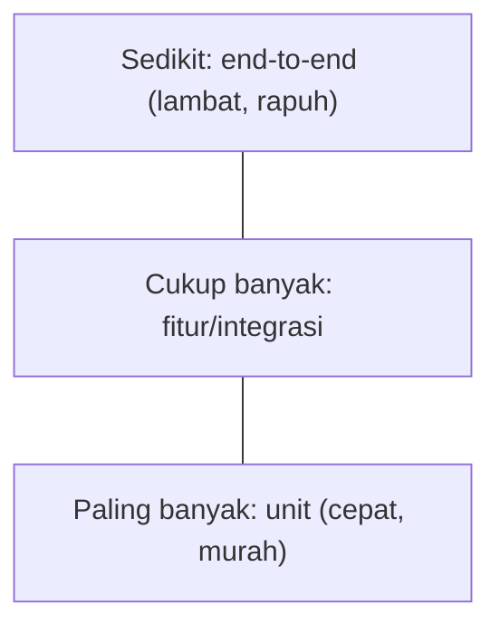
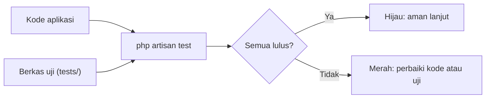

# Pengantar Software Testing

Kamu sudah membangun aplikasi yang cukup besar: autentikasi, peran, API, antrean. Setiap perubahan baru berisiko merusak sesuatu yang dulu berfungsi. Mengujinya manual satu per satu tidak berkelanjutan. **Pengujian otomatis** adalah kode yang memeriksa kode, dijalankan dalam hitungan detik, kapan pun kamu mau.

## Tujuan Pembelajaran

Setelah menyelesaikan sub bab ini, kamu dapat:

- [ ] Menjelaskan mengapa pengujian otomatis penting.
- [ ] Membedakan uji unit, fitur, integrasi, dan *end-to-end*.
- [ ] Menjelaskan piramida pengujian dan kompromi kecepatan vs realisme.
- [ ] Menjelaskan alur pengembangan dengan uji (termasuk TDD secara konsep).
- [ ] Menyebutkan alat uji di ekosistem Laravel (PHPUnit, Pest, `artisan test`).
- [ ] Menjalankan uji bawaan proyek dan membaca hasilnya.

## Prasyarat

- Proyek `cms-artikel` dari bab sebelumnya.
- Dasar PHP dan OOP.

## Pengantar

Bayangkan kamu menambah aturan baru: judul artikel maksimal 150 karakter. Tiga minggu kemudian rekan mengubah validasi dan tidak sengaja membuat judul kosong lolos. Tanpa uji, bug ini baru terlihat saat pengguna mengeluh. Dengan uji, perubahan itu langsung gagal di terminal.

## Penjelasan Konsep

### Mengapa menguji?

| Manfaat | Penjelasan |
|---|---|
| Mendeteksi regresi | Fitur lama yang rusak ketahuan segera |
| Keberanian refactor | Kode boleh diubah selama uji tetap hijau |
| Dokumentasi hidup | Uji menunjukkan perilaku yang dijanjikan |
| Rancangan lebih baik | Kode yang mudah diuji cenderung terstruktur |

Uji tidak menjamin bebas bug; ia hanya menjamin bahwa perilaku yang kamu tuliskan sebagai uji tidak berubah diam-diam.

### Jenis pengujian

| Jenis | Yang diuji | Kecepatan | Contoh di proyek |
|---|---|---|---|
| Unit | Satu class/fungsi terisolasi | Sangat cepat | Pembuatan slug di `ArticlePublisher` |
| Fitur (*feature*) | Satu fitur utuh lewat HTTP/database | Cepat | `POST /articles` membuat artikel |
| Integrasi | Beberapa komponen bekerja bersama | Sedang | Listener + antrean + notifikasi |
| End-to-end / browser | Alur lengkap seperti pengguna nyata | Lambat | Login lalu terbitkan artikel di browser |

### Piramida pengujian



Pedoman umum: banyak uji cepat di dasar, sedikit uji lambat di puncak. Di Laravel, **uji fitur** sangat berguna karena murah dan realistis, sehingga proporsinya sering besar.

### Struktur sebuah uji: Arrange, Act, Assert

1. **Arrange**: siapkan data dan kondisi.
2. **Act**: jalankan satu aksi yang diuji.
3. **Assert**: periksa hasilnya.

Satu uji sebaiknya menguji satu perilaku sehingga ketika gagal, penyebabnya jelas.

### Alat di Laravel

Menurut dokumentasi, Laravel dibangun dengan pengujian di pikiran dan mendukung **Pest** dan **PHPUnit**; berkas `phpunit.xml` sudah tersedia, dan direktori `tests/Feature` dan `tests/Unit` diisi contoh `ExampleTest.php`. Perintah `php artisan test` menjalankan semua uji dengan keluaran yang lebih mudah dibaca.

### TDD secara singkat

*Test-Driven Development* menulis uji **sebelum** kode: merah (uji gagal), hijau (tulis kode minimal agar lulus), refaktor. Tidak wajib, tetapi melatih berpikir dari sisi perilaku.

### Batas pengujian

- Uji yang rapuh (bergantung waktu, urutan, jaringan) mengurangi kepercayaan.
- Cakupan tinggi tidak sama dengan kualitas tinggi (dibahas di sub bab Test Coverage).
- Jangan menguji detail internal framework; percayai Laravel dan uji aturan aplikasimu.

### Keamanan

Pengujian adalah cara murah untuk memastikan kontrol keamanan tetap bekerja: pengguna tanpa hak tetap mendapat `403`, input berbahaya tetap ditolak. Jangan menaruh kredensial nyata di berkas uji dan jangan menjalankan uji terhadap database produksi.

## Cara Kerja



## Contoh Praktik

Kamu menjalankan uji bawaan, membaca ringkasannya, lalu sengaja merusak satu perilaku untuk melihat uji gagal.

## Penjelasan Kode

Berkas bawaan `tests/Feature/ExampleTest.php` (isi bisa sedikit berbeda antar versi skeleton) berbentuk:

```php
<?php

namespace Tests\Feature;

use Tests\TestCase;

class ExampleTest extends TestCase
{
    public function test_the_application_returns_a_successful_response(): void
    {
        $response = $this->get('/');

        $response->assertStatus(200);
    }
}
```

`TestCase` menyiapkan aplikasi Laravel untuk uji. Method yang namanya diawali `test_` dijalankan sebagai uji. `$this->get('/')` mensimulasikan permintaan tanpa server sungguhan, dan `assertStatus(200)` memeriksa kodenya.

## Implementasi Langkah demi Langkah

### Langkah 1: jalankan uji bawaan

```bash
php artisan test
```

### Langkah 2: baca ringkasan

Catat jumlah uji lulus/gagal dan durasi.

### Langkah 3: rusak sementara

Ubah `assertStatus(200)` menjadi `assertStatus(404)`, jalankan lagi, dan baca pesan kegagalan (nilai diharapkan vs aktual). Kembalikan.

### Langkah 4: jalankan satu berkas atau uji

```bash
php artisan test tests/Feature/ExampleTest.php
php artisan test --filter=test_the_application_returns_a_successful_response
```

### Langkah 5: catat di Git

Tidak ada perubahan yang perlu di-*commit* jika kamu sudah mengembalikan berkas.

## Eksekusi dan Verifikasi

| Langkah | Hasil yang diharapkan |
|---|---|
| 1 | Semua uji bawaan lulus |
| 3 | Satu uji gagal dengan pesan `Expected response status code [404] but received 200` (kurang lebih) |
| 4 | Hanya uji terpilih yang berjalan |

## Hasil yang Diharapkan

Pesan persis bergantung versi PHPUnit/Pest dan skeleton; cocokkan dengan hasilmu. Penulis belum menjalankan perintah ini pada lingkungan sungguhan.

## Kesalahan Umum dan Pemecahan Masalah

| Gejala | Penyebab | Cara mengenali | Solusi | Pencegahan |
|---|---|---|---|---|
| Uji bawaan gagal pada proyek yang dimodifikasi | Beranda berubah (mis. redirect/login) | Status ≠ 200 | Sesuaikan harapan uji | Perbarui uji bersama fitur |
| `No tests found` | Nama berkas/method tak sesuai | Tidak ada yang berjalan | Akhiran `Test.php`; method `test_` atau atribut | Gunakan `make:test` |
| Uji mengubah database lokal | Tidak memakai database uji | Data hilang | Gunakan `RefreshDatabase` & DB uji | Periksa `phpunit.xml` |
| Uji lambat | Terlalu banyak uji end-to-end | Durasi menit | Perbanyak uji unit/fitur | Piramida pengujian |
| Uji kadang lulus kadang gagal | Bergantung waktu/urutan | Hasil tidak stabil | Bekukan waktu; isolasi data | Hindari ketergantungan antar-uji |

## Latihan Praktik

### Latihan dasar

**D1. Klasifikasikan jenis uji**
- *Masalah:* menentukan jenis.
- *Persyaratan:* klasifikasikan (a) menguji `Str::slug`, (b) `POST /login` dengan sandi salah, (c) pengguna masuk dan mengunggah gambar lewat browser.
- *Perilaku yang diharapkan:* (a) unit, (b) fitur, (c) end-to-end.
- *Tujuan belajar:* mengenali jenis uji.

### Latihan implementasi

**I1. Tulis harapan dulu**
- *Masalah:* ingin mencoba TDD.
- *Persyaratan:* tulis tiga kalimat perilaku untuk "pengguna menghapus artikel" (sebagai pemilik, sebagai orang lain, sebagai tamu) tanpa kode.
- *Perilaku yang diharapkan:* tiga skenario jelas.
- *Tujuan belajar:* berpikir dari perilaku.

### Latihan tantangan

**T1. Kapan tidak perlu menguji?**
- *Masalah:* tim ingin menguji semuanya.
- *Persyaratan:* tulis kriteria bagian yang kurang bernilai diuji dan alasannya.
- *Perilaku yang diharapkan:* kriteria beralasan.
- *Tujuan belajar:* menimbang biaya uji.
- *Catatan:* kerjakan mandiri; tidak ada kunci jawaban.

## Uji Pemahaman

1. Apa manfaat utama pengujian otomatis?
2. Apa beda uji unit dan uji fitur?
3. Apa itu Arrange-Act-Assert?
4. Mengapa piramida pengujian berbentuk demikian?
5. Apa langkah TDD?

??? success "Kunci jawaban singkat"
    1. Mendeteksi regresi dan memberi keberanian mengubah kode.
    2. Unit menguji satu bagian terisolasi; fitur menguji fitur utuh.
    3. Siapkan, jalankan, periksa.
    4. Uji cepat banyak di dasar, uji lambat sedikit di puncak.
    5. Merah, hijau, refaktor.

## Ringkasan

- Uji otomatis menjaga perilaku aplikasi dari regresi.
- Unit, fitur, integrasi, dan end-to-end punya kompromi berbeda.
- Gunakan `php artisan test` dan tulis uji dengan pola Arrange-Act-Assert.

Selanjutnya: *Dasar Pengujian*.

## Referensi Resmi

- [Laravel: Testing, Getting Started](https://laravel.com/docs/13.x/testing)
