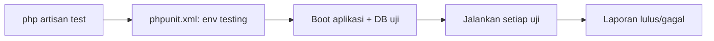

# Dasar Pengujian (Testing Fundamentals)

Sebelum menulis banyak uji, pahami fondasinya: struktur direktori `tests/`, lingkungan `testing`, database uji, `phpunit.xml`, perintah menjalankan uji, dan kebiasaan menulis uji yang andal. Sub bab ini membangun "kerangka kerja" yang dipakai semua sub bab berikutnya.

## Tujuan Pembelajaran

- [ ] Menjelaskan fungsi `tests/Feature`, `tests/Unit`, `TestCase`, dan `phpunit.xml`.
- [ ] Menyiapkan lingkungan dan database khusus pengujian.
- [ ] Membuat uji dengan `php artisan make:test`.
- [ ] Menjalankan uji: semua, per berkas, per filter, paralel, berhenti saat gagal.
- [ ] Menulis uji yang independen dan deterministik.
- [ ] Menghindari uji yang menyentuh data atau layanan nyata.

## Prasyarat

- [Pengantar Software Testing](08-01-introduction-to-software-testing.md).

## Pengantar

Uji pertama yang kamu tulis berjalan di komputermu. Pertanyaan pentingnya: *terhadap database mana*? Jika jawabannya "database pengembangan", satu uji ceroboh dapat menghapus data kerjamu. Karena itu lingkungan uji dipisahkan.

## Penjelasan Konsep

### Struktur

```text
tests/
  Feature/       uji fitur (memakai framework penuh)
  Unit/          uji unit (class terisolasi)
  TestCase.php   kelas dasar
phpunit.xml      konfigurasi PHPUnit/Pest
```

Menurut dokumentasi, saat menjalankan uji Laravel otomatis mengatur lingkungan konfigurasi ke `testing` dan membuat sesi serta cache memakai driver `array` sehingga tidak ada data sesi atau cache yang bertahan antar-uji.

### Lingkungan uji

Nilai lingkungan khusus uji didefinisikan di `phpunit.xml` pada elemen `<php>`:

```xml
<php>
    <env name="APP_ENV" value="testing"/>
    <env name="DB_CONNECTION" value="sqlite"/>
    <env name="DB_DATABASE" value=":memory:"/>
    <env name="MAIL_MAILER" value="array"/>
    <env name="QUEUE_CONNECTION" value="sync"/>
</php>
```

Nilai di atas adalah contoh umum; **periksa `phpunit.xml` proyekmu** karena isi bawaan bergantung versi skeleton. SQLite `:memory:` membuat database sementara yang hilang setelah uji selesai, cepat dan terisolasi. Jika aplikasimu memakai fitur khusus MySQL, pertimbangkan database MySQL uji terpisah.

### Membuat dan menjalankan

```bash
php artisan make:test ArticleTest            # tests/Feature/ArticleTest.php
php artisan make:test SlugTest --unit        # tests/Unit/SlugTest.php

php artisan test                              # semua
php artisan test --testsuite=Feature          # satu suite
php artisan test --filter=nama_uji            # per nama
php artisan test --stop-on-failure            # berhenti di kegagalan pertama
php artisan test --parallel                   # paralel (butuh paket tambahan: lihat dokumentasi)
```

Mode paralel menurut dokumentasi memerlukan paket pengembangan `brianium/paratest`; ini dependensi dev tambahan dan opsional.

### Ciri uji yang baik

| Ciri | Arti |
|---|---|
| Independen | Tidak bergantung pada hasil uji lain atau urutan |
| Deterministik | Hasil sama setiap dijalankan (bekukan waktu, hindari acak tanpa seed) |
| Cepat | Ratusan uji dalam hitungan detik |
| Terbaca | Nama menjelaskan perilaku: `test_penulis_tidak_dapat_mengubah_artikel_orang_lain` |
| Fokus | Satu perilaku per uji |

### Nama uji

Gunakan nama deskriptif berbahasa yang konsisten (Inggris atau Indonesia, pilih satu). Contoh: `test_guest_is_redirected_to_login`.

### Hal yang dihindari

- Memanggil layanan nyata (email sungguhan, API pihak ketiga) dari uji; gunakan *fake* (sub bab Mocking).
- Berbagi status global antar-uji.
- Menyalin data produksi ke uji (privasi).

### Keamanan

Uji tidak boleh memuat rahasia produksi. Gunakan data palsu (factory). Jangan commit berkas `.env.testing` yang berisi kredensial nyata.

## Cara Kerja



## Contoh Praktik

Kamu membuat uji fitur dan uji unit pertama, memeriksa `phpunit.xml`, dan mencoba berbagai opsi menjalankan.

## Penjelasan Kode

File: `tests/Unit/SlugTest.php`

```php
<?php

namespace Tests\Unit;

use Illuminate\Support\Str;
use PHPUnit\Framework\TestCase;

class SlugTest extends TestCase
{
    public function test_slug_replaces_spaces_with_dashes(): void
    {
        $this->assertSame('belajar-laravel', Str::slug('Belajar Laravel'));
    }
}
```

Uji unit di sini memakai `PHPUnit\Framework\TestCase` (tanpa boot Laravel) sehingga sangat cepat. `assertSame` membandingkan nilai dan tipe.

## Implementasi Langkah demi Langkah

### Langkah 1: periksa `phpunit.xml`

Buka berkas dan catat `DB_CONNECTION`, `DB_DATABASE`, `QUEUE_CONNECTION`, `MAIL_MAILER`. Bila `DB_CONNECTION`/`DB_DATABASE` dikomentari, aktifkan SQLite `:memory:` untuk pengujian.

### Langkah 2: buat uji unit

```bash
php artisan make:test SlugTest --unit
```

Isi seperti di atas.

### Langkah 3: jalankan

```bash
php artisan test --filter=SlugTest
```

### Langkah 4: coba opsi

```bash
php artisan test --stop-on-failure
php artisan test --testsuite=Unit
```

### Langkah 5: buktikan independensi

Jalankan satu uji saja (`--filter`) lalu seluruh suite; hasil harus sama.

### Langkah 6: catat di Git

```bash
git add tests phpunit.xml
git commit -m "Siapkan lingkungan pengujian dan uji unit pertama"
```

## Eksekusi dan Verifikasi

| Langkah | Hasil yang diharapkan |
|---|---|
| 3 | 1 uji lulus |
| 4 | Hanya suite terpilih berjalan |
| 5 | Hasil sama dengan atau tanpa filter |

## Hasil yang Diharapkan

Diturunkan dari dokumentasi; belum dijalankan penulis. Format laporan bergantung alat.

## Kesalahan Umum dan Pemecahan Masalah

| Gejala | Penyebab | Cara mengenali | Solusi | Pencegahan |
|---|---|---|---|---|
| Uji menghapus data lokal | Database pengembangan dipakai | Data hilang | Pakai SQLite memori / DB uji | Periksa `phpunit.xml` |
| `could not find driver` | Ekstensi SQLite tak aktif | Galat PDO | Aktifkan `pdo_sqlite` | `php -m` |
| `Class "Tests\TestCase" not found` pada unit | Salah kelas dasar | Galat | Gunakan `PHPUnit\Framework\TestCase` atau `Tests\TestCase` | Pilih sesuai kebutuhan |
| `--parallel` gagal | Paket paralel belum dipasang | Galat | Pasang `brianium/paratest --dev` | Baca dokumentasi |
| Uji saling mempengaruhi | Status bersama | Hasil bergantung urutan | Isolasi data | Reset database per uji |

## Latihan Praktik

### Latihan dasar

**D1. Baca konfigurasi**
- *Masalah:* ingin tahu lingkungan uji.
- *Persyaratan:* jelaskan arti `APP_ENV=testing` dan `DB_DATABASE=:memory:`.
- *Perilaku yang diharapkan:* lingkungan khusus uji; DB sementara di memori.
- *Tujuan belajar:* memahami isolasi.

### Latihan implementasi

**I1. Uji helper**
- *Masalah:* ingin menguji `Str::limit`.
- *Persyaratan:* tulis uji unit dengan dua kasus (teks pendek dan panjang).
- *Perilaku yang diharapkan:* keduanya lulus.
- *Tujuan belajar:* uji unit sederhana.

### Latihan tantangan

**T1. Uji yang tidak stabil**
- *Masalah:* uji bergantung `now()`.
- *Persyaratan:* jelaskan mengapa tidak deterministik dan dua cara memperbaikinya.
- *Perilaku yang diharapkan:* penjelasan benar.
- *Tujuan belajar:* determinisme.
- *Catatan:* kerjakan mandiri; tidak ada kunci jawaban.

## Uji Pemahaman

1. Apa fungsi `phpunit.xml`?
2. Mengapa database uji dipisah?
3. Sebutkan dua ciri uji yang baik.
4. Apa fungsi `--filter`?

??? success "Kunci jawaban singkat"
    1. Mengonfigurasi suite, lingkungan, dan opsi uji.
    2. Agar uji tidak merusak data kerja.
    3. Misalnya independen dan deterministik.
    4. Menjalankan uji yang namanya cocok.

## Ringkasan

- `tests/Feature` untuk fitur, `tests/Unit` untuk unit; `phpunit.xml` mengatur lingkungan.
- Gunakan database uji terpisah dan uji yang independen serta deterministik.
- Jalankan dengan `php artisan test` dan opsinya.

Selanjutnya: *PHPUnit dan Pest*.

## Referensi Resmi

- [Laravel: Testing, Environment](https://laravel.com/docs/13.x/testing#environment)
- [Laravel: Running Tests](https://laravel.com/docs/13.x/testing#running-tests)
