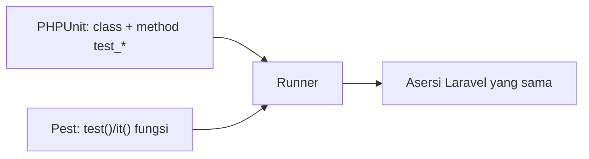

# PHPUnit dan Pest

Laravel mendukung dua kerangka uji: **PHPUnit** (berbasis class) dan **Pest** (berbasis fungsi dengan sintaks ringkas, dibangun di atas PHPUnit). Keduanya menjalankan `php artisan test` dan memakai asersi Laravel yang sama. Materi ini memakai **PHPUnit sebagai bahasa utama** dan menunjukkan padanan Pest agar kamu bisa membaca keduanya.

## Tujuan Pembelajaran

- [ ] Membandingkan PHPUnit dan Pest.
- [ ] Menulis uji yang sama dalam kedua gaya.
- [ ] Memakai asersi dasar (`assertTrue`, `assertSame`, `assertEquals`, `assertCount`).
- [ ] Memakai *data provider* (PHPUnit) dan `dataset` (Pest) untuk banyak kasus.
- [ ] Menggunakan `setUp`/`beforeEach` untuk persiapan bersama.
- [ ] Memutuskan kerangka mana yang dipakai di proyek.

## Prasyarat

- [Dasar Pengujian](08-02-testing-fundamentals.md).

## Pengantar

Kamu membaca tutorial yang memakai `it('...', function () {...})` dan di proyek lain `public function test_...`. Keduanya sah. Memahami keduanya membuatmu fleksibel.

## Penjelasan Konsep

### Perbandingan

| Aspek | PHPUnit | Pest |
|---|---|---|
| Gaya | Class dengan method `test_*` | Fungsi `test()` / `it()` |
| Pemasangan | Bawaan skeleton | Paket dev tambahan (opsional) |
| Keluaran | Standar | Lebih ringkas |
| Data uji | `#[DataProvider]` | `->with([...])` (*dataset*) |
| Ekosistem | Paling luas | Plugin Pest tambahan |

Menurut dokumentasi Laravel, kedua kerangka didukung penuh dan contoh kodenya disajikan berdampingan. **Pest bukan dependensi wajib** untuk kurikulum ini; menambahkannya ke proyek adalah pilihanmu (`composer require pestphp/pest --dev` bersama plugin Laravel-nya, ikuti dokumentasi Pest). Bila ragu, tetap dengan PHPUnit.

### Contoh sama, dua gaya

PHPUnit:

```php
<?php

namespace Tests\Unit;

use PHPUnit\Framework\TestCase;

class MathTest extends TestCase
{
    public function test_addition(): void
    {
        $this->assertSame(4, 2 + 2);
    }
}
```

Pest:

```php
<?php

test('addition', function () {
    expect(2 + 2)->toBe(4);
});
```

### Asersi dasar PHPUnit

| Asersi | Arti |
|---|---|
| `assertTrue($x)` / `assertFalse($x)` | Nilai benar/salah |
| `assertSame($a, $b)` | Sama nilai **dan** tipe (`===`) |
| `assertEquals($a, $b)` | Sama nilai (longgar) |
| `assertCount(3, $arr)` | Jumlah elemen |
| `assertNull($x)` | Bernilai `null` |
| `assertStringContainsString('a', $s)` | Berisi substring |
| `expectException(Kelas::class)` | Mengharapkan pengecualian |

Pilih `assertSame` secara bawaan agar perbedaan tipe (`"1"` vs `1`) tidak lolos.

### Banyak kasus: data provider

```php
use PHPUnit\Framework\Attributes\DataProvider;

#[DataProvider('contohJudul')]
public function test_slug(string $judul, string $diharapkan): void
{
    $this->assertSame($diharapkan, \Illuminate\Support\Str::slug($judul));
}

public static function contohJudul(): array
{
    return [
        'spasi'  => ['Belajar Laravel', 'belajar-laravel'],
        'besar'  => ['PHP 8 Hebat', 'php-8-hebat'],
        'simbol' => ['Halo, Dunia!', 'halo-dunia'],
    ];
}
```

Pest: `it('membuat slug', fn ($j, $d) => expect(Str::slug($j))->toBe($d))->with([['Belajar Laravel','belajar-laravel'], ...]);`.

### Persiapan bersama

PHPUnit: method `setUp()` (panggil `parent::setUp()` terlebih dulu). Pest: `beforeEach(function () {...});`. Gunakan seperlunya; persiapan yang terlalu besar menyulitkan membaca uji.

### Mana yang dipilih?

Pilih satu per proyek dan konsisten. Untuk pemula, PHPUnit membantu memahami OOP; Pest unggul pada keringkasan. Keduanya tidak memengaruhi kemampuan menguji Laravel.

### Keamanan

Tidak ada perbedaan keamanan antar-kerangka. Perhatikan hanya bahwa paket dev (Pest, plugin) tidak ikut terpasang di produksi (`composer install --no-dev`).

## Cara Kerja



## Contoh Praktik

Kamu menulis uji slug dengan data provider dan membandingkannya dengan padanan Pest (bila kamu memasangnya).

## Penjelasan Kode

Data provider memberi nama pada setiap kasus (`'spasi'`, `'besar'`), sehingga pesan gagal menyebut kasus mana yang bermasalah.

## Implementasi Langkah demi Langkah

### Langkah 1: buat uji

```bash
php artisan make:test SlugProviderTest --unit
```

### Langkah 2: isi dengan data provider

Gunakan contoh di atas (ubah kelas dasar sesuai uji unit).

### Langkah 3: jalankan

```bash
php artisan test --filter=SlugProviderTest
```

### Langkah 4: tambah kasus gagal

Tambahkan kasus dengan harapan salah, jalankan, dan baca pesan yang menyebut nama kasus. Hapus kasus itu.

### Langkah 5 (opsional): coba Pest

Ikuti dokumentasi Pest di cabang percobaan Git terpisah; jangan campur kedua gaya tanpa alasan di cabang utama.

### Langkah 6: catat di Git

```bash
git add tests
git commit -m "Tambah uji slug dengan data provider"
```

## Eksekusi dan Verifikasi

| Langkah | Hasil yang diharapkan |
|---|---|
| 3 | Tiga kasus lulus |
| 4 | Satu kasus gagal bernama jelas |

## Hasil yang Diharapkan

Diturunkan dari dokumentasi; belum dijalankan penulis.

## Kesalahan Umum dan Pemecahan Masalah

| Gejala | Penyebab | Cara mengenali | Solusi | Pencegahan |
|---|---|---|---|---|
| `assertEquals` meloloskan bug tipe | Perbandingan longgar | `"1" == 1` lolos | Pakai `assertSame` | Bawaan `assertSame` |
| Data provider tak jalan | Method bukan `public static` | Galat provider | Jadikan `public static` | Ikuti dokumentasi |
| Lupa `parent::setUp()` | Aplikasi tak ter-boot | Galat aneh | Panggil `parent::setUp()` | Template uji |
| Dua gaya tercampur | Tak konsisten | Proyek membingungkan | Pilih satu | Kesepakatan tim |
| Paket Pest ikut ke produksi | Instal tanpa `--dev` | `vendor` besar | `--no-dev` saat deploy | Skrip deploy |

## Latihan Praktik

### Latihan dasar

**D1. `assertSame` vs `assertEquals`**
- *Masalah:* memilih asersi.
- *Persyaratan:* jelaskan hasil `assertEquals(1, '1')` dan `assertSame(1, '1')`.
- *Perilaku yang diharapkan:* yang pertama lulus, yang kedua gagal.
- *Tujuan belajar:* ketepatan asersi.

### Latihan implementasi

**I1. Data provider**
- *Masalah:* banyak kasus validasi email.
- *Persyaratan:* uji aturan email sederhana (fungsi `filter_var`) dengan lima kasus valid/tidak valid.
- *Perilaku yang diharapkan:* semua lulus.
- *Tujuan belajar:* banyak kasus tanpa duplikasi.

### Latihan tantangan

**T1. PHPUnit atau Pest?**
- *Masalah:* tim berselisih.
- *Persyaratan:* tulis perbandingan beralasan dan rekomendasi untuk tim kecil pemula.
- *Perilaku yang diharapkan:* alasan jelas.
- *Tujuan belajar:* keputusan alat.
- *Catatan:* kerjakan mandiri; tidak ada kunci jawaban.

## Uji Pemahaman

1. Apa beda gaya PHPUnit dan Pest?
2. Mengapa `assertSame` lebih disarankan?
3. Apa fungsi data provider?
4. Apakah Pest wajib?

??? success "Kunci jawaban singkat"
    1. PHPUnit berbasis class; Pest berbasis fungsi yang ringkas.
    2. Memeriksa nilai dan tipe.
    3. Menjalankan satu uji dengan banyak set data.
    4. Tidak; ia opsional.

## Ringkasan

- PHPUnit dan Pest sama-sama didukung dan memakai asersi Laravel yang sama.
- Gunakan `assertSame`, data provider/dataset, dan persiapan seperlunya.
- Pilih satu gaya per proyek.

Selanjutnya: *Unit Testing*.

## Referensi Resmi

- [Laravel: Testing](https://laravel.com/docs/13.x/testing)
- [PHPUnit](https://docs.phpunit.de/)
- [Pest](https://pestphp.com/docs)
