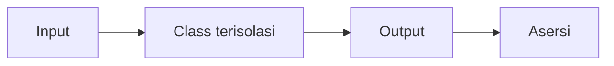

# Unit Testing

Uji unit memeriksa satu bagian kode **terisolasi**: satu class atau fungsi, tanpa database, jaringan, atau framework. Karena kecil dan cepat, uji unit cocok untuk logika murni seperti perhitungan, format, dan aturan bisnis. Di Laravel, kamu dapat membuat kode lebih mudah diuji unit dengan injeksi ketergantungan (Level 07).

## Tujuan Pembelajaran

- [ ] Menentukan kode yang cocok diuji unit.
- [ ] Menulis uji unit untuk class murni dan service dengan ketergantungan palsu sederhana.
- [ ] Menguji kasus normal, batas, dan kesalahan.
- [ ] Menggunakan `expectException` untuk memastikan galat.
- [ ] Merancang kode agar mudah diuji (ketergantungan disuntik).
- [ ] Membedakan uji unit dan uji fitur di proyek.

## Prasyarat

- [PHPUnit dan Pest](08-03-phpunit-and-pest.md), [Dependency Injection](../level-07/07-03-dependency-injection.md).

## Pengantar

Aturan bisnis: ringkasan artikel diambil dari 160 karakter pertama tanpa tag HTML, diakhiri "…" bila dipotong. Logika ini tidak butuh database, jadi cocok diuji unit.

## Penjelasan Konsep

### Kandidat uji unit

| Cocok | Kurang cocok (pakai uji fitur) |
|---|---|
| Format, perhitungan, validasi murni | Alur HTTP |
| Value object, helper | Query database kompleks |
| Service dengan ketergantungan yang bisa diganti | Integrasi antar-lapisan |

### Class yang diuji

File: `app/Support/ArticleExcerpt.php`

```php
<?php

namespace App\Support;

class ArticleExcerpt
{
    public function __construct(private int $limit = 160) {}

    public function make(string $html): string
    {
        $teks = trim(preg_replace('/\s+/', ' ', strip_tags($html)));

        if (mb_strlen($teks) <= $this->limit) {
            return $teks;
        }

        return rtrim(mb_substr($teks, 0, $this->limit)).'…';
    }
}
```

`strip_tags` menghapus tag, `preg_replace` merapikan spasi, dan `mb_*` aman untuk karakter multibita.

### Uji

File: `tests/Unit/ArticleExcerptTest.php`

```php
<?php

namespace Tests\Unit;

use App\Support\ArticleExcerpt;
use PHPUnit\Framework\TestCase;

class ArticleExcerptTest extends TestCase
{
    public function test_short_text_is_returned_unchanged(): void
    {
        $this->assertSame('Halo dunia', (new ArticleExcerpt(50))->make('Halo dunia'));
    }

    public function test_html_tags_are_removed(): void
    {
        $this->assertSame('Halo dunia', (new ArticleExcerpt())->make('<p>Halo <b>dunia</b></p>'));
    }

    public function test_long_text_is_truncated_with_ellipsis(): void
    {
        $hasil = (new ArticleExcerpt(5))->make('abcdefghij');

        $this->assertSame('abcde…', $hasil);
    }

    public function test_boundary_length_is_not_truncated(): void
    {
        $this->assertSame('abcde', (new ArticleExcerpt(5))->make('abcde'));
    }
}
```

Perhatikan empat kasus: pendek, tag, panjang, dan **batas** tepat. Kasus batas sering memuat bug *off-by-one*.

### Menguji galat

```php-inline
public function test_negative_limit_is_rejected(): void
{
    $this->expectException(\InvalidArgumentException::class);

    new \App\Support\ArticleExcerpt(-1);
}
```

Agar lulus, tambahkan pemeriksaan di constructor yang melempar `InvalidArgumentException` bila `$limit < 1`.

### Rancang agar mudah diuji

Class yang menerima ketergantungan lewat constructor mudah diuji dengan objek palsu buatan tangan:

```php-inline
class PengirimPalsu implements \App\Contracts\PengirimPesan
{
    public array $terkirim = [];

    public function kirim(string $tujuan, string $isi): void
    {
        $this->terkirim[] = [$tujuan, $isi];
    }
}
```

Pada uji, suntikkan `PengirimPalsu` lalu periksa `terkirim`. Teknik lebih lanjut (mock) ada di sub bab Mocking.

### Keamanan

Uji unit membantu mengunci fungsi sensitif keamanan seperti sanitasi dan validasi nama berkas. Tulis kasus berbahaya (`../`, tag `<script>`) sebagai bagian dari uji.

## Cara Kerja



## Contoh Praktik

Kamu membuat `ArticleExcerpt`, menulis empat uji plus satu uji galat, lalu memverifikasi bahwa mengubah batas merusak uji yang tepat.

## Penjelasan Kode

Setiap uji membuat objek sendiri (`new ArticleExcerpt(...)`) sehingga tidak ada status bersama. Nama method menjelaskan perilaku, bukan implementasi.

## Implementasi Langkah demi Langkah

### Langkah 1: buat class

Simpan `app/Support/ArticleExcerpt.php`.

### Langkah 2: buat uji

```bash
php artisan make:test ArticleExcerptTest --unit
```

Isi dengan empat uji di atas.

### Langkah 3: jalankan

```bash
php artisan test --filter=ArticleExcerptTest
```

### Langkah 4: tambah uji galat dan perbaiki kode

Tulis uji `expectException` lebih dulu (merah), lalu tambahkan pemeriksaan di constructor (hijau).

### Langkah 5: uji mutasi manual

Ubah `<=` menjadi `<` di class, jalankan: `test_boundary_length_is_not_truncated` harus gagal. Kembalikan.

### Langkah 6: catat di Git

```bash
git add app tests
git commit -m "Tambah ArticleExcerpt dengan uji unit"
```

## Eksekusi dan Verifikasi

| Langkah | Hasil yang diharapkan |
|---|---|
| 3 | Empat uji lulus |
| 4 | Uji galat lulus setelah pemeriksaan ditambahkan |
| 5 | Uji batas gagal saat `<` dipakai |

## Hasil yang Diharapkan

Diturunkan dari kode; belum dijalankan penulis.

## Kesalahan Umum dan Pemecahan Masalah

| Gejala | Penyebab | Cara mengenali | Solusi | Pencegahan |
|---|---|---|---|---|
| Uji unit perlu database | Class bergantung Eloquent | Galat koneksi | Pindah ke uji fitur atau pisahkan logika | Pisahkan logika murni |
| Uji lolos padahal salah | Asersi lemah | Bug lolos | Perkuat dengan `assertSame` & kasus batas | Mutasi manual |
| Uji rapuh | Menguji detail implementasi | Gagal saat refactor | Uji perilaku | Fokus pada output |
| `Call to undefined function` | Helper Laravel tak ter-boot di unit murni | Galat fungsi | Gunakan `Tests\TestCase` atau hindari helper | Pakai fungsi PHP murni |
| Teks multibita salah potong | Memakai `substr` | Karakter rusak | Pakai `mb_substr` | Uji dengan karakter Unicode |

## Latihan Praktik

### Latihan dasar

**D1. Kasus batas**
- *Masalah:* menemukan kasus batas.
- *Persyaratan:* untuk `ArticleExcerpt(5)`, daftar tiga input batas (panjang 4, 5, 6) dan hasil yang diharapkan.
- *Perilaku yang diharapkan:* tidak dipotong, tidak dipotong, dipotong.
- *Tujuan belajar:* berpikir batas.

### Latihan implementasi

**I1. Value object harga**
- *Masalah:* butuh class `Rupiah` yang memformat angka.
- *Persyaratan:* buat `Rupiah::format(int $nilai): string` (`Rp 1.500.000`) dan uji nol, ribuan, jutaan, dan negatif.
- *Perilaku yang diharapkan:* seluruh uji lulus.
- *Tujuan belajar:* uji logika murni.

### Latihan tantangan

**T1. Teks Unicode**
- *Masalah:* judul berbahasa Jepang dan emoji.
- *Persyaratan:* tambahkan uji dengan karakter multibita dan jelaskan potensi masalah pada emoji gabungan.
- *Perilaku yang diharapkan:* uji bermakna.
- *Tujuan belajar:* batas pemrosesan teks.
- *Catatan:* kerjakan mandiri; tidak ada kunci jawaban.

## Uji Pemahaman

1. Apa ciri uji unit?
2. Mengapa kasus batas penting?
3. Bagaimana menguji bahwa pengecualian dilempar?
4. Bagaimana merancang kode agar mudah diuji unit?

??? success "Kunci jawaban singkat"
    1. Terisolasi, cepat, tanpa database/jaringan.
    2. Bug off-by-one sering terjadi di batas.
    3. `expectException(Kelas::class)` sebelum memanggil kode.
    4. Suntikkan ketergantungan lewat constructor.

## Ringkasan

- Uji unit memeriksa logika terisolasi dengan cepat.
- Uji kasus normal, batas, dan galat; gunakan objek palsu sederhana.
- Rancang dengan DI agar mudah diuji.

Selanjutnya: *Feature Testing*.

## Referensi Resmi

- [Laravel: Testing](https://laravel.com/docs/13.x/testing)
- [PHPUnit: Assertions](https://docs.phpunit.de/en/latest/assertions.html)
