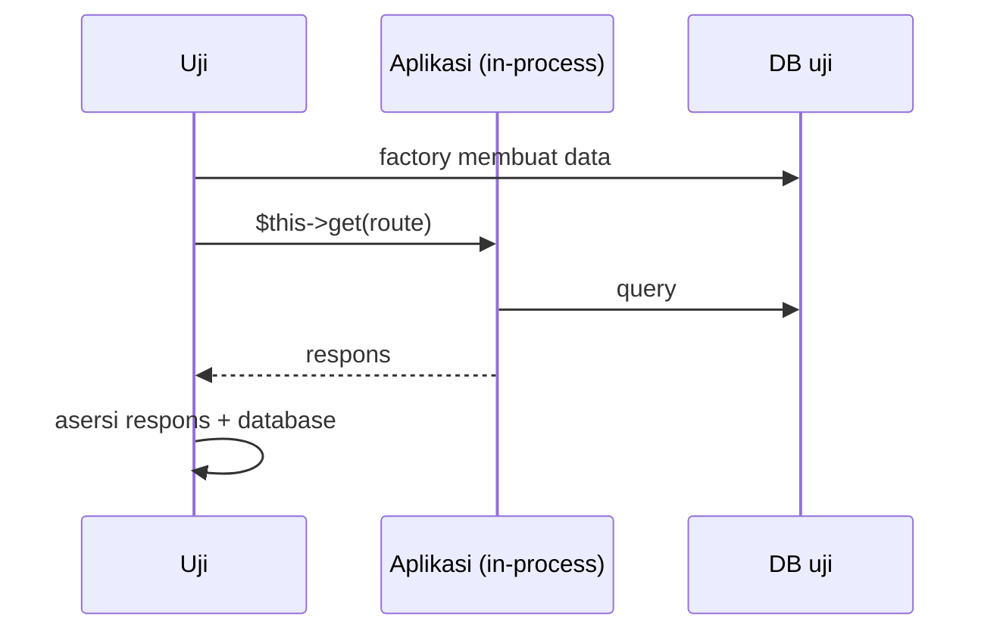

# Feature Testing

Uji fitur menjalankan sebagian besar aplikasi: permintaan HTTP masuk, melewati middleware, controller, validasi, database, lalu respons keluar. Inilah jenis uji yang paling berguna di Laravel karena meniru apa yang dialami pengguna tanpa memerlukan browser.

!!! note "Penyesuaian dengan proyekmu"
    Contoh memakai route dan nama dari proyek `cms-artikel` (`articles.index`, `articles.show`, `admin.articles.store`, dst.). Sesuaikan jika namamu berbeda. Kode uji belum dijalankan penulis pada aplikasi sungguhan.

## Tujuan Pembelajaran

- [ ] Menulis uji fitur dengan `Tests\TestCase` dan `RefreshDatabase`.
- [ ] Menyiapkan data dengan factory.
- [ ] Mengirim permintaan `get`/`post` dan memeriksa respons (status, tampilan, konten).
- [ ] Menguji alur sukses dan alur gagal.
- [ ] Memeriksa efek samping di database.
- [ ] Menjaga uji independen dan terbaca.

## Prasyarat

- [Dasar Pengujian](08-02-testing-fundamentals.md), [Unit Testing](08-04-unit-testing.md), factory dari Level 04.

## Pengantar

Halaman daftar artikel harus hanya menampilkan artikel terbit, terurut terbaru. Tanpa uji, perubahan scope bisa membocorkan draf. Uji fitur mengunci perilaku ini.

## Penjelasan Konsep

### Kerangka uji fitur

File: `tests/Feature/ArticleListTest.php`

```php
<?php

namespace Tests\Feature;

use App\Models\Article;
use Illuminate\Foundation\Testing\RefreshDatabase;
use Tests\TestCase;

class ArticleListTest extends TestCase
{
    use RefreshDatabase;

    public function test_only_published_articles_are_listed(): void
    {
        $terbit = Article::factory()->published()->create(['title' => 'Artikel Terbit']);
        $draf = Article::factory()->create(['title' => 'Artikel Draf', 'published_at' => null]);

        $response = $this->get(route('articles.index'));

        $response->assertOk();
        $response->assertSee('Artikel Terbit');
        $response->assertDontSee('Artikel Draf');
    }

    public function test_article_detail_returns_404_for_draft(): void
    {
        $draf = Article::factory()->create(['published_at' => null]);

        $this->get(route('articles.show', $draf))->assertNotFound();
    }
}
```

| Bagian | Fungsi |
|---|---|
| `RefreshDatabase` | Memigrasi database uji dan membungkus tiap uji dalam transaksi sehingga data bersih |
| `Article::factory()->published()` | Membuat data sesuai *state* yang sudah ada di Level 04 |
| `$this->get(route(...))` | Mensimulasikan permintaan `GET` tanpa server |
| `assertOk()` | Status 200 |
| `assertSee` / `assertDontSee` | Teks muncul / tidak muncul di respons |
| `assertNotFound()` | Status 404 |

Menurut dokumentasi, trait `RefreshDatabase` tidak memigrasi ulang bila skema sudah mutakhir, melainkan membungkus uji dalam transaksi database.

### Alur sukses dan gagal

Setiap fitur memiliki minimal tiga uji: jalur bahagia, validasi gagal, dan akses tak berhak. Contoh pembuatan komentar publik:

```php-inline
public function test_guest_can_post_comment(): void
{
    $artikel = Article::factory()->published()->create();

    $response = $this->post(route('comments.store', $artikel), [
        'author_name' => 'Budi',
        'body' => 'Mantap!',
    ]);

    $response->assertRedirect();
    $this->assertDatabaseHas('comments', ['article_id' => $artikel->id, 'author_name' => 'Budi']);
}

public function test_comment_requires_body(): void
{
    $artikel = Article::factory()->published()->create();

    $this->post(route('comments.store', $artikel), ['author_name' => 'Budi'])
        ->assertSessionHasErrors('body');

    $this->assertDatabaseCount('comments', 0);
}
```

(Sesuaikan nama field dan route komentar dengan proyekmu.) Perhatikan pula CSRF: Laravel menonaktifkan verifikasi token CSRF secara bawaan saat pengujian, sehingga kamu tidak perlu mengirim token di uji.

### Satu uji, satu perilaku

Hindari uji panjang yang memeriksa lima hal; saat gagal, kamu tidak tahu mana yang bermasalah. Gunakan data minimal untuk setiap uji (jangan *seed* seluruh database).

### Keamanan

Uji fitur adalah tempat menguji "yang tidak boleh terjadi": draf tidak terlihat publik, input kosong ditolak, pengguna tak berhak ditolak (sub bab 08.09). Jangan hanya menguji jalur bahagia.

## Cara Kerja



## Contoh Praktik

Kamu menulis empat uji untuk daftar dan detail artikel, lalu dua uji untuk komentar (sukses dan gagal).

## Penjelasan Kode

`assertSee` meng-*escape* teks secara bawaan (membandingkan dengan keluaran ter-escape). Gunakan `assertSee($teks, false)` hanya bila ingin mencocokkan HTML mentah.

## Implementasi Langkah demi Langkah

### Langkah 1: buat berkas

```bash
php artisan make:test ArticleListTest
```

### Langkah 2: isi dua uji pertama

Gunakan kode di atas.

### Langkah 3: jalankan

```bash
php artisan test --filter=ArticleListTest
```

### Langkah 4: tambah uji komentar

Tulis `CommentTest` dengan uji sukses dan gagal.

### Langkah 5: uji mutasi manual

Hapus sementara `->published()` scope pada query daftar; uji pertama harus gagal. Kembalikan.

### Langkah 6: catat di Git

```bash
git add tests
git commit -m "Tambah uji fitur daftar artikel dan komentar"
```

## Eksekusi dan Verifikasi

| Langkah | Hasil yang diharapkan |
|---|---|
| 3 | Dua uji lulus |
| 4 | Uji komentar lulus |
| 5 | Uji gagal saat scope dihapus |

## Hasil yang Diharapkan

Diturunkan dari dokumentasi dan kode proyek; belum dijalankan penulis. Sesuaikan nama route, kolom, dan teks dengan proyekmu.

## Kesalahan Umum dan Pemecahan Masalah

| Gejala | Penyebab | Cara mengenali | Solusi | Pencegahan |
|---|---|---|---|---|
| `no such table` | Lupa `RefreshDatabase` / migrasi | Galat SQL | Tambah trait | Template uji |
| `Route [x] not defined` | Nama route salah | Galat route | `php artisan route:list` | Salin nama persis |
| Uji lulus padahal salah | `assertSee` terlalu longgar | Teks muncul di tempat lain | Periksa konteks / data khusus | Gunakan data unik |
| Mass assignment error | Atribut tidak fillable di `create` biasa | `MassAssignmentException` | Factory tidak terpengaruh; pakai factory | Buat data lewat factory |
| Data bocor antar-uji | Tanpa isolasi | Hasil tergantung urutan | `RefreshDatabase` | Satu data per uji |
| Faker acak bentrok | Nilai unik kebetulan sama | Gagal sesekali | Beri nilai eksplisit untuk yang diperiksa | Data deterministik |

## Latihan Praktik

### Latihan dasar

**D1. Halaman 404**
- *Masalah:* ingin menguji slug tidak ada.
- *Persyaratan:* tulis uji `GET /artikel/tidak-ada` mengharapkan 404.
- *Perilaku yang diharapkan:* lulus.
- *Tujuan belajar:* uji dasar.

### Latihan implementasi

**I1. Paginasi**
- *Masalah:* daftar memakai 10 per halaman.
- *Persyaratan:* buat 12 artikel terbit; uji halaman 1 menampilkan 10 judul dan halaman 2 menampilkan 2.
- *Perilaku yang diharapkan:* sesuai.
- *Tujuan belajar:* menguji paginasi.

**I2. Pencarian**
- *Masalah:* fitur pencarian judul.
- *Persyaratan:* uji bahwa `?q=laravel` hanya memunculkan judul yang cocok dan bahwa input berisi `%` tidak menyebabkan galat.
- *Perilaku yang diharapkan:* hasil benar tanpa galat.
- *Tujuan belajar:* menguji input.

### Latihan tantangan

**T1. Matriks skenario**
- *Masalah:* satu fitur, banyak kondisi.
- *Persyaratan:* untuk "buat komentar" buat tabel skenario (valid, kosong, terlalu panjang, spam cepat, artikel draf) beserta harapan, lalu terjemahkan menjadi uji.
- *Perilaku yang diharapkan:* matriks lengkap.
- *Tujuan belajar:* merancang uji.
- *Catatan:* kerjakan mandiri; tidak ada kunci jawaban.

## Uji Pemahaman

1. Apa fungsi `RefreshDatabase`?
2. Mengapa menguji alur gagal?
3. Apa beda `assertSee` dan `assertDatabaseHas`?
4. Mengapa CSRF tidak perlu dikirim di uji?

??? success "Kunci jawaban singkat"
    1. Menjaga database uji bersih untuk setiap uji.
    2. Mengunci perilaku keamanan dan validasi.
    3. Pertama memeriksa respons; kedua memeriksa baris di database.
    4. Laravel menonaktifkan verifikasi CSRF saat pengujian.

## Ringkasan

- Uji fitur menjalankan permintaan HTTP lengkap dalam proses uji.
- Gunakan factory, `RefreshDatabase`, dan asersi respons serta database.
- Uji jalur bahagia, validasi gagal, dan akses tak berhak.

Selanjutnya: *HTTP Testing*.

## Referensi Resmi

- [Laravel: HTTP Tests](https://laravel.com/docs/13.x/http-tests)
- [Laravel: Database Testing](https://laravel.com/docs/13.x/database-testing)
