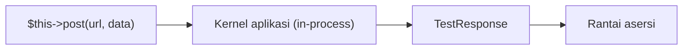

# HTTP Testing

Uji fitur bergantung pada kemampuan "menelepon" aplikasi dan memeriksa jawaban. Sub bab ini mendalami **API pengujian HTTP** Laravel: metode permintaan, header, cookie, sesi, redirect, tampilan, dan katalog asersi respons yang paling sering dipakai.

## Tujuan Pembelajaran

- [ ] Memakai `get`, `post`, `put`, `patch`, `delete`, dan padanan `*Json`.
- [ ] Mengatur header, cookie, dan sesi pada permintaan uji.
- [ ] Mengikuti redirect dan memeriksa tujuan.
- [ ] Memakai asersi status, header, tampilan, sesi, dan JSON.
- [ ] Menguji validasi dengan `assertSessionHasErrors` dan `assertInvalid`.
- [ ] Men-*debug* respons dengan `dump()`/`dd()` pada respons.

## Prasyarat

- [Feature Testing](08-05-feature-testing.md).

## Pengantar

Uji "setelah login, pengguna diarahkan ke dashboard" membutuhkan: kirim `POST`, periksa redirect, lalu ikuti redirect dan lihat konten. Semua itu ada di API HTTP testing.

## Penjelasan Konsep

### Metode permintaan

```php
$this->get('/artikel');
$this->post('/login', $data);
$this->put('/profil', $data);
$this->patch('/x', $data);
$this->delete('/admin/artikel/1');

$this->getJson('/api/v1/articles');          // menambah Accept: application/json
$this->postJson('/api/v1/articles', $data);  // JSON + Accept
```

Menurut dokumentasi, metode ini tidak benar-benar membuat permintaan jaringan; aplikasi menangani permintaan secara internal. Satu uji sebaiknya hanya melakukan satu permintaan utama.

### Header, cookie, sesi

```php
$this->withHeaders(['X-Header' => 'nilai'])->get('/');
$this->withCookie('warna', 'biru')->get('/');
$this->withSession(['banned' => false])->get('/');
```

`actingAs($user)` untuk autentikasi dibahas di sub bab 08.08.

### Redirect

```php
$this->post('/login', $data)->assertRedirect(route('dashboard'));

$this->followingRedirects()->post('/login', $data)->assertSee('Dashboard');
```

`followingRedirects()` mengikuti pengalihan sehingga kamu dapat memeriksa halaman akhir.

### Katalog asersi

| Asersi | Memeriksa |
|---|---|
| `assertOk()` / `assertStatus(n)` | Status |
| `assertCreated()` / `assertNoContent()` | 201 / 204 |
| `assertRedirect($url)` | Pengalihan |
| `assertNotFound()` / `assertForbidden()` / `assertUnauthorized()` | 404 / 403 / 401 |
| `assertSee` / `assertDontSee` / `assertSeeText` | Konten |
| `assertViewIs('nama')` / `assertViewHas('k', 'v')` | Tampilan dan datanya |
| `assertSessionHas('k')` / `assertSessionHasErrors('f')` | Sesi, galat validasi |
| `assertHeader('X', 'v')` | Header respons |
| `assertJson([...])` / `assertJsonPath('a.b', v)` / `assertJsonStructure([...])` | JSON |
| `assertValid()` / `assertInvalid(['f'])` | Hasil validasi (respons JSON/tersimpan) |

### Menguji validasi

```php
$this->post(route('admin.articles.store'), ['title' => ''])
    ->assertSessionHasErrors(['title']);
```

Untuk API (JSON) status 422 dengan `assertUnprocessable()` dan `assertJsonValidationErrors(['title'])`.

### Debugging respons

```php
$response->dump();          // cetak isi respons lalu lanjut
$response->dumpHeaders();
$response->dd();            // cetak lalu berhenti
```

Menurut dokumentasi, ketika uji gagal tanpa petunjuk jelas, `$this->withoutExceptionHandling()` menampilkan pengecualian asli alih-alih halaman 500 generik. Pakai hanya saat debugging dan hapus setelah selesai.

### Keamanan

Gunakan uji HTTP untuk memastikan header keamanan, status redirect pada akses tanpa login, dan penolakan input jahat. Menurut dokumentasi, middleware CSRF dinonaktifkan otomatis saat pengujian, jadi **uji CSRF tersendiri tidak bisa diwakili oleh uji fitur biasa**; verifikasi manual atau uji khusus jika diperlukan.

## Cara Kerja



## Contoh Praktik

Kamu menulis uji login (redirect dan sesi), uji validasi formulir artikel, dan uji header respons.

## Penjelasan Kode

File: `tests/Feature/LoginFlowTest.php`

```php
<?php

namespace Tests\Feature;

use App\Models\User;
use Illuminate\Foundation\Testing\RefreshDatabase;
use Tests\TestCase;

class LoginFlowTest extends TestCase
{
    use RefreshDatabase;

    public function test_user_can_login_and_is_redirected(): void
    {
        $user = User::factory()->create(['password' => 'rahasia-123']);

        $this->post(route('login.store'), [
            'email' => $user->email,
            'password' => 'rahasia-123',
        ])->assertRedirect();

        $this->assertAuthenticatedAs($user);
    }

    public function test_wrong_password_shows_error(): void
    {
        $user = User::factory()->create();

        $this->from(route('login'))
            ->post(route('login.store'), ['email' => $user->email, 'password' => 'salah'])
            ->assertRedirect(route('login'))
            ->assertSessionHasErrors();

        $this->assertGuest();
    }
}
```

`'password' => 'rahasia-123'` bekerja karena model `User` memakai cast `hashed`, sehingga nilai di-*hash* otomatis saat disimpan. Bila modelmu tidak memakai cast itu, gunakan `Hash::make(...)`. `from(...)` menetapkan URL referer agar redirect "kembali" bisa diperiksa.

## Implementasi Langkah demi Langkah

### Langkah 1: buat uji

```bash
php artisan make:test LoginFlowTest
```

### Langkah 2: isi uji

Gunakan kode di atas, sesuaikan nama route login proyekmu.

### Langkah 3: jalankan

```bash
php artisan test --filter=LoginFlowTest
```

### Langkah 4: coba debugging

Tambahkan `->dump()` pada salah satu rantai, jalankan, lalu hapus.

### Langkah 5: uji validasi

Tambahkan uji `assertSessionHasErrors(['email'])` untuk email kosong.

### Langkah 6: catat di Git

```bash
git add tests
git commit -m "Tambah uji HTTP alur login"
```

## Eksekusi dan Verifikasi

| Langkah | Hasil yang diharapkan |
|---|---|
| 3 | Uji login lulus; `assertGuest` lulus saat gagal |
| 5 | Validasi email kosong terdeteksi |

## Hasil yang Diharapkan

Diturunkan dari dokumentasi dan proyek; belum dijalankan penulis.

## Kesalahan Umum dan Pemecahan Masalah

| Gejala | Penyebab | Cara mengenali | Solusi | Pencegahan |
|---|---|---|---|---|
| 302 ke halaman tak terduga | Redirect belum diikuti | Status 302 | `followingRedirects()` atau periksa tujuan | Tahu alur |
| Login gagal di uji | Sandi tidak di-hash | Kredensial salah | Cast `hashed` / `Hash::make` | Pakai factory |
| 500 tanpa pesan | Pengecualian tertangkap handler | Halaman 500 | `withoutExceptionHandling()` sementara | Debug terarah |
| `assertSee` gagal karena escape | HTML ter-escape | Teks berbeda | Gunakan `assertSeeText` / `false` | Pahami escape |
| Uji `Accept` salah | `post` bukan `postJson` | Respons HTML | Pakai `postJson` untuk API | Konsisten |

## Latihan Praktik

### Latihan dasar

**D1. Pilih asersi**
- *Masalah:* mencocokkan asersi.
- *Persyaratan:* pilih asersi untuk (a) halaman terlarang, (b) data tampilan, (c) pesan flash.
- *Perilaku yang diharapkan:* (a) `assertForbidden`, (b) `assertViewHas`, (c) `assertSessionHas`.
- *Tujuan belajar:* mengenali asersi.

### Latihan implementasi

**I1. Logout**
- *Masalah:* logout harus menghapus sesi.
- *Persyaratan:* uji `POST /logout` mengalihkan dan `assertGuest()`.
- *Perilaku yang diharapkan:* lulus.
- *Tujuan belajar:* alur autentikasi.

**I2. Header keamanan**
- *Masalah:* ingin menjamin header tertentu.
- *Persyaratan:* jika proyekmu menambah header (mis. `X-Content-Type-Options`), uji dengan `assertHeader`.
- *Perilaku yang diharapkan:* header terverifikasi.
- *Tujuan belajar:* menguji konfigurasi.

### Latihan tantangan

**T1. Batasan uji CSRF**
- *Masalah:* tim yakin CSRF teruji.
- *Persyaratan:* jelaskan mengapa uji fitur biasa tidak membuktikan perlindungan CSRF dan bagaimana mengujinya.
- *Perilaku yang diharapkan:* penjelasan benar.
- *Tujuan belajar:* batas pengujian.
- *Catatan:* kerjakan mandiri; tidak ada kunci jawaban.

## Uji Pemahaman

1. Apa beda `post` dan `postJson`?
2. Apa fungsi `followingRedirects()`?
3. Bagaimana melihat isi respons saat debugging?
4. Mengapa CSRF tidak teruji di uji fitur biasa?

??? success "Kunci jawaban singkat"
    1. `postJson` menambah header `Accept: application/json` dan mengirim JSON.
    2. Mengikuti redirect untuk memeriksa halaman akhir.
    3. `dump()` atau `dd()` pada respons.
    4. Middleware CSRF dinonaktifkan saat pengujian.

## Ringkasan

- API HTTP testing menyediakan metode, header, cookie, sesi, redirect, dan banyak asersi.
- Uji validasi dan alur auth, bukan hanya jalur bahagia.
- Pahami batas pengujian (mis. CSRF).

Selanjutnya: *Database Testing*.

## Referensi Resmi

- [Laravel: HTTP Tests](https://laravel.com/docs/13.x/http-tests)
