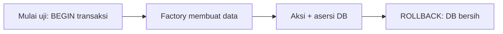

# Database Testing

Hampir semua fitur menyentuh database. Sub bab ini membahas cara mengatur database uji, mereset data antar-uji, dan memakai asersi database seperti `assertDatabaseHas`, `assertDatabaseMissing`, `assertDatabaseCount`, dan `assertSoftDeleted`.

## Tujuan Pembelajaran

- [ ] Membedakan `RefreshDatabase`, `LazilyRefreshDatabase`, `DatabaseMigrations`, dan `DatabaseTruncation`.
- [ ] Menyiapkan data dengan factory dan *seeder* untuk uji.
- [ ] Memakai asersi database.
- [ ] Menguji soft delete, relasi, dan transaksi.
- [ ] Menghindari ketergantungan antar-uji dan data produksi.

## Prasyarat

- [Feature Testing](08-05-feature-testing.md), Eloquent dan soft delete (Level 04).

## Pengantar

Menghapus artikel harus *soft delete*: baris tetap ada dengan `deleted_at` terisi. Hanya pemeriksaan langsung ke database yang membuktikannya.

## Penjelasan Konsep

### Mereset database

| Trait | Cara kerja | Catatan |
|---|---|---|
| `RefreshDatabase` | Migrasi sekali, tiap uji dalam transaksi yang di-*rollback* | Bawaan, cepat |
| `LazilyRefreshDatabase` | Seperti di atas, tetapi migrasi hanya bila uji menyentuh DB | Berguna bila banyak uji tanpa DB |
| `DatabaseMigrations` | Migrasi dan rollback tiap uji | Lebih lambat |
| `DatabaseTruncation` | Mengosongkan tabel antar uji | Untuk uji yang tak cocok dengan transaksi (mis. browser) |

Pakai `RefreshDatabase` kecuali ada alasan lain. Menurut dokumentasi, trait ini tidak memigrasi ulang bila skema sudah mutakhir.

### Mengisi data

```php
$user = User::factory()->create();
$artikel = Article::factory()->for($user)->count(3)->published()->create();

$this->seed();                          // jalankan DatabaseSeeder
$this->seed(CategorySeeder::class);     // seeder tertentu
```

Buat data **minimal** per uji dengan factory. Seeder lengkap membuat uji lambat dan sulit dipahami.

### Asersi database

```php
$this->assertDatabaseHas('articles', ['title' => 'Halo']);
$this->assertDatabaseMissing('articles', ['title' => 'Terhapus']);
$this->assertDatabaseCount('comments', 2);
$this->assertSoftDeleted($artikel);
$this->assertNotSoftDeleted($artikel);
$this->assertModelExists($artikel);
$this->assertModelMissing($artikel);
```

### Contoh: soft delete

File: `tests/Feature/ArticleDeleteTest.php`

```php
<?php

namespace Tests\Feature;

use App\Enums\UserRole;
use App\Models\Article;
use App\Models\User;
use Illuminate\Foundation\Testing\RefreshDatabase;
use Tests\TestCase;

class ArticleDeleteTest extends TestCase
{
    use RefreshDatabase;

    public function test_owner_can_soft_delete_article(): void
    {
        $penulis = User::factory()->create(['role' => UserRole::Author]);
        $artikel = Article::factory()->for($penulis)->create();

        $this->actingAs($penulis)
            ->delete(route('admin.articles.destroy', $artikel))
            ->assertRedirect();

        $this->assertSoftDeleted($artikel);
    }
}
```

`->for($penulis)` mengisi relasi `user`. Uji ini mengandaikan penulis dapat menghapus miliknya dan akun sudah terverifikasi (factory `User` bawaan menandai email terverifikasi). Namespace `App\Enums\UserRole` mengikuti Level 05; sesuaikan bila berbeda.

### Menguji relasi dan integritas

```php
public function test_deleting_user_removes_their_comments(): void
{
    $komentar = Comment::factory()->create();
    $komentar->user->delete();   // jika relasi/foreign key cascadeOnDelete

    $this->assertModelMissing($komentar);
}
```

(Sesuaikan dengan skemamu. Ini menguji aturan foreign key `cascadeOnDelete` dari Level 04.)

### Database uji dan produksi

- Jangan menjalankan uji terhadap database produksi atau kerja.
- `RefreshDatabase` pada koneksi yang salah dapat menghapus data; pastikan `phpunit.xml` menunjuk database uji.
- Hindari mengisi data pribadi nyata; pakai factory.

### Keamanan

Uji integritas (foreign key, unique, pembatasan mass assignment) mencegah regresi yang merusak data. Pastikan juga data sensitif tidak tersimpan polos (mis. sandi ter-*hash*: `assertNotSame('plain', $user->password)`).

## Cara Kerja



## Contoh Praktik

Kamu menulis uji soft delete, uji unik slug, dan uji sandi tersimpan sebagai hash.

## Penjelasan Kode

Uji sandi:

```php
public function test_password_is_stored_hashed(): void
{
    $user = User::factory()->create(['password' => 'rahasia-123']);

    $this->assertNotSame('rahasia-123', $user->password);
    $this->assertTrue(\Illuminate\Support\Facades\Hash::check('rahasia-123', $user->password));
}
```

## Implementasi Langkah demi Langkah

### Langkah 1: periksa koneksi uji

Pastikan `phpunit.xml` memakai SQLite `:memory:` (atau DB uji khusus).

### Langkah 2: tulis uji soft delete

Buat `ArticleDeleteTest` seperti di atas.

### Langkah 3: tulis uji unik

Coba membuat dua artikel dengan slug sama; harapkan `UniqueConstraintViolationException`:

```php
$this->expectException(\Illuminate\Database\UniqueConstraintViolationException::class);
Article::factory()->create(['slug' => 'sama']);
Article::factory()->create(['slug' => 'sama']);
```

### Langkah 4: jalankan

```bash
php artisan test --filter=ArticleDeleteTest
```

### Langkah 5: periksa isolasi

Jalankan seluruh suite dua kali; hasil sama.

### Langkah 6: catat di Git

```bash
git add tests
git commit -m "Tambah uji database untuk soft delete dan integritas"
```

## Eksekusi dan Verifikasi

| Langkah | Hasil yang diharapkan |
|---|---|
| 4 | Uji soft delete lulus |
| 5 | Hasil stabil |

## Hasil yang Diharapkan

Diturunkan dari dokumentasi dan proyek; belum dijalankan penulis.

## Kesalahan Umum dan Pemecahan Masalah

| Gejala | Penyebab | Cara mengenali | Solusi | Pencegahan |
|---|---|---|---|---|
| Data uji muncul di DB kerja | Koneksi salah | Data berubah | Periksa `phpunit.xml` | Pakai SQLite memori |
| `assertDatabaseHas` gagal padahal ada | Kolom/nilai tipe berbeda | Selisih kecil | Cetak baris dengan `dump` | Periksa cast & timestamp |
| Uji bergantung urutan | Data sisa | Gagal bila sendiri | Data per-uji | `RefreshDatabase` |
| Soft delete tak terdeteksi | Pakai `assertDatabaseMissing` | Gagal salah | Pakai `assertSoftDeleted` | Pahami trait |
| Uji lambat | Seeder penuh di tiap uji | Durasi tinggi | Factory minimal | Data seperlunya |
| Dukungan SQLite berbeda dari MySQL | Fitur khusus MySQL | Perilaku beda | DB uji MySQL terpisah | Samakan mesin kritis |

## Latihan Praktik

### Latihan dasar

**D1. Pilih trait**
- *Masalah:* memilih reset DB.
- *Persyaratan:* pilih trait untuk (a) uji fitur biasa, (b) uji browser yang tidak berbagi transaksi.
- *Perilaku yang diharapkan:* (a) `RefreshDatabase`, (b) `DatabaseTruncation`.
- *Tujuan belajar:* mengenali trait.

### Latihan implementasi

**I1. Pemulihan artikel**
- *Masalah:* ada aksi pulihkan.
- *Persyaratan:* uji `PATCH /admin/artikel/{id}/pulihkan` mengubah artikel kembali (`assertNotSoftDeleted`).
- *Perilaku yang diharapkan:* lulus.
- *Tujuan belajar:* asersi soft delete.

**I2. Cascade**
- *Masalah:* komentar ikut terhapus bersama artikel.
- *Persyaratan:* uji bahwa menghapus permanen (`forceDelete`) artikel menghapus komentarnya.
- *Perilaku yang diharapkan:* komentar hilang.
- *Tujuan belajar:* integritas referensial.

### Latihan tantangan

**T1. Uji migrasi**
- *Masalah:* migrasi baru berisiko.
- *Persyaratan:* rancang cara memastikan migrasi bisa naik dan turun (`migrate:fresh`, `migrate:rollback`) pada pipeline CI.
- *Perilaku yang diharapkan:* rancangan benar.
- *Tujuan belajar:* keandalan skema.
- *Catatan:* kerjakan mandiri; tidak ada kunci jawaban.

## Uji Pemahaman

1. Bagaimana `RefreshDatabase` menjaga data bersih?
2. Mengapa factory lebih baik dari seeder penuh untuk uji?
3. Asersi apa untuk soft delete?
4. Mengapa sandi diuji sebagai hash?

??? success "Kunci jawaban singkat"
    1. Tiap uji dalam transaksi yang di-rollback.
    2. Data minimal membuat uji cepat dan jelas.
    3. `assertSoftDeleted`.
    4. Agar tidak tersimpan polos.

## Ringkasan

- `RefreshDatabase` + factory membuat uji database bersih dan cepat.
- Gunakan asersi database untuk memverifikasi efek, termasuk soft delete.
- Pastikan koneksi uji terpisah dari data kerja.

Selanjutnya: *Authentication Testing*.

## Referensi Resmi

- [Laravel: Database Testing](https://laravel.com/docs/13.x/database-testing)
