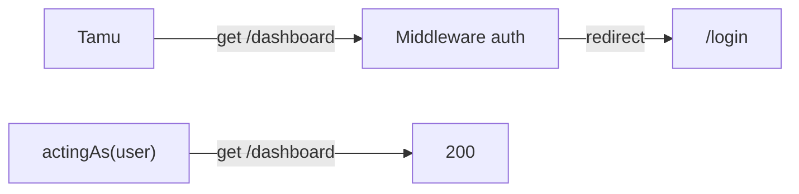

# Authentication Testing

Autentikasi adalah gerbang pertama keamanan. Uji harus memastikan: pengguna sah bisa masuk, pengguna tak sah ditolak, halaman terproteksi mengalihkan tamu, pembatasan laju bekerja, dan verifikasi email ditegakkan. Dengan `actingAs`, kamu juga dapat menguji halaman terproteksi tanpa mengulang proses login.

## Tujuan Pembelajaran

- [ ] Memakai `actingAs` dan `actingAsGuest`.
- [ ] Menguji login, logout, registrasi, dan reset sandi.
- [ ] Menguji akses tamu ke halaman terproteksi.
- [ ] Menguji verifikasi email dan pengguna belum terverifikasi.
- [ ] Menguji pembatasan laju login.
- [ ] Menggunakan `assertAuthenticated`, `assertGuest`, dan `assertAuthenticatedAs`.

## Prasyarat

- [HTTP Testing](08-06-http-testing.md), autentikasi Level 05.

## Pengantar

Regresi yang berbahaya: seseorang menghapus middleware `auth` dari satu route saat refactor dan halaman admin terbuka untuk publik. Satu uji sederhana mendeteksinya.

## Penjelasan Konsep

### `actingAs`

Menurut dokumentasi, `actingAs` menetapkan pengguna yang sedang masuk selama permintaan uji:

```php
$user = User::factory()->create();

$this->actingAs($user)->get('/dashboard')->assertOk();
$this->actingAs($user, 'web')->get('/dashboard');  // guard tertentu
$this->actingAsGuest();                               // pastikan tamu
```

Ini melewati proses login (cepat), jadi uji login sendiri tetap perlu terpisah.

### Uji halaman terproteksi

```php
public function test_guest_is_redirected_to_login(): void
{
    $this->get(route('dashboard'))->assertRedirect(route('login'));
}

public function test_verified_user_sees_dashboard(): void
{
    $user = User::factory()->create();

    $this->actingAs($user)->get(route('dashboard'))->assertOk();
}

public function test_unverified_user_is_sent_to_verification_notice(): void
{
    $user = User::factory()->unverified()->create();

    $this->actingAs($user)->get(route('dashboard'))
        ->assertRedirect(route('verification.notice'));
}
```

Route `dashboard` memakai middleware `auth` dan `verified` (Level 05).

### Uji login dan batas laju

```php
public function test_login_is_rate_limited(): void
{
    $user = User::factory()->create();

    for ($i = 0; $i < 5; $i++) {
        $this->post(route('login.store'), ['email' => $user->email, 'password' => 'salah']);
    }

    $this->post(route('login.store'), ['email' => $user->email, 'password' => 'salah'])
        ->assertStatus(429);
}
```

Jumlah percobaan dan status bergantung implementasimu (Level 05, 05.24). Beberapa implementasi menampilkan galat validasi alih-alih 429; sesuaikan asersi. Bersihkan hitungan antar-uji: driver cache uji (`array`) sudah terisolasi per proses.

### Registrasi

```php
public function test_registration_ignores_role_field(): void
{
    $this->post(route('register.store'), [
        'name' => 'Cici',
        'email' => 'cici@contoh.test',
        'password' => 'sandi-kuat-123',
        'password_confirmation' => 'sandi-kuat-123',
        'role' => 'admin',
    ]);

    $this->assertDatabaseHas('users', ['email' => 'cici@contoh.test', 'role' => 'author']);
}
```

Ini menguji perlindungan *mass assignment* (Level 05, 05.23): peran tidak boleh ditentukan pengguna.

### Reset sandi dan notifikasi

Untuk email, gunakan *fake*:

```php
use Illuminate\Support\Facades\Notification;
use Illuminate\Auth\Notifications\ResetPassword;

public function test_reset_link_is_sent(): void
{
    Notification::fake();
    $user = User::factory()->create();

    $this->post(route('password.email'), ['email' => $user->email]);

    Notification::assertSentTo($user, ResetPassword::class);
}
```

Sub bab Mocking menjelaskan *fake* lebih lanjut. Gunakan nama route dan notifikasi sesuai implementasimu.

### Keamanan

- Uji kasus negatif: kredensial salah, akun belum terverifikasi, sesi kedaluwarsa.
- Jangan menaruh kata sandi nyata di uji; gunakan nilai palsu.
- Uji bahwa pesan galat tidak membocorkan apakah email terdaftar (enumerasi akun).

## Cara Kerja



## Contoh Praktik

Kamu menulis tujuh uji autentikasi: login sukses/gagal, tamu ditolak, belum verifikasi, batas laju, registrasi aman, dan pengiriman tautan reset.

## Penjelasan Kode

Semua uji memakai factory `User`. `unverified()` adalah state bawaan factory pengguna yang mengosongkan `email_verified_at`.

## Implementasi Langkah demi Langkah

### Langkah 1: buat berkas

```bash
php artisan make:test AuthenticationTest
```

### Langkah 2: isi uji

Salin contoh di atas dan sesuaikan nama route/kolom.

### Langkah 3: jalankan

```bash
php artisan test --filter=AuthenticationTest
```

### Langkah 4: mutasi manual

Hapus sementara `auth` dari route dashboard; `test_guest_is_redirected_to_login` harus gagal. Kembalikan.

### Langkah 5: catat di Git

```bash
git add tests
git commit -m "Tambah uji autentikasi"
```

## Eksekusi dan Verifikasi

| Langkah | Hasil yang diharapkan |
|---|---|
| 3 | Uji lulus (bergantung implementasi proyekmu) |
| 4 | Uji tamu gagal saat middleware dihapus |

## Hasil yang Diharapkan

Diturunkan dari dokumentasi dan proyek; belum dijalankan penulis. Nama route, jumlah percobaan laju, dan status dapat berbeda di proyekmu.

## Kesalahan Umum dan Pemecahan Masalah

| Gejala | Penyebab | Cara mengenali | Solusi | Pencegahan |
|---|---|---|---|---|
| 302 ke login padahal `actingAs` | Guard berbeda | Redirect | Sebut guard | Samakan guard |
| Uji verifikasi gagal | Factory sudah terverifikasi | Tidak redirect | `unverified()` | Pakai state |
| Batas laju tak terdeteksi | Hitungan berbeda | Tidak 429 | Sesuaikan jumlah | Baca implementasi |
| Kolom `role` tak terisi | Tidak fillable | Nilai null | Atur lewat factory | Pakai factory |
| Email uji terkirim sungguhan | Tidak di-fake | Email nyata | `Notification::fake()` / mailer `array` | `phpunit.xml` |

## Latihan Praktik

### Latihan dasar

**D1. Tamu vs pengguna**
- *Masalah:* menguji akses profil.
- *Persyaratan:* tulis dua uji: tamu dialihkan, pengguna melihat 200 untuk `/profil`.
- *Perilaku yang diharapkan:* lulus.
- *Tujuan belajar:* `actingAs`.

### Latihan implementasi

**I1. Logout dan sesi**
- *Masalah:* logout harus mencabut akses.
- *Persyaratan:* uji bahwa setelah `POST /logout`, `GET /dashboard` kembali dialihkan.
- *Perilaku yang diharapkan:* dialihkan.
- *Tujuan belajar:* alur lengkap.

**I2. Tidak membocorkan email**
- *Masalah:* enumerasi akun.
- *Persyaratan:* uji bahwa pesan galat login untuk email tak terdaftar dan sandi salah sama.
- *Perilaku yang diharapkan:* pesan identik.
- *Tujuan belajar:* menguji kebocoran informasi.

### Latihan tantangan

**T1. Sesi bersamaan**
- *Masalah:* login di dua perangkat.
- *Persyaratan:* rancang uji untuk fitur "keluar dari perangkat lain" (Level 05) dan jelaskan keterbatasan simulasi sesi di uji.
- *Perilaku yang diharapkan:* rancangan masuk akal.
- *Tujuan belajar:* batas simulasi.
- *Catatan:* kerjakan mandiri; tidak ada kunci jawaban.

## Uji Pemahaman

1. Apa fungsi `actingAs`?
2. Mengapa uji login tetap diperlukan?
3. Bagaimana menguji pengguna belum terverifikasi?
4. Mengapa uji registrasi memeriksa kolom `role`?

??? success "Kunci jawaban singkat"
    1. Menetapkan pengguna yang sedang masuk.
    2. `actingAs` melewati proses login.
    3. State `unverified()` pada factory.
    4. Memastikan mass assignment tidak bisa menaikkan hak.

## Ringkasan

- Uji autentikasi mencakup login, tamu, verifikasi, laju, dan registrasi aman.
- Gunakan `actingAs` dan state factory.
- Fokus pada kasus negatif.

Selanjutnya: *Authorization Testing*.

## Referensi Resmi

- [Laravel: HTTP Tests, Authentication](https://laravel.com/docs/13.x/http-tests#authentication)
- [Laravel: Authentication](https://laravel.com/docs/13.x/authentication)
