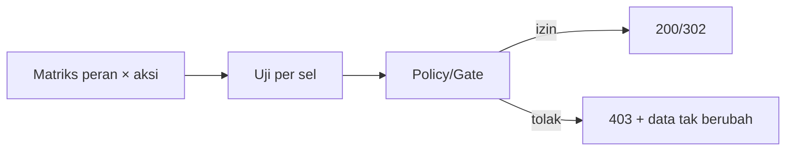

# Authorization Testing

Autentikasi menjawab "kamu siapa?", otorisasi menjawab "apa yang boleh kamu lakukan?". Bug otorisasi sering lolos karena jalur bahagia tetap berfungsi: pemilik bisa mengubah artikelnya, tetapi lupa memeriksa bahwa **orang lain tidak boleh**. Uji otorisasi menutup celah itu, termasuk IDOR dan kenaikan hak.

## Tujuan Pembelajaran

- [ ] Menyusun matriks peran × aksi sebagai dasar uji.
- [ ] Menguji Policy dan Gate secara langsung dan lewat HTTP.
- [ ] Menguji `403` (dilarang) vs `401`/redirect (belum masuk) vs `404`.
- [ ] Menguji IDOR (mengakses sumber daya milik orang lain).
- [ ] Menggunakan data provider untuk matriks peran.
- [ ] Memastikan perubahan peran tidak membuka akses diam-diam.

## Prasyarat

- [Authentication Testing](08-08-authentication-testing.md), Policy/Gate dan peran (Level 05).

## Pengantar

Penulis A mengubah URL dari `/admin/artikel/3/ubah` menjadi `/admin/artikel/4/ubah` (milik B). Apakah aplikasi menolak? Hanya uji yang bisa memastikan hal ini tetap benar setelah ratusan perubahan.

## Penjelasan Konsep

### Matriks peran × aksi

| Aksi | Admin | Editor | Penulis (pemilik) | Penulis (bukan pemilik) | Tamu |
|---|---|---|---|---|---|
| Lihat daftar admin | ✔ | ✔ | ✔ | ✔ | redirect login |
| Ubah artikel | ✔ | ✔ | ✔ | ✘ 403 | redirect login |
| Hapus artikel | ✔ | ✘ | ✔ | ✘ 403 | redirect login |

(Sesuaikan isi dengan Policy di proyekmu.) Setiap sel adalah calon uji.

### Menguji Policy langsung

Karena Policy adalah class biasa, ia mudah diuji tanpa HTTP:

```php-inline
use App\Models\Article;
use App\Models\User;
use Illuminate\Foundation\Testing\RefreshDatabase;
use Tests\TestCase;

class ArticlePolicyTest extends TestCase
{
    use RefreshDatabase;

    public function test_owner_can_update_but_other_author_cannot(): void
    {
        $pemilik = User::factory()->create();
        $lain = User::factory()->create();
        $artikel = Article::factory()->for($pemilik)->create();

        $this->assertTrue($pemilik->can('update', $artikel));
        $this->assertFalse($lain->can('update', $artikel));
    }
}
```

`$user->can('update', $artikel)` memanggil Policy lewat Gate. Pastikan peran default factory `User` sesuai (mis. `author`).

### Menguji lewat HTTP

```php-inline
public function test_other_author_cannot_edit_article(): void
{
    $pemilik = User::factory()->create();
    $lain = User::factory()->create();
    $artikel = Article::factory()->for($pemilik)->create();

    $this->actingAs($lain)
        ->get(route('admin.articles.edit', $artikel))
        ->assertForbidden();

    $this->actingAs($lain)
        ->put(route('admin.articles.update', $artikel), ['title' => 'Dibajak', 'body' => 'x'])
        ->assertForbidden();

    $this->assertDatabaseMissing('articles', ['id' => $artikel->id, 'title' => 'Dibajak']);
}
```

Pernyataan terakhir penting: bukan hanya status 403, tetapi **data tidak berubah**.

### Matriks dengan data provider

```php-inline
use App\Enums\UserRole;
use PHPUnit\Framework\Attributes\DataProvider;

#[DataProvider('peranDanHasil')]
public function test_category_management_by_role(UserRole $peran, int $status): void
{
    $user = User::factory()->create(['role' => $peran]);

    $this->actingAs($user)->get(route('admin.categories.index'))->assertStatus($status);
}

public static function peranDanHasil(): array
{
    return [
        'admin'  => [UserRole::Admin, 200],
        'editor' => [UserRole::Editor, 200],
        'author' => [UserRole::Author, 403],
    ];
}
```

Isi sesuai Gate `manage-categories` di proyekmu.

### 403 atau 404?

Kadang kamu sengaja menyembunyikan keberadaan sumber daya milik orang lain dengan 404. Pilih satu kebijakan, tulis di uji, dan konsisten. Uji harus mencerminkan keputusan itu.

### Keamanan

- Uji **semua** metode (GET, PUT, DELETE), bukan hanya tampilan.
- Uji akses ke ID yang bukan milik pengguna (IDOR) dan ke sumber daya soft-deleted.
- Setelah menambah route baru, tambah baris di matriks.
- Hati-hati: uji yang hanya memakai admin membuat semua tampak lulus.

## Cara Kerja



## Contoh Praktik

Kamu menulis uji Policy, uji HTTP IDOR, dan matriks kategori berdasarkan peran.

## Penjelasan Kode

Semua uji membuat dua pengguna dan satu artikel milik salah satunya, sehingga pelanggaran kepemilikan tidak bisa bersembunyi.

## Implementasi Langkah demi Langkah

### Langkah 1: buat matriks

Tulis tabel peran × aksi untuk artikel, komentar, kategori, dan pengguna dari Policy/Gate yang ada.

### Langkah 2: uji Policy

```bash
php artisan make:test ArticlePolicyTest
```

### Langkah 3: uji HTTP IDOR

Tambah `ArticleAuthorizationTest` dengan uji ubah dan hapus oleh non-pemilik.

### Langkah 4: uji matriks

Tambah uji berbasis data provider untuk kategori dan pengguna.

### Langkah 5: jalankan dan mutasi

```bash
php artisan test --filter=Authorization
```

Hapus sementara `$this->authorize('update', $article)` di controller; uji IDOR harus gagal. Kembalikan.

### Langkah 6: catat di Git

```bash
git add tests
git commit -m "Tambah uji otorisasi"
```

## Eksekusi dan Verifikasi

| Langkah | Hasil yang diharapkan |
|---|---|
| 5 | Uji lulus; gagal saat otorisasi dihapus |

## Hasil yang Diharapkan

Diturunkan dari dokumentasi dan proyek; belum dijalankan penulis. Isi matriks bergantung Policy proyekmu.

## Kesalahan Umum dan Pemecahan Masalah

| Gejala | Penyebab | Cara mengenali | Solusi | Pencegahan |
|---|---|---|---|---|
| Semua uji lulus tetapi ada celah | Hanya jalur bahagia diuji | Pengguna lain lolos | Tambah uji negatif | Matriks |
| 403 tapi data berubah | Mengubah sebelum otorisasi | Baris berubah | Otorisasi dulu | `assertDatabaseMissing` |
| Uji Policy gagal tak terduga | Peran default factory | `can` false | Atur role di factory | Eksplisit peran |
| 404 vs 403 tidak konsisten | Tanpa kebijakan | Uji rapuh | Putuskan | Catat di dokumentasi |
| Gate tak teruji | Hanya Policy diuji | Gate bocor | Uji route dengan middleware `can:` | Matriks route |

## Latihan Praktik

### Latihan dasar

**D1. Isi matriks**
- *Masalah:* tidak ada matriks.
- *Persyaratan:* isi matriks untuk komentar (hapus oleh admin, editor, penulis, tamu).
- *Perilaku yang diharapkan:* matriks sesuai Policy.
- *Tujuan belajar:* memetakan hak.

### Latihan implementasi

**I1. Soft delete dan akses**
- *Masalah:* artikel terhapus seharusnya tidak dapat diubah.
- *Persyaratan:* uji bahwa mengubah artikel soft-deleted ditolak (404/403 sesuai kebijakan).
- *Perilaku yang diharapkan:* ditolak.
- *Tujuan belajar:* kasus tepi.

**I2. Kenaikan hak**
- *Masalah:* penulis mencoba menjadikan dirinya admin.
- *Persyaratan:* uji `PUT /profil` dengan `role=admin` tidak mengubah peran.
- *Perilaku yang diharapkan:* peran tetap.
- *Tujuan belajar:* menguji mass assignment.

### Latihan tantangan

**T1. Generator uji matriks**
- *Masalah:* matriks bertambah besar.
- *Persyaratan:* rancang uji berbasis data (daftar route × peran × harapan) yang mudah diperbarui, dan jelaskan risikonya (uji terlalu generik).
- *Perilaku yang diharapkan:* rancangan seimbang.
- *Tujuan belajar:* skala uji otorisasi.
- *Catatan:* kerjakan mandiri; tidak ada kunci jawaban.

## Uji Pemahaman

1. Apa beda 401 dan 403?
2. Mengapa memeriksa data tidak berubah setelah 403?
3. Apa itu IDOR?
4. Mengapa matriks peran berguna?

??? success "Kunci jawaban singkat"
    1. 401 belum terautentikasi; 403 terautentikasi tetapi dilarang.
    2. Memastikan aksi tidak sempat terlaksana.
    3. Mengakses sumber daya orang lain dengan mengganti ID.
    4. Memastikan setiap kombinasi peran dan aksi teruji.

## Ringkasan

- Uji otorisasi menekankan kasus negatif: siapa yang tidak boleh.
- Uji Policy langsung dan lewat HTTP; periksa data tidak berubah.
- Pakai matriks dan data provider untuk cakupan sistematis.

Selanjutnya: *API Testing*.

## Referensi Resmi

- [Laravel: Authorization](https://laravel.com/docs/13.x/authorization)
- [Laravel: HTTP Tests](https://laravel.com/docs/13.x/http-tests)
