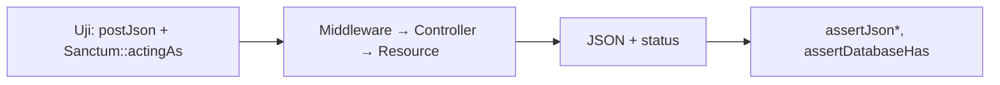

# API Testing

API mengembalikan JSON, memakai token, dan memiliki kontrak yang dipegang klien. Uji API Laravel memakai metode `getJson`/`postJson`, asersi JSON, dan `Sanctum::actingAs` untuk autentikasi token. Hasilnya adalah jaring pengaman untuk API yang dibangun di Level 06.

## Tujuan Pembelajaran

- [ ] Menguji endpoint API dengan `getJson`, `postJson`, `patchJson`, `deleteJson`.
- [ ] Menguji struktur dan isi JSON (`assertJsonStructure`, `assertJsonPath`, `assertExactJson`).
- [ ] Menguji paginasi, penyaringan, dan format galat.
- [ ] Mengautentikasi dengan `Sanctum::actingAs` dan menguji abilities.
- [ ] Menguji 401, 403, 404, 422, dan 429.
- [ ] Menjaga kontrak API dengan uji.

## Prasyarat

- [HTTP Testing](08-06-http-testing.md), [Authorization Testing](08-09-authorization-testing.md), Level 06.

## Pengantar

Aplikasi seluler bergantung pada kunci `data.title`. Jika seseorang menggantinya menjadi `data.headline` di `v1` tanpa sengaja, aplikasi rusak. Uji struktur JSON menangkapnya sebelum rilis.

## Penjelasan Konsep

### Permintaan JSON

```php-inline
$this->getJson('/api/v1/articles');
$this->postJson('/api/v1/articles', ['title' => 'Halo', 'body' => 'Isi']);
$this->patchJson("/api/v1/articles/{$slug}", ['title' => 'Baru']);
$this->deleteJson("/api/v1/articles/{$slug}");
```

Metode `*Json` menambah `Accept: application/json` sehingga galat dirender sebagai JSON.

### Asersi JSON

| Asersi | Memeriksa |
|---|---|
| `assertJson([...])` | Fragmen JSON ada |
| `assertExactJson([...])` | JSON persis sama |
| `assertJsonPath('data.title', 'Halo')` | Nilai pada path |
| `assertJsonStructure(['data' => ['id', 'title']])` | Kunci ada |
| `assertJsonCount(5, 'data')` | Jumlah elemen |
| `assertJsonValidationErrors(['title'])` | Galat validasi 422 |
| `assertUnprocessable()` / `assertCreated()` / `assertNoContent()` | Status |

### Autentikasi token

Menurut dokumentasi Sanctum, `Sanctum::actingAs` mengautentikasi pengguna dan menentukan abilities token:

```php-inline
use Laravel\Sanctum\Sanctum;

Sanctum::actingAs(User::factory()->create(), ['articles:write']);
```

Hanya untuk pengujian; token sungguhan dibuat lewat `createToken`. Untuk menguji ability yang kurang, berikan array yang tidak memuatnya dan harapkan 403.

### Contoh uji API

File: `tests/Feature/Api/ArticleApiTest.php`

```php
<?php

namespace Tests\Feature\Api;

use App\Models\Article;
use App\Models\User;
use Illuminate\Foundation\Testing\RefreshDatabase;
use Laravel\Sanctum\Sanctum;
use Tests\TestCase;

class ArticleApiTest extends TestCase
{
    use RefreshDatabase;

    public function test_index_returns_paginated_published_articles(): void
    {
        Article::factory()->count(3)->published()->create();
        Article::factory()->create(['published_at' => null]);

        $this->getJson('/api/v1/articles?per_page=2')
            ->assertOk()
            ->assertJsonCount(2, 'data')
            ->assertJsonStructure([
                'data' => [['id', 'title', 'slug']],
                'links',
                'meta',
            ]);
    }

    public function test_store_requires_authentication(): void
    {
        $this->postJson('/api/v1/articles', ['title' => 'x', 'body' => 'y'])
            ->assertUnauthorized();
    }

    public function test_store_validates_input(): void
    {
        Sanctum::actingAs(User::factory()->create(), ['articles:write']);

        $this->postJson('/api/v1/articles', ['body' => 'tanpa judul'])
            ->assertUnprocessable()
            ->assertJsonValidationErrors(['title']);
    }

    public function test_store_creates_article_owned_by_token_user(): void
    {
        $user = User::factory()->create();
        Sanctum::actingAs($user, ['articles:write']);

        $this->postJson('/api/v1/articles', ['title' => 'Dari API', 'body' => 'Isi'])
            ->assertCreated()
            ->assertJsonPath('data.title', 'Dari API');

        $this->assertDatabaseHas('articles', ['title' => 'Dari API', 'user_id' => $user->id]);
    }

    public function test_user_id_in_payload_is_ignored(): void
    {
        $user = User::factory()->create();
        $lain = User::factory()->create();
        Sanctum::actingAs($user, ['articles:write']);

        $this->postJson('/api/v1/articles', ['title' => 'Palsu', 'body' => 'x', 'user_id' => $lain->id]);

        $this->assertDatabaseHas('articles', ['title' => 'Palsu', 'user_id' => $user->id]);
    }

    public function test_unknown_article_returns_json_404(): void
    {
        $this->getJson('/api/v1/articles/tidak-ada')
            ->assertNotFound()
            ->assertJsonStructure(['message', 'code']);
    }
}
```

Kunci JSON (`message`, `code`) mengikuti format galat seragam sub bab 06.11; sesuaikan dengan implementasimu. Uji `user_id` abaikan membuktikan perlindungan kepemilikan.

### Uji ability dan laju

```php-inline
public function test_token_without_write_ability_is_forbidden(): void
{
    Sanctum::actingAs(User::factory()->create(), ['articles:read']);

    $this->postJson('/api/v1/articles', ['title' => 'x', 'body' => 'y'])->assertForbidden();
}
```

Untuk 429, kirim permintaan melebihi batas dalam satu uji (atau turunkan batas lewat konfigurasi uji) dan periksa header `Retry-After`.

### Kontrak sebagai uji

`assertJsonStructure` pada endpoint utama berfungsi sebagai uji kontrak sederhana. Bila perubahan merusak (rename kunci) terjadi, uji ini gagal, mengingatkan untuk membuat versi baru (06.19).

### Keamanan

- Uji tanpa token, token kurang ability, dan token milik orang lain.
- Uji bahwa respons tidak memuat kolom sensitif (`password`, `remember_token`): `assertJsonMissingPath('data.password')`.
- Uji bahwa galat tidak membocorkan jejak (stack trace) pada JSON.

## Cara Kerja



## Contoh Praktik

Kamu menulis enam uji di atas, menambah uji ability dan uji respons tanpa kolom sensitif.

## Penjelasan Kode

`assertJsonStructure` hanya memeriksa keberadaan kunci, bukan nilainya; padukan dengan `assertJsonPath` untuk nilai penting.

## Implementasi Langkah demi Langkah

### Langkah 1: buat berkas

```bash
php artisan make:test Api/ArticleApiTest
```

### Langkah 2: isi uji

Salin dan sesuaikan path, kunci, dan factory.

### Langkah 3: jalankan

```bash
php artisan test --filter=ArticleApiTest
```

### Langkah 4: tambah uji ability dan sensitif

Tambahkan uji `articles:read` (403) dan `assertJsonMissingPath('data.user.password')`.

### Langkah 5: mutasi manual

Ubah nama kunci Resource (`title` → `headline`); `assertJsonStructure` harus gagal. Kembalikan.

### Langkah 6: catat di Git

```bash
git add tests
git commit -m "Tambah uji API artikel"
```

## Eksekusi dan Verifikasi

| Langkah | Hasil yang diharapkan |
|---|---|
| 3 | Enam uji lulus (bergantung implementasi) |
| 5 | Uji struktur gagal pada rename kunci |

## Hasil yang Diharapkan

Diturunkan dari dokumentasi dan proyek; belum dijalankan penulis.

## Kesalahan Umum dan Pemecahan Masalah

| Gejala | Penyebab | Cara mengenali | Solusi | Pencegahan |
|---|---|---|---|---|
| Respons HTML 302 | Memakai `post` bukan `postJson` | Redirect ke login | Gunakan `*Json` | Konsisten |
| 401 padahal `actingAs` | Guard `web` bukan `sanctum` | Unauthorized | `Sanctum::actingAs` | Pakai helper yang tepat |
| Struktur gagal | Kunci berbeda | Pesan kunci hilang | Samakan Resource | Dokumentasikan kontrak |
| 403 tak terduga | Ability tak diberikan | Forbidden | Tambah ability | Sebutkan abilities |
| Uji tak stabil | Urutan data acak | Hasil berbeda | `orderBy` eksplisit / data unik | Data deterministik |

## Latihan Praktik

### Latihan dasar

**D1. Detail artikel**
- *Masalah:* uji endpoint detail.
- *Persyaratan:* uji `GET /api/v1/articles/{slug}` dengan `assertJsonPath('data.slug', ...)`.
- *Perilaku yang diharapkan:* lulus.
- *Tujuan belajar:* asersi JSON.

### Latihan implementasi

**I1. Penyaringan dan pencarian**
- *Masalah:* endpoint punya `filter[category]` dan `q`.
- *Persyaratan:* uji bahwa filter menghasilkan subset benar dan `sort` tak valid menghasilkan 422.
- *Perilaku yang diharapkan:* sesuai.
- *Tujuan belajar:* uji parameter.

**I2. Login API**
- *Masalah:* endpoint login mengeluarkan token.
- *Persyaratan:* uji sukses (201 + token), kredensial salah (422), dan logout mencabut token.
- *Perilaku yang diharapkan:* sesuai kontrak.
- *Tujuan belajar:* uji alur token.

### Latihan tantangan

**T1. Uji kontrak dari OpenAPI**
- *Masalah:* ingin uji otomatis terhadap `openapi.yaml`.
- *Persyaratan:* rancang bagaimana mencocokkan respons dengan skema OpenAPI (alat/paket yang mungkin, risiko dependensi baru) tanpa menginstalnya.
- *Perilaku yang diharapkan:* rancangan beralasan.
- *Tujuan belajar:* menjaga kontrak.
- *Catatan:* kerjakan mandiri; tidak ada kunci jawaban.

## Uji Pemahaman

1. Mengapa memakai `postJson`?
2. Apa beda `assertJson` dan `assertExactJson`?
3. Bagaimana mengautentikasi token di uji?
4. Mengapa menguji `user_id` di payload?

??? success "Kunci jawaban singkat"
    1. Mengirim JSON dan `Accept: application/json` agar galat berupa JSON.
    2. `assertJson` memeriksa fragmen; `assertExactJson` persis.
    3. `Sanctum::actingAs($user, [abilities])`.
    4. Memastikan pemilik tidak bisa dipalsukan.

## Ringkasan

- Uji API memakai `*Json`, asersi JSON, dan `Sanctum::actingAs`.
- Uji sukses, 401, 403, 404, 422, dan 429, serta data sensitif.
- Uji struktur menjaga kontrak API.

Selanjutnya: *Mocking*.

## Referensi Resmi

- [Laravel: HTTP Tests, Testing JSON APIs](https://laravel.com/docs/13.x/http-tests#testing-json-apis)
- [Laravel: Sanctum, Testing](https://laravel.com/docs/13.x/sanctum#testing)
- [Laravel: Eloquent API Resources](https://laravel.com/docs/13.x/eloquent-resources)
