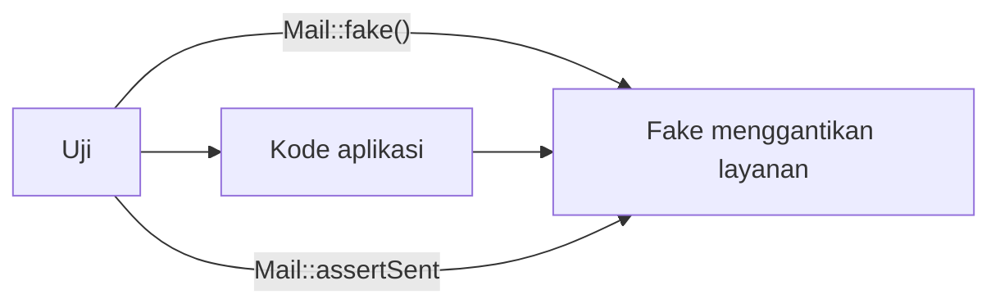

# Mocking

Sebagian kode berinteraksi dengan dunia luar: mengirim email, memanggil API pihak ketiga, menaruh job di antrean, menulis berkas. Dalam uji, kita tidak ingin efek nyata itu terjadi. **Mocking** dan **faking** mengganti ketergantungan dengan pengganti yang bisa kita kendalikan dan periksa.

## Tujuan Pembelajaran

- [ ] Membedakan *fake*, *mock*, dan *spy* secara konsep.
- [ ] Memakai `Mail::fake`, `Notification::fake`, `Queue::fake`, `Event::fake`, `Bus::fake`, `Storage::fake`.
- [ ] Mem-*fake* HTTP keluar dengan `Http::fake`.
- [ ] Membuat mock objek dengan `$this->mock()` dan `$this->spy()`.
- [ ] Membekukan waktu dengan `travel`/`freezeTime`.
- [ ] Menghindari mock berlebihan yang membuat uji rapuh.

## Prasyarat

- [Unit Testing](08-04-unit-testing.md), [Feature Testing](08-05-feature-testing.md), antrean dan notifikasi Level 07.

## Pengantar

Saat artikel diterbitkan, job pemberitahuan masuk antrean dan email dikirim. Dalam uji kita ingin memastikan job *didorong* dan email *akan* dikirim, tanpa benar-benar mengirim apa pun.

## Penjelasan Konsep

### Istilah

| Istilah | Arti |
|---|---|
| Fake | Implementasi pengganti yang bekerja sederhana (mis. mencatat) |
| Mock | Objek yang diprogram untuk mengharapkan panggilan tertentu |
| Spy | Mencatat panggilan; kamu menegaskan setelah kejadian |

Laravel menyediakan fake bawaan untuk banyak layanan, jauh lebih sederhana daripada mock manual.

### Fake bawaan

```php-inline
use Illuminate\Support\Facades\Mail;
use Illuminate\Support\Facades\Queue;
use Illuminate\Support\Facades\Notification;
use Illuminate\Support\Facades\Event;
use Illuminate\Support\Facades\Storage;

Mail::fake();
Mail::assertSent(ArticlePublishedMail::class);
Mail::assertNothingSent();

Queue::fake();
Queue::assertPushed(NotifyArticleSubscribers::class);

Notification::fake();
Notification::assertSentTo($user, ArticlePublishedNotification::class);

Event::fake();
Event::assertDispatched(ArticlePublished::class);

Storage::fake('local');
Storage::disk('local')->assertExists('laporan/uji.csv');
```

Menurut dokumentasi, setelah `Event::fake()` listener tidak dijalankan; jika kamu membutuhkan sebagian event tetap berjalan, gunakan `Event::fake([Kelas::class])` untuk sebagian saja. `Queue::fake()` mencegah job benar-benar diproses.

### Contoh: penerbitan artikel

```php-inline
public function test_publishing_dispatches_event_and_queues_notifications(): void
{
    Event::fake([ArticlePublished::class]);

    $penulis = User::factory()->create();
    $artikel = app(ArticlePublisher::class)->create($penulis, ['title' => 'Halo', 'body' => 'x']);

    Event::assertDispatched(ArticlePublished::class, fn ($e) => $e->article->is($artikel));
}
```

Closure kedua pada `assertDispatched` memeriksa isi event.

### HTTP keluar

```php-inline
use Illuminate\Support\Facades\Http;

Http::fake([
    'api.contoh.test/*' => Http::response(['ok' => true], 200),
]);

$respons = Http::get('https://api.contoh.test/status');
Http::assertSent(fn ($request) => $request->url() === 'https://api.contoh.test/status');
```

Dengan `Http::preventStrayRequests()` (di `setUp` uji), permintaan keluar yang tidak di-fake menjadi galat, mencegah panggilan jaringan tak sengaja.

### Mock objek

```php-inline
use Mockery\MockInterface;

$this->mock(PengirimPesan::class, function (MockInterface $mock) {
    $mock->shouldReceive('kirim')->once()->with('ani@contoh.test', 'Halo');
});
```

`$this->mock()` mengganti binding di container dengan mock, sehingga kode yang menyuntik `PengirimPesan` menerima mock. Bila kelas diganti dengan *fake* buatan sendiri (lihat 08.04), uji sering lebih mudah dibaca.

### Waktu

```php-inline
$this->freezeTime();                   // waktu berhenti
$this->travel(5)->days();              // maju 5 hari
$this->travelTo(now()->minus(hours: 6));
$this->travelBack();
```

Berguna untuk uji kedaluwarsa token, jadwal, dan `published_at`.

### Kapan *tidak* mem-mock?

| Jangan | Mengapa |
|---|---|
| Mock model Eloquent milik sendiri | Uji tak lagi membuktikan apa-apa; pakai factory |
| Mock semua kolaborator | Uji rapuh terhadap refactor |
| Mock apa yang bisa dipakai nyata dengan murah (DB memori) | Tambah kompleksitas |

Mock untuk batas sistem (jaringan, email, waktu, sistem berkas), bukan untuk logika sendiri.

### Keamanan

Fake mencegah uji mengirim email nyata ke alamat sungguhan atau memanggil layanan pihak ketiga dengan kredensial nyata. Konfigurasikan `phpunit.xml` agar mailer `array` dan antrean `sync`, dan jangan pernah menaruh kunci API produksi di lingkungan uji.

## Cara Kerja



## Contoh Praktik

Kamu menulis uji bahwa penerbitan men-dispatch event, notifikasi dikirim ke pelanggan, dan email tidak keluar sungguhan.

## Penjelasan Kode

File: `tests/Feature/PublishNotificationTest.php`

```php
<?php

namespace Tests\Feature;

use App\Models\Article;
use App\Models\User;
use App\Notifications\ArticlePublishedNotification;
use Illuminate\Foundation\Testing\RefreshDatabase;
use Illuminate\Support\Facades\Notification;
use Tests\TestCase;

class PublishNotificationTest extends TestCase
{
    use RefreshDatabase;

    public function test_subscribers_are_notified(): void
    {
        Notification::fake();

        $pelanggan = User::factory()->count(2)->create();
        $artikel = Article::factory()->published()->create();

        Notification::send($pelanggan, new ArticlePublishedNotification($artikel));

        Notification::assertSentTo($pelanggan, ArticlePublishedNotification::class);
        Notification::assertCount(2);
    }
}
```

Uji ini lebih berguna bila memicu alur nyata (menerbitkan lewat service/permintaan HTTP) daripada memanggil `Notification::send` langsung; langsung dipakai di sini hanya untuk memperkenalkan API fake.

## Implementasi Langkah demi Langkah

### Langkah 1: fake notifikasi

Tulis uji di atas dan jalankan.

### Langkah 2: picu alur nyata

Ganti `Notification::send` dengan permintaan penerbitan artikel (`actingAs(...)->post(...)`) dan pastikan listener antre diproses (gunakan `QUEUE_CONNECTION=sync` di `phpunit.xml`).

### Langkah 3: fake antrean

Tambah uji `Queue::fake()` yang menegaskan `Queue::assertPushed(...)` setelah penerbitan.

### Langkah 4: fake HTTP

Jika ada layanan eksternal, tulis uji dengan `Http::fake` dan `Http::preventStrayRequests()`.

### Langkah 5: bekukan waktu

Uji token kedaluwarsa dengan `travel(15)->days()`.

### Langkah 6: catat di Git

```bash
git add tests
git commit -m "Tambah uji dengan fake notifikasi, antrean, dan waktu"
```

## Eksekusi dan Verifikasi

| Langkah | Hasil yang diharapkan |
|---|---|
| 1 | Uji lulus; tidak ada email nyata |
| 3 | `assertPushed` lulus |
| 5 | Token dinyatakan kedaluwarsa |

## Hasil yang Diharapkan

Diturunkan dari dokumentasi; belum dijalankan penulis.

## Kesalahan Umum dan Pemecahan Masalah

| Gejala | Penyebab | Cara mengenali | Solusi | Pencegahan |
|---|---|---|---|---|
| Listener tidak berjalan | `Event::fake()` memblokir | Efek tidak terjadi | `Event::fake([X])` sebagian | Tahu efek fake |
| `assertSent` gagal | Email antre | Terdaftar sebagai queued | `assertQueued` | Periksa jenis |
| Uji memanggil jaringan | Lupa fake | Lambat/gagal | `Http::preventStrayRequests()` | Setup uji |
| Mock rapuh | Terlalu banyak ekspektasi | Gagal saat refactor | Mock di batas sistem saja | Prinsip mock minimal |
| Waktu tidak kembali | Lupa `travelBack` | Uji lain terpengaruh | `travelBack()`/gunakan `freezeTime` closure | TearDown |

## Latihan Praktik

### Latihan dasar

**D1. Fake yang tepat**
- *Masalah:* memilih fake.
- *Persyaratan:* pilih fake untuk (a) email, (b) job, (c) unggahan, (d) API cuaca.
- *Perilaku yang diharapkan:* `Mail`, `Queue`, `Storage`, `Http`.
- *Tujuan belajar:* mengenali fake.

### Latihan implementasi

**I1. Unggahan**
- *Masalah:* uji unggah gambar sampul.
- *Persyaratan:* gunakan `Storage::fake('public')` dan `UploadedFile::fake()->image('a.jpg')`, uji berkas tersimpan.
- *Perilaku yang diharapkan:* `assertExists` lulus.
- *Tujuan belajar:* uji unggahan.

**I2. Email tak terkirim bila batal**
- *Masalah:* draf tidak boleh memicu email.
- *Persyaratan:* simpan artikel draf; `Mail::assertNothingSent()` dan `Queue::assertNothingPushed()`.
- *Perilaku yang diharapkan:* lulus.
- *Tujuan belajar:* menegaskan ketiadaan efek.

### Latihan tantangan

**T1. Terlalu banyak mock**
- *Masalah:* sebuah uji men-mock lima kolaborator.
- *Persyaratan:* jelaskan mengapa itu bau desain dan cara memperbaikinya.
- *Perilaku yang diharapkan:* analisis benar.
- *Tujuan belajar:* disiplin mock.
- *Catatan:* kerjakan mandiri; tidak ada kunci jawaban.

## Uji Pemahaman

1. Apa beda fake dan mock?
2. Apa fungsi `Http::preventStrayRequests()`?
3. Mengapa tidak mem-mock model sendiri?
4. Bagaimana menguji logika yang bergantung waktu?

??? success "Kunci jawaban singkat"
    1. Fake mengganti dengan implementasi sederhana; mock memprogram ekspektasi panggilan.
    2. Membuat permintaan HTTP tak di-fake menjadi galat.
    3. Uji tak membuktikan apa-apa; gunakan factory.
    4. `freezeTime`, `travel`, `travelTo`.

## Ringkasan

- Pakai fake bawaan untuk email, antrean, notifikasi, event, penyimpanan, dan HTTP.
- Mock hanya di batas sistem; hindari mock berlebihan.
- Kendalikan waktu dengan `travel`/`freezeTime`.

Selanjutnya: *Factories in Testing*.

## Referensi Resmi

- [Laravel: Mocking](https://laravel.com/docs/13.x/mocking)
- [Laravel: Mail, Testing](https://laravel.com/docs/13.x/mail#testing-mailables)
- [Laravel: Queues, Testing](https://laravel.com/docs/13.x/queues#testing)
