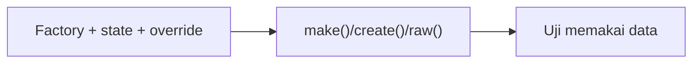

# Factories dalam Pengujian

Kualitas uji sangat bergantung pada kualitas data uji. Factory (Level 04) membuat data realistis dan konsisten. Sub bab ini fokus pada **cara memakai factory secara efektif di dalam uji**: state bermakna, relasi, `make` vs `create`, override eksplisit, dan menghindari uji yang bergantung pada nilai acak.

## Tujuan Pembelajaran

- [ ] Membedakan `make()`, `create()`, dan `raw()`.
- [ ] Merancang *state* yang mengungkapkan maksud (`published()`, `suspended()`).
- [ ] Membuat relasi dengan `for()`, `has()`, dan `hasAttached()`.
- [ ] Menimpa atribut yang relevan dan membiarkan sisanya acak.
- [ ] Membuat data deterministik untuk uji yang stabil.
- [ ] Menghindari factory yang terlalu berat atau memuat logika bisnis.

## Prasyarat

- [Model Factories](../level-04/04-11-model-factories.md), [Database Testing](08-07-database-testing.md).

## Pengantar

Uji "hanya admin dapat membuka manajemen pengguna" tidak peduli nama atau tanggal lahir admin; ia hanya peduli perannya. Factory yang baik membuat sisanya terisi sendiri sehingga uji hanya menyebut yang relevan.

## Penjelasan Konsep

### `make`, `create`, `raw`

| Method | Hasil |
|---|---|
| `make()` | Objek model tanpa disimpan ke database |
| `create()` | Objek tersimpan di database |
| `raw()` | Array atribut (berguna untuk payload permintaan) |

```php-inline
$data = Article::factory()->raw(['title' => 'Dari factory']);
$this->postJson('/api/v1/articles', $data)->assertCreated();
```

`raw()` menghemat penulisan payload valid dan menjaganya sinkron dengan factory.

### Override eksplisit

```php-inline
$admin = User::factory()->create(['role' => UserRole::Admin]);
$artikel = Article::factory()->create(['title' => 'Judul Tetap', 'slug' => 'judul-tetap']);
```

Tuliskan hanya nilai yang menjadi syarat uji. Ini membuat membaca uji menjadi mudah: pembaca langsung tahu apa yang penting.

### State bermakna

File: `database/factories/UserFactory.php` (tambahan)

```php-inline
public function admin(): static
{
    return $this->state(fn () => ['role' => \App\Enums\UserRole::Admin]);
}

public function editor(): static
{
    return $this->state(fn () => ['role' => \App\Enums\UserRole::Editor]);
}
```

Pemakaian: `User::factory()->admin()->create()`. Dibanding `['role' => ...]` berulang, state mengurangi duplikasi dan mencegah salah ketik.

### Relasi

```php-inline
Article::factory()->for($penulis)->create();                         // belongsTo
User::factory()->has(Article::factory()->count(3))->create();        // hasMany
Article::factory()->hasComments(5)->create();                        // magic has{Relasi}
Article::factory()->hasAttached(Tag::factory()->count(2))->create(); // many-to-many
```

Hati-hati: factory yang membuat relasi secara otomatis (mis. `'user_id' => User::factory()`) membuat pengguna baru untuk setiap artikel. Gunakan `for($user)` bila ingin berbagi satu pengguna.

### Deterministik

Nilai acak Faker bisa membuat uji kadang gagal (mis. dua judul kebetulan sama pada kolom unik). Aturan:

- Beri nilai eksplisit pada kolom yang kamu periksa.
- Gunakan `unique()` Faker hanya jika perlu, atau urutan (`Sequence`).
- Untuk data tak terlihat, acak boleh.

```php-inline
use Illuminate\Database\Eloquent\Factories\Sequence;

User::factory()->count(3)->state(new Sequence(
    ['role' => UserRole::Admin],
    ['role' => UserRole::Editor],
    ['role' => UserRole::Author],
))->create();
```

### Anti-pola

| Anti-pola | Masalah |
|---|---|
| Factory yang memicu efek samping (kirim email) | Uji lambat/berisiko |
| Seeder besar sebagai fixture di setiap uji | Lambat dan kabur |
| State yang tersebar dengan nama tak jelas | Sulit dibaca |
| Uji bergantung pada data hasil seeder produksi | Rapuh |

### Keamanan

Factory menghasilkan data palsu; jangan menyalin data pengguna nyata ke factory. Kata sandi di factory pengguna sebaiknya nilai uji bersama yang jelas (mis. hash dari `password`), bukan sandi nyata.

## Cara Kerja



## Contoh Praktik

Kamu menambah state `admin()` dan `editor()`, merapikan uji lama memakai state, dan memakai `raw()` untuk payload API.

## Penjelasan Kode

Contoh uji dengan state dan `raw()`:

```php-inline
public function test_admin_can_open_user_management(): void
{
    $admin = User::factory()->admin()->create();

    $this->actingAs($admin)->get(route('admin.users.index'))->assertOk();
}

public function test_valid_payload_creates_article(): void
{
    Sanctum::actingAs(User::factory()->create(), ['articles:write']);

    $payload = Article::factory()->raw();

    $this->postJson('/api/v1/articles', $payload)->assertCreated();
}
```

Pastikan `raw()` hanya menghasilkan kolom yang diterima validasi API (tidak ada `user_id`, `slug` bila tidak diizinkan); jika tidak, gunakan `Arr::only($payload, ['title', 'body'])`.

## Implementasi Langkah demi Langkah

### Langkah 1: tambahkan state

Tambahkan `admin()` dan `editor()` ke `UserFactory`.

### Langkah 2: refaktor uji

Cari `['role' => UserRole::Admin]` di `tests/` dan ganti dengan state.

```bash
grep -rn "UserRole::Admin" tests | head
```

### Langkah 3: pakai `raw()`

Ubah satu uji API agar memakai `Article::factory()->raw()`.

### Langkah 4: jalankan seluruh uji

```bash
php artisan test
```

### Langkah 5: cek kestabilan

Jalankan suite tiga kali; semua hijau.

### Langkah 6: catat di Git

```bash
git add database tests
git commit -m "Tambah state factory untuk peran dan rapikan uji"
```

## Eksekusi dan Verifikasi

| Langkah | Hasil yang diharapkan |
|---|---|
| 4 | Semua uji lulus setelah refaktor |
| 5 | Tidak ada uji yang kadang gagal |

## Hasil yang Diharapkan

Diturunkan dari dokumentasi; belum dijalankan penulis.

## Kesalahan Umum dan Pemecahan Masalah

| Gejala | Penyebab | Cara mengenali | Solusi | Pencegahan |
|---|---|---|---|---|
| Banyak pengguna terbuat | Relasi otomatis di factory | Jumlah user membengkak | Gunakan `for()` | Sadar relasi |
| Uji kadang gagal | Nilai acak bentrok unik | Duplicate entry sesekali | Nilai eksplisit / `Sequence` | Data deterministik |
| `raw()` ditolak validasi | Kolom berlebih | 422 | `Arr::only` | Sesuaikan payload |
| `create` lambat | Terlalu banyak data | Suite lambat | Gunakan `make()` bila tak perlu DB | Data minimal |
| State tak ditemukan | Salah nama / belum didefinisikan | Galat method | Periksa factory | Nama konsisten |

## Latihan Praktik

### Latihan dasar

**D1. `make` atau `create`?**
- *Masalah:* memilih method.
- *Persyaratan:* pilih untuk (a) uji unit tanpa database, (b) uji fitur yang membaca dari DB, (c) payload HTTP.
- *Perilaku yang diharapkan:* (a) `make`, (b) `create`, (c) `raw`.
- *Tujuan belajar:* efisiensi.

### Latihan implementasi

**I1. State draf dan arsip**
- *Masalah:* butuh variasi status artikel.
- *Persyaratan:* tambah `draft()` dan `scheduled()` dan pakai di dua uji.
- *Perilaku yang diharapkan:* uji lebih terbaca.
- *Tujuan belajar:* state bermakna.

**I2. Relasi banyak-ke-banyak**
- *Masalah:* artikel dengan dua tag.
- *Persyaratan:* buat dengan `hasAttached` dan uji bahwa halaman menampilkan kedua tag.
- *Perilaku yang diharapkan:* lulus.
- *Tujuan belajar:* relasi di factory.

### Latihan tantangan

**T1. Audit data uji**
- *Masalah:* suite lambat.
- *Persyaratan:* identifikasi tiga penyebab lambat terkait data (seeder, relasi berlebih, `create` tak perlu) dan solusinya.
- *Perilaku yang diharapkan:* analisis beralasan.
- *Tujuan belajar:* efisiensi uji.
- *Catatan:* kerjakan mandiri; tidak ada kunci jawaban.

## Uji Pemahaman

1. Apa beda `make` dan `create`?
2. Untuk apa `raw()`?
3. Mengapa state lebih baik dari override berulang?
4. Bagaimana mencegah uji acak yang tidak stabil?

??? success "Kunci jawaban singkat"
    1. `make` tidak menyimpan; `create` menyimpan.
    2. Menghasilkan array atribut, mis. payload.
    3. Mengurangi duplikasi dan salah ketik, serta mengungkapkan maksud.
    4. Beri nilai eksplisit untuk yang diperiksa atau gunakan `Sequence`.

## Ringkasan

- Gunakan `make`, `create`, `raw` sesuai kebutuhan.
- State bermakna dan override eksplisit membuat uji terbaca.
- Hindari data acak yang diperiksa dan factory berat.

Selanjutnya: *Test Coverage*.

## Referensi Resmi

- [Laravel: Eloquent Factories](https://laravel.com/docs/13.x/eloquent-factories)
- [Laravel: Database Testing](https://laravel.com/docs/13.x/database-testing)
