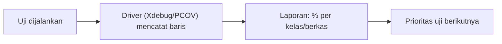

# Test Coverage

*Test coverage* (cakupan uji) mengukur seberapa banyak kode aplikasi yang **dijalankan** oleh uji. Angka ini berguna untuk menemukan bagian yang tak teruji, tetapi menyesatkan bila dijadikan tujuan. Sub bab ini mengajarkan cara mengukur, membaca, dan memanfaatkan cakupan dengan bijak.

!!! warning "Membutuhkan pemasangan ekstensi"
    Pengukuran cakupan memerlukan driver cakupan (**Xdebug** atau **PCOV**) yang terpasang di PHP-mu. Ini perangkat pengembangan di luar proyek. Penulis tidak menjalankannya di lingkungan ini.

## Tujuan Pembelajaran

- [ ] Menjelaskan jenis cakupan (baris, cabang, jalur).
- [ ] Menjalankan `php artisan test --coverage` dan membaca keluarannya.
- [ ] Menetapkan ambang minimum dengan `--min`.
- [ ] Menghasilkan laporan HTML dan menafsirkannya.
- [ ] Menjelaskan mengapa cakupan 100% tidak menjamin kualitas.
- [ ] Menggunakan cakupan untuk memprioritaskan uji berikutnya.

## Prasyarat

- [Feature Testing](08-05-feature-testing.md) dan [API Testing](08-10-api-testing.md).
- Xdebug (mode `coverage`) atau PCOV terpasang.

## Pengantar

Tim bangga: "cakupan 95%!" Tetapi uji yang hanya memanggil fungsi tanpa asersi bermakna menaikkan angka tanpa menangkap bug. Sebaliknya, 70% cakupan yang menguji logika penting bisa lebih berharga.

## Penjelasan Konsep

### Jenis cakupan

| Jenis | Arti |
|---|---|
| Baris (*line*) | Persentase baris yang dieksekusi |
| Cabang (*branch*) | Setiap kondisi `if/else` dijalani kedua arah |
| Jalur (*path*) | Kombinasi cabang (jarang dipakai penuh) |

Driver dan alat menentukan jenis yang tersedia; PCOV umumnya baris, Xdebug dapat melaporkan cabang dan jalur.

### Menjalankan

Menurut dokumentasi Laravel, cakupan diukur dengan:

```bash
php artisan test --coverage
php artisan test --coverage --min=80
```

`--min` membuat perintah gagal bila cakupan di bawah ambang (berguna di CI). Xdebug memerlukan mode coverage aktif, mis. `XDEBUG_MODE=coverage php artisan test --coverage`.

Untuk laporan HTML dengan PHPUnit:

```bash
XDEBUG_MODE=coverage vendor/bin/phpunit --coverage-html storage/coverage
```

Buka `storage/coverage/index.html` di browser; baris hijau teruji, merah belum. (Jangan commit direktori laporan; tambahkan ke `.gitignore`.)

### Membaca hasil

```text
App\Services\ArticlePublisher ........ 85.7%
App\Http\Controllers\ReportController . 0.0%
```

(Contoh ilustrasi bentuk keluaran, bukan hasil nyata.)

Pertanyaan yang tepat: *mengapa bagian ini tak teruji, dan apakah bagian itu berisiko?* Controller laporan 0% yang mengunduh data sensitif jauh lebih mendesak daripada getter sepele.

### Cakupan bukan tujuan

| Mitos | Realitas |
|---|---|
| 100% = tanpa bug | Kode dijalankan ≠ kode diperiksa |
| Semakin tinggi semakin baik | Mengejar angka mendorong uji dangkal |
| Cakupan rendah = uji buruk | Bisa jadi bagian yang tak penting |

Gunakan cakupan sebagai **peta bagian gelap**, bukan skor.

### Prioritas

1. Kode keamanan (otorisasi, validasi, autentikasi).
2. Logika bisnis inti (penerbitan, pembayaran).
3. Kode yang sering berubah.
4. Sisanya.

### Mutation testing (konsep)

Alat *mutation testing* (mis. Infection) mengubah kode secara otomatis dan melihat apakah uji gagal. Ia menilai kekuatan asersi, bukan sekadar eksekusi. Menambah dependensi dev; di luar cakupan sub bab ini.

### Keamanan

Laporan cakupan HTML memuat kode sumber; jangan mempublikasikannya ke luar. Jangan memasang Xdebug di produksi karena memperlambat dan membuka permukaan serangan.

## Cara Kerja



## Contoh Praktik

Kamu mengukur cakupan proyek, mencari kelas berisiko dengan cakupan rendah, dan menambah satu uji untuknya.

## Penjelasan Kode

Tidak ada kode aplikasi baru. Perubahan `.gitignore`:

```text
/storage/coverage
```

## Implementasi Langkah demi Langkah

### Langkah 1: periksa driver

```bash
php -m | grep -i -E "xdebug|pcov"
```

Bila kosong, pasang salah satunya mengikuti dokumentasi resmi (di luar materi ini).

### Langkah 2: ukur

```bash
php artisan test --coverage
```

### Langkah 3: laporan HTML

```bash
XDEBUG_MODE=coverage vendor/bin/phpunit --coverage-html storage/coverage
```

### Langkah 4: pilih satu bagian berisiko

Cari kelas keamanan atau bisnis dengan cakupan rendah dan tulis satu uji bermakna.

### Langkah 5: ukur ulang

Bandingkan sebelum dan sesudah.

### Langkah 6: catat di Git

```bash
git add tests .gitignore
git commit -m "Tambah uji untuk bagian cakupan rendah"
```

## Eksekusi dan Verifikasi

| Langkah | Hasil yang diharapkan |
|---|---|
| 2 | Tabel persentase per kelas |
| 5 | Cakupan kelas terpilih naik |

## Hasil yang Diharapkan

Angka bergantung proyekmu; tidak ada angka "benar" universal. Penulis belum menjalankan perintah ini.

## Kesalahan Umum dan Pemecahan Masalah

| Gejala | Penyebab | Cara mengenali | Solusi | Pencegahan |
|---|---|---|---|---|
| `No code coverage driver is available` | Xdebug/PCOV tak ada | Pesan galat | Pasang driver | Periksa `php -m` |
| Xdebug mode salah | `XDEBUG_MODE` bukan coverage | Tidak ada data | Set `XDEBUG_MODE=coverage` | Dokumentasikan |
| Uji sangat lambat | Xdebug aktif terus | Suite lambat | Aktifkan hanya untuk cakupan | Terpisah dari uji harian |
| Cakupan tinggi tapi bug lolos | Asersi lemah | Bug di kode "teruji" | Perkuat asersi | Tinjau uji |
| Laporan ter-commit | Lupa `.gitignore` | Berkas besar di Git | Hapus dan abaikan | `.gitignore` |

## Latihan Praktik

### Latihan dasar

**D1. Baca laporan**
- *Masalah:* menafsirkan hasil.
- *Persyaratan:* dari laporan nyata, sebut tiga kelas cakupan terendah dan nilai risikonya.
- *Perilaku yang diharapkan:* analisis beralasan.
- *Tujuan belajar:* membaca peta cakupan.

### Latihan implementasi

**I1. Ambang di CI**
- *Masalah:* ingin mencegah cakupan turun.
- *Persyaratan:* tentukan nilai `--min` realistis dan jelaskan cara menaikkannya bertahap.
- *Perilaku yang diharapkan:* strategi jelas.
- *Tujuan belajar:* ambang bertahap.

### Latihan tantangan

**T1. Uji yang sia-sia**
- *Masalah:* uji menaikkan cakupan tanpa asersi.
- *Persyaratan:* buat contoh uji seperti itu, jelaskan masalahnya, dan perbaiki.
- *Perilaku yang diharapkan:* contoh dan perbaikan.
- *Tujuan belajar:* kualitas asersi.
- *Catatan:* kerjakan mandiri; tidak ada kunci jawaban.

## Uji Pemahaman

1. Apa yang diukur cakupan?
2. Mengapa 100% tidak menjamin bebas bug?
3. Apa fungsi `--min`?
4. Bagian mana yang diprioritaskan?

??? success "Kunci jawaban singkat"
    1. Bagian kode yang dijalankan oleh uji.
    2. Eksekusi tidak sama dengan verifikasi.
    3. Gagal bila cakupan di bawah ambang.
    4. Keamanan dan logika bisnis inti.

## Ringkasan

- Cakupan adalah peta bagian yang belum teruji, bukan skor.
- Ukur dengan `--coverage` (butuh Xdebug/PCOV), tetapkan ambang bertahap.
- Prioritaskan kode berisiko dan jaga kualitas asersi.

Selanjutnya: *Debugging dan Diagnosis Error*.

## Referensi Resmi

- [Laravel: Testing, Test Coverage](https://laravel.com/docs/13.x/testing#running-tests-via-artisan)
- [PHPUnit: Code Coverage](https://docs.phpunit.de/en/latest/code-coverage.html)
