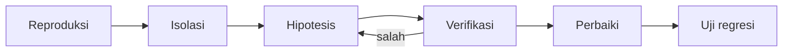

# Debugging dan Diagnosis Error

Uji gagal, halaman 500, atau data salah tanpa pesan jelas: debugging adalah keterampilan sistematis, bukan menebak. Sub bab ini mengajarkan alur diagnosis, membaca jejak galat, alat bawaan Laravel (`dump`, `dd`, `ray` konsep, log, Tinker, `withoutExceptionHandling`), dan cara mereproduksi bug dengan uji.

## Tujuan Pembelajaran

- [ ] Menerapkan alur diagnosis: reproduksi → isolasi → hipotesis → verifikasi → perbaiki → cegah.
- [ ] Membaca pesan galat dan *stack trace* Laravel.
- [ ] Memakai `dump`, `dd`, `Log`, dan Tinker untuk menyelidiki.
- [ ] Mereproduksi bug sebagai uji yang gagal (regresi).
- [ ] Mendiagnosis kegagalan uji (kesalahan uji vs kode).
- [ ] Menjelaskan risiko mode debug di produksi.

## Prasyarat

- Seluruh sub bab Level 08 sebelumnya, [Logging](../level-07/07-18-logging.md).

## Pengantar

Pengguna melapor: "Menerbitkan artikel menghasilkan halaman error." Kamu tidak boleh langsung mengubah kode. Langkah pertama adalah **mereproduksi** dan membaca pesan galat dengan teliti.

## Penjelasan Konsep

### Alur diagnosis

| Langkah | Pertanyaan |
|---|---|
| Reproduksi | Bisakah kulakukan lagi secara konsisten? Langkah persisnya? |
| Isolasi | Bagian mana yang terlibat? Kecilkan kasusnya |
| Hipotesis | Apa penyebab paling mungkin berdasarkan bukti? |
| Verifikasi | Bukti apa yang menguatkan/membantah? |
| Perbaiki | Ubah minimal |
| Cegah | Tulis uji agar tidak kembali |

### Membaca galat

Halaman galat Laravel (saat `APP_DEBUG=true` di lokal) menampilkan: kelas pengecualian, pesan, berkas dan baris, serta *stack trace*. Baca dari atas: pesan, lalu frame pertama **milik aplikasimu** (`app/...`), bukan frame `vendor/`.

| Galat umum | Petunjuk |
|---|---|
| `SQLSTATE[...]` | Kolom/tabel salah, constraint, migrasi belum jalan |
| `Call to a member function x() on null` | Variabel null (relasi tak ada, model tak ditemukan) |
| `Class "X" not found` | `use` salah, autoload, typo |
| `MassAssignmentException` | Atribut belum fillable |
| `419` | Token CSRF hilang/kedaluwarsa |
| `403` / `404` | Otorisasi / route / model tak ditemukan |

### Alat investigasi

```php-inline
dump($variabel);          // cetak lalu lanjut
dd($variabel);            // cetak lalu berhenti
logger()->debug('titik A', ['id' => $id]);   // ke log
```

Tinker untuk mencoba cepat:

```bash
php artisan tinker
>>> App\Models\Article::find(3)?->user
```

Log (`storage/logs/laravel.log`) menyimpan jejak galat 500. Hapus semua `dump`/`dd` sebelum commit.

### Dalam uji

```php-inline
$this->withoutExceptionHandling();   // melihat pengecualian asli, bukan halaman 500
$response->dump();                    // isi respons
$response->dumpSession();
```

Jika uji gagal, pertanyaan pertama: *apakah uji salah atau kode salah?* Periksa asumsi data uji (factory), bukan hanya asersinya.

### Reproduksi sebagai uji

Bug "menerbitkan artikel tanpa kategori memicu 500":

```php-inline
public function test_can_publish_article_without_category(): void
{
    $penulis = User::factory()->create();

    $this->withoutExceptionHandling();

    $this->actingAs($penulis)
        ->post(route('admin.articles.store'), ['title' => 'Tanpa kategori', 'body' => 'x'])
        ->assertRedirect();
}
```

Uji gagal (merah) menunjukkan pengecualian; setelah perbaikan menjadi hijau dan tinggal sebagai penjaga regresi.

### Pembagian "debug" lingkungan

| Lingkungan | `APP_DEBUG` |
|---|---|
| Lokal | `true` |
| Produksi | **`false`** |

Dengan `APP_DEBUG=true` di produksi, halaman galat menampilkan jalur berkas, kueri, dan nilai `.env`, membocorkan rahasia. Ini kesalahan konfigurasi serius.

### Debugger interaktif (konsep)

Xdebug memungkinkan *breakpoint* dan inspeksi variabel langkah demi langkah di IDE. Berguna untuk alur kompleks; pengaturannya bergantung IDE (di luar cakupan).

### Keamanan

- Jangan men-*debug* di produksi dengan `dd()`.
- Jangan menempelkan log berisi rahasia ke forum atau alat AI publik; saring dulu.
- Hapus kode debug sebelum commit.

## Cara Kerja



## Contoh Praktik

Kamu sengaja membuat bug (relasi null), mendiagnosisnya dengan alur di atas, menulis uji regresi yang gagal, memperbaiki, dan memastikan uji hijau.

## Penjelasan Kode

Bug buatan: di view artikel, `{{ $article->category->name }}` gagal bila `category` null. Perbaikan: `{{ $article->category?->name ?? 'Tanpa kategori' }}`.

## Implementasi Langkah demi Langkah

### Langkah 1: buat bug

Pada view detail, ganti ekspresi menjadi `{{ $article->category->name }}` dan buat artikel tanpa kategori.

### Langkah 2: reproduksi

Buka halaman artikel itu: lihat galat `Attempt to read property "name" on null`.

### Langkah 3: baca jejak

Temukan frame pertama di `resources/views/...` dan baris tepatnya.

### Langkah 4: tulis uji regresi

```php-inline
public function test_article_without_category_renders(): void
{
    $artikel = Article::factory()->published()->create(['category_id' => null]);

    $this->get(route('articles.show', $artikel))->assertOk();
}
```

Jalankan: gagal (merah).

### Langkah 5: perbaiki

Gunakan operator null-safe dan nilai bawaan. Jalankan uji: lulus.

### Langkah 6: bersihkan dan catat

Pastikan tak ada `dump`/`dd` tersisa:

```bash
grep -rn "dd(\|dump(" app resources routes | head
git add app resources tests
git commit -m "Perbaiki halaman artikel tanpa kategori dan tambah uji regresi"
```

## Eksekusi dan Verifikasi

| Langkah | Hasil yang diharapkan |
|---|---|
| 2 | Galat property on null |
| 4 | Uji merah |
| 5 | Uji hijau |

## Hasil yang Diharapkan

Pesan galat persis bergantung versi PHP dan proyek. Penulis belum menjalankan skenario ini.

## Kesalahan Umum dan Pemecahan Masalah

| Gejala | Penyebab | Cara mengenali | Solusi | Pencegahan |
|---|---|---|---|---|
| Mengubah banyak hal sekaligus | Tak ada hipotesis | Tak tahu mana yang memperbaiki | Satu perubahan per percobaan | Disiplin alur |
| `dd()` tertinggal | Lupa membersihkan | Halaman putih di produksi | Cari dan hapus | Review & lint |
| Menyalahkan framework | Tak membaca trace | Waktu terbuang | Cari frame `app/` pertama | Baca dari atas |
| Uji lulus lokal, gagal di CI | Perbedaan lingkungan | Hasil beda | Samakan versi & konfigurasi | Dokumentasi env |
| Debug aktif di produksi | `APP_DEBUG=true` | Halaman galat terperinci | Set `false` | Checklist deploy |
| Log berisi rahasia dibagikan | Menyalin utuh | Kebocoran | Saring sebelum berbagi | Kebiasaan |

## Latihan Praktik

### Latihan dasar

**D1. Baca trace**
- *Masalah:* membaca jejak.
- *Persyaratan:* dari galat `Class "App\Services\Foo" not found`, jelaskan tiga penyebab mungkin dan cara memeriksanya.
- *Perilaku yang diharapkan:* namespace, nama berkas, autoload.
- *Tujuan belajar:* hipotesis.

### Latihan implementasi

**I1. Bug N+1**
- *Masalah:* halaman daftar lambat.
- *Persyaratan:* aktifkan log query (`DB::listen` atau `Model::preventLazyLoading()`), temukan N+1, perbaiki dengan `with`, dan tulis uji jumlah query sederhana (`DB::getQueryLog`).
- *Perilaku yang diharapkan:* jumlah query berkurang.
- *Tujuan belajar:* diagnosis performa.

**I2. Galat 419**
- *Masalah:* formulir gagal dengan 419.
- *Persyaratan:* daftar penyebab (lupa `@csrf`, sesi kedaluwarsa, domain berbeda) dan cara memeriksanya.
- *Perilaku yang diharapkan:* daftar benar.
- *Tujuan belajar:* diagnosis terarah.

### Latihan tantangan

**T1. Postmortem**
- *Masalah:* bug produksi yang menyebabkan email ganda.
- *Persyaratan:* tulis postmortem singkat (kronologi, akar masalah, perbaikan, pencegahan) tanpa menyalahkan individu.
- *Perilaku yang diharapkan:* dokumen jelas.
- *Tujuan belajar:* belajar dari insiden.
- *Catatan:* kerjakan mandiri; tidak ada kunci jawaban.

## Uji Pemahaman

1. Sebutkan langkah alur diagnosis.
2. Frame mana di trace yang dibaca pertama?
3. Mengapa menulis uji regresi setelah bug?
4. Mengapa `APP_DEBUG` harus `false` di produksi?

??? success "Kunci jawaban singkat"
    1. Reproduksi, isolasi, hipotesis, verifikasi, perbaiki, cegah.
    2. Frame pertama yang berasal dari kode aplikasi (`app/`).
    3. Agar bug tidak kembali tanpa terdeteksi.
    4. Halaman galat membocorkan jalur, kueri, dan konfigurasi.

## Ringkasan

- Debugging adalah proses sistematis, bukan tebakan.
- Baca galat dari frame aplikasi, gunakan `dump`, log, Tinker, dan `withoutExceptionHandling`.
- Reproduksi bug sebagai uji dan jangan aktifkan debug di produksi.

Selanjutnya: proyek penutup, *Pengujian Otomatis untuk Manajemen Artikel*.

## Referensi Resmi

- [Laravel: Error Handling](https://laravel.com/docs/13.x/errors)
- [Laravel: Logging](https://laravel.com/docs/13.x/logging)
- [Laravel: Artisan Tinker](https://laravel.com/docs/13.x/artisan#tinker)
