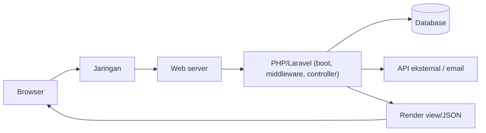
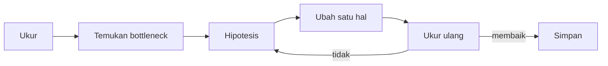

# Dasar-dasar Performa

"Aplikasinya lambat" bukan diagnosis. Sebelum mengoptimalkan, kamu perlu **mengukur**: apa yang lambat, seberapa lambat, bagi siapa, dan apa penyebabnya. Sub bab ini memberi kosakata dan metode: latensi, throughput, persentil, *bottleneck*, dan aturan emas "ukur dulu, optimalkan kemudian".

## Tujuan Pembelajaran

- [ ] Membedakan latensi, throughput, dan konkurensi.
- [ ] Menjelaskan mengapa persentil (p95, p99) lebih informatif dari rata-rata.
- [ ] Mengidentifikasi lapisan penyebab lambat: jaringan, aplikasi, database, I/O eksternal, klien.
- [ ] Menerapkan siklus ukur → hipotesis → ubah satu hal → ukur ulang.
- [ ] Menyusun anggaran performa sederhana.
- [ ] Mengenali optimasi prematur.

## Prasyarat

- Bab utama Level 01–08.
- Proyek `cms-artikel` dengan data uji yang cukup banyak (akan dibuat di langkah praktik).

## Pengantar

Tim menambah cache di mana-mana setelah ada keluhan "halaman lambat". Ternyata 90% waktu habis di satu query tanpa indeks, dan cache baru hanya menambah kompleksitas. Mengukur lebih dulu mencegah kerja sia-sia.

## Penjelasan Konsep

### Istilah

| Istilah | Arti | Contoh |
|---|---|---|
| Latensi | Waktu satu permintaan selesai | 180 ms |
| Throughput | Permintaan selesai per detik | 120 req/s |
| Konkurensi | Permintaan yang diproses bersamaan | 20 |
| Bottleneck | Bagian paling lambat yang membatasi sisanya | Query tanpa indeks |

### Rata-rata menyesatkan

Jika 95 permintaan 100 ms dan 5 permintaan 5.000 ms, rata-rata ≈ 345 ms, tidak menggambarkan keduanya. Gunakan **persentil**: p50 (median), p95, p99. Pengguna merasakan ekor yang lambat.

### Ke mana waktu pergi?



Setiap kotak adalah tersangka. Alat yang berbeda mengukur kotak yang berbeda.

### Siklus optimasi

1. **Ukur** kondisi awal (dengan data realistis).
2. **Temukan** bottleneck terbesar (hukum Amdahl: memperbaiki bagian kecil tidak banyak membantu).
3. **Hipotesis** satu perubahan.
4. **Ubah satu hal**.
5. **Ukur ulang**, bandingkan, putuskan simpan atau buang.

### Anggaran performa

Tentukan target terukur, contoh: "halaman beranda p95 < 300 ms pada 50 permintaan bersamaan; maksimal 10 query per halaman." Target membuat diskusi konkret.

### Optimasi prematur

"Optimasi prematur adalah akar segala kejahatan" (Knuth). Kode yang terbaca dan benar lebih dulu; optimalkan hanya bagian yang terbukti lambat dan penting. Kompleksitas yang ditambahkan (cache, antrean) memiliki biaya perawatan dan risiko bug (data basi).

### Data realistis

Aplikasi dengan 10 baris data terasa cepat. Masalah muncul di 100.000 baris. Isi data uji besar dengan factory (di lingkungan lokal, bukan produksi).

```php
// database/seeders/PerfSeeder.php (lokal saja)
\App\Models\User::factory()->count(50)->create()->each(function ($u) {
    \App\Models\Article::factory()->for($u)->count(200)->published()->create();
});
```

### Pengukuran dasar tanpa alat tambahan

```bash
# Waktu respons satu permintaan
curl -o /dev/null -s -w "total: %{time_total}s\n" http://127.0.0.1:8000/artikel
```

Alat beban seperti `ab`, `wrk`, `k6`, atau `hey` mengukur banyak permintaan, tetapi merupakan alat luar yang harus dipasang terpisah. Hasil di mesin lokal (server pengembangan `artisan serve`) **tidak** mewakili produksi.

### Keamanan

- Jangan menjalankan uji beban terhadap sistem yang bukan milikmu atau tanpa izin (bisa dianggap serangan DoS).
- Jangan memakai data produksi sungguhan untuk pengujian performa lokal.
- Jangan menonaktifkan kontrol keamanan demi kecepatan.

## Cara Kerja



## Contoh Praktik

Kamu mengisi data besar, mengukur waktu beranda dan halaman daftar dengan `curl`, mencatat baseline, dan menetapkan anggaran awal.

## Penjelasan Kode

Seeder performa hanya untuk lokal. Total: 50 penulis × 200 artikel = 10.000 artikel.

## Implementasi Langkah demi Langkah

### Langkah 1: buat seeder

Simpan `database/seeders/PerfSeeder.php` seperti di atas.

### Langkah 2: isi data (lokal)

```bash
php artisan migrate:fresh
php artisan db:seed --class=PerfSeeder
```

### Langkah 3: ukur baseline

```bash
for i in 1 2 3 4 5; do curl -o /dev/null -s -w "%{time_total}\n" http://127.0.0.1:8000/artikel; done
```

Catat lima angka dan perkirakan median.

### Langkah 4: catat baseline

Buat `docs-performa.md` (atau catatan) berisi tanggal, data, perintah, hasil, dan lingkungan (PHP versi, mesin).

### Langkah 5: tetapkan anggaran

Tulis target, mis. "daftar artikel < 200 ms median lokal, ≤ 8 query".

### Langkah 6: catat di Git

```bash
git add database docs-performa.md
git commit -m "Tambah seeder performa dan catatan baseline"
```

## Eksekusi dan Verifikasi

| Langkah | Hasil yang diharapkan |
|---|---|
| 2 | 10.000 artikel terbuat |
| 3 | Lima waktu terukur (nilai bergantung mesinmu) |

## Hasil yang Diharapkan

Angka tidak bisa diprediksi: bergantung perangkat keras, versi PHP, driver, dan data. Penulis tidak mengukur apa pun di lingkungan ini; jangan mencocokkan dengan angka orang lain, bandingkan dengan baselinemu sendiri.

## Kesalahan Umum dan Pemecahan Masalah

| Gejala | Penyebab | Cara mengenali | Solusi | Pencegahan |
|---|---|---|---|---|
| Hasil ukur tidak konsisten | Satu pengukuran / cache dingin | Angka loncat | Ulangi, buang pemanasan pertama | Median dari banyak percobaan |
| Optimasi tak berdampak | Bottleneck salah | Waktu tetap | Profil dulu | Hukum Amdahl |
| "Lebih cepat" hanya di lokal | Data kecil | Produksi lambat | Data realistis | Seeder performa |
| Mengubah banyak hal sekaligus | Tak tahu penyebab | Tak tahu mana yang efektif | Satu perubahan | Disiplin siklus |
| Uji beban ke sistem orang lain | Tanpa izin | Pelanggaran | Hanya milikmu | Etika |

## Latihan Praktik

### Latihan dasar

**D1. Hitung persentil**
- *Masalah:* 20 waktu respons (ms): 10 kali 100, 8 kali 120, 2 kali 2000.
- *Persyaratan:* hitung median, rata-rata, dan p95 perkiraan.
- *Perilaku yang diharapkan:* median 100–120, rata-rata 288, p95 ≈ 2000.
- *Tujuan belajar:* rata-rata vs persentil.

### Latihan implementasi

**I1. Baseline halaman**
- *Masalah:* tiga halaman utama belum terukur.
- *Persyaratan:* ukur beranda, daftar, dan detail masing-masing lima kali, catat median.
- *Perilaku yang diharapkan:* tabel baseline.
- *Tujuan belajar:* pengukuran dasar.

### Latihan tantangan

**T1. Anggaran performa**
- *Masalah:* tim tidak punya target.
- *Persyaratan:* tulis anggaran untuk lima halaman (waktu, jumlah query, ukuran respons) dengan alasan.
- *Perilaku yang diharapkan:* target terukur dan realistis.
- *Tujuan belajar:* menetapkan target.
- *Catatan:* kerjakan mandiri; tidak ada kunci jawaban.

## Uji Pemahaman

1. Apa beda latensi dan throughput?
2. Mengapa persentil lebih baik dari rata-rata?
3. Apa langkah siklus optimasi?
4. Apa itu optimasi prematur?

??? success "Kunci jawaban singkat"
    1. Latensi waktu satu permintaan; throughput permintaan per detik.
    2. Rata-rata menyembunyikan ekor yang lambat.
    3. Ukur, temukan bottleneck, hipotesis, ubah satu hal, ukur ulang.
    4. Mengoptimalkan sebelum terbukti perlu.

## Ringkasan

- Ukur dulu, pakai persentil dan data realistis.
- Ubah satu hal per siklus dan bandingkan dengan baseline sendiri.
- Hindari optimasi prematur; jangan korbankan keamanan.

Selanjutnya: *Optimasi Performa Laravel*.

## Referensi Resmi

- [Laravel: Deployment, Optimization](https://laravel.com/docs/13.x/deployment#optimization)
- [Laravel: Eloquent, Eager Loading](https://laravel.com/docs/13.x/eloquent-relationships#eager-loading)
