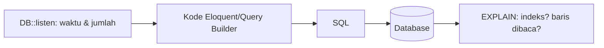

# Optimasi Query Database

Di aplikasi berbasis data, database sering menjadi bottleneck. Sub bab ini mengajarkan cara **melihat** query apa yang berjalan, menemukan yang lambat atau berlebihan, dan memperbaikinya: hanya ambil kolom yang perlu, batasi baris, hindari query di dalam perulangan, dan pindahkan pekerjaan ke database.

## Tujuan Pembelajaran

- [ ] Melihat query yang dijalankan (`DB::listen`, `toSql`, `toRawSql`, log query).
- [ ] Menghitung jumlah query per halaman.
- [ ] Memakai `select`, `limit`, `paginate`, dan `exists` dengan tepat.
- [ ] Memproses data besar dengan `chunk`, `chunkById`, `lazy`, atau `cursor`.
- [ ] Memindahkan agregasi ke database.
- [ ] Menggunakan `EXPLAIN` untuk membaca rencana eksekusi.

## Prasyarat

- [Dasar-dasar Performa](09-01-performance-fundamentals.md), Query Builder dan Eloquent (Level 04).

## Pengantar

Halaman daftar artikel menjalankan 211 query dan memuat seluruh isi artikel (teks panjang) hanya untuk menampilkan judul. Dengan sedikit perubahan menjadi 3 query dan data yang jauh lebih kecil.

## Penjelasan Konsep

### Melihat query

```php-inline
use Illuminate\Support\Facades\DB;

DB::listen(function ($query) {
    logger()->debug('SQL', [
        'sql' => $query->sql,
        'waktu_ms' => $query->time,
    ]);
});
```

Letakkan sementara di `AppServiceProvider::boot()` (hanya lokal). Menurut dokumentasi, `QueryExecuted` juga menyediakan `toRawSql()` untuk SQL dengan binding terisi; **jangan** mencatat binding di produksi bila memuat data pribadi.

Cara lain: `Article::query()->where(...)->toSql()`, `->dump()`, `->dd()` pada query builder (lokal).

### Hitung query per halaman

```php-inline
DB::enableQueryLog();
// ... proses
$jumlah = count(DB::getQueryLog());
```

Atau aktifkan `DB::listen` yang menambah penghitung. Targetkan jumlah query konstan, tidak tumbuh seiring jumlah baris.

### Ambil seperlunya

| Praktik | Mengapa |
|---|---|
| `select('id','title','slug')` | Kolom besar (teks) tidak ikut terambil |
| `paginate()` / `limit()` | Jangan ambil ribuan baris |
| `exists()` bukan `count() > 0` | Berhenti saat baris pertama ditemukan |
| `pluck('title','id')` | Hanya kolom yang dibutuhkan |
| Agregasi di SQL (`sum`, `count`, `groupBy`) | Jangan hitung di PHP dari koleksi besar |

```php-inline
// Buruk: memuat semua artikel lengkap hanya untuk menghitung
$jumlah = Article::all()->where('published_at', '!=', null)->count();

// Baik: satu query hitung
$jumlah = Article::published()->count();
```

### Data besar

| Metode | Kapan |
|---|---|
| `chunk(100, fn)` | Proses batch; hati-hati bila mengubah kolom yang dipakai untuk penyaringan |
| `chunkById(100, fn)` | Proses batch sambil memperbarui baris (aman) |
| `lazy()` | Aliran koleksi malas, memori rendah |
| `cursor()` | Satu query, satu model dalam memori; hati-hati dengan relasi |

```php-inline
Article::query()->published()->chunkById(500, function ($artikel) {
    foreach ($artikel as $a) {
        // proses
    }
});
```

`all()` pada tabel besar bisa menghabiskan memori.

### Query dalam perulangan

```php-inline
// Buruk: N query
foreach ($ids as $id) {
    $judul[] = Article::find($id)->title;
}

// Baik: 1 query
$judul = Article::whereIn('id', $ids)->pluck('title');
```

### `EXPLAIN`

`EXPLAIN` menunjukkan bagaimana database menjalankan query (indeks yang dipakai, perkiraan baris dibaca). Contoh (MySQL):

```sql
EXPLAIN SELECT id, title FROM articles WHERE published_at IS NOT NULL ORDER BY published_at DESC LIMIT 15;
```

Perhatikan `type=ALL` (pindai tabel penuh) dan `key=NULL` (tidak memakai indeks). Format keluaran berbeda antar SQLite/MySQL/PostgreSQL. Indeks dibahas di sub bab berikutnya. Jalankan `EXPLAIN` lewat klien database (atau `DB::select('EXPLAIN ...')` di Tinker); SQL-nya dapat diambil dari `toSql()`.

### Keamanan

- Optimasi tidak boleh melonggarkan keamanan: tetap pakai binding (jangan menyusun SQL dari input demi "kecepatan").
- `whereRaw` dengan input pengguna tanpa binding membuka injeksi SQL.
- Log query dapat memuat data pribadi; matikan di produksi.

## Cara Kerja



## Contoh Praktik

Kamu mengaktifkan penghitung query pada halaman daftar, memperbaiki pengambilan kolom, dan membandingkan jumlah serta waktu.

## Penjelasan Kode

Perbaikan controller daftar:

```php-inline
$articles = Article::query()
    ->published()
    ->select(['id', 'title', 'slug', 'excerpt', 'user_id', 'published_at'])
    ->with('user:id,name')
    ->latest('published_at')
    ->paginate(15);
```

`select` membatasi kolom, `with` memuat penulis dengan satu query tambahan, dan `paginate` membatasi baris. Jangan lupa menyertakan kolom kunci asing (`user_id`) yang dibutuhkan relasi.

## Implementasi Langkah demi Langkah

### Langkah 1: pasang pendengar sementara

Tambahkan `DB::listen` dengan penghitung ke `AppServiceProvider::boot()` (kondisi `app()->isLocal()`).

### Langkah 2: ukur halaman daftar

Muat `/artikel`, hitung query dan total waktu dari log. Catat.

### Langkah 3: terapkan perbaikan

Ubah query seperti di atas.

### Langkah 4: ukur ulang

Bandingkan jumlah query, ukuran HTML, dan waktu.

### Langkah 5: periksa `EXPLAIN`

Jalankan `EXPLAIN` untuk query utama di klien database dan catat apakah indeks dipakai.

### Langkah 6: hapus pendengar dan commit

```bash
git add app
git commit -m "Optimalkan query daftar artikel"
```

## Eksekusi dan Verifikasi

| Langkah | Hasil yang diharapkan |
|---|---|
| 2 | Jumlah query dan waktu terdata |
| 4 | Jumlah query dan ukuran respons turun |

## Hasil yang Diharapkan

Penurunan tepatnya tergantung data dan skemamu; penulis belum mengukur. Pastikan perilaku halaman tetap sama (uji fitur dari Level 08 harus tetap hijau).

## Kesalahan Umum dan Pemecahan Masalah

| Gejala | Penyebab | Cara mengenali | Solusi | Pencegahan |
|---|---|---|---|---|
| Relasi `null` setelah `select` | Kolom kunci tak ikut dipilih | `user` null | Sertakan `user_id` | Cek kunci relasi |
| Memori habis | `all()` / `get()` besar | `Allowed memory size` | `chunkById`/`lazy` | Batasi baris |
| `chunk` melewatkan baris | Mengubah kolom filter saat iterasi | Data terlewat | `chunkById` | Pilih metode benar |
| Query log di produksi | Lupa menghapus | Log penuh/data pribadi | Hapus; kondisi lokal | Review sebelum merge |
| Optimasi merusak perilaku | Tidak ada uji | Bug baru | Jalankan suite uji | Uji regresi |
| `whereRaw` dengan input | Injeksi | Hasil aneh | Binding `?` | Hindari raw dengan input |

## Latihan Praktik

### Latihan dasar

**D1. Perbaiki perulangan**
- *Masalah:* kode memanggil `Category::find($id)` dalam loop 50 kali.
- *Persyaratan:* tulis ulang dengan satu query.
- *Perilaku yang diharapkan:* `whereIn` atau `keyBy`.
- *Tujuan belajar:* menghindari N query.

### Latihan implementasi

**I1. Hitung di database**
- *Masalah:* dasbor menghitung artikel per kategori di PHP.
- *Persyaratan:* pindahkan ke `groupBy` + `count` dan bandingkan waktu.
- *Perilaku yang diharapkan:* satu query, hasil sama.
- *Tujuan belajar:* agregasi di SQL.

**I2. Ekspor besar**
- *Masalah:* ekspor 100.000 artikel menghabiskan memori.
- *Persyaratan:* gunakan `lazy()` atau `chunkById` untuk menulis CSV bertahap.
- *Perilaku yang diharapkan:* memori stabil.
- *Tujuan belajar:* pemrosesan data besar.

### Latihan tantangan

**T1. Anggaran query**
- *Masalah:* ingin mencegah regresi jumlah query.
- *Persyaratan:* rancang uji otomatis yang gagal bila halaman daftar menjalankan > N query (mis. dengan `DB::listen` di uji) dan jelaskan keterbatasannya.
- *Perilaku yang diharapkan:* rancangan masuk akal.
- *Tujuan belajar:* menjaga performa lewat uji.
- *Catatan:* kerjakan mandiri; tidak ada kunci jawaban.

## Uji Pemahaman

1. Bagaimana melihat query yang berjalan?
2. Mengapa `exists()` lebih baik dari `count() > 0`?
3. Kapan memakai `chunkById`?
4. Apa yang ditunjukkan `EXPLAIN`?

??? success "Kunci jawaban singkat"
    1. `DB::listen`, `toSql`, log query.
    2. Berhenti pada baris pertama.
    3. Memproses batch sambil memperbarui baris.
    4. Rencana eksekusi: indeks dan perkiraan baris dibaca.

## Ringkasan

- Ukur query (jumlah dan waktu) sebelum mengubah.
- Ambil kolom dan baris seperlunya; hindari query di perulangan; agregasi di SQL.
- Pakai `chunkById`/`lazy` untuk data besar dan `EXPLAIN` untuk memahami rencana.

Selanjutnya: *Database Indexing*.

## Referensi Resmi

- [Laravel: Database, Listening for Query Events](https://laravel.com/docs/13.x/database#listening-for-query-events)
- [Laravel: Query Builder, Chunking Results](https://laravel.com/docs/13.x/queries#chunking-results)
