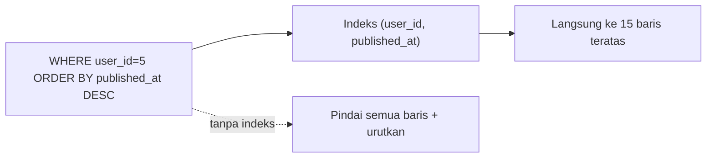

# Database Indexing

Indeks database mirip indeks di belakang buku: daripada membaca semua halaman untuk menemukan sebuah kata, kamu melompat langsung ke halamannya. Indeks yang tepat dapat mengubah query dari detik menjadi milidetik; indeks yang salah memperlambat penulisan dan memboroskan penyimpanan.

## Tujuan Pembelajaran

- [ ] Menjelaskan apa itu indeks dan biayanya.
- [ ] Menentukan kolom yang layak diindeks (`WHERE`, `JOIN`, `ORDER BY`, foreign key).
- [ ] Membuat indeks tunggal, unik, dan komposit lewat migrasi.
- [ ] Menjelaskan urutan kolom pada indeks komposit (aturan *leftmost prefix*).
- [ ] Membaca `EXPLAIN` untuk memverifikasi pemakaian indeks.
- [ ] Mengenali kapan indeks tidak membantu (`LIKE '%x'`, fungsi pada kolom).

## Prasyarat

- [Optimasi Query Database](09-03-database-query-optimization.md), migrasi (Level 04).

## Pengantar

Halaman daftar mengurutkan artikel terbit berdasarkan `published_at` di tabel 1 juta baris. Tanpa indeks, database memindai dan mengurutkan semuanya setiap kali.

## Penjelasan Konsep

### Cara kerja dan biaya

Indeks umumnya struktur B-tree terurut. Manfaat: pencarian, pengurutan, dan join lebih cepat. Biaya:

| Biaya | Penjelasan |
|---|---|
| Penulisan lebih lambat | Setiap `INSERT/UPDATE/DELETE` memperbarui indeks |
| Ruang penyimpanan | Setiap indeks menyimpan salinan kolom |
| Kompleksitas | Terlalu banyak indeks sulit dirawat |

### Kolom yang layak diindeks

- Kolom pada `WHERE` yang sering dipakai dan selektif.
- Kolom `JOIN` / foreign key (Laravel `foreignId()->constrained()` membuat constraint; periksa apakah mesin database membuat indeks otomatis untuk FK, MySQL InnoDB melakukannya).
- Kolom `ORDER BY` bersama filter.
- Kolom pencarian unik (`slug`, `email`) dengan `unique`.

Kolom dengan sedikit nilai berbeda (boolean) jarang berguna sebagai indeks tunggal.

### Membuat indeks

Menurut dokumentasi migrasi, `$table->index('email')`, `$table->unique('email')`, dan indeks komposit dengan array kolom:

File: `database/migrations/2026_11_07_000000_add_indexes_to_articles_table.php`

```php
<?php

use Illuminate\Database\Migrations\Migration;
use Illuminate\Database\Schema\Blueprint;
use Illuminate\Support\Facades\Schema;

return new class extends Migration
{
    public function up(): void
    {
        Schema::table('articles', function (Blueprint $table) {
            $table->index(['published_at', 'id'], 'articles_published_at_id_index');
            $table->index(['user_id', 'published_at'], 'articles_user_published_index');
        });
    }

    public function down(): void
    {
        Schema::table('articles', function (Blueprint $table) {
            $table->dropIndex('articles_published_at_id_index');
            $table->dropIndex('articles_user_published_index');
        });
    }
};
```

Nama tanggal pada nama berkas dibuat otomatis oleh `php artisan make:migration add_indexes_to_articles_table`; gunakan perintah itu, jangan menyalin nama di atas. Beri nama indeks eksplisit agar `down()` mudah.

### Indeks komposit dan urutan kolom

Indeks `(user_id, published_at)` efektif untuk:

- `WHERE user_id = ?`
- `WHERE user_id = ? ORDER BY published_at`
- `WHERE user_id = ? AND published_at > ?`

Tetapi **tidak** efektif untuk `WHERE published_at > ?` saja (kolom pertama tidak dipakai). Aturannya *leftmost prefix*: indeks hanya berguna mulai dari kolom paling kiri. Letakkan kolom yang dipakai dengan kesetaraan (`=`) di kiri, rentang/urut di kanan.

### Memverifikasi dengan `EXPLAIN`

```sql
EXPLAIN SELECT id, title FROM articles WHERE user_id = 5 ORDER BY published_at DESC LIMIT 15;
```

Cari `key` yang menyebut indeks dan `rows` kecil. Sebelum indeks biasanya `type=ALL` dan `rows` besar. Format keluaran berbeda antar mesin database.

### Yang membuat indeks tak terpakai

| Pola | Masalah |
|---|---|
| `WHERE title LIKE '%laravel'` | Awalan wildcard; indeks biasa tak bisa dipakai (pakai FULLTEXT) |
| `WHERE DATE(published_at) = ?` | Fungsi pada kolom; ubah menjadi rentang `>= ... AND < ...` |
| `WHERE user_id = '5'` (tipe berbeda) | Konversi implisit dapat mengabaikan indeks |
| Kolom terlalu tidak selektif | Pemindai tabel lebih murah |

Untuk pencarian teks, `$table->fullText('body')` (didukung database tertentu) dan `whereFullText` dapat dipakai; periksa dukungan mesinmu.

### Migrasi di produksi

Menambah indeks pada tabel besar dapat mengunci tabel dan memakan waktu. Rencanakan jendela perawatan, gunakan opsi *online* DDL bila mesin mendukung, dan uji di salinan data.

### Keamanan

Indeks `unique` adalah kontrol integritas dan keamanan (mencegah duplikat email/slug meskipun ada balapan). Jangan menghapusnya demi kecepatan.

## Cara Kerja



## Contoh Praktik

Kamu mengukur query daftar penulis tanpa indeks, menambah indeks komposit, dan membandingkan `EXPLAIN` serta waktu.

## Penjelasan Kode

Migrasi menambah dua indeks yang melayani dua pola query nyata: daftar publik terurut tanggal, dan daftar per penulis terurut tanggal.

## Implementasi Langkah demi Langkah

### Langkah 1: siapkan data besar

Gunakan `PerfSeeder` (09.01), tambahkan hingga ratusan ribu baris bila mesin kuat.

### Langkah 2: catat `EXPLAIN` awal

Jalankan `EXPLAIN` pada query daftar publik dan per penulis. Catat `key` dan `rows`.

### Langkah 3: buat migrasi

```bash
php artisan make:migration add_indexes_to_articles_table
php artisan migrate
```

### Langkah 4: `EXPLAIN` ulang dan ukur waktu

Bandingkan `key`, `rows`, dan waktu respons.

### Langkah 5: uji pola yang tidak terbantu

Coba `LIKE '%kata'` dan lihat `EXPLAIN` tidak memakai indeks.

### Langkah 6: rollback aman

```bash
php artisan migrate:rollback --step=1
```

Pastikan `down()` bekerja, lalu `migrate` lagi.

### Langkah 7: catat di Git

```bash
git add database
git commit -m "Tambah indeks untuk daftar artikel"
```

## Eksekusi dan Verifikasi

| Langkah | Hasil yang diharapkan |
|---|---|
| 4 | `key` memakai indeks baru; `rows` jauh lebih kecil |
| 5 | `LIKE '%kata'` tetap memindai |
| 6 | Rollback menghapus indeks |

## Hasil yang Diharapkan

Bentuk `EXPLAIN` bergantung mesin dan versi. Penulis belum menjalankan; cocokkan dengan hasilmu.

## Kesalahan Umum dan Pemecahan Masalah

| Gejala | Penyebab | Cara mengenali | Solusi | Pencegahan |
|---|---|---|---|---|
| Indeks tak dipakai | Urutan kolom salah / fungsi pada kolom | `key=NULL` | Susun ulang; ubah query | `EXPLAIN` selalu |
| Penulisan melambat | Terlalu banyak indeks | `INSERT` lambat | Hapus indeks tak terpakai | Audit berkala |
| Migrasi mengunci tabel | Tabel besar | Aplikasi tersendat | Jendela perawatan / online DDL | Uji di salinan |
| Nama indeks bentrok | Nama otomatis panjang | Galat nama | Nama eksplisit | Konvensi |
| Indeks pada boolean | Tidak selektif | Tak berguna | Hapus; komposit | Pahami selektivitas |
| `unique` dihapus demi kecepatan | Salah prioritas | Duplikat muncul | Pertahankan | Integritas > kecepatan |

## Latihan Praktik

### Latihan dasar

**D1. Kolom mana?**
- *Masalah:* menentukan indeks.
- *Persyaratan:* untuk query `WHERE category_id = ? AND published_at IS NOT NULL ORDER BY published_at DESC`, usulkan indeks komposit dan urutannya.
- *Perilaku yang diharapkan:* `(category_id, published_at)`.
- *Tujuan belajar:* leftmost prefix.

### Latihan implementasi

**I1. Slug unik**
- *Masalah:* slug dicari di setiap detail.
- *Persyaratan:* pastikan `slug` punya indeks unik (periksa migrasi) dan buktikan dengan `EXPLAIN`.
- *Perilaku yang diharapkan:* pencarian memakai indeks.
- *Tujuan belajar:* indeks unik.

**I2. Audit indeks**
- *Masalah:* tabel punya banyak indeks.
- *Persyaratan:* daftar semua indeks `articles` (`SHOW INDEX`), tandai yang melayani query nyata, dan usulkan penghapusan yang tidak.
- *Perilaku yang diharapkan:* daftar beralasan.
- *Tujuan belajar:* biaya indeks.

### Latihan tantangan

**T1. Pencarian teks**
- *Masalah:* `LIKE '%kata%'` lambat.
- *Persyaratan:* bandingkan FULLTEXT, mesin pencari eksternal, dan `LIKE`, termasuk dependensi yang diperlukan.
- *Perilaku yang diharapkan:* perbandingan beralasan.
- *Tujuan belajar:* memilih solusi pencarian.
- *Catatan:* kerjakan mandiri; tidak ada kunci jawaban.

## Uji Pemahaman

1. Apa biaya indeks?
2. Apa aturan leftmost prefix?
3. Mengapa `LIKE '%x'` tidak memakai indeks biasa?
4. Bagaimana memverifikasi pemakaian indeks?

??? success "Kunci jawaban singkat"
    1. Penulisan lebih lambat dan ruang tambahan.
    2. Indeks komposit berguna mulai dari kolom paling kiri.
    3. Awalan wildcard membuat pencarian tidak terurut.
    4. Dengan `EXPLAIN`.

## Ringkasan

- Indeks mempercepat baca, memperlambat tulis; pilih berdasarkan query nyata.
- Urutan kolom komposit penting; hindari fungsi/wildcard di depan.
- Verifikasi dengan `EXPLAIN` dan rencanakan migrasi di tabel besar.

Selanjutnya: *Eloquent Optimization*.

## Referensi Resmi

- [Laravel: Migrations, Indexes](https://laravel.com/docs/13.x/migrations#indexes)
- [MySQL: Optimization and Indexes](https://dev.mysql.com/doc/refman/8.4/en/optimization-indexes.html)
