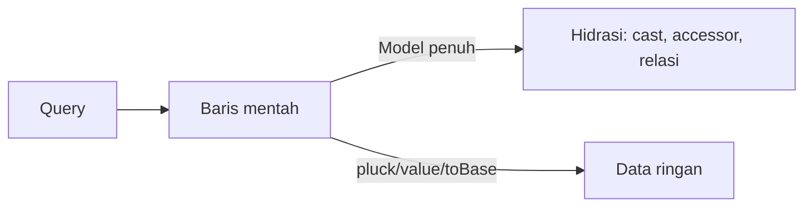

# Eloquent Optimization

Eloquent nyaman, tetapi kemudahan itu menyembunyikan biaya: hidrasi model, atribut ter-cast, akses relasi yang diam-diam menjalankan query. Sub bab ini mengajarkan cara memakai Eloquent secara efisien: memilih kolom, menghindari hidrasi tak perlu, memakai agregat relasi, dan memutuskan kapan query builder lebih tepat.

## Tujuan Pembelajaran

- [ ] Menjelaskan biaya hidrasi model.
- [ ] Memilih kolom dengan `select` dan memahami konsekuensinya.
- [ ] Memakai `withCount`, `withExists`, dan `withSum` alih-alih menghitung di PHP.
- [ ] Memakai `pluck`, `value`, `exists`, dan `toBase()` bila model penuh tak perlu.
- [ ] Mengoptimalkan *accessor* dan *cast* yang mahal.
- [ ] Memakai `upsert`, `insert`, dan `update` massal untuk operasi besar.

## Prasyarat

- [Optimasi Query Database](09-03-database-query-optimization.md), relasi Eloquent (Level 04).

## Pengantar

Halaman dashboard menampilkan 50 artikel beserta jumlah komentarnya. Memuat 50 artikel × semua komentar hanya untuk `count()` adalah pemborosan; satu `withCount` cukup.

## Penjelasan Konsep

### Biaya hidrasi

Setiap baris yang diambil menjadi objek model: atribut di-*cast*, *accessor* tersedia, event model terhubung. Untuk 10.000 baris, itu berarti 10.000 objek. Bila hanya butuh satu nilai, jangan hidrasi seluruh model.

### Ambil bentuk data minimal

| Kebutuhan | Pilihan hemat |
|---|---|
| Satu kolom daftar | `->pluck('title', 'id')` |
| Satu nilai | `->value('title')` |
| Cek keberadaan | `->exists()` |
| Banyak baris tanpa perilaku model | `->toBase()->get()` (objek `stdClass`) |
| Hanya beberapa kolom | `->select([...])` |

### Agregat relasi

```php
$artikel = Article::query()
    ->published()
    ->withCount('comments')
    ->withExists(['comments as has_comments'])
    ->latest('published_at')
    ->paginate(15);
```

Menghasilkan satu query dengan subquery untuk `comments_count`, tanpa memuat komentar. Tersedia pula `withSum`, `withAvg`, `withMin`, `withMax`.

### Memuat relasi dengan kolom terbatas

```php
Article::with(['user:id,name', 'category:id,name'])->get();
```

Sertakan kolom kunci (`id`) agar relasi dapat dicocokkan.

### Accessor dan cast yang mahal

Accessor yang menjalankan query atau perhitungan berat dipanggil setiap kali diakses. Hindari akses ke relasi di dalam accessor yang dipakai di daftar (memicu N+1). Cache hasil bila perlu (`Attribute::make(...)->shouldCache()` memoizes dalam satu instance).

### Operasi massal

```php
// Buruk: hidrasi + N UPDATE
Article::where('user_id', $id)->get()->each->update(['is_published' => false]);

// Baik: satu UPDATE
Article::where('user_id', $id)->update(['is_published' => false]);
```

Catatan: pembaruan massal **tidak** memicu event model (`updating`/`updated`) maupun observer. Bila event dibutuhkan (mis. invalidasi cache lewat observer), pertimbangkan kompromi atau jalankan invalidasi manual.

`insert([...])` dan `upsert([...], ['slug'], ['title'])` memasukkan banyak baris dalam satu query, juga tanpa event dan tanpa mengisi timestamp otomatis bila tidak disertakan.

### Pencegahan lazy loading

`Model::preventLazyLoading()` (Level 04/05) melempar pengecualian saat relasi diakses tanpa dimuat. Aktifkan di lingkungan non-produksi:

```php
// AppServiceProvider::boot()
\Illuminate\Database\Eloquent\Model::preventLazyLoading(! app()->isProduction());
```

Menurut dokumentasi, ini membantu menemukan N+1 saat pengembangan. Sub bab berikutnya mendalaminya.

### Kapan keluar dari Eloquent?

Untuk laporan agregat kompleks atau ekspor jutaan baris, query builder (`DB::table`) atau SQL mentah berparameter bisa lebih efisien. Tetap pakai binding dan tulis uji. Pilih Eloquent bila kejelasan dan fitur model lebih penting daripada beberapa milidetik.

### Keamanan

- Operasi massal yang melewati event/observer bisa melewati kontrol (audit log, validasi di model). Pastikan itu disadari.
- `upsert` dengan kolom yang bisa diatur pengguna perlu daftar kolom ketat (hindari mass assignment tak sengaja).
- Jangan mem-bypass Policy demi kecepatan.

## Cara Kerja



## Contoh Praktik

Kamu memperbaiki dashboard penulis: memakai `withCount`, memilih kolom, dan mengganti pembaruan perulangan dengan pembaruan massal.

## Penjelasan Kode

```php
$ringkasan = Article::query()
    ->where('user_id', $user->id)
    ->select(['id', 'title', 'slug', 'published_at'])
    ->withCount('comments')
    ->latest('id')
    ->limit(20)
    ->get();
```

`select` + `withCount` + `limit` memberi satu query kecil. `comments_count` tersedia sebagai atribut.

## Implementasi Langkah demi Langkah

### Langkah 1: aktifkan pencegahan lazy loading

Tambahkan `preventLazyLoading` di `AppServiceProvider::boot()` untuk non-produksi.

### Langkah 2: ukur dashboard

Muat dashboard dan catat jumlah query serta waktu.

### Langkah 3: perbaiki

Gunakan `withCount`, `select`, dan `with` berkolom terbatas.

### Langkah 4: ganti pembaruan perulangan

Cari `each->update` atau `foreach ... save()` pada banyak baris dan ganti dengan `update` massal bila event tak dibutuhkan.

### Langkah 5: jalankan uji

```bash
php artisan test
```

### Langkah 6: catat di Git

```bash
git add app
git commit -m "Optimalkan query Eloquent dashboard"
```

## Eksekusi dan Verifikasi

| Langkah | Hasil yang diharapkan |
|---|---|
| 1 | Akses relasi tanpa eager load melempar pengecualian di lokal |
| 3 | Jumlah query turun; `comments_count` tersedia |
| 5 | Uji tetap hijau |

## Hasil yang Diharapkan

Penurunan bergantung data; penulis belum mengukur.

## Kesalahan Umum dan Pemecahan Masalah

| Gejala | Penyebab | Cara mengenali | Solusi | Pencegahan |
|---|---|---|---|---|
| `LazyLoadingViolationException` | Relasi tak di-eager load | Pengecualian di lokal | `with(...)` | Aktifkan di lokal |
| Relasi kosong setelah `select` | Kunci hilang | Relasi `null` | Sertakan `id`/FK | Periksa kolom kunci |
| Observer tak terpicu | Pembaruan massal | Cache tak terhapus | Hapus manual / loop terbatas | Dokumentasikan |
| `comments_count` tak ada | `withCount` terlewat | Atribut null | Tambahkan | Uji tampilan |
| Memori tinggi | Hidrasi ribuan model | Lonjakan memori | `chunk`/`lazy`/`toBase` | Pantau |
| Timestamp kosong pada `insert` | Tidak otomatis | `created_at` null | Sertakan manual | Gunakan `create` bila perlu |

## Latihan Praktik

### Latihan dasar

**D1. Pilih metode**
- *Masalah:* memilih metode hemat.
- *Persyaratan:* pilih untuk (a) daftar judul untuk dropdown, (b) cek apakah slug ada, (c) satu nama penulis.
- *Perilaku yang diharapkan:* (a) `pluck`, (b) `exists`, (c) `value`.
- *Tujuan belajar:* data minimal.

### Latihan implementasi

**I1. Dashboard**
- *Masalah:* dashboard menampilkan jumlah komentar dan komentar terakhir.
- *Persyaratan:* gunakan `withCount` dan `withMax('comments','created_at')` dalam satu query.
- *Perilaku yang diharapkan:* satu query utama.
- *Tujuan belajar:* agregat relasi.

**I2. Pembaruan massal**
- *Masalah:* menonaktifkan semua draf lama.
- *Persyaratan:* satu `update` dengan kondisi; jelaskan efeknya pada observer.
- *Perilaku yang diharapkan:* satu query, tanpa event model.
- *Tujuan belajar:* kompromi operasi massal.

### Latihan tantangan

**T1. Eloquent vs query builder**
- *Masalah:* laporan bulanan 2 juta baris.
- *Persyaratan:* putuskan alat, jelaskan kompromi keterbacaan, uji, dan keamanan (binding).
- *Perilaku yang diharapkan:* keputusan beralasan.
- *Tujuan belajar:* memilih alat.
- *Catatan:* kerjakan mandiri; tidak ada kunci jawaban.

## Uji Pemahaman

1. Apa biaya hidrasi model?
2. Apa keuntungan `withCount`?
3. Apa risiko pembaruan massal?
4. Apa fungsi `preventLazyLoading`?

??? success "Kunci jawaban singkat"
    1. Objek, cast, dan accessor untuk tiap baris.
    2. Menghitung relasi di SQL tanpa memuat relasi.
    3. Event/observer model tidak berjalan.
    4. Memunculkan pengecualian pada lazy loading agar N+1 ketahuan.

## Ringkasan

- Ambil data minimal: `select`, `pluck`, `value`, `exists`, `toBase`.
- Pakai agregat relasi dan operasi massal dengan sadar akan event.
- Aktifkan `preventLazyLoading` di lingkungan non-produksi.

Selanjutnya: *Lazy Loading vs Eager Loading*.

## Referensi Resmi

- [Laravel: Eloquent Relationships, Aggregating Related Models](https://laravel.com/docs/13.x/eloquent-relationships#aggregating-related-models)
- [Laravel: Eloquent Relationships, Preventing Lazy Loading](https://laravel.com/docs/13.x/eloquent-relationships#preventing-lazy-loading)
