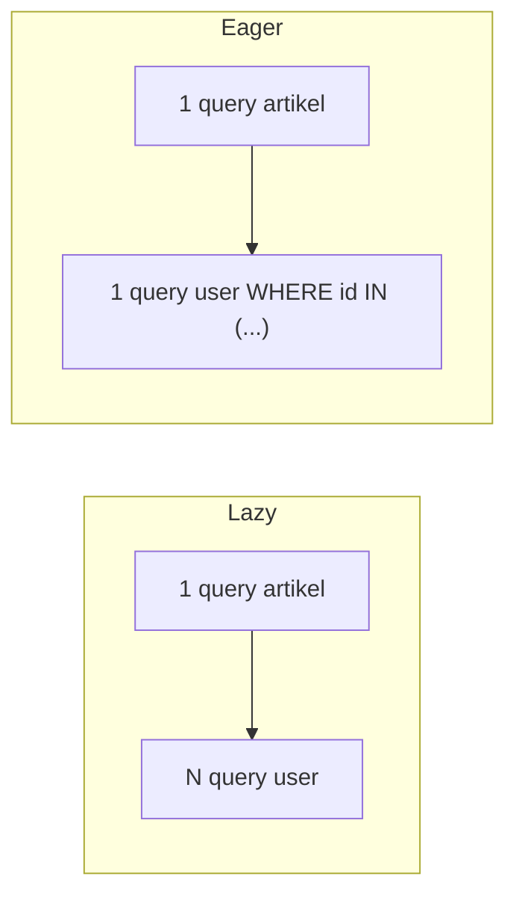

# Lazy Loading vs Eager Loading

Masalah performa Eloquent paling terkenal adalah **N+1**: satu query mengambil N baris, lalu N query tambahan mengambil relasi per baris. Sub bab ini menjelaskan mengapa itu terjadi, cara mendeteksi, dan cara memperbaikinya dengan *eager loading* (`with`, `load`, `loadMissing`, `withCount`).

## Tujuan Pembelajaran

- [ ] Menjelaskan lazy loading dan mengapa menimbulkan N+1.
- [ ] Mendeteksi N+1 lewat log query dan `preventLazyLoading`.
- [ ] Memperbaiki dengan `with`, nested `with`, `load`, dan `loadMissing`.
- [ ] Membatasi kolom dan menambah kondisi pada eager loading.
- [ ] Mengenali kapan eager loading berlebihan.
- [ ] Menulis uji yang mencegah regresi N+1.

## Prasyarat

- [Eloquent Optimization](09-05-eloquent-optimization.md), relasi Eloquent (Level 04).

## Pengantar

Halaman daftar menampilkan judul dan nama penulis untuk 15 artikel. Jika `user` tidak dimuat awal, Laravel menjalankan 1 query artikel + 15 query penulis = 16 query. Dengan 100 artikel per halaman: 101 query.

## Penjelasan Konsep

### Lazy loading

Relasi dimuat saat pertama kali diakses:

```php-inline
$artikel = Article::published()->take(15)->get();       // 1 query

foreach ($artikel as $a) {
    echo $a->user->name;                                 // +1 query setiap iterasi
}
```

Total 16 query. Ini nyaman untuk satu model, berbahaya dalam perulangan.

### Eager loading

```php-inline
$artikel = Article::published()->with('user')->take(15)->get();   // 2 query total
```

Query kedua: `SELECT * FROM users WHERE id IN (...)`. Jumlah query tetap, tidak tumbuh seiring baris.

Menurut dokumentasi, beberapa relasi dan relasi bersarang:

```php-inline
Article::with(['user:id,name', 'category:id,name', 'comments.user'])->get();
```

`comments.user` memuat komentar lalu pengguna tiap komentar. Pilih hanya relasi yang dipakai halaman.

### Kondisi dan kolom

```php-inline
Article::with(['comments' => function ($query) {
    $query->where('is_approved', true)->latest()->limit(5);
}])->get();
```

Awas: `limit` di dalam eager loading berlaku global, bukan per induk, pada banyak versi; untuk "N komentar terbaru per artikel" gunakan pendekatan khusus (mis. relasi `latestOfMany`, atau fitur limit eager load per-induk bila tersedia di versi Laravel yang dipakai; periksa dokumentasi relasi). Jangan mengandalkan asumsi.

### Memuat setelah fakta

```php-inline
$artikel->load('comments');          // muat relasi pada model/koleksi yang sudah ada
$artikel->loadMissing('user');       // hanya jika belum dimuat
$artikel->loadCount('comments');
```

Berguna di controller yang menerima model dari route binding.

### Mendeteksi

1. **Log query** (09.03): jumlah query tumbuh dengan jumlah baris.
2. **`preventLazyLoading`**: menurut dokumentasi,

```php-inline
Model::preventLazyLoading(! app()->isProduction());
```

Mengakses relasi yang belum dimuat melempar `LazyLoadingViolationException`. Di produksi biarkan nonaktif agar aplikasi tidak error (atau gunakan `handleLazyLoadingViolationUsing` untuk hanya mencatat log).

3. **Uji**: hitung query dalam uji.

```php-inline
public function test_index_runs_constant_number_of_queries(): void
{
    Article::factory()->count(20)->published()->create();

    DB::enableQueryLog();
    $this->get(route('articles.index'))->assertOk();
    $jumlah = count(DB::getQueryLog());

    $this->assertLessThanOrEqual(6, $jumlah);
}
```

Batas (6) contoh; tentukan dari baselinemu. Uji ini mencegah regresi.

### Eager loading berlebihan

Memuat relasi besar yang tak ditampilkan membuang memori dan waktu. Pertanyaan: *apakah tampilan memakai data ini?* Gunakan `withCount` bila hanya butuh jumlah.

### Keamanan

Eager loading tidak melewati otorisasi: pastikan kondisi (mis. hanya komentar yang disetujui) tetap diterapkan agar data tersembunyi tidak bocor lewat relasi.

## Cara Kerja



## Contoh Praktik

Kamu membuat N+1 sengaja di halaman daftar, mendeteksinya dengan `preventLazyLoading`, memperbaikinya, dan menulis uji jumlah query.

## Penjelasan Kode

Controller sebelum perbaikan memanggil `Article::published()->paginate(15)`; view menampilkan `$a->user->name` (N+1). Setelah: `->with('user:id,name')`.

## Implementasi Langkah demi Langkah

### Langkah 1: aktifkan pencegahan

Tambah `Model::preventLazyLoading(! app()->isProduction());` di `AppServiceProvider::boot()`.

### Langkah 2: picu galat

Hilangkan `with('user')` dari query daftar; muat halaman: muncul `LazyLoadingViolationException`.

### Langkah 3: hitung query

Matikan sementara pencegahan, hitung query dengan log (misal 16 untuk 15 artikel).

### Langkah 4: perbaiki

Tambah `with('user:id,name')`, hitung ulang (konstan).

### Langkah 5: tambah uji

Tulis uji jumlah query seperti di atas.

### Langkah 6: catat di Git

```bash
git add app tests
git commit -m "Perbaiki N+1 dan tambah uji jumlah query"
```

## Eksekusi dan Verifikasi

| Langkah | Hasil yang diharapkan |
|---|---|
| 2 | Pengecualian lazy loading |
| 3 | Jumlah query = 1 + jumlah baris (+ paginasi) |
| 4 | Jumlah query konstan |

## Hasil yang Diharapkan

Angka persisnya bergantung query halamanmu (paginasi menambah query hitung). Penulis belum menjalankan.

## Kesalahan Umum dan Pemecahan Masalah

| Gejala | Penyebab | Cara mengenali | Solusi | Pencegahan |
|---|---|---|---|---|
| N+1 di view | Akses relasi tanpa `with` | Query tumbuh | `with` | `preventLazyLoading` |
| Pengecualian di produksi | Pencegahan aktif di produksi | Error 500 | Hanya non-produksi | Kondisi `isProduction` |
| Relasi `null` | Kolom kunci tak dipilih | Data kosong | Sertakan FK | Periksa select |
| Memori besar | Eager load relasi besar | Lonjakan | Batasi kolom/baris | Muat seperlunya |
| N+1 di accessor | Accessor mengakses relasi | Query tersembunyi | Eager load / hitung di query | Review accessor |
| Limit eager tak sesuai harapan | Asumsi per-induk | Hasil aneh | Baca dokumentasi / pendekatan lain | Uji hasil |

## Latihan Praktik

### Latihan dasar

**D1. Hitung query**
- *Masalah:* 20 artikel, tampil nama penulis dan kategori tanpa eager loading.
- *Persyaratan:* hitung jumlah query dan setelah `with(['user','category'])`.
- *Perilaku yang diharapkan:* 41 dan 3.
- *Tujuan belajar:* memahami N+1.

### Latihan implementasi

**I1. Komentar terbaru**
- *Masalah:* beranda menampilkan jumlah komentar dan penulis tiap artikel.
- *Persyaratan:* muat dengan `withCount` dan `with`, buktikan jumlah query konstan.
- *Perilaku yang diharapkan:* konstan.
- *Tujuan belajar:* kombinasi.

**I2. Handler pelanggaran**
- *Masalah:* ingin mencatat pelanggaran di staging tanpa error.
- *Persyaratan:* gunakan `Model::handleLazyLoadingViolationUsing` untuk `Log::warning`.
- *Perilaku yang diharapkan:* log, tanpa 500.
- *Tujuan belajar:* deteksi aman.

### Latihan tantangan

**T1. Relasi bersarang**
- *Masalah:* halaman memuat artikel → komentar → pengguna → profil.
- *Persyaratan:* rancang eager loading minimal dan ukur ukuran data; bandingkan dengan API terpisah.
- *Perilaku yang diharapkan:* analisis kompromi.
- *Tujuan belajar:* kedalaman eager load.
- *Catatan:* kerjakan mandiri; tidak ada kunci jawaban.

## Uji Pemahaman

1. Apa itu N+1?
2. Bagaimana `with` memperbaikinya?
3. Apa fungsi `preventLazyLoading`?
4. Kapan `loadMissing` berguna?

??? success "Kunci jawaban singkat"
    1. Satu query induk + N query relasi.
    2. Memuat relasi untuk semua induk dalam satu query tambahan.
    3. Melempar pengecualian saat lazy loading agar ketahuan.
    4. Memuat relasi hanya bila belum dimuat.

## Ringkasan

- Lazy loading menimbulkan N+1; eager loading menjaga jumlah query konstan.
- Deteksi dengan log, `preventLazyLoading`, dan uji; muat hanya yang dipakai.
- Jangan aktifkan pengecualian lazy loading di produksi.

Selanjutnya: *Redis Cache*.

## Referensi Resmi

- [Laravel: Eloquent Relationships, Eager Loading](https://laravel.com/docs/13.x/eloquent-relationships#eager-loading)
- [Laravel: Preventing Lazy Loading](https://laravel.com/docs/13.x/eloquent-relationships#preventing-lazy-loading)
