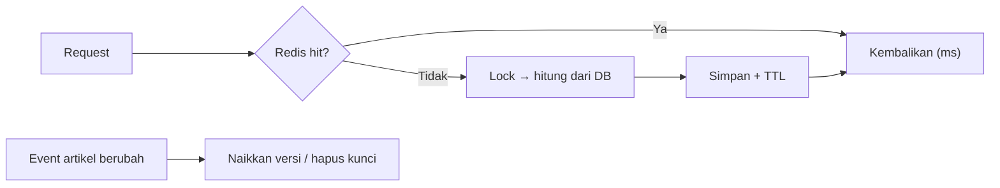

# Redis Cache

Cache (07.12) dan Redis (07.13) sudah dikenal. Di sini keduanya digabung untuk performa: strategi cache yang matang, *tags*, kunci berversi, *cache stampede*, dan pengukuran *hit ratio*. Fokusnya adalah **kapan dan apa** yang di-cache, bukan sekadar cara.

!!! warning "Belum dijalankan penulis"
    Redis dan PHP tidak dijalankan di lingkungan penulis. Perilaku diturunkan dari dokumentasi Laravel 13.x; ukur sendiri.

## Tujuan Pembelajaran

- [ ] Memilih data yang layak di-cache berdasarkan biaya hitung dan frekuensi baca.
- [ ] Mengatur `CACHE_STORE=redis` dan memisahkan database/awalan Redis.
- [ ] Menerapkan pola *cache-aside*, TTL, dan invalidasi eksplisit.
- [ ] Memakai cache tags (store yang mendukung) dan kunci berversi.
- [ ] Mencegah *cache stampede* dengan lock atau `flexible`.
- [ ] Mengukur *hit ratio* dan dampaknya.

## Prasyarat

- [Cache Management](../level-07/07-12-cache-management.md), [Redis Integration](../level-07/07-13-redis-integration.md).

## Pengantar

Beranda menampilkan "10 artikel terpopuler minggu ini". Query-nya menggabungkan tabel besar dan butuh 400 ms, tetapi datanya cukup diperbarui tiap 5 menit. Cache menjadikan 399 dari 400 permintaan tak menyentuh database.

## Penjelasan Konsep

### Apa yang layak di-cache?

| Layak | Kurang layak |
|---|---|
| Mahal dihitung, jarang berubah | Murah dihitung |
| Dibaca sangat sering | Jarang dibaca |
| Boleh agak basi | Harus real-time akurat |
| Sama untuk banyak pengguna | Spesifik tiap pengguna (kecuali kunci per pengguna) |

### Pola cache-aside

```php
$populer = Cache::remember('articles:popular:week', now()->plus(minutes: 5), function () {
    return Article::published()
        ->select(['id', 'title', 'slug'])
        ->orderByDesc('views')
        ->limit(10)
        ->get();
});
```

Aplikasi memeriksa cache, bila miss menghitung dan menyimpan. Simpan data minimal (kolom terpilih), bukan model besar penuh relasi.

### Tags dan kunci berversi

Cache tags (`Cache::tags(['articles'])->remember(...)`, lalu `Cache::tags('articles')->flush()`) memudahkan invalidasi kelompok. Menurut dokumentasi, tags **tidak** didukung driver `file`, `dynamodb`, atau `database`; Redis mendukungnya. Alternatif tanpa tags: **kunci berversi**:

```php
$versi = Cache::get('articles:version', 1);
$kunci = "articles:list:v{$versi}:page:{$halaman}";
// saat artikel berubah: Cache::increment('articles:version');
```

Kunci lama kedaluwarsa sendiri lewat TTL. Pola ini mencegah `flush()` yang menghapus segalanya.

### Stampede

Saat cache populer kedaluwarsa, ratusan permintaan menghitung ulang serentak. Solusi:

```php
// 1) Lock
$data = Cache::lock('lock:popular', 10)->block(5, function () {
    return Cache::remember('articles:popular:week', 300, fn () => hitungPopuler());
});

// 2) flexible: sajikan nilai agak basi sambil menyegarkan di belakang
$data = Cache::flexible('articles:popular:week', [60, 300], fn () => hitungPopuler());
```

`flexible` (stale-while-revalidate) menurut dokumentasi mengambil dua nilai: periode "segar" dan periode "boleh basi".

### Redis: pengaturan relevan

- Pisahkan database/awalan untuk cache vs antrean (`REDIS_CACHE_DB`, `REDIS_PREFIX`) agar `cache:clear` tidak menghapus antrean.
- Atur batas memori dan kebijakan pengusiran (`maxmemory-policy`, mis. `allkeys-lru`) di server Redis untuk instance khusus cache.
- Jangan simpan data kritis satu-satunya di cache.

### Mengukur

Ratio hit = `hit / (hit + miss)`. Hitung dengan penghitung (`Cache::increment('stat:cache:hit')`) atau statistik Redis (`INFO stats`: `keyspace_hits`, `keyspace_misses`). Cache dengan hit ratio rendah mungkin bukan cache yang tepat atau TTL terlalu pendek.

### Invalidasi

"Hanya ada dua masalah sulit dalam ilmu komputer: invalidasi cache dan penamaan." Pastikan setiap data yang di-cache punya (a) TTL dan (b) pemicu invalidasi yang jelas, dicatat di dokumentasi.

### Keamanan

- Jangan men-cache data khusus pengguna pada kunci umum (kebocoran antar pengguna).
- Jangan men-cache hasil yang bergantung otorisasi tanpa memasukkan siapa pemintanya ke kunci.
- Lindungi Redis (autentikasi, tidak terbuka ke publik).
- Data pribadi di cache sulit dihapus (hak hapus data); beri TTL pendek.

## Cara Kerja



## Contoh Praktik

Kamu men-cache daftar terpopuler, mengukur dampaknya, menambah invalidasi lewat event, dan melindungi dari stampede.

## Penjelasan Kode

File: `app/Services/PopularArticles.php`

```php
<?php

namespace App\Services;

use App\Models\Article;
use Illuminate\Support\Facades\Cache;

class PopularArticles
{
    public function week()
    {
        return Cache::flexible('articles:popular:week', [60, 300], function () {
            return Article::query()
                ->published()
                ->select(['id', 'title', 'slug', 'views'])
                ->orderByDesc('views')
                ->limit(10)
                ->get();
        });
    }
}
```

Listener `ArticlePublished` bisa menghapus kunci `articles:popular:week` bila daftar harus segera mencerminkan artikel baru.

## Implementasi Langkah demi Langkah

### Langkah 1: pastikan Redis cache

Atur `CACHE_STORE=redis`, `php artisan config:clear`, uji dengan tinker (07.13).

### Langkah 2: ukur sebelum

Muat beranda lima kali tanpa cache dan catat median.

### Langkah 3: terapkan layanan

Buat `PopularArticles` dan pakai di controller beranda.

### Langkah 4: ukur sesudah

Ulangi; permintaan pertama miss, berikutnya hit.

### Langkah 5: periksa Redis

```bash
docker exec redis-belajar redis-cli --scan --pattern '*popular*'
docker exec redis-belajar redis-cli info stats | grep keyspace
```

### Langkah 6: invalidasi

Hapus kunci pada event `ArticlePublished`; terbitkan artikel dan pastikan daftar diperbarui.

### Langkah 7: catat di Git

```bash
git add app
git commit -m "Cache artikel terpopuler dengan Redis"
```

## Eksekusi dan Verifikasi

| Langkah | Hasil yang diharapkan |
|---|---|
| 4 | Permintaan hit jauh lebih cepat dari miss |
| 5 | Kunci ada; `keyspace_hits` naik |
| 6 | Daftar mencerminkan perubahan setelah invalidasi |

## Hasil yang Diharapkan

Angka bergantung perangkat keras dan data; penulis belum mengukur.

## Kesalahan Umum dan Pemecahan Masalah

| Gejala | Penyebab | Cara mengenali | Solusi | Pencegahan |
|---|---|---|---|---|
| Data basi | Tak ada invalidasi | Perubahan tak tampil | Hapus kunci pada event | Catat pemicu |
| Data bocor antar pengguna | Kunci umum | Pengguna lihat data orang | Kunci per pengguna | Review kunci |
| `This cache store does not support tagging` | Driver tak mendukung | Pengecualian | Redis atau kunci berversi | Cek driver |
| `cache:clear` menghapus antrean | Database/awalan sama | Job hilang | Pisahkan DB/prefix | Konfigurasi |
| Stampede | TTL serentak | Lonjakan DB | Lock/`flexible` | Jitter TTL |
| Memori Redis penuh | Tanpa kebijakan | Error OOM | `maxmemory` + policy | Pantau |

## Latihan Praktik

### Latihan dasar

**D1. Layak di-cache?**
- *Masalah:* menilai kandidat.
- *Persyaratan:* nilai (a) saldo pengguna real-time, (b) daftar kategori, (c) 10 terpopuler.
- *Perilaku yang diharapkan:* (a) tidak, (b) ya, (c) ya.
- *Tujuan belajar:* kriteria cache.

### Latihan implementasi

**I1. Hit ratio**
- *Masalah:* ingin tahu efektivitas.
- *Persyaratan:* tambahkan penghitung hit/miss pada `PopularArticles` dan tampilkan rasio.
- *Perilaku yang diharapkan:* rasio mendekati 1 setelah pemanasan.
- *Tujuan belajar:* mengukur cache.

**I2. Kunci berversi**
- *Masalah:* daftar artikel per halaman banyak kunci.
- *Persyaratan:* terapkan kunci berversi dan naikkan versi saat artikel berubah.
- *Perilaku yang diharapkan:* semua halaman ter-invalidasi tanpa `flush`.
- *Tujuan belajar:* invalidasi kelompok.

### Latihan tantangan

**T1. Kebijakan cache**
- *Masalah:* tim menambah cache sembarangan.
- *Persyaratan:* tulis kebijakan (kriteria, penamaan kunci, TTL, invalidasi, pengujian, pemantauan).
- *Perilaku yang diharapkan:* dokumen praktis.
- *Tujuan belajar:* tata kelola cache.
- *Catatan:* kerjakan mandiri; tidak ada kunci jawaban.

## Uji Pemahaman

1. Apa itu pola cache-aside?
2. Apa alternatif tags bila driver tak mendukung?
3. Apa itu cache stampede dan solusinya?
4. Mengapa hit ratio penting?

??? success "Kunci jawaban singkat"
    1. Cek cache dulu; jika miss, hitung dan simpan.
    2. Kunci berversi.
    3. Banyak permintaan menghitung ulang bersamaan; lock atau `flexible`.
    4. Menunjukkan apakah cache bermanfaat.

## Ringkasan

- Cache data mahal, sering dibaca, dan boleh agak basi; selalu punya TTL dan invalidasi.
- Gunakan tags atau kunci berversi, serta lock/`flexible` melawan stampede.
- Ukur hit ratio dan jaga keamanan data antar pengguna.

Selanjutnya: *HTTP Caching*.

## Referensi Resmi

- [Laravel: Cache](https://laravel.com/docs/13.x/cache)
- [Laravel: Redis](https://laravel.com/docs/13.x/redis)
