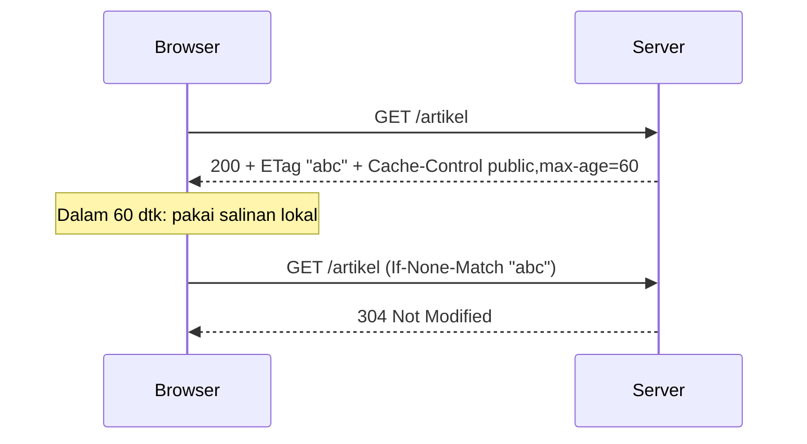

# HTTP Caching

Cache server (Redis) mengurangi kerja aplikasi. **HTTP caching** lebih jauh: respons disimpan di peramban, CDN, atau proxy sehingga permintaan bahkan tidak sampai ke server. Dengan header `Cache-Control`, `ETag`, dan `Last-Modified`, kamu mengontrol siapa boleh menyimpan, berapa lama, dan bagaimana memvalidasi.

## Tujuan Pembelajaran

- [ ] Menjelaskan `Cache-Control` (`public`, `private`, `max-age`, `no-store`, `s-maxage`).
- [ ] Menjelaskan validasi kondisional dengan `ETag`/`Last-Modified` dan respons `304`.
- [ ] Memakai middleware `cache.headers` Laravel.
- [ ] Menentukan halaman yang boleh dan tidak boleh di-cache publik.
- [ ] Menguji header dengan `curl`.
- [ ] Menghindari kebocoran data pribadi lewat cache bersama.

## Prasyarat

- [Redis Cache](09-07-redis-cache.md), dasar HTTP (Level 01).

## Pengantar

Halaman artikel publik berubah jarang. Jika setiap pembaca mengunduh ulang dan memicu aplikasi mengeksekusi PHP, itu boros. Dengan `Cache-Control: public, max-age=60`, peramban dan CDN dapat melayani salinan selama semenit.

## Penjelasan Konsep

### `Cache-Control`

| Direktif | Arti |
|---|---|
| `public` | Boleh disimpan cache bersama (CDN/proxy) |
| `private` | Hanya cache peramban pengguna |
| `max-age=N` | Segar selama N detik |
| `s-maxage=N` | Segar untuk cache bersama |
| `no-cache` | Boleh simpan, tapi harus validasi sebelum pakai |
| `no-store` | Jangan simpan sama sekali |
| `stale-while-revalidate=N` | Boleh pakai salinan basi sambil memperbarui |

### Validasi kondisional

Server mengirim `ETag: "abc"` (sidik jari isi). Klien berikutnya mengirim `If-None-Match: "abc"`. Jika isi tak berubah, server membalas `304 Not Modified` tanpa body, menghemat bandwidth. `Last-Modified`/`If-Modified-Since` bekerja serupa berdasarkan waktu.

### Middleware `cache.headers`

Menurut dokumentasi, Laravel menyediakan middleware `cache.headers` untuk mengatur `Cache-Control` per grup route, dengan opsi `etag`:

```php
Route::middleware('cache.headers:public;max_age=60;etag')->group(function () {
    Route::get('/artikel', [ArticleController::class, 'index'])->name('articles.index');
    Route::get('/artikel/{article:slug}', [ArticleController::class, 'show'])->name('articles.show');
});
```

Opsi `etag` membuat Laravel menghitung ETag dari isi respons; aplikasi tetap mengeksekusi permintaan dan menghitung body, tetapi menghemat transfer ke klien yang memiliki salinan valid. Menurut dokumentasi, opsi lain juga tersedia (mis. `s_maxage`, `stale_while_revalidate`).

### Apa yang tidak boleh di-cache publik?

| Jangan `public` | Alasan |
|---|---|
| Halaman setelah login (dashboard, profil) | Data pribadi |
| Respons yang memuat token CSRF atau flash | Token bocor/basi |
| Respons yang berbeda per pengguna | Pengguna lain melihat data orang |
| API terautentikasi | Bergantung `Authorization` |

Untuk halaman terautentikasi gunakan `private, no-store` atau `no-cache`. Halaman publik yang memuat formulir dengan token CSRF juga bermasalah bila dicache bersama: token milik sesi tertentu. Pisahkan bagian dinamis atau jangan cache publik halaman berformulir.

### Header `Vary`

Jika respons berbeda menurut header (mis. `Accept-Language`, `Accept`), tambahkan `Vary` agar cache menyimpan varian terpisah. Kegagalan `Vary` bisa menyajikan bahasa yang salah kepada pengguna lain.

### Aset statis

Vite menghasilkan nama berkas ber-hash sehingga aset dapat di-cache lama (`max-age=31536000, immutable`) di web server/CDN. Itu dikonfigurasi di Nginx (Level 10), bukan di Laravel.

### Menguji

```bash
curl -s -I http://127.0.0.1:8000/artikel | grep -i -E "cache-control|etag"
curl -s -I -H 'If-None-Match: "<etag-dari-atas>"' http://127.0.0.1:8000/artikel | head -1
```

Permintaan kedua seharusnya `304` bila isi tak berubah.

### Keamanan

- Cache publik yang keliru dapat membocorkan data pribadi ke pengguna lain (*cache poisoning/leak*).
- Jangan menggunakan `public` pada respons berautentikasi.
- Sertakan `Vary` yang benar.
- Header pada respons error (4xx/5xx) jangan di-cache lama.

## Cara Kerja



## Contoh Praktik

Kamu memasang `cache.headers` pada halaman publik, memeriksa header dan `304` dengan `curl`, dan memastikan dashboard tidak ikut ter-cache.

## Penjelasan Kode

Gunakan grup terpisah: halaman publik dengan `cache.headers:public;...`, dan grup `auth` dengan `cache.headers:private;no_store` atau biarkan bawaan Laravel (sesi menambah `Cache-Control: no-cache, private`).

## Implementasi Langkah demi Langkah

### Langkah 1: baseline header

```bash
curl -s -I http://127.0.0.1:8000/artikel | grep -i -E "cache-control|etag"
```

### Langkah 2: pasang middleware

Bungkus route publik dengan `cache.headers:public;max_age=60;etag` (hanya yang aman).

### Langkah 3: periksa

Ulangi `curl -I`; catat `Cache-Control` dan `ETag`.

### Langkah 4: uji 304

Kirim `If-None-Match` dengan ETag yang diterima; harapkan `304`.

### Langkah 5: periksa halaman pribadi

`curl -I` ke `/dashboard` (dengan cookie sesi) dan pastikan **bukan** `public`.

### Langkah 6: catat di Git

```bash
git add routes
git commit -m "Tambah HTTP caching untuk halaman publik"
```

## Eksekusi dan Verifikasi

| Langkah | Hasil yang diharapkan |
|---|---|
| 3 | `Cache-Control: max-age=60, public` dan `ETag` |
| 4 | `HTTP/1.1 304` |
| 5 | `private`/`no-cache`, bukan `public` |

## Hasil yang Diharapkan

Urutan direktif dalam header dapat berbeda. Penulis belum menjalankan; cocokkan dengan hasilmu.

## Kesalahan Umum dan Pemecahan Masalah

| Gejala | Penyebab | Cara mengenali | Solusi | Pencegahan |
|---|---|---|---|---|
| Pengguna lihat data pengguna lain | `public` pada halaman pribadi | Kebocoran | `private`/`no-store` | Audit route |
| Konten basi terlalu lama | `max-age` panjang | Perubahan tak tampil | Perpendek / validasi | Pilih TTL realistis |
| Token CSRF basi di halaman ter-cache | Cache halaman berformulir | Error 419 | Jangan cache publik | Pisahkan bagian dinamis |
| Bahasa salah | Tanpa `Vary` | Teks bahasa lain | Tambah `Vary` | Uji lintas bahasa |
| 304 tidak pernah muncul | ETag berubah tiap kali (konten dinamis) | Selalu 200 | Hilangkan elemen berubah | Periksa isi |
| Header tertimpa | Middleware lain | Nilai tak sesuai | Urutkan middleware | `curl -I` |

## Latihan Praktik

### Latihan dasar

**D1. Pilih direktif**
- *Masalah:* menentukan header.
- *Persyaratan:* pilih header untuk (a) logo statis, (b) halaman profil, (c) artikel publik.
- *Perilaku yang diharapkan:* (a) `public, max-age` panjang, (b) `private, no-store`, (c) `public, max-age` pendek + ETag.
- *Tujuan belajar:* memilih kebijakan.

### Latihan implementasi

**I1. Last-Modified**
- *Masalah:* ingin validasi berbasis waktu.
- *Persyaratan:* di controller detail artikel, kembalikan respons dengan `Last-Modified` dari `updated_at` dan tangani `If-Modified-Since` (`$response->isNotModified($request)`).
- *Perilaku yang diharapkan:* `304` bila tak berubah.
- *Tujuan belajar:* validasi kondisional manual.

**I2. Uji header**
- *Masalah:* header bisa berubah tanpa disengaja.
- *Persyaratan:* tulis uji fitur yang menegaskan `Cache-Control` publik pada daftar dan non-publik pada dashboard.
- *Perilaku yang diharapkan:* lulus.
- *Tujuan belajar:* menjaga kebijakan dengan uji.

### Latihan tantangan

**T1. CDN**
- *Masalah:* ingin CDN di depan aplikasi.
- *Persyaratan:* rancang kebijakan cache (s-maxage, purge saat artikel berubah, bypass untuk cookie sesi) dan risiko kebocorannya.
- *Perilaku yang diharapkan:* rancangan aman.
- *Tujuan belajar:* cache bersama.
- *Catatan:* kerjakan mandiri; tidak ada kunci jawaban.

## Uji Pemahaman

1. Apa beda `public` dan `private`?
2. Apa fungsi ETag dan 304?
3. Halaman apa yang tidak boleh `public`?
4. Mengapa `Vary` penting?

??? success "Kunci jawaban singkat"
    1. `public` boleh di cache bersama; `private` hanya peramban.
    2. Validasi tanpa mengunduh ulang isi.
    3. Halaman pribadi/terautentikasi dan berformulir CSRF.
    4. Agar varian respons tidak tertukar.

## Ringkasan

- HTTP caching mengurangi permintaan dan transfer lewat `Cache-Control`, ETag, dan 304.
- `cache.headers` memudahkan penerapan; pilih route dengan hati-hati.
- Jangan cache publik data pribadi; sertakan `Vary` bila perlu.

Selanjutnya: *Queue Optimization*.

## Referensi Resmi

- [Laravel: Responses, Cache Control Middleware](https://laravel.com/docs/13.x/responses#cache-control-middleware)
- [MDN: HTTP Caching](https://developer.mozilla.org/en-US/docs/Web/HTTP/Caching)
