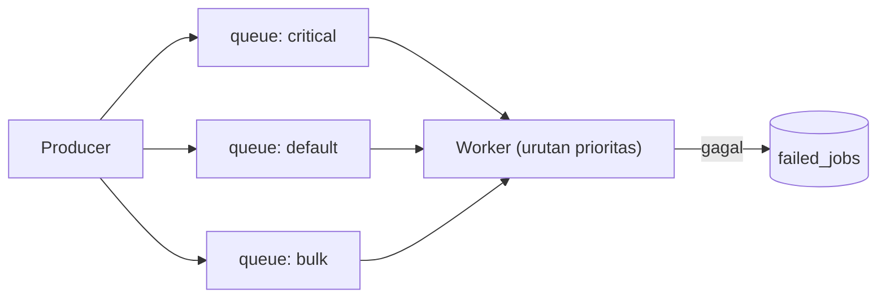

# Queue Optimization

Antrean memindahkan pekerjaan lambat dari request, tetapi antrean yang dirancang buruk menjadi bottleneck baru: job lambat memblokir yang penting, worker kurang, memori bocor, atau job gagal beruntun. Sub bab ini membahas penyetelan antrean: prioritas, jumlah worker, ukuran job, batching, rate limiting, dan pemantauan.

## Tujuan Pembelajaran

- [ ] Memisahkan antrean berdasarkan prioritas dan karakter job.
- [ ] Menentukan jumlah worker dari beban kerja.
- [ ] Merancang job kecil, idempoten, dan tahan lama.
- [ ] Memakai batching dan chain secara tepat.
- [ ] Membatasi laju pemrosesan job (rate limiting job/middleware).
- [ ] Memantau panjang antrean, waktu tunggu, dan kegagalan.

## Prasyarat

- [Jobs dan Queues](../level-07/07-09-jobs-and-queues.md), [Queue Workers](../level-07/07-10-queue-workers.md), [Redis Integration](../level-07/07-13-redis-integration.md).

## Pengantar

Job "kirim email massal 10.000 penerima" memenuhi satu antrean selama dua jam; selama itu, email reset sandi (penting) mengantre di belakangnya. Pemisahan antrean dan prioritas menyelesaikannya.

## Penjelasan Konsep

### Pisahkan antrean

```php-inline
SendPasswordReset::dispatch($user)->onQueue('critical');
SendNewsletter::dispatch($user)->onQueue('bulk');
ProcessImage::dispatch($path)->onQueue('media');
```

Worker dapat diberi urutan prioritas:

```bash
php artisan queue:work --queue=critical,default,bulk
```

Worker selalu mengosongkan `critical` sebelum `default`, lalu `bulk`. Pisahkan juga proses worker untuk beban berat (mis. `media` dengan lebih sedikit proses tetapi timeout panjang).

### Berapa banyak worker?

Perkiraan kasar: `worker ≈ laju kedatangan job/detik × waktu proses rata-rata (detik)`. Contoh: 20 job/detik × 0,5 s ≈ 10 worker. Tambahkan margin dan batasi oleh CPU/memori serta kapasitas layanan eksternal. Ukur panjang antrean dan waktu tunggu; jangan menebak.

### Job yang sehat

| Prinsip | Alasan |
|---|---|
| Kecil dan fokus | Gagal-ulang lebih murah |
| Idempoten | Aman dicoba ulang |
| Bawa ID, bukan data besar | Payload kecil; data selalu segar |
| Batas waktu eksplisit (`#[Timeout]`) | Job macet tidak menahan worker |
| `#[Tries]` dan `#[Backoff]` | Pemulihan terkendali |

### Chain dan batch

Menurut dokumentasi queues:

```php-inline
use Illuminate\Support\Facades\Bus;

Bus::chain([
    new GenerateReport($laporan),
    new CompressReport($laporan),
    new NotifyReportReady($laporan),
])->dispatch();   // berurutan; berhenti bila satu gagal

Bus::batch([
    new SendNewsletterChunk($idRentang1),
    new SendNewsletterChunk($idRentang2),
])->then(fn ($batch) => logger()->info('Batch selesai'))
  ->catch(fn ($batch, $e) => logger()->error('Batch gagal', ['galat' => $e->getMessage()]))
  ->dispatch();
```

Batch membutuhkan tabel `job_batches` (`php artisan make:queue-batches-table`, lalu `migrate`). Pecah pekerjaan besar menjadi banyak job kecil yang berjalan paralel pada beberapa worker.

### Membatasi laju

Layanan eksternal sering punya batas (mis. 10 email/detik). Gunakan job middleware:

```php-inline
use Illuminate\Queue\Middleware\RateLimited;

public function middleware(): array
{
    return [new RateLimited('email-provider')];
}
```

Dengan `RateLimiter::for('email-provider', fn () => Limit::perSecond(10));` di `AppServiceProvider`. Job yang melebihi batas dilepas kembali ke antrean. Ada pula `WithoutOverlapping` untuk mencegah dua job sejenis berjalan bersamaan. (Sesuaikan dengan API versi Laravel 13; lihat dokumentasi job middleware.)

### Driver

`database` cukup untuk beban kecil; Redis untuk throughput tinggi dan latensi rendah. Antrean berbasis database menambah beban pada database utama dan sering menjadi sumber kunci berlebih pada beban tinggi.

### Memori dan umur worker

Worker panjang bisa bocor memori. Gunakan `--max-jobs`, `--max-time`, `--memory` dan Supervisor untuk memulai ulang bersih (Level 10).

### Pemantauan

| Metrik | Arti |
|---|---|
| Panjang antrean | Jumlah menunggu |
| Waktu tunggu (usia job tertua) | Ketertinggalan |
| Waktu proses | Efisiensi job |
| Tingkat gagal | Kesehatan |

`php artisan queue:monitor redis:default,redis:critical --max=100` memicu event bila antrean melebihi batas (hubungkan dengan notifikasi). Laravel Horizon (khusus Redis) menyediakan dasbor dan penyeimbangan; ia paket tambahan di luar daftar yang disetujui, jadi hanya disebut sebagai opsi.

### Keamanan

- Payload job tersimpan di antrean/log gagal; jangan menaruh rahasia.
- Batasi akses dasbor pemantauan.
- Batas laju melindungi layanan pihak ketiga dari pemblokiran akun.

## Cara Kerja



## Contoh Praktik

Kamu memisahkan job email penting dan massal, menjalankan worker dengan prioritas, dan membuktikan job penting selesai lebih dulu.

## Penjelasan Kode

Atur antrean pada job:

```php-inline
class SendNewsletter implements ShouldQueue
{
    use Queueable;

    public function __construct(public int $userId)
    {
        $this->onQueue('bulk');
    }
}
```

`onQueue` di constructor menetapkan antrean bawaan job; pemanggil tetap bisa menimpanya.

## Implementasi Langkah demi Langkah

### Langkah 1: tentukan antrean

Pilih nama: `critical`, `default`, `bulk`.

### Langkah 2: kirim job campuran

Dispatch 50 job `bulk` lalu 1 job `critical` (sederhana: job yang `sleep(1)` dan mencatat log).

### Langkah 3: jalankan worker berprioritas

```bash
php artisan queue:work --queue=critical,default,bulk --stop-when-empty
```

### Langkah 4: baca log

Pastikan job `critical` diproses sebelum sisa `bulk` (setelah job `bulk` yang sedang berjalan selesai).

### Langkah 5: ukur

Catat waktu total satu worker vs dua worker (jalankan dua terminal).

### Langkah 6: catat di Git

```bash
git add app
git commit -m "Pisahkan antrean berdasarkan prioritas"
```

## Eksekusi dan Verifikasi

| Langkah | Hasil yang diharapkan |
|---|---|
| 4 | Job `critical` diproses lebih awal dari mayoritas `bulk` |
| 5 | Dua worker menyelesaikan kira-kira dua kali lebih cepat (bergantung beban) |

## Hasil yang Diharapkan

Angka bergantung mesin; penulis belum mengukur.

## Kesalahan Umum dan Pemecahan Masalah

| Gejala | Penyebab | Cara mengenali | Solusi | Pencegahan |
|---|---|---|---|---|
| Job penting tertunda | Satu antrean untuk semua | Antre panjang | Pisahkan + prioritas | Rancang antrean |
| Worker macet | Tanpa timeout | Job menggantung | `#[Timeout]` | Atur batas |
| Memori tumbuh | Worker lama | OOM | `--max-time`/`--memory` | Supervisor |
| Batch error `job_batches` | Tabel belum dibuat | Galat SQL | Buat tabel & migrasi | Baca dokumentasi |
| Akun diblokir pihak ketiga | Tanpa rate limit | Banyak 429 | `RateLimited` | Hormati kuota |
| Job ganda | Retry non-idempoten | Duplikasi | Rancang idempoten | Kunci unik |

## Latihan Praktik

### Latihan dasar

**D1. Hitung worker**
- *Masalah:* 30 job/detik, rata-rata 0,2 detik.
- *Persyaratan:* hitung perkiraan worker dan beri margin.
- *Perilaku yang diharapkan:* ≈ 6, lalu 8–10 dengan margin.
- *Tujuan belajar:* perkiraan kapasitas.

### Latihan implementasi

**I1. Batch newsletter**
- *Masalah:* 10.000 penerima.
- *Persyaratan:* pecah menjadi batch 200 per job dan beri callback `then`/`catch`.
- *Perilaku yang diharapkan:* batch selesai dan tercatat.
- *Tujuan belajar:* batching.

**I2. Rate limit email**
- *Masalah:* penyedia membatasi 5 email/detik.
- *Persyaratan:* buat limiter dan job middleware `RateLimited`.
- *Perilaku yang diharapkan:* laju ≤ 5/detik.
- *Tujuan belajar:* kepatuhan kuota.

### Latihan tantangan

**T1. Rencana kapasitas**
- *Masalah:* peluncuran fitur diperkirakan menaikkan job 10×.
- *Persyaratan:* rancang rencana (ukur baseline, hitung worker, uji beban terbatas, pantau, rencana mundur).
- *Perilaku yang diharapkan:* rencana lengkap.
- *Tujuan belajar:* perencanaan kapasitas.
- *Catatan:* kerjakan mandiri; tidak ada kunci jawaban.

## Uji Pemahaman

1. Mengapa memisahkan antrean?
2. Bagaimana memperkirakan jumlah worker?
3. Apa beda chain dan batch?
4. Mengapa job harus idempoten?

??? success "Kunci jawaban singkat"
    1. Agar job penting tak tertahan job massal.
    2. Laju kedatangan × waktu proses, ditambah margin.
    3. Chain berurutan; batch paralel dengan callback kolektif.
    4. Karena percobaan ulang bisa menjalankan job dua kali.

## Ringkasan

- Pisahkan dan prioritaskan antrean; sesuaikan jumlah worker dengan beban.
- Rancang job kecil, idempoten, dan bertimeout; gunakan batch dan rate limit.
- Pantau panjang antrean, waktu tunggu, dan kegagalan.

Selanjutnya: *Session Management*.

## Referensi Resmi

- [Laravel: Queues](https://laravel.com/docs/13.x/queues)
- [Laravel: Job Middleware](https://laravel.com/docs/13.x/queues#job-middleware)
