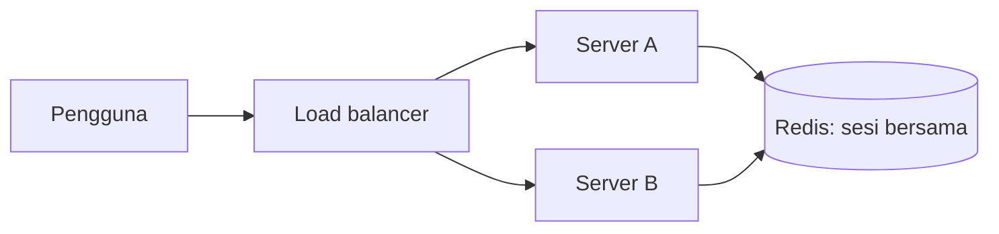

# Session Management

Sesi menyimpan status pengguna antar permintaan. Pilihan driver (file, database, Redis, cookie) dan cara mengelolanya memengaruhi performa, skalabilitas, dan keamanan. Saat aplikasi berjalan di banyak server, sesi yang tersimpan di disk lokal menjadi masalah.

## Tujuan Pembelajaran

- [ ] Membandingkan driver sesi: `file`, `cookie`, `database`, `redis`, `array`.
- [ ] Memilih driver yang cocok untuk satu server vs banyak server.
- [ ] Menjelaskan dampak sesi pada performa (I/O, ukuran, penguncian).
- [ ] Mengatur masa berlaku (`SESSION_LIFETIME`) dan pembersihan sesi kedaluwarsa.
- [ ] Menjaga ukuran sesi kecil.
- [ ] Menerapkan pengaturan keamanan sesi (cookie aman).

## Prasyarat

- Sesi dan autentikasi (Level 05), [Redis Integration](../level-07/07-13-redis-integration.md).

## Pengantar

Aplikasi dengan dua server di balik *load balancer*: pengguna login di server A, permintaan berikutnya mendarat di server B yang tidak punya berkas sesinya, sehingga pengguna "keluar" sendiri. Sesi harus tersimpan di tempat bersama.

## Penjelasan Konsep

### Driver

| Driver | Penyimpanan | Cocok | Catatan |
|---|---|---|---|
| `file` | Berkas di `storage/framework/sessions` | Satu server, lokal | Tidak dibagi antar server |
| `cookie` | Di cookie terenkripsi pada klien | Data kecil | Batas ±4 KB; dikirim tiap permintaan |
| `database` | Tabel `sessions` | Satu/banyak server beban kecil-sedang | Menambah beban DB |
| `redis` | Redis | Banyak server, beban tinggi | Cepat dan bersama |
| `array` | Memori proses | Pengujian | Tidak persisten |

Atur lewat `SESSION_DRIVER` di `.env`. Skeleton Laravel terbaru memakai `database` secara bawaan (tabel `sessions` dibuat oleh migrasi bawaan; periksa proyekmu).

### Dampak performa

- Setiap permintaan membaca dan menulis sesi (kecuali route tanpa middleware sesi).
- Sesi besar (menyimpan koleksi/objek) memperlambat dan membengkakkan penyimpanan.
- Pada driver berkas/DB tertentu, permintaan bersamaan dari satu pengguna dapat berurutan karena penguncian; Redis dan penguncian atomik mengurangi masalah ini (lihat `Route::...->block()` dan dokumentasi).

### Simpan seperlunya

```php
// Buruk
session(['keranjang' => $semuaProdukLengkap]);

// Baik
session(['keranjang' => [101 => 2, 205 => 1]]);   // hanya id dan jumlah
```

Simpan ID dan data kecil, ambil detail dari database/cache saat dibutuhkan. Jangan simpan model Eloquent penuh di sesi.

### Route tanpa sesi

API stateless (token) tidak butuh sesi. Grup `api` tidak menjalankan middleware sesi secara bawaan sehingga lebih ringan. Untuk halaman publik sangat ramai yang tak memerlukan status pengguna, pertimbangkan route tanpa middleware sesi (tetapi jangan menghapus CSRF/flash tanpa paham dampaknya).

### Masa berlaku dan pembersihan

`SESSION_LIFETIME` (menit) menentukan masa tidak aktif. Untuk driver `file`/`database`, sesi kedaluwarsa dibersihkan oleh *lottery* kecil (`'lottery' => [2, 100]` di `config/session.php`). Sesi di Redis kedaluwarsa otomatis lewat TTL. Pada tabel `sessions` yang besar, indeks pada `last_activity` (ada di migrasi bawaan) dan pembersihan berkala menjaga performa.

### Keamanan sesi

Pengaturan di `config/session.php` / `.env`:

| Opsi | Rekomendasi |
|---|---|
| `SESSION_SECURE_COOKIE=true` | Cookie hanya lewat HTTPS (produksi) |
| `http_only=true` | JavaScript tak bisa membaca cookie (bawaan) |
| `same_site=lax` / `strict` | Mengurangi CSRF |
| `SESSION_ENCRYPT=true` | Enkripsi data sesi bila menyimpan data sensitif |
| Regenerasi ID setelah login | Mencegah session fixation (bawaan di alur login Laravel) |

Jangan menyimpan kata sandi atau data kartu di sesi.

### Banyak server

Gunakan `database` atau `redis` agar semua server berbagi sesi. Alternatif lain, *sticky session* di load balancer, mengikat pengguna ke satu server tetapi mengurangi ketahanan.

## Cara Kerja



## Contoh Praktik

Kamu memindahkan sesi ke Redis, membuktikan sesi tersimpan di sana, dan memeriksa ukuran sesi.

## Penjelasan Kode

Pengaturan `.env` (lokal, dengan Redis dari 07.13):

```text
SESSION_DRIVER=redis
SESSION_LIFETIME=120
SESSION_ENCRYPT=false
```

Di produksi tambah `SESSION_SECURE_COOKIE=true` (butuh HTTPS).

## Implementasi Langkah demi Langkah

### Langkah 1: baseline

Catat `SESSION_DRIVER` saat ini dan ukur waktu halaman terproteksi.

### Langkah 2: ubah ke Redis

Atur `SESSION_DRIVER=redis`, lalu `php artisan config:clear`.

### Langkah 3: login dan periksa

Login lewat browser, lalu:

```bash
docker exec redis-belajar redis-cli --scan --pattern '*session*' | head
```

### Langkah 4: ukur ulang

Bandingkan waktu halaman terproteksi sebelum/sesudah.

### Langkah 5: audit isi sesi

Cari `session(` dan `->put(` di kode; pastikan hanya data kecil yang disimpan.

### Langkah 6: catat di Git

Tidak ada perubahan kode selain konfigurasi non-rahasia; jangan commit `.env`.

## Eksekusi dan Verifikasi

| Langkah | Hasil yang diharapkan |
|---|---|
| 3 | Kunci sesi muncul di Redis |
| 4 | Waktu serupa atau lebih baik (tergantung beban) |

## Hasil yang Diharapkan

Perbedaan kecil di mesin lokal. Penulis belum mengukur.

## Kesalahan Umum dan Pemecahan Masalah

| Gejala | Penyebab | Cara mengenali | Solusi | Pencegahan |
|---|---|---|---|---|
| Pengguna keluar sendiri di multi-server | Sesi `file` lokal | Login hilang antar permintaan | Redis/database | Rancang untuk banyak server |
| Pengguna logout setelah ubah driver | Sesi lama tak terbawa | Semua keluar | Terima/jadwalkan | Komunikasikan |
| Cookie terlalu besar | Driver `cookie` + data besar | Sesi tak tersimpan | Pindah driver | Simpan data kecil |
| Cookie tak terkirim | `SECURE_COOKIE` tanpa HTTPS | Sesi hilang | HTTPS atau matikan di lokal | Konfigurasi per lingkungan |
| Tabel `sessions` membengkak | Tak dibersihkan | Query lambat | Bersihkan; indeks `last_activity` | Pembersihan berkala |
| Sesi berisi model besar | Menyimpan objek | Lambat | Simpan ID | Review kode |

## Latihan Praktik

### Latihan dasar

**D1. Pilih driver**
- *Masalah:* menentukan driver.
- *Persyaratan:* pilih untuk (a) laptop pengembangan, (b) 3 server di belakang load balancer, (c) pengujian.
- *Perilaku yang diharapkan:* (a) `file`/`database`, (b) `redis`/`database`, (c) `array`.
- *Tujuan belajar:* memilih driver.

### Latihan implementasi

**I1. Perkecil sesi**
- *Masalah:* keranjang menyimpan objek penuh.
- *Persyaratan:* ubah ke ID dan jumlah, dan ambil detail dari database saat tampil.
- *Perilaku yang diharapkan:* ukuran sesi turun.
- *Tujuan belajar:* sesi ramping.

**I2. Cookie aman**
- *Masalah:* audit keamanan sesi.
- *Persyaratan:* periksa atribut cookie sesi di DevTools (`HttpOnly`, `Secure`, `SameSite`) dan catat perbaikan.
- *Perilaku yang diharapkan:* daftar temuan.
- *Tujuan belajar:* audit konfigurasi.

### Latihan tantangan

**T1. Sticky session vs sesi bersama**
- *Masalah:* memilih arsitektur.
- *Persyaratan:* bandingkan sticky session dan sesi di Redis dari sisi ketahanan, skala, dan kompleksitas.
- *Perilaku yang diharapkan:* perbandingan beralasan.
- *Tujuan belajar:* arsitektur sesi.
- *Catatan:* kerjakan mandiri; tidak ada kunci jawaban.

## Uji Pemahaman

1. Mengapa sesi `file` bermasalah di banyak server?
2. Apa batas driver `cookie`?
3. Mengapa menyimpan ID alih-alih objek?
4. Apa fungsi `SESSION_SECURE_COOKIE`?

??? success "Kunci jawaban singkat"
    1. Sesi hanya ada di disk satu server.
    2. Ukuran kecil (~4 KB) dan dikirim tiap permintaan.
    3. Ukuran kecil dan data selalu segar.
    4. Memastikan cookie hanya dikirim lewat HTTPS.

## Ringkasan

- Pilih driver sesuai skala: bersama (Redis/database) untuk banyak server.
- Simpan sesi kecil dan atur masa berlaku serta pembersihan.
- Terapkan cookie aman dan regenerasi ID.

Selanjutnya: *Laravel Octane*.

## Referensi Resmi

- [Laravel: Session](https://laravel.com/docs/13.x/session)
