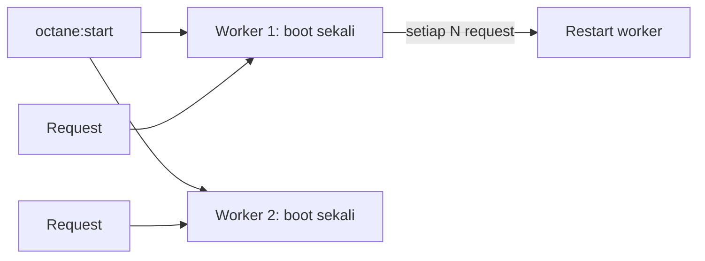

# Laravel Octane

Pada model PHP-FPM tradisional, setiap permintaan memboot aplikasi dari nol lalu membuangnya. **Laravel Octane** memuat aplikasi sekali ke memori lalu melayani banyak permintaan dengan server berperforma tinggi (FrankenPHP, RoadRunner, atau Swoole). Hasilnya throughput jauh lebih tinggi, dengan syarat kamu memahami konsekuensi aplikasi yang hidup lama.

!!! warning "Dependensi dan belum diuji penulis"
    Octane adalah paket tambahan (`laravel/octane`) dan sudah disetujui untuk kurikulum ini. Penulis tidak menjalankannya di lingkungan ini; semua perintah diturunkan dari dokumentasi Laravel 13.x. Octane mengubah model eksekusi: **uji menyeluruh sebelum dipakai di produksi**.

## Tujuan Pembelajaran

- [ ] Menjelaskan perbedaan model PHP-FPM dan Octane.
- [ ] Memasang dan menjalankan Octane (`octane:install`, `octane:start`).
- [ ] Mengenali risiko aplikasi berumur panjang: kebocoran status dan memori.
- [ ] Menghindari injeksi container/request/config ke singleton.
- [ ] Mengatur jumlah worker dan `--max-requests`.
- [ ] Memutuskan kapan Octane layak dan kapan tidak.

## Prasyarat

- [Laravel Performance Optimization](09-02-laravel-performance-optimization.md), [Service Container](../level-07/07-01-service-container.md), PHP CLI terpasang dengan ekstensi yang dibutuhkan server pilihan.

## Pengantar

Profil menunjukkan 40% waktu permintaan habis untuk booting framework dan provider. Dengan Octane, booting terjadi sekali per worker; permintaan berikutnya langsung ke controller.

## Penjelasan Konsep

### PHP-FPM vs Octane

| Aspek | PHP-FPM | Octane |
|---|---|---|
| Booting aplikasi | Setiap permintaan | Sekali per worker |
| Status antar permintaan | Terbuang | Bertahan di memori |
| Kecepatan | Baik | Umumnya jauh lebih tinggi |
| Risiko | Rendah | Kebocoran status/memori jika salah kode |
| Perubahan kode | Langsung terbaca | Perlu reload worker |

### Memasang

Menurut dokumentasi:

```bash
composer require laravel/octane
php artisan octane:install
```

`octane:install` menanyakan server (FrankenPHP, RoadRunner, Swoole) dan memasang konfigurasi `config/octane.php`. Server memiliki prasyarat berbeda (biner Go, ekstensi Swoole, dsb.); ikuti dokumentasi server yang kamu pilih. Di Windows, banyak orang menjalankannya lewat WSL atau Docker/Sail.

### Menjalankan

```bash
php artisan octane:start                       # server terpilih
php artisan octane:start --watch               # lokal: muat ulang saat berkas berubah (butuh Node + chokidar)
php artisan octane:start --workers=4 --max-requests=250
php artisan octane:reload                      # restart worker anggun (setelah deploy)
php artisan octane:status
```

Menurut dokumentasi, Octane me-restart worker setelah menangani sejumlah permintaan (bawaan 500) untuk mencegah kebocoran memori; atur dengan `--max-requests`.

### Aturan emas: jangan simpan status permintaan di objek yang bertahan

Karena aplikasi dibuat sekali, objek **singleton** bertahan lintas permintaan.

**Jangan menyuntik container, request, atau repository config ke singleton** lewat constructor. Dokumentasi memberi pola yang aman:

```php
// Bermasalah: $app dari boot pertama dipakai selamanya
$this->app->singleton(Service::class, function (Application $app) {
    return new Service($app);
});

// Aman: injeksi closure yang mengambil container segar
$this->app->singleton(Service::class, function ($app) {
    return new Service(fn () => Container::getInstance());
});
```

Untuk request: jangan simpan `$request` di properti singleton; ambil `request()` saat dibutuhkan. Untuk konfigurasi serupa.

### Status statis dan array yang tumbuh

| Kesalahan | Akibat |
|---|---|
| Menambah ke array statis/properti singleton tiap request | Memori tumbuh tanpa batas |
| Menyimpan data pengguna di properti singleton | **Data pengguna A terlihat oleh pengguna B** |
| Mengandalkan `static` sebagai cache permintaan | Bocor lintas permintaan |
| Membuka koneksi/berkas tanpa menutup | Kebocoran sumber daya |

Gunakan `scoped` (07.01) untuk objek yang seharusnya hidup per permintaan; Octane meresetnya otomatis.

### Konkurensi dan tugas

Octane menyediakan `Octane::concurrently([...])` (Swoole/OpenSwoole) untuk menjalankan beberapa tugas paralel. Fitur server-spesifik; lihat dokumentasi bila perlu.

### Kapan layak?

| Layak | Kurang layak |
|---|---|
| Beban permintaan tinggi, boot framework dominan | Beban rendah |
| Tim paham aplikasi stateful dan memori | Kode warisan penuh `static`/singleton |
| Bisa menguji kebocoran status | Banyak paket yang belum teruji dengan Octane |

Ukur dulu (09.01): bila bottleneck adalah database atau API eksternal, Octane tidak banyak membantu.

### Keamanan

Kebocoran status adalah risiko **keamanan**, bukan sekadar bug: data satu pengguna dapat bocor ke pengguna lain. Audit singleton, properti statis, dan paket pihak ketiga. Jangan menjalankan Octane tanpa uji beban multi-pengguna.

## Cara Kerja



## Contoh Praktik

Kamu menjalankan Octane, membuat singleton yang sengaja menyimpan status per permintaan untuk melihat kebocoran, lalu memperbaikinya dengan `scoped`.

## Penjelasan Kode

File: `app/Services/PengunjungTerakhir.php`

```php
<?php

namespace App\Services;

class PengunjungTerakhir
{
    private array $daftar = [];

    public function catat(string $nama): int
    {
        $this->daftar[] = $nama;

        return count($this->daftar);
    }
}
```

Jika didaftarkan sebagai `singleton`, `daftar` bertambah terus lintas permintaan di worker yang sama. Jika `scoped`, Octane membuat instans baru tiap permintaan.

## Implementasi Langkah demi Langkah

### Langkah 1: pasang

```bash
composer require laravel/octane
php artisan octane:install
```

Pilih server sesuai lingkungan dan ikuti petunjuk prasyaratnya.

### Langkah 2: jalankan

```bash
php artisan octane:start --workers=1
```

### Langkah 3: buat kebocoran

Daftarkan `PengunjungTerakhir` sebagai `singleton`, tambahkan route percobaan yang memanggil `catat('x')` dan mengembalikan hasilnya. Panggil route berulang dengan `curl`: angka terus bertambah (kebocoran status).

### Langkah 4: perbaiki

Ubah menjadi `$this->app->scoped(...)`, restart worker (`octane:reload`), ulangi: angka selalu 1.

### Langkah 5: ukur

Bandingkan throughput sederhana (mis. 200 permintaan beruntun dengan `curl` atau alat beban pilihanmu) antara `artisan serve`/FPM dan Octane. Catat kondisi pengukuran.

### Langkah 6: hapus percobaan dan catat

Hapus route dan binding percobaan.

```bash
git add composer.json composer.lock config/octane.php
git commit -m "Pasang Laravel Octane"
```

## Eksekusi dan Verifikasi

| Langkah | Hasil yang diharapkan |
|---|---|
| 3 | Angka bertambah lintas permintaan (kebocoran) |
| 4 | Angka selalu 1 setelah `scoped` |
| 5 | Throughput Octane lebih tinggi (besarnya bergantung beban) |

## Hasil yang Diharapkan

Besar peningkatan sangat bergantung beban dan server; penulis tidak mengukur. Jangan bandingkan `artisan serve` dengan Octane sebagai ukuran produksi.

## Kesalahan Umum dan Pemecahan Masalah

| Gejala | Penyebab | Cara mengenali | Solusi | Pencegahan |
|---|---|---|---|---|
| Kode lama berjalan | Worker tidak dimuat ulang | Perubahan tak berlaku | `octane:reload` / `--watch` | Reload saat deploy |
| Data pengguna bocor | Status di singleton | Data tertukar | `scoped`; hapus status | Audit singleton |
| Memori tumbuh | Array statis tumbuh | Worker membengkak | Perbaiki; `--max-requests` | Pantau memori |
| Config/request basi | Disuntik ke singleton | Nilai lama | Resolver closure | Ikuti dokumentasi |
| Server gagal start | Prasyarat server kurang | Galat saat start | Pasang prasyarat | Baca dokumentasi server |
| Paket tidak kompatibel | Mengasumsikan siklus per-request | Perilaku aneh | Uji / ganti paket | Uji beban |

## Latihan Praktik

### Latihan dasar

**D1. Bandingkan model**
- *Masalah:* paham perbedaan.
- *Persyaratan:* jelaskan dalam tiga kalimat mengapa Octane lebih cepat dan risiko apa yang muncul.
- *Perilaku yang diharapkan:* booting sekali; status bertahan.
- *Tujuan belajar:* konsep.

### Latihan implementasi

**I1. Audit singleton**
- *Masalah:* ingin aman di Octane.
- *Persyaratan:* telusuri `singleton(` di aplikasi dan paket yang kamu pakai, lalu nilai mana yang menyimpan status permintaan.
- *Perilaku yang diharapkan:* daftar dan penilaian.
- *Tujuan belajar:* audit kompatibilitas.

**I2. Uji kebocoran otomatis**
- *Masalah:* ingin menangkap kebocoran sejak dini.
- *Persyaratan:* rancang skrip yang memanggil endpoint 100 kali sebagai pengguna berbeda dan memastikan tidak ada data silang.
- *Perilaku yang diharapkan:* rancangan jelas.
- *Tujuan belajar:* menguji aplikasi stateful.

### Latihan tantangan

**T1. Keputusan adopsi**
- *Masalah:* tim ragu memakai Octane.
- *Persyaratan:* tulis keputusan (ukuran bottleneck, risiko, biaya uji, rencana mundur ke FPM).
- *Perilaku yang diharapkan:* dokumen berbasis data.
- *Tujuan belajar:* keputusan teknis.
- *Catatan:* kerjakan mandiri; tidak ada kunci jawaban.

## Uji Pemahaman

1. Apa beda Octane dan PHP-FPM?
2. Mengapa singleton berisiko di Octane?
3. Apa fungsi `scoped`?
4. Apa fungsi `--max-requests`?

??? success "Kunci jawaban singkat"
    1. Octane boot sekali dan melayani banyak permintaan; FPM boot tiap permintaan.
    2. Status bertahan lintas permintaan sehingga data bisa bocor.
    3. Instans baru per permintaan yang direset otomatis.
    4. Me-restart worker setelah sejumlah permintaan untuk mencegah kebocoran memori.

## Ringkasan

- Octane mempercepat dengan memuat aplikasi sekali di memori.
- Konsekuensinya: waspada status singleton/statis, memori, dan reload saat deploy.
- Ukur dulu dan uji kebocoran data antar pengguna sebelum produksi.

Selanjutnya: *Profiling dan Monitoring*.

## Referensi Resmi

- [Laravel: Octane](https://laravel.com/docs/13.x/octane)
- [Laravel: Octane, Dependency Injection and Octane](https://laravel.com/docs/13.x/octane#dependency-injection-and-octane)
