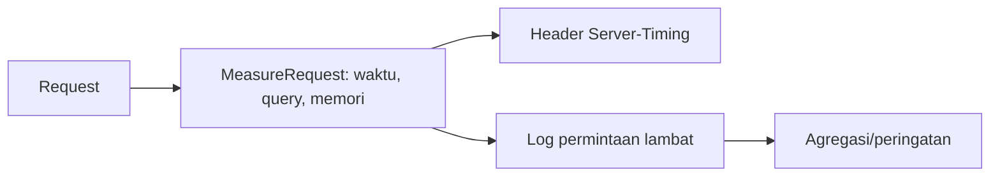

# Profiling dan Monitoring

*Profiling* mencari tahu **di mana** waktu dan memori habis pada satu permintaan; *monitoring* memantau kesehatan aplikasi **terus-menerus** di produksi. Tanpa keduanya, optimasi hanya tebakan. Sub bab ini memakai alat bawaan Laravel/PHP, tanpa menambah paket, lalu menyebut alat tambahan sebagai opsi.

## Tujuan Pembelajaran

- [ ] Membedakan profiling (diagnosis) dan monitoring (pengawasan).
- [ ] Mengukur waktu dan memori permintaan dengan middleware sederhana dan header `Server-Timing`.
- [ ] Menangkap query lambat dengan `DB::listen` dan `DB::whenQueryingForLongerThan`.
- [ ] Mencatat metrik penting dan memantau log.
- [ ] Menentukan metrik yang layak dipantau (RED/USE) dan ambang peringatan.
- [ ] Mengenali alat tambahan (Telescope, Pulse, Xdebug/XHProf, APM) beserta kompromi dependensinya.

## Prasyarat

- [Dasar-dasar Performa](09-01-performance-fundamentals.md), [Optimasi Query Database](09-03-database-query-optimization.md), [Logging](../level-07/07-18-logging.md).

## Pengantar

Pengguna melapor "kadang lambat". Tanpa data, kamu tidak tahu kapan, di halaman mana, dan penyebabnya. Dengan pengukuran per permintaan yang tercatat, pola muncul dalam satu hari.

## Penjelasan Konsep

### Profiling vs monitoring

| | Profiling | Monitoring |
|---|---|---|
| Tujuan | Menemukan penyebab | Mendeteksi masalah |
| Kapan | Saat menyelidiki | Terus-menerus |
| Contoh | Profil satu permintaan lambat | Peringatan jika p95 > 1 detik |

### Middleware pengukur

File: `app/Http/Middleware/MeasureRequest.php`

```php
<?php

namespace App\Http\Middleware;

use Closure;
use Illuminate\Http\Request;
use Illuminate\Support\Facades\DB;
use Illuminate\Support\Facades\Log;
use Symfony\Component\HttpFoundation\Response;

class MeasureRequest
{
    public function handle(Request $request, Closure $next): Response
    {
        $mulai = hrtime(true);
        $queries = 0;
        $waktuDb = 0.0;

        DB::listen(function ($q) use (&$queries, &$waktuDb) {
            $queries++;
            $waktuDb += $q->time;
        });

        $response = $next($request);

        $ms = (hrtime(true) - $mulai) / 1_000_000;
        $memMb = memory_get_peak_usage(true) / 1048576;

        $response->headers->set(
            'Server-Timing',
            sprintf('app;dur=%.1f, db;dur=%.1f', $ms, $waktuDb)
        );

        if ($ms > 500) {
            Log::warning('Permintaan lambat', [
                'path' => $request->path(),
                'metode' => $request->method(),
                'ms' => round($ms, 1),
                'query' => $queries,
                'db_ms' => round($waktuDb, 1),
                'mem_mb' => round($memMb, 1),
            ]);
        }

        return $response;
    }
}
```

| Bagian | Fungsi |
|---|---|
| `hrtime(true)` | Waktu presisi tinggi (nanodetik) |
| `DB::listen` | Menghitung query dan total waktu DB |
| `Server-Timing` | Header standar yang terbaca di tab Network DevTools |
| `Log::warning` | Mencatat hanya permintaan lambat, tanpa query, header, atau parameter sensitif |

Catatan: `DB::listen` yang didaftarkan di middleware menumpuk pada tiap permintaan di aplikasi berumur panjang (Octane). Di lingkungan seperti itu, daftarkan sekali di provider dan simpan hitungan pada objek `scoped`. Jangan mencatat `$request->all()` atau query dengan binding.

### Query lambat dan total waktu DB

Menurut dokumentasi, `DB::whenQueryingForLongerThan(500, fn ...)` memanggil callback saat total waktu query dalam satu permintaan melebihi ambang (ms):

```php
DB::whenQueryingForLongerThan(500, function ($connection, $event) {
    Log::warning('Total waktu query tinggi', ['koneksi' => $connection->getName()]);
});
```

Untuk satu query lambat: `DB::listen` lalu cek `$query->time > 100`.

### Profiler sampling (konsep)

Untuk melihat fungsi PHP mana yang memakan CPU, gunakan profiler seperti Xdebug (mode profile) atau XHProf/SPX. Mereka memperlambat aplikasi dan dipasang sebagai ekstensi PHP; gunakan di lokal/staging, jangan di produksi tanpa perencanaan.

### Alat tambahan (opsional, perlu persetujuan dependensi)

| Alat | Kegunaan | Catatan |
|---|---|---|
| Laravel Telescope | Melihat permintaan, query, job, email saat pengembangan | Paket resmi; tidak untuk produksi terbuka |
| Laravel Pulse | Dasbor performa produksi (endpoint lambat, job, pengguna aktif) | Paket resmi; butuh migrasi/penyimpanan |
| APM komersial | Tracing terdistribusi, peringatan | Layanan pihak ketiga; data keluar dari sistem |

Materi ini tidak mewajibkan satupun. Bila kamu ingin memasang Telescope atau Pulse di proyekmu, itu pilihan sendiri; ikuti dokumentasi resmi masing-masing dan batasi aksesnya (Pulse menyediakan gate `viewPulse`; keduanya tidak boleh terbuka ke publik).

### Apa yang dipantau?

Metode **RED** (layanan): *Rate* (permintaan/detik), *Errors* (persen galat), *Duration* (latensi p50/p95/p99). Metode **USE** (sumber daya): *Utilization*, *Saturation*, *Errors* untuk CPU, memori, disk, koneksi DB, panjang antrean.

| Metrik | Contoh ambang peringatan |
|---|---|
| Persentase 5xx | > 1% selama 5 menit |
| p95 latensi | > 1 detik |
| Panjang antrean | > 1.000 atau usia tertua > 5 menit |
| Disk | > 80% |
| Job gagal | Kenaikan mendadak |

### Keamanan dan privasi

- Log tidak boleh memuat kata sandi, token, atau data pribadi yang tak perlu.
- Header `Server-Timing` membuka info internal ke klien; di produksi pertimbangkan hanya mengirimkannya untuk pengguna internal atau menghapusnya.
- Dasbor pemantauan harus terproteksi (autentikasi, jaringan internal).

## Cara Kerja



## Contoh Praktik

Kamu memasang middleware pengukur, membaca `Server-Timing` di DevTools, memicu permintaan lambat sengaja, dan memeriksa log.

## Penjelasan Kode

Pada langkah praktik, kamu menambah `usleep(600000)` sementara di satu controller untuk memicu log lambat, lalu menghapusnya.

## Implementasi Langkah demi Langkah

### Langkah 1: buat middleware

Simpan `MeasureRequest` dan daftarkan ke grup `web` di `bootstrap/app.php` (`$middleware->web(append: [MeasureRequest::class]);`).

### Langkah 2: lihat header

```bash
curl -s -I http://127.0.0.1:8000/artikel | grep -i server-timing
```

### Langkah 3: lihat di DevTools

Buka tab Network, pilih permintaan, bagian Timing menampilkan `app` dan `db`.

### Langkah 4: picu permintaan lambat

Tambah `usleep(600000);` sementara di controller daftar, muat halaman, dan baca log:

```bash
tail -n 5 storage/logs/laravel.log
```

Hapus `usleep`.

### Langkah 5: pasang pemantau total waktu DB

Tambahkan `DB::whenQueryingForLongerThan` di `AppServiceProvider::boot()` dengan ambang yang kamu pilih.

### Langkah 6: catat di Git

```bash
git add app bootstrap
git commit -m "Tambah middleware pengukur performa"
```

## Eksekusi dan Verifikasi

| Langkah | Hasil yang diharapkan |
|---|---|
| 2 | Header `Server-Timing: app;dur=..., db;dur=...` |
| 4 | Log "Permintaan lambat" dengan `ms` > 500 |

## Hasil yang Diharapkan

Nilai bergantung mesinmu. Penulis belum menjalankan kode ini.

## Kesalahan Umum dan Pemecahan Masalah

| Gejala | Penyebab | Cara mengenali | Solusi | Pencegahan |
|---|---|---|---|---|
| Pengukur memperlambat | Terlalu banyak log | Log penuh | Log hanya di atas ambang | Sampling |
| Data pribadi di log | Mencatat parameter | Rahasia di log | Catat metadata saja | Review log |
| Listener menumpuk (Octane) | `DB::listen` per permintaan | Hitungan membesar | Daftar sekali di provider | Pahami siklus hidup |
| Header membuka detail | `Server-Timing` publik | Info internal terlihat | Batasi produksi | Kebijakan header |
| Metrik tanpa tindakan | Tak ada ambang/peringatan | Dasbor tak dilihat | Tetapkan alert | RED/USE + ambang |
| Profiler di produksi | Ekstensi aktif | Aplikasi lambat | Hanya lokal/staging | Aturan lingkungan |

## Latihan Praktik

### Latihan dasar

**D1. Baca `Server-Timing`**
- *Masalah:* menafsirkan hasil.
- *Persyaratan:* jelaskan arti `app;dur=420, db;dur=380`.
- *Perilaku yang diharapkan:* 420 ms total; 380 ms di database → database bottleneck.
- *Tujuan belajar:* membaca pengukuran.

### Latihan implementasi

**I1. Peringatan jumlah query**
- *Masalah:* ingin tahu halaman dengan banyak query.
- *Persyaratan:* catat peringatan bila jumlah query > 20.
- *Perilaku yang diharapkan:* log memuat path dan jumlah.
- *Tujuan belajar:* deteksi N+1 di staging.

**I2. Ringkasan log**
- *Masalah:* ingin melihat path paling lambat.
- *Persyaratan:* tulis skrip (`grep`/`awk` atau PHP) yang meringkas log menjadi 5 path terlambat.
- *Perilaku yang diharapkan:* daftar peringkat.
- *Tujuan belajar:* analisis log.

### Latihan tantangan

**T1. Rencana monitoring**
- *Masalah:* aplikasi akan di-deploy.
- *Persyaratan:* rancang monitoring (metrik RED/USE, ambang, kanal peringatan, siapa merespons, privasi) dan pilih apakah memakai Pulse/APM beserta alasannya.
- *Perilaku yang diharapkan:* rencana lengkap.
- *Tujuan belajar:* observabilitas.
- *Catatan:* kerjakan mandiri; tidak ada kunci jawaban.

## Uji Pemahaman

1. Apa beda profiling dan monitoring?
2. Apa fungsi header `Server-Timing`?
3. Apa itu metode RED?
4. Mengapa profiler tidak dipasang di produksi sembarangan?

??? success "Kunci jawaban singkat"
    1. Profiling mencari penyebab; monitoring mengawasi terus-menerus.
    2. Memberi tahu klien durasi bagian-bagian server.
    3. Rate, Errors, Duration.
    4. Memperlambat aplikasi dan menambah risiko.

## Ringkasan

- Ukur per permintaan (waktu, query, memori) dan log yang lambat.
- Pantau metrik RED/USE dengan ambang dan peringatan.
- Alat tambahan opsional; jaga privasi dan akses dasbor.

Selanjutnya: *Application Scalability*.

## Referensi Resmi

- [Laravel: Database, Monitoring Cumulative Query Time](https://laravel.com/docs/13.x/database#monitoring-cumulative-query-time)
- [Laravel: Pulse](https://laravel.com/docs/13.x/pulse)
- [MDN: Server-Timing](https://developer.mozilla.org/en-US/docs/Web/HTTP/Headers/Server-Timing)
