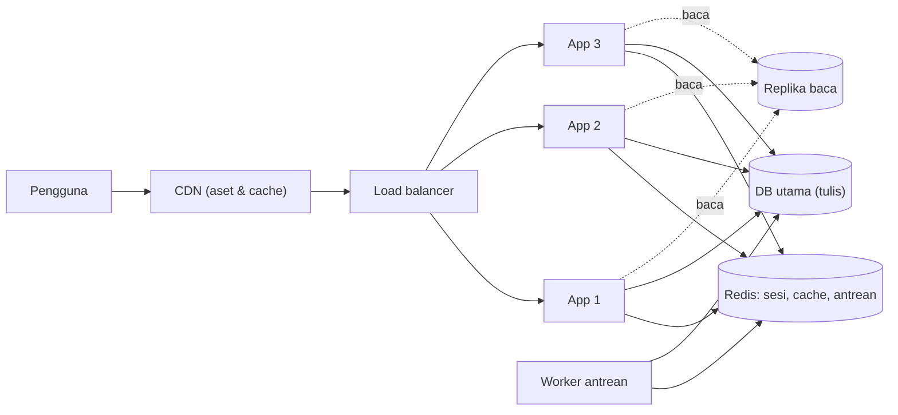
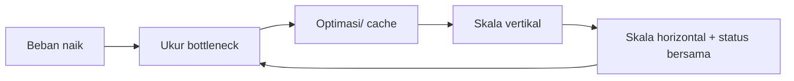

# Application Scalability

Satu server pada akhirnya penuh. *Skalabilitas* adalah kemampuan menambah kapasitas untuk menangani beban lebih besar. Sub bab ini memberi peta konsep: skala vertikal vs horizontal, aplikasi *stateless*, load balancer, pemisahan layanan, replika database, dan batas yang muncul. Praktik server nyata dilakukan di Level 10.

## Tujuan Pembelajaran

- [ ] Membedakan skala vertikal dan horizontal.
- [ ] Menjelaskan mengapa aplikasi harus stateless untuk diskalakan horizontal.
- [ ] Mengidentifikasi status yang harus dipindahkan (sesi, cache, berkas, antrean, jadwal).
- [ ] Menjelaskan load balancer, replika baca database, dan CDN.
- [ ] Menemukan bottleneck berikutnya setelah satu diperbaiki.
- [ ] Menyusun daftar periksa kesiapan skala.

## Prasyarat

- [Session Management](09-10-session-management.md), [Redis Cache](09-07-redis-cache.md), [Queue Optimization](09-09-queue-optimization.md).

## Pengantar

Tim meluncurkan promo; trafik naik 20×. Server tunggal kehabisan CPU. Menambah server kedua hanya membantu jika aplikasi bisa berjalan di dua server sekaligus tanpa saling mengganggu.

## Penjelasan Konsep

### Vertikal vs horizontal

| | Vertikal (*scale up*) | Horizontal (*scale out*) |
|---|---|---|
| Cara | Server lebih besar | Lebih banyak server |
| Kelebihan | Sederhana, tanpa perubahan kode | Kapasitas hampir tak terbatas, tahan gangguan |
| Kekurangan | Ada batas atas, titik kegagalan tunggal | Aplikasi harus stateless; kompleksitas |

Mulailah dengan vertikal dan optimasi (bab ini); beralih ke horizontal ketika perlu.

### Stateless: apa yang harus dipindahkan?

Setiap server harus bisa melayani permintaan apa pun. Pindahkan status dari disk/memori lokal ke layanan bersama:

| Status | Tempat salah (lokal) | Tempat benar (bersama) |
|---|---|---|
| Sesi | `file` | Redis / database |
| Cache | `file` | Redis |
| Antrean | `sync` / proses lokal | Redis / database + worker terpisah |
| Unggahan | `storage/app` lokal | Penyimpanan objek (S3-kompatibel) |
| Jadwal | Cron di semua server | `onOneServer()` atau satu server khusus |
| Sesi WebSocket | Memori lokal | Reverb/Redis bersama |

### Arsitektur horizontal sederhana



### Load balancer

Membagi permintaan ke beberapa server dan mengeluarkan server yang tidak sehat (*health check*). Perhatikan: header `X-Forwarded-*` dan *trusted proxies* (agar IP klien, skema HTTPS terbaca benar), serta sesi yang bersama.

### Database: sering bottleneck berikutnya

Setelah menambah server aplikasi, database menjadi penyempit. Opsi bertahap:

1. Indeks dan optimasi query (09.03–09.06).
2. Cache agresif untuk baca (09.07).
3. **Replika baca**: Laravel mendukung koneksi `read`/`write` terpisah di konfigurasi database; menurut dokumentasi, gunakan opsi `sticky` agar pembacaan setelah penulisan dalam satu permintaan membaca dari sumber yang sama (menghindari data basi).
4. Pemisahan beban (laporan berat ke replika).
5. Sharding/partisi: kompleks, hindari kecuali benar-benar perlu.

Replika menimbulkan *replication lag*: data baru mungkin belum tampil di replika. Rancang UI yang toleran.

### Pekerjaan berat keluar dari request

Email, pemrosesan gambar, laporan: antrean (07.09) dengan worker yang diskalakan independen dari server web.

### Aset statis dan CDN

Aset (CSS/JS/gambar) disajikan CDN; respons publik yang dapat di-cache (09.08) juga ditangani CDN, mengurangi beban origin drastis.

### Titik kegagalan tunggal

Redis, database, load balancer: masing-masing bisa menjadi SPOF. Penanganannya (replikasi, failover terkelola) adalah topik operasi; setidaknya ketahui mereka ada.

### Kapan *tidak* perlu?

Banyak aplikasi cukup dengan satu server yang dioptimasi baik. Skala horizontal menambah kompleksitas operasional (deploy, log terpusat, debugging terdistribusi). Ukur dan tetapkan target kapasitas sebelum merancang.

### Keamanan

- Server tambahan memperluas permukaan serangan: samakan konfigurasi dan tambalan.
- Rahasia harus didistribusikan aman (bukan lewat repositori).
- Layanan bersama (Redis, DB) tidak boleh terbuka ke internet; gunakan jaringan privat.
- Atur *trusted proxies* dengan benar; salah konfigurasi membuat IP palsu lolos (bypass rate limit).

## Cara Kerja



## Contoh Praktik

Kamu mengaudit aplikasi `cms-artikel` terhadap daftar periksa stateless dan menuliskan rencana skala tanpa membangun infrastruktur.

## Penjelasan Kode

Contoh konfigurasi replika baca (`config/database.php`, koneksi `mysql`):

```php-inline
'mysql' => [
    'read' => [
        'host' => [env('DB_READ_HOST', '127.0.0.1')],
    ],
    'write' => [
        'host' => [env('DB_WRITE_HOST', '127.0.0.1')],
    ],
    'sticky' => true,
    // driver, database, username, password, dst. tetap
],
```

`sticky => true` membuat pembacaan setelah penulisan dalam permintaan yang sama memakai koneksi tulis. Kredensial tetap dari `.env`.

## Implementasi Langkah demi Langkah

### Langkah 1: audit status lokal

Periksa `.env`: `SESSION_DRIVER`, `CACHE_STORE`, `QUEUE_CONNECTION`, `FILESYSTEM_DISK`. Catat mana yang lokal.

### Langkah 2: audit jadwal dan berkas

Cari penggunaan `Storage::disk('local')`/`public` untuk unggahan pengguna dan tugas terjadwal tanpa `onOneServer`.

### Langkah 3: audit rahasia dan proxy

Pastikan rahasia hanya dari lingkungan dan tinjau konfigurasi `trustProxies` di `bootstrap/app.php`.

### Langkah 4: tulis rencana

Untuk tiap status lokal, tulis tujuan pemindahan dan urutannya.

### Langkah 5: tetapkan target kapasitas

Tulis "mampu X req/s dengan p95 < Y ms" berdasarkan baseline dan prediksi beban.

### Langkah 6: catat di Git

Simpan rencana di `docs-performa.md`.

```bash
git add docs-performa.md
git commit -m "Tambah audit dan rencana skalabilitas"
```

## Eksekusi dan Verifikasi

| Langkah | Hasil yang diharapkan |
|---|---|
| 1–3 | Daftar status lokal dan risiko |
| 4–5 | Rencana bertahap dengan target terukur |

## Hasil yang Diharapkan

Hasil berupa dokumen audit/rencana. Kamu tidak perlu membangun multi-server di sub bab ini; implementasi infrastruktur ada di Level 10.

## Kesalahan Umum dan Pemecahan Masalah

| Gejala | Penyebab | Cara mengenali | Solusi | Pencegahan |
|---|---|---|---|---|
| Pengguna logout acak | Sesi lokal | Hilang antar-server | Sesi bersama | Audit status |
| Gambar unggahan hilang | Berkas di disk lokal satu server | 404 di server lain | Penyimpanan bersama | Disk objek |
| Jadwal berjalan ganda | Cron di semua server | Email ganda | `onOneServer` | Satu penjadwal |
| IP klien selalu IP load balancer | Trusted proxies salah | Rate limit memblokir semua | Atur proxy tepercaya | Uji di belakang proxy |
| Data basi setelah menulis | Replication lag | Data lama tampil | `sticky`, baca dari primer | Rancang UI |
| Database tetap lambat | Menambah server aplikasi saja | CPU DB tinggi | Optimasi DB, replika | Cari bottleneck |

## Latihan Praktik

### Latihan dasar

**D1. Vertikal atau horizontal?**
- *Masalah:* memilih.
- *Persyaratan:* untuk (a) CPU 90% pada satu server kecil, (b) kebutuhan tanpa downtime saat satu server mati, pilih strategi.
- *Perilaku yang diharapkan:* (a) mulai vertikal/optimasi, (b) horizontal.
- *Tujuan belajar:* menimbang pilihan.

### Latihan implementasi

**I1. Daftar periksa stateless**
- *Masalah:* siap multi-server?
- *Persyaratan:* buat daftar periksa 8 butir (sesi, cache, antrean, berkas, jadwal, log, rahasia, proxy) dan nilai proyekmu.
- *Perilaku yang diharapkan:* hasil audit.
- *Tujuan belajar:* kesiapan skala.

**I2. Rencana replika baca**
- *Masalah:* beban baca dominan.
- *Persyaratan:* tulis rencana konfigurasi replika, risiko lag, dan bagian UI yang butuh data terbaru.
- *Perilaku yang diharapkan:* rencana jelas.
- *Tujuan belajar:* replika baca.

### Latihan tantangan

**T1. Kapasitas dan biaya**
- *Masalah:* anggaran terbatas.
- *Persyaratan:* hitung perkiraan server yang dibutuhkan untuk 500 req/s bila satu server menangani 80 req/s, sertakan margin, dan bandingkan dengan optimasi yang menaikkan kapasitas ke 150 req/s.
- *Perilaku yang diharapkan:* perhitungan dan perbandingan biaya.
- *Tujuan belajar:* ekonomi skala.
- *Catatan:* kerjakan mandiri; tidak ada kunci jawaban.

## Uji Pemahaman

1. Apa beda skala vertikal dan horizontal?
2. Mengapa aplikasi harus stateless?
3. Status apa yang harus dipindahkan ke layanan bersama?
4. Apa risiko replika baca?

??? success "Kunci jawaban singkat"
    1. Vertikal memperbesar server; horizontal menambah server.
    2. Agar permintaan dapat dilayani server mana pun.
    3. Sesi, cache, antrean, unggahan, jadwal.
    4. Replication lag sehingga data baru belum tampil.

## Ringkasan

- Optimasi dan skala vertikal dulu; horizontal bila perlu.
- Stateless: sesi, cache, antrean, berkas, dan jadwal harus bersama.
- Database sering menjadi bottleneck berikutnya; waspadai SPOF dan keamanan layanan bersama.

Selanjutnya: proyek penutup, *Optimasi Performa untuk Manajemen Artikel*.

## Referensi Resmi

- [Laravel: Database, Read and Write Connections](https://laravel.com/docs/13.x/database#read-and-write-connections)
- [Laravel: Requests, Configuring Trusted Proxies](https://laravel.com/docs/13.x/requests#configuring-trusted-proxies)
- [Laravel: Deployment](https://laravel.com/docs/13.x/deployment)
