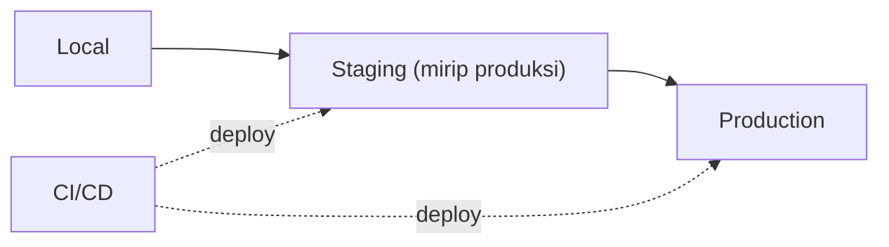

# Production Environment

Aplikasi yang berjalan mulus di laptopmu belum tentu siap melayani pengguna sungguhan. Lingkungan *production* punya aturan lain: keamanan ketat, kinerja stabil, pemulihan dari kegagalan, dan data yang tak boleh hilang. Sub bab ini memetakan perbedaan lingkungan dan prasyarat server sebelum kamu menyentuh VPS.

!!! danger "Belum teruji penulis"
    Level 10 membahas server, Nginx, Docker, dan CI/CD. Penulis **tidak menjalankan** langkah-langkahnya pada VPS atau Docker sungguhan. Isi diturunkan dari dokumentasi resmi (Laravel 13.x, Nginx, PHP, MySQL, Docker, GitHub, Let's Encrypt). Coba **hanya di server uji milikmu sendiri**, baca setiap perintah sebelum menjalankan, dan gunakan bagian "Daftar periksa verifikasi" sebagai bukti. Versi paket dan nama aksi dapat berubah; periksa dokumentasi resminya.

## Tujuan Pembelajaran

- [ ] Membedakan lingkungan local, staging, dan production.
- [ ] Menyebutkan prasyarat server Laravel 13.x (versi PHP dan ekstensi).
- [ ] Menetapkan konfigurasi wajib produksi (`APP_ENV`, `APP_DEBUG`, `APP_KEY`, log).
- [ ] Menjelaskan prinsip konfigurasi lewat lingkungan dan rahasia.
- [ ] Menyusun daftar periksa kesiapan produksi.
- [ ] Menjelaskan route kesehatan `/up`.

## Prasyarat

- Bab utama Level 01–09.
- Pemahaman dasar jaringan (IP, port, DNS) dari Level 01.

## Pengantar

Tiga hal sering terjadi saat pertama kali deploy: halaman menampilkan galat lengkap dengan konfigurasi (debug menyala), unggahan gagal (izin folder), dan antrean tak berjalan (tidak ada worker). Semuanya dapat dicegah dengan memahami perbedaan lingkungan dari awal.

## Penjelasan Konsep

### Tiga lingkungan

| Lingkungan | Tujuan | Data | Debug |
|---|---|---|---|
| Local | Pengembangan | Data palsu | Menyala |
| Staging | Uji sebelum rilis, mirip produksi | Data uji (bukan data nyata) | Mati |
| Production | Pengguna nyata | Data nyata | **Mati** |

Staging yang menyerupai produksi (versi PHP, database, antrean, cache) menangkap masalah sebelum pengguna terkena.

### Prasyarat server

Menurut dokumentasi deployment Laravel 13.x, server membutuhkan PHP ≥ 8.3 dan ekstensi: Ctype, cURL, DOM, Fileinfo, Filter, Hash, Mbstring, OpenSSL, PCRE, PDO, Session, Tokenizer, dan XML. Tambahkan ekstensi driver database (mis. `pdo_mysql`) dan, bila dipakai, `redis`. Periksa daftar terbaru di dokumentasi resmi karena dapat berubah.

### Konfigurasi wajib produksi

```text
APP_ENV=production
APP_DEBUG=false
APP_URL=https://contoh.com
LOG_LEVEL=warning
SESSION_SECURE_COOKIE=true
```

| Variabel | Alasan |
|---|---|
| `APP_DEBUG=false` | Dokumentasi menekankan bahwa `true` di produksi berisiko membocorkan konfigurasi sensitif |
| `APP_KEY` unik | Dipakai enkripsi dan cookie; jangan dipakai ulang antar-lingkungan, jangan hilang (data terenkripsi tak terbaca) |
| `APP_URL` benar | Tautan email dan aset |
| Log level wajar | `debug` di produksi membanjiri log dan membuka detail |

### Rahasia dan konfigurasi

Prinsip *twelve-factor*: konfigurasi (kredensial DB, kunci API) berada di **lingkungan**, bukan kode. File `.env` ada di server, tidak di Git. Cara lebih aman untuk tim: variabel lingkungan dari layanan secret manager atau variabel rahasia CI. Putar (*rotate*) kunci bila pernah bocor.

### Hal yang harus ada di produksi

| Kebutuhan | Sub bab |
|---|---|
| Web server + PHP-FPM | 10.04, 10.05 |
| Database terkonfigurasi | 10.06 |
| Deploy yang terulang | 10.08 |
| Worker antrean dan jadwal | 10.10, 10.11 |
| HTTPS | 10.12 |
| Backup | 10.18 |
| Monitoring | 10.19 |

### Route kesehatan

Menurut dokumentasi, Laravel menyediakan route `/up` yang mengembalikan 200 jika aplikasi berhasil boot, 500 jika tidak, dan memicu event `DiagnosingHealth` untuk pemeriksaan tambahan. Dipakai oleh load balancer dan layanan pemantau. Path dapat diubah di `withRouting(health: '/status')`.

### Keamanan

Prinsip: hak terkecil, permukaan serangan minimum, pertahanan berlapis, dan semua rahasia di luar repositori. Sub bab-sub bab berikut menerapkannya satu per satu.

## Cara Kerja



## Contoh Praktik

Kamu membuat daftar periksa kesiapan produksi untuk `cms-artikel` dan memeriksa konfigurasi proyek terhadap daftar itu (tanpa menyentuh server).

## Penjelasan Kode

Cek cepat konfigurasi lokal terhadap kebiasaan produksi:

```bash
php artisan about
php -m | sort
grep -E "^(APP_ENV|APP_DEBUG|LOG_LEVEL)=" .env
```

`php artisan about` menampilkan ringkasan lingkungan (versi PHP/Laravel, status cache, driver); `php -m` mendaftar ekstensi PHP.

## Implementasi Langkah demi Langkah

### Langkah 1: cek versi dan ekstensi

Bandingkan `php -v` dan `php -m` lokal dengan prasyarat di atas.

### Langkah 2: tulis daftar periksa

Buat `docs-deploy.md` berisi daftar periksa produksi: konfigurasi, keamanan, data, operasi.

### Langkah 3: audit rahasia

```bash
git log --all --oneline -- .env | head
git ls-files | grep -i -E "\.env$|id_rsa|\.pem$"
```

Output sebaiknya kosong. Jika ada rahasia pernah ter-commit, anggap bocor dan putar.

### Langkah 4: tentukan lingkungan

Tulis rencana: apakah memakai staging, di mana, dan bagaimana mengisinya dengan data uji.

### Langkah 5: catat di Git

```bash
git add docs-deploy.md
git commit -m "Tambah daftar periksa kesiapan produksi"
```

## Eksekusi dan Verifikasi

| Langkah | Hasil yang diharapkan |
|---|---|
| 1 | Versi PHP ≥ 8.3 dan ekstensi lengkap |
| 3 | Tidak ada `.env`/kunci privat di repositori |

## Daftar periksa verifikasi

- [ ] PHP dan ekstensi memenuhi prasyarat.
- [ ] Tidak ada rahasia di Git.
- [ ] `docs-deploy.md` memuat konfigurasi, keamanan, backup, dan monitoring.

## Hasil yang Diharapkan

Berupa dokumen dan audit lokal; tidak ada perubahan server. Belum diuji pada server sungguhan oleh penulis.

## Kesalahan Umum dan Pemecahan Masalah

| Gejala | Penyebab | Cara mengenali | Solusi | Pencegahan |
|---|---|---|---|---|
| Halaman galat menampilkan konfigurasi | `APP_DEBUG=true` | Halaman galat detail | Set `false`, `config:cache` | Daftar periksa |
| Data terenkripsi tak terbaca | `APP_KEY` berubah | Dekripsi gagal | Pulihkan kunci dari cadangan aman | Simpan kunci aman |
| Staging beda perilaku dari produksi | Versi/driver berbeda | Bug hanya di produksi | Samakan stack | Infrastruktur sebagai kode |
| Rahasia di Git | `.env` ter-commit | `git ls-files` | Cabut & putar kunci | `.gitignore`, pemindaian |
| Ekstensi hilang di server | Paket tak dipasang | Galat class/fungsi | Pasang ekstensi | Cek prasyarat |

## Latihan Praktik

### Latihan dasar

**D1. Bedakan lingkungan**
- *Masalah:* menentukan lingkungan.
- *Persyaratan:* tentukan lingkungan yang cocok untuk (a) mencoba fitur baru dengan data palsu, (b) uji penerimaan pengguna, (c) melayani pelanggan.
- *Perilaku yang diharapkan:* local, staging, production.
- *Tujuan belajar:* peran lingkungan.

### Latihan implementasi

**I1. Daftar periksa**
- *Masalah:* butuh daftar periksa kesiapan.
- *Persyaratan:* tulis minimal 15 butir terkelompok (konfigurasi, keamanan, data, operasi) untuk `cms-artikel`.
- *Perilaku yang diharapkan:* daftar lengkap dan dapat dicentang.
- *Tujuan belajar:* kesiapan produksi.

### Latihan tantangan

**T1. Strategi rahasia**
- *Masalah:* tim 5 orang berbagi `.env` lewat chat.
- *Persyaratan:* usulkan cara aman mengelola rahasia (secret manager, variabel CI, rotasi) dan risiko tiap opsi.
- *Perilaku yang diharapkan:* usulan beralasan.
- *Tujuan belajar:* manajemen rahasia.
- *Catatan:* kerjakan mandiri; tidak ada kunci jawaban.

## Uji Pemahaman

1. Apa beda staging dan production?
2. Mengapa `APP_DEBUG` harus `false`?
3. Apa fungsi route `/up`?
4. Mengapa `APP_KEY` tidak boleh hilang?

??? success "Kunci jawaban singkat"
    1. Staging meniru produksi untuk pengujian dengan data uji.
    2. Mencegah kebocoran konfigurasi sensitif.
    3. Pemeriksaan kesehatan aplikasi untuk pemantau/load balancer.
    4. Data terenkripsi tak dapat didekripsi tanpa kunci yang sama.

## Ringkasan

- Produksi menuntut debug mati, kunci terjaga, rahasia di luar repositori, dan operasi yang matang.
- Pastikan prasyarat PHP dan ekstensi terpenuhi.
- Siapkan daftar periksa sebelum menyentuh server.

Selanjutnya: *Linux Server Fundamentals*.

## Referensi Resmi

- [Laravel: Deployment](https://laravel.com/docs/13.x/deployment)
- [Laravel: Configuration](https://laravel.com/docs/13.x/configuration)
- [The Twelve-Factor App: Config](https://12factor.net/config)
