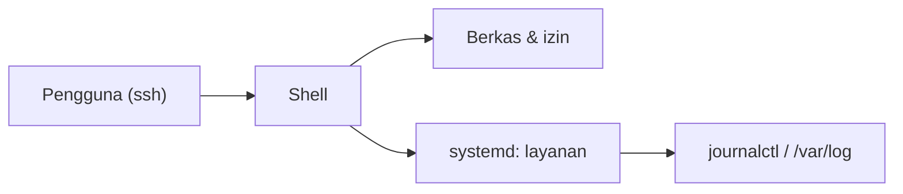

# Linux Server Fundamentals

Hampir semua server produksi Laravel berjalan di Linux. Kamu tidak perlu menjadi administrator sistem, tetapi harus nyaman bernavigasi lewat terminal, memahami pengguna dan izin, mengelola layanan, dan membaca log. Semua latihan dapat dilakukan di mesin Linux apa pun (WSL, VM, kontainer Docker, atau server uji milikmu).

!!! danger "Belum teruji penulis"
    Perintah diturunkan dari dokumentasi umum Linux/Ubuntu dan Laravel. Penulis tidak menjalankannya pada server nyata. Jalankan di lingkungan uji dan baca setiap perintah (terutama yang mengubah sistem) sebelum menjalankan.

## Tujuan Pembelajaran

- [ ] Bernavigasi dan mengelola berkas (`ls`, `cd`, `cp`, `mv`, `rm`, `mkdir`).
- [ ] Membaca dan menyunting berkas (`cat`, `less`, `tail`, `nano`).
- [ ] Memahami pengguna, grup, dan izin (`chmod`, `chown`, `sudo`).
- [ ] Mengelola paket dan layanan (`apt`, `systemctl`, `journalctl`).
- [ ] Memeriksa proses, memori, disk, dan jaringan (`ps`, `top`, `df`, `free`, `ss`).
- [ ] Menghindari perintah berbahaya (`rm -rf /`, `chmod -R 777`).

## Prasyarat

- [Production Environment](10-01-production-environment.md), dasar terminal dari Level 01.
- Akses ke mesin Linux (WSL2/VM/kontainer) untuk latihan.

## Pengantar

Aplikasi tidak muncul di browser; kamu `ssh` ke server, dan hal pertama yang kamu butuhkan adalah tahu di mana berkas berada, siapa pemilik, dan mengapa layanan tidak jalan.

## Penjelasan Konsep

### Struktur direktori penting

| Path | Isi |
|---|---|
| `/etc` | Konfigurasi sistem dan layanan (Nginx, PHP, Supervisor) |
| `/var/www` atau `/srv` | Lokasi umum aplikasi web |
| `/var/log` | Log sistem dan layanan |
| `/home/<user>` | Direktori pengguna |
| `/tmp` | Sementara |

### Navigasi dan berkas

```bash
pwd                      # lokasi saat ini
ls -la                   # daftar lengkap (termasuk tersembunyi) dengan izin
cd /var/log
cat berkas.txt           # tampilkan isi
less berkas.log          # baca bertahap (q keluar)
tail -n 50 -f laravel.log   # ikuti log secara langsung
mkdir -p dir/sub
cp -r sumber tujuan
mv lama baru
rm berkas                # hapus berkas
```

`rm -rf` menghapus rekursif tanpa tanya dan tidak bisa dibatalkan. Periksa path dua kali; jangan pernah menjalankannya dengan variabel yang mungkin kosong (`rm -rf "$DIR/"`).

### Pengguna, grup, dan izin

`ls -l` menampilkan, misalnya, `-rwxr-x---  1 deploy www-data ...`:

```text
- rwx r-x ---
│  │   │   └─ other (semua orang lain)
│  │   └──── group
│  └──────── owner
└─────────── tipe (- berkas, d direktori)
```

| Angka | Arti |
|---|---|
| r=4, w=2, x=1 | `7`=rwx, `6`=rw-, `5`=r-x, `4`=r-- |

```bash
chmod 640 .env              # pemilik baca-tulis, grup baca, lainnya tak boleh
chown deploy:www-data .env
sudo perintah               # jalankan sebagai root (gunakan seperlunya)
```

**Hindari `chmod -R 777`.** Itu memberi semua orang hak tulis dan menjadi celah. Izin yang tepat dibahas di 10.09.

### Paket dan layanan (Ubuntu/Debian)

```bash
sudo apt update
sudo apt install nginx
systemctl status nginx
sudo systemctl restart nginx
sudo systemctl enable nginx     # otomatis saat boot
journalctl -u nginx -n 50       # log layanan
```

`systemd` mengelola layanan. `journalctl` membaca log terpusat.

### Proses dan sumber daya

```bash
ps aux | grep php               # proses
top                              # pemantau interaktif (q keluar)
df -h                            # penggunaan disk
free -m                          # memori
ss -tlnp                         # port yang didengarkan
```

Disk penuh dan memori habis adalah penyebab umum aplikasi mati.

### Editor teks

`nano berkas` adalah editor termudah (Ctrl+O simpan, Ctrl+X keluar). Hati-hati menyunting berkas konfigurasi sistem: simpan salinan dulu (`cp nginx.conf nginx.conf.bak`).

### Keamanan

- Gunakan akun biasa + `sudo`, bukan login `root` terus-menerus.
- Jangan tempel perintah dari sumber tak tepercaya tanpa membacanya, terutama `curl ... | sudo bash`.
- Jangan menyimpan kata sandi di riwayat perintah; gunakan variabel lingkungan atau prompt.

## Cara Kerja



## Contoh Praktik

Kamu menjelajahi struktur, membuat folder uji, mengatur izin, membaca log layanan, dan memeriksa sumber daya pada mesin Linux uji.

## Penjelasan Kode

Skenario: membuat berkas rahasia uji dan mengatur izin agar hanya pemilik dan grup yang bisa membacanya.

## Implementasi Langkah demi Langkah

### Langkah 1: siapkan area latihan

```bash
mkdir -p ~/latihan/aplikasi/storage
cd ~/latihan
echo "RAHASIA=uji" > aplikasi/.env
```

### Langkah 2: periksa izin awal

```bash
ls -la aplikasi
```

### Langkah 3: ubah izin

```bash
chmod 640 aplikasi/.env
ls -l aplikasi/.env
```

### Langkah 4: ikuti log

```bash
echo "baris 1" >> ~/latihan/uji.log
tail -f ~/latihan/uji.log &
echo "baris 2" >> ~/latihan/uji.log
kill %1
```

### Langkah 5: periksa sumber daya

```bash
df -h | head
free -m
ss -tlnp | head
```

### Langkah 6: layanan (bila ada systemd)

```bash
systemctl list-units --type=service --state=running | head
```

### Langkah 7: bersihkan

```bash
rm -r ~/latihan
```

## Eksekusi dan Verifikasi

| Langkah | Hasil yang diharapkan |
|---|---|
| 3 | `-rw-r-----` pada `.env` |
| 4 | `tail -f` menampilkan "baris 2" |
| 5 | Tabel disk/memori/port tampil |

## Daftar periksa verifikasi

- [ ] Kamu dapat menjelaskan arti `-rw-r-----`.
- [ ] Kamu dapat menemukan log layanan dengan `journalctl`.
- [ ] Kamu tahu mengapa `chmod 777` dihindari.

## Hasil yang Diharapkan

Keluaran bergantung distribusi Linux. Belum diuji pada server nyata oleh penulis.

## Kesalahan Umum dan Pemecahan Masalah

| Gejala | Penyebab | Cara mengenali | Solusi | Pencegahan |
|---|---|---|---|---|
| `Permission denied` | Izin/pemilik salah | Galat saat baca/tulis | `ls -l`, `chown`/`chmod` seperlunya | Pahami pemilik |
| `command not found` | Paket belum terpasang / PATH | Pesan galat | `apt install` | Cek nama paket |
| Layanan gagal start | Konfigurasi salah | `systemctl status` merah | `journalctl -u nama` | Uji konfigurasi sebelum restart |
| Disk penuh | Log besar | `df -h` 100% | Bersihkan/rotasi log | Pantau disk |
| Salah hapus | `rm -rf` ceroboh | Data hilang | Pulihkan dari cadangan | Periksa path, backup |
| Kata sandi di riwayat | Diketik di perintah | `history` | Hapus & ganti | Gunakan prompt |

## Latihan Praktik

### Latihan dasar

**D1. Baca izin**
- *Masalah:* menafsirkan izin.
- *Persyaratan:* jelaskan `drwxr-x---` dan `-rw-rw-r--`.
- *Perilaku yang diharapkan:* direktori: pemilik rwx, grup r-x, lain tak ada; berkas: pemilik/grup rw, lain r.
- *Tujuan belajar:* membaca izin.

### Latihan implementasi

**I1. Cari file besar**
- *Masalah:* disk hampir penuh.
- *Persyaratan:* temukan 5 berkas terbesar di `/var/log` (`du -ah /var/log | sort -rh | head -5`) dan jelaskan langkah aman membersihkannya.
- *Perilaku yang diharapkan:* daftar dan rencana tanpa menghapus sembarangan.
- *Tujuan belajar:* diagnosis disk.

**I2. Layanan**
- *Masalah:* layanan gagal start.
- *Persyaratan:* tulis urutan diagnosis (status → log → uji konfigurasi → perbaiki → restart).
- *Perilaku yang diharapkan:* urutan benar.
- *Tujuan belajar:* pemecahan masalah.

### Latihan tantangan

**T1. Skrip pemeriksaan harian**
- *Masalah:* ingin ringkasan kesehatan.
- *Persyaratan:* tulis skrip Bash yang mencetak penggunaan disk, memori, dan 5 proses teratas, dengan `set -euo pipefail`.
- *Perilaku yang diharapkan:* skrip berjalan tanpa galat.
- *Tujuan belajar:* otomasi sederhana.
- *Catatan:* kerjakan mandiri; tidak ada kunci jawaban.

## Uji Pemahaman

1. Apa arti `chmod 640`?
2. Mengapa `chmod -R 777` berbahaya?
3. Apa fungsi `journalctl -u nginx`?
4. Mengapa tidak login sebagai root terus-menerus?

??? success "Kunci jawaban singkat"
    1. Pemilik baca-tulis, grup baca, lainnya tanpa akses.
    2. Semua orang dapat menulis berkas, membuka celah eksekusi dan perusakan.
    3. Membaca log layanan Nginx.
    4. Kesalahan kecil bisa merusak sistem; sudo membatasi dan mencatat.

## Ringkasan

- Kuasai navigasi, izin, paket, layanan, dan log di Linux.
- Hindari `777` dan perintah destruktif ceroboh.
- Periksa sumber daya (disk, memori, port) saat diagnosis.

Selanjutnya: *VPS Preparation*.

## Referensi Resmi

- [Ubuntu Server Documentation](https://ubuntu.com/server/docs)
- [Linux man pages](https://man7.org/linux/man-pages/)
- [Laravel: Deployment](https://laravel.com/docs/13.x/deployment)
