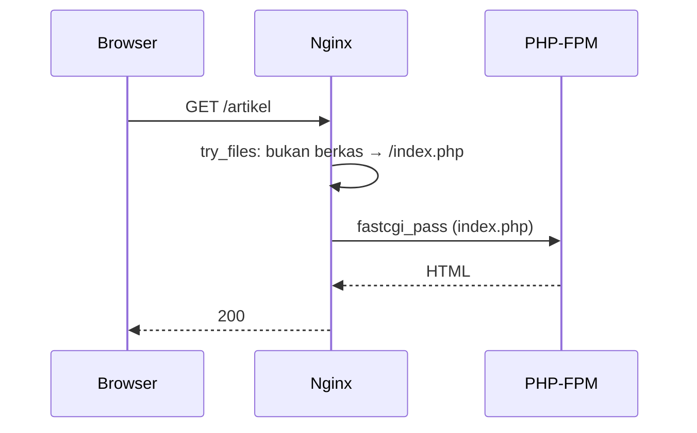

# Nginx Configuration

Web server menerima permintaan HTTP dari internet, menyajikan berkas statis, dan meneruskan permintaan PHP ke PHP-FPM. **Nginx** adalah pilihan populer untuk Laravel. Sub bab ini memasang Nginx dan memakai konfigurasi dari dokumentasi Laravel, dengan penjelasan setiap blok dan pengamanannya.

!!! danger "Belum teruji penulis"
    Konfigurasi di bawah diturunkan dari dokumentasi deployment Laravel 13.x dan Nginx, dan belum dijalankan penulis pada server nyata. Uji di server milikmu, selalu jalankan `nginx -t` sebelum memuat ulang, dan simpan cadangan konfigurasi.

## Tujuan Pembelajaran

- [ ] Memasang Nginx dan memahami struktur konfigurasinya.
- [ ] Menulis server block untuk Laravel (root ke `public/`, `try_files`, `fastcgi_pass`).
- [ ] Menjelaskan mengapa `root` harus menunjuk `public/` dan bukan root proyek.
- [ ] Mengaktifkan, menguji (`nginx -t`), dan memuat ulang konfigurasi.
- [ ] Memblokir akses ke berkas tersembunyi dan skrip PHP selain `index.php`.
- [ ] Membaca log akses dan galat Nginx.

## Prasyarat

- [VPS Preparation](10-03-vps-preparation.md), nama domain mengarah ke IP server (untuk HTTPS di 10.12).
- PHP-FPM dipasang di sub bab berikutnya; di sini fokus Nginx (kamu bisa menyelesaikan 10.05 lalu kembali untuk uji akhir).

## Pengantar

Salah satu kesalahan deploy paling berbahaya: mengarahkan `root` ke folder proyek. Maka `https://situs.com/.env` dapat diunduh siapa saja. Nginx harus hanya menyajikan `public/`.

## Penjelasan Konsep

### Pemasangan

```bash
sudo apt install nginx
sudo systemctl enable --now nginx
systemctl status nginx
```

Dengan UFW dari 10.03, port 80/443 sudah dibuka. Halaman sambutan Nginx muncul di `http://IP_SERVER`.

### Struktur (Debian/Ubuntu)

| Path | Fungsi |
|---|---|
| `/etc/nginx/nginx.conf` | Konfigurasi utama |
| `/etc/nginx/sites-available/` | Konfigurasi situs (tersedia) |
| `/etc/nginx/sites-enabled/` | Tautan simbolik ke yang aktif |
| `/var/log/nginx/` | `access.log`, `error.log` |

### Server block untuk Laravel

Menurut dokumentasi, konfigurasi awal yang disarankan (sesuaikan domain, path, dan versi PHP):

File: `/etc/nginx/sites-available/contoh.com`

```nginx
server {
    listen 80;
    listen [::]:80;
    server_name contoh.com www.contoh.com;
    root /var/www/contoh.com/current/public;

    add_header X-Frame-Options "SAMEORIGIN";
    add_header X-Content-Type-Options "nosniff";

    index index.php;

    charset utf-8;

    location / {
        try_files $uri $uri/ /index.php?$query_string;
    }

    location = /favicon.ico { access_log off; log_not_found off; }
    location = /robots.txt  { access_log off; log_not_found off; }

    error_page 404 /index.php;

    location ~ ^/index\.php(/|$) {
        fastcgi_pass unix:/var/run/php/php8.3-fpm.sock;
        fastcgi_param SCRIPT_FILENAME $realpath_root$fastcgi_script_name;
        include fastcgi_params;
        fastcgi_hide_header X-Powered-By;
    }

    location ~ \.php$ {
        return 404;
    }

    location ~ /\.(?!well-known).* {
        deny all;
    }
}
```

| Baris | Fungsi |
|---|---|
| `server_name` | Domain yang dilayani |
| `root .../public` | **Hanya** `public/` yang terpapar ke web |
| `try_files $uri $uri/ /index.php?$query_string` | Berkas statis bila ada; jika tidak, serahkan ke `index.php` (front controller Laravel) |
| `location ~ ^/index\.php(/|$)` | Hanya `index.php` yang diteruskan ke PHP-FPM |
| `fastcgi_pass unix:...sock` | Soket PHP-FPM (sesuaikan versi PHP) |
| `location ~ \.php$ { return 404; }` | Skrip PHP lain tidak dieksekusi (mencegah eksekusi unggahan berbahaya) |
| `location ~ /\.(?!well-known).*` | Blokir `.env`, `.git`, dll. kecuali `.well-known` (diperlukan sertifikat) |
| `X-Content-Type-Options`, `X-Frame-Options` | Header keamanan dasar |
| `fastcgi_hide_header X-Powered-By` | Tidak membocorkan versi PHP |

Path `/var/www/contoh.com/current/public` mengikuti pola rilis (10.08); `current` adalah tautan ke rilis aktif.

### Mengaktifkan

```bash
sudo ln -s /etc/nginx/sites-available/contoh.com /etc/nginx/sites-enabled/
sudo rm /etc/nginx/sites-enabled/default      # situs bawaan, bila tak dipakai
sudo nginx -t
sudo systemctl reload nginx
```

**Selalu `nginx -t` dulu.** `reload` menerapkan konfigurasi tanpa memutus koneksi aktif; jika konfigurasi salah, Nginx menolaknya dan tetap memakai yang lama.

### Batas unggahan

Nginx membatasi ukuran body permintaan (`client_max_body_size`, bawaan 1 MB). Bila aplikasi menerima unggahan lebih besar, atur di server block (mis. `client_max_body_size 10M;`) dan samakan dengan batas PHP (`upload_max_filesize`, `post_max_size`) serta validasi Laravel. Batasi seperlunya; nilai besar mengundang penyalahgunaan.

### Aset statis

Tambahkan cache panjang untuk aset berhash Vite:

```nginx
location ~* \.(?:css|js|woff2?|png|jpe?g|gif|svg|ico)$ {
    expires 1y;
    add_header Cache-Control "public, immutable";
    access_log off;
}
```

(Letakkan sebelum blok `location ~ \.php$` bila konflik; nama berkas dari Vite berisi hash sehingga aman di-cache lama.) Perhatikan bahwa blok ini tidak boleh membuat PHP tereksekusi: ia hanya cocok untuk ekstensi aset.

### Log

```bash
sudo tail -n 50 /var/log/nginx/error.log
sudo tail -f /var/log/nginx/access.log
```

### Keamanan

- `root` ke `public/` saja; jangan pernah ke root proyek.
- Sembunyikan versi Nginx: `server_tokens off;` di blok `http` pada `nginx.conf`.
- Jangan mengaktifkan `autoindex`.
- HTTPS dibahas di 10.12 (menambahkan header HSTS di sana).

## Cara Kerja



## Contoh Praktik

Kamu memasang Nginx, membuat server block dengan root sementara berisi `index.html` uji, memverifikasi blokir berkas tersembunyi, lalu mengganti root ke `public/` pada 10.08.

## Penjelasan Kode

Untuk uji awal tanpa PHP: buat `/var/www/contoh.com/current/public/index.html` berisi teks sederhana, serta berkas `/var/www/contoh.com/current/.env` berisi "rahasia" untuk membuktikan bahwa berkas di luar `public` dan dotfile tidak bisa diakses.

## Implementasi Langkah demi Langkah

### Langkah 1: pasang Nginx

```bash
sudo apt install nginx
```

### Langkah 2: siapkan direktori uji

```bash
sudo mkdir -p /var/www/contoh.com/current/public
echo "Halo dari Nginx" | sudo tee /var/www/contoh.com/current/public/index.html
echo "RAHASIA=uji" | sudo tee /var/www/contoh.com/current/.env
```

### Langkah 3: server block

Buat berkas di `sites-available` (gunakan domain/IP-mu) dan aktifkan.

### Langkah 4: uji dan muat ulang

```bash
sudo nginx -t && sudo systemctl reload nginx
```

### Langkah 5: verifikasi

```bash
curl -i http://contoh.com/                 # 200 + "Halo dari Nginx"
curl -i http://contoh.com/.env             # 404 atau 403, bukan isi berkas
curl -i http://contoh.com/test.php         # 404
```

### Langkah 6: periksa log

```bash
sudo tail -n 5 /var/log/nginx/access.log
```

### Langkah 7: simpan konfigurasi

Salin konfigurasi ke repositori infrastruktur/dokumentasimu (tanpa rahasia): `docs-deploy.md`.

## Eksekusi dan Verifikasi

| Langkah | Hasil yang diharapkan |
|---|---|
| 4 | `syntax is ok` dan `test is successful` |
| 5 | `/` 200; `/.env` tidak membocorkan isi; `.php` selain `index.php` 404 |

## Daftar periksa verifikasi

- [ ] `root` menunjuk ke `.../public`.
- [ ] `/.env` dan `/.git/` tidak dapat diakses.
- [ ] `nginx -t` bersih sebelum reload.
- [ ] Header keamanan terkirim (`curl -I`).
- [ ] Versi Nginx/PHP tidak bocor di header.

## Hasil yang Diharapkan

Respons tepatnya bergantung konfigurasi; penulis belum menjalankannya.

## Kesalahan Umum dan Pemecahan Masalah

| Gejala | Penyebab | Cara mengenali | Solusi | Pencegahan |
|---|---|---|---|---|
| `.env` dapat diunduh | `root` ke root proyek / tanpa blokir dotfile | Isi `.env` terbaca | Root ke `public`, blokir dotfile | Uji `curl /.env` |
| 502 Bad Gateway | PHP-FPM mati / soket salah | Galat 502 | Periksa FPM & path soket | `systemctl status php8.3-fpm` |
| 404 di semua route | `try_files` salah | Hanya `/` bekerja | Perbaiki `try_files` | Salin dari dokumentasi |
| `nginx -t` gagal | Titik koma/kurung hilang | Pesan baris | Perbaiki | Uji sebelum reload |
| 413 Request Entity Too Large | `client_max_body_size` kecil | Unggahan gagal | Naikkan seperlunya | Samakan dengan PHP |
| Halaman default Nginx | Situs `default` aktif | Teks "Welcome to nginx" | Hapus tautan default | Bersihkan |

## Latihan Praktik

### Latihan dasar

**D1. Kenapa `public/`?**
- *Masalah:* paham isolasi.
- *Persyaratan:* jelaskan apa yang bocor bila root = folder proyek.
- *Perilaku yang diharapkan:* `.env`, kode, `vendor`, `storage`.
- *Tujuan belajar:* batas web.

### Latihan implementasi

**I1. Header keamanan**
- *Masalah:* ingin menambah header.
- *Persyaratan:* tambah `Referrer-Policy` dan `Permissions-Policy` yang wajar dan verifikasi dengan `curl -I`.
- *Perilaku yang diharapkan:* header terlihat.
- *Tujuan belajar:* hardening dasar.

**I2. Pembatasan laju di Nginx**
- *Masalah:* ingin lapisan perlindungan sebelum PHP.
- *Persyaratan:* baca `limit_req_zone`/`limit_req` dan rancang batas untuk `/login`.
- *Perilaku yang diharapkan:* rancangan benar.
- *Tujuan belajar:* pertahanan berlapis.

### Latihan tantangan

**T1. Dua situs satu server**
- *Masalah:* staging dan produksi di satu VPS.
- *Persyaratan:* rancang dua server block (domain, root, soket FPM terpisah) dan risiko berbagi server.
- *Perilaku yang diharapkan:* rancangan beralasan.
- *Tujuan belajar:* multi-situs.
- *Catatan:* kerjakan mandiri; tidak ada kunci jawaban.

## Uji Pemahaman

1. Mengapa `root` harus `public/`?
2. Apa fungsi `try_files ... /index.php?$query_string`?
3. Mengapa `location ~ \.php$ { return 404; }`?
4. Mengapa `nginx -t` sebelum reload?

??? success "Kunci jawaban singkat"
    1. Agar kode dan `.env` tidak dapat diakses publik.
    2. Berkas statis bila ada; selain itu ke front controller Laravel.
    3. Mencegah eksekusi skrip PHP selain `index.php`.
    4. Mencegah menerapkan konfigurasi rusak.

## Ringkasan

- Nginx menyajikan `public/` dan meneruskan `index.php` ke PHP-FPM.
- Blokir dotfile dan PHP lain; sembunyikan versi; uji dengan `nginx -t`.
- Verifikasi dari luar dengan `curl`.

Selanjutnya: *PHP-FPM*.

## Referensi Resmi

- [Laravel: Deployment, Nginx](https://laravel.com/docs/13.x/deployment#nginx)
- [Nginx Documentation](https://nginx.org/en/docs/)
