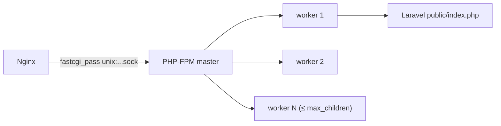

# PHP-FPM

Nginx tidak mengeksekusi PHP. Ia meneruskan permintaan ke **PHP-FPM** (FastCGI Process Manager), yaitu sekumpulan proses PHP yang siap melayani. Penyetelan FPM menentukan berapa permintaan yang bisa diproses bersamaan, berapa memori terpakai, dan seberapa aman PHP dijalankan.

!!! danger "Belum teruji penulis"
    Konfigurasi diturunkan dari dokumentasi PHP, Ubuntu, dan Laravel 13.x dan belum dijalankan penulis pada server nyata. Nama paket dan path (`/etc/php/8.3/...`) bergantung distribusi dan versi PHP. Selalu uji konfigurasi sebelum memuat ulang.

## Tujuan Pembelajaran

- [ ] Memasang PHP 8.3+ dengan ekstensi yang dibutuhkan Laravel.
- [ ] Menjelaskan peran pool FPM, pengguna proses, dan soket.
- [ ] Mengatur `pm`, `pm.max_children`, dan parameter terkait berdasarkan memori.
- [ ] Mengatur `php.ini` produksi (error, OPcache, batas unggahan, keamanan).
- [ ] Memasang Composer dengan cara yang diverifikasi.
- [ ] Memuat ulang FPM dengan benar setelah deploy.

## Prasyarat

- [Nginx Configuration](10-04-nginx-configuration.md), [Optimasi Performa Laravel](../level-09/09-02-laravel-performance-optimization.md).

## Pengantar

Aplikasi dengan 2 GB RAM mulai menolak permintaan (502) saat trafik naik. Penyebabnya: `pm.max_children` terlalu rendah, atau terlalu tinggi sehingga memori habis dan proses dibunuh sistem. Penyetelan harus berdasarkan angka.

## Penjelasan Konsep

### Memasang

Ubuntu 24.04 menyertakan PHP 8.3 di repositori resmi. Pada rilis Ubuntu yang lebih lama, PHP 8.3 biasanya didapat dari repositori pihak ketiga (PPA); itu menambah kepercayaan pada pihak ketiga, jadi periksa dokumentasi distribusimu.

```bash
sudo apt update
sudo apt install php8.3-fpm php8.3-cli php8.3-mysql php8.3-mbstring \
  php8.3-xml php8.3-curl php8.3-zip php8.3-bcmath php8.3-intl php8.3-redis
php -v
php -m | sort
systemctl status php8.3-fpm
```

Ekstensi Ctype, Tokenizer, Fileinfo, DOM, dan lainnya biasanya sudah tercakup paket inti/`xml`/`mbstring`; periksa `php -m` terhadap prasyarat (10.01). `php8.3-redis` hanya bila memakai Redis.

### Pool dan pengguna

Konfigurasi pool: `/etc/php/8.3/fpm/pool.d/www.conf`.

```ini
[www]
user = www-data
group = www-data
listen = /run/php/php8.3-fpm.sock
listen.owner = www-data
listen.group = www-data
listen.mode = 0660
```

`user`/`group` menentukan identitas proses PHP; ini yang menulis ke `storage/`. Soket UNIX harus bisa dibaca Nginx (yang juga berjalan sebagai `www-data` di Ubuntu). Untuk isolasi lebih baik, aplikasi berbeda memakai pool dan pengguna berbeda.

### Mode proses

```ini
pm = dynamic
pm.max_children = 10
pm.start_servers = 3
pm.min_spare_servers = 2
pm.max_spare_servers = 5
pm.max_requests = 500
```

| Parameter | Arti |
|---|---|
| `pm = dynamic` | Jumlah proses naik-turun sesuai beban |
| `pm.max_children` | Batas atas proses bersamaan |
| `pm.max_requests` | Restart proses setelah N permintaan (mencegah bocor memori) |

**Menghitung `max_children`:**

`max_children ≈ (RAM tersedia untuk PHP) ÷ (memori rata-rata per proses)`.

Ukur memori proses:

```bash
ps --no-headers -o rss -C php-fpm8.3 | awk '{sum+=$1; n++} END {print sum/n/1024 " MB rata-rata"}'
```

Contoh: server 2 GB, sisihkan ±1 GB untuk PHP, proses ±60 MB → ±16. Sisakan memori untuk MySQL, Nginx, worker antrean, dan sistem. Angka ini contoh perhitungan, bukan rekomendasi: ukur milikmu.

### `php.ini` produksi

Berkas: `/etc/php/8.3/fpm/php.ini` (FPM) dan `/etc/php/8.3/cli/php.ini` (CLI, untuk artisan/worker).

```ini
expose_php = Off
display_errors = Off
log_errors = On
memory_limit = 256M
upload_max_filesize = 10M
post_max_size = 12M
max_execution_time = 30

opcache.enable = 1
opcache.memory_consumption = 192
opcache.max_accelerated_files = 20000
opcache.validate_timestamps = 0
```

| Pengaturan | Alasan |
|---|---|
| `display_errors=Off` | Jangan tampilkan galat ke pengunjung |
| `expose_php=Off` | Sembunyikan versi PHP |
| `opcache.validate_timestamps=0` | Tidak memeriksa perubahan berkas tiap permintaan (cepat); konsekuensinya **harus reload FPM saat deploy** |
| `post_max_size` ≥ `upload_max_filesize` | Konsisten dengan batas Nginx dan validasi Laravel |

### Composer

Pasang Composer dengan cara resmi dan verifikasi tanda tangan (lihat petunjuk di getcomposer.org/download, yang memuat skrip dengan pemeriksaan hash). Jangan menjalankan `curl ... | php` tanpa verifikasi. Alternatif: paket `composer` dari distribusi (versi bisa lebih lama).

### Reload

```bash
sudo php-fpm8.3 -t                    # uji konfigurasi
sudo systemctl reload php8.3-fpm      # terapkan tanpa memutus permintaan berjalan
```

Reload FPM juga mengosongkan OPcache, sehingga kode rilis baru terbaca.

### Keamanan

- Jangan menjalankan PHP-FPM sebagai root.
- Matikan `display_errors`, sembunyikan `expose_php`.
- `disable_functions` (mis. `exec`, `shell_exec`, `system`) dapat mengurangi dampak kompromi, tetapi dapat memecahkan paket yang memerlukannya; uji terlebih dahulu.
- `open_basedir` dapat membatasi akses berkas PHP; dapat menyulitkan Composer/aplikasi, gunakan dengan hati-hati.
- Perbarui PHP secara berkala (patch keamanan).

## Cara Kerja



## Contoh Praktik

Kamu memasang PHP-FPM dan ekstensi, menyetel pool dan `php.ini`, menjalankan skrip `phpinfo` sementara (dihapus segera), dan mengukur memori per proses untuk menghitung `max_children`.

## Penjelasan Kode

Skrip uji sementara `/var/www/contoh.com/current/public/info.php` membuka informasi sensitif; hapus segera setelah dipakai. Karena `location ~ \.php$ { return 404; }` di Nginx, `info.php` tidak akan berjalan; untuk uji sementara gunakan CLI: `php -i | grep -i opcache`.

## Implementasi Langkah demi Langkah

### Langkah 1: pasang

Jalankan perintah `apt install` di atas (sesuaikan versi).

### Langkah 2: periksa ekstensi

```bash
php -m | grep -i -E "mbstring|xml|curl|pdo_mysql|openssl|tokenizer|ctype|fileinfo"
```

### Langkah 3: atur pool

Edit `www.conf`, uji dengan `php-fpm8.3 -t`.

### Langkah 4: atur `php.ini`

Edit FPM dan CLI. Jalankan `php -i | grep -E "display_errors|opcache.enable|memory_limit"`.

### Langkah 5: reload

```bash
sudo systemctl reload php8.3-fpm
systemctl status php8.3-fpm
```

### Langkah 6: hubungkan dengan Nginx

Pastikan `fastcgi_pass unix:/run/php/php8.3-fpm.sock;` sama dengan `listen` di pool. Uji `nginx -t`.

### Langkah 7: ukur memori

Jalankan perintah `ps ... awk` setelah aplikasi dipakai beberapa saat; hitung `max_children`.

## Eksekusi dan Verifikasi

| Langkah | Hasil yang diharapkan |
|---|---|
| 2 | Ekstensi tampil |
| 5 | `active (running)` |
| 6 | Nginx bisa meneruskan ke FPM (diuji penuh pada 10.08) |

## Daftar periksa verifikasi

- [ ] Versi PHP ≥ 8.3 dan ekstensi lengkap.
- [ ] `display_errors=Off`, `expose_php=Off`.
- [ ] Soket pada pool dan Nginx identik.
- [ ] `pm.max_children` dihitung dari pengukuran.
- [ ] OPcache aktif dan prosedur reload dipahami.

## Hasil yang Diharapkan

Bergantung distribusi dan versi; belum diuji penulis.

## Kesalahan Umum dan Pemecahan Masalah

| Gejala | Penyebab | Cara mengenali | Solusi | Pencegahan |
|---|---|---|---|---|
| 502 Bad Gateway | FPM mati / soket tak cocok | Log Nginx: connect() failed | Samakan path soket; start FPM | `nginx -t`, `systemctl status` |
| 502 saat trafik | `max_children` kecil | Log FPM: reached pm.max_children | Naikkan sesuai memori | Ukur |
| Server kehabisan memori | `max_children` terlalu besar | OOM killer | Turunkan | Hitung |
| Perubahan kode tak terbaca | `validate_timestamps=0` | Kode lama | Reload FPM saat deploy | Skrip deploy |
| Izin `storage` ditolak | Pengguna FPM beda | Galat tulis log | Atur pemilik/grup (10.09) | Konsisten |
| Konfigurasi CLI berbeda | Mengedit hanya FPM `php.ini` | Worker berperilaku beda | Atur CLI juga | Periksa `php --ini` |

## Latihan Praktik

### Latihan dasar

**D1. Hitung `max_children`**
- *Masalah:* server 4 GB, 2 GB untuk PHP, 80 MB per proses.
- *Persyaratan:* hitung `max_children` dan beri margin.
- *Perilaku yang diharapkan:* 25 → sekitar 20–22.
- *Tujuan belajar:* perhitungan kapasitas.

### Latihan implementasi

**I1. Pool terpisah**
- *Masalah:* dua aplikasi satu server.
- *Persyaratan:* buat pool kedua dengan pengguna berbeda dan soket sendiri, hubungkan ke server block terpisah.
- *Perilaku yang diharapkan:* isolasi proses.
- *Tujuan belajar:* isolasi aplikasi.

**I2. Log lambat FPM**
- *Masalah:* ingin menemukan skrip lambat.
- *Persyaratan:* aktifkan `slowlog` dan `request_slowlog_timeout` pada pool dan baca hasilnya.
- *Perilaku yang diharapkan:* jejak permintaan lambat.
- *Tujuan belajar:* diagnosis.

### Latihan tantangan

**T1. Rencana penyetelan**
- *Masalah:* aplikasi lambat saat beban puncak.
- *Persyaratan:* tulis langkah penyetelan FPM berbasis data (ukur memori, uji beban terbatas, ubah satu parameter, pantau) dan batas aman.
- *Perilaku yang diharapkan:* rencana ilmiah.
- *Tujuan belajar:* penyetelan berbasis ukuran.
- *Catatan:* kerjakan mandiri; tidak ada kunci jawaban.

## Uji Pemahaman

1. Apa peran PHP-FPM?
2. Bagaimana memperkirakan `pm.max_children`?
3. Mengapa `validate_timestamps=0` mengharuskan reload saat deploy?
4. Mengapa `display_errors=Off`?

??? success "Kunci jawaban singkat"
    1. Menjalankan proses PHP yang melayani permintaan dari Nginx.
    2. Memori tersedia untuk PHP dibagi memori rata-rata per proses.
    3. OPcache tidak lagi memeriksa perubahan berkas.
    4. Agar galat tidak tampil ke pengunjung.

## Ringkasan

- PHP-FPM menjalankan PHP; setel `pm.max_children` dari data memori.
- `php.ini` produksi: tanpa tampilan galat, OPcache aktif, batas unggahan konsisten.
- Reload FPM setelah deploy; jaga pembaruan keamanan.

Selanjutnya: *MySQL Production Configuration*.

## Referensi Resmi

- [PHP: FPM Configuration](https://www.php.net/manual/en/install.fpm.configuration.php)
- [Laravel: Deployment, Server Requirements](https://laravel.com/docs/13.x/deployment#server-requirements)
- [Composer: Download](https://getcomposer.org/download/)
