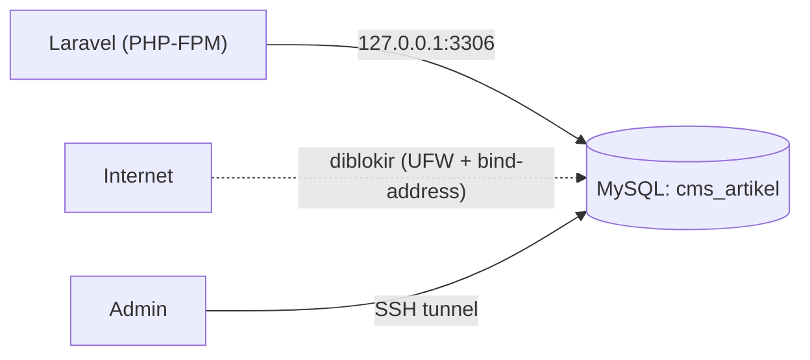

# MySQL Production Configuration

Database menyimpan satu-satunya salinan data pengguna. Konfigurasi produksi MySQL harus mengutamakan keamanan (tidak terbuka ke publik, hak akses minimal), integritas (charset, mesin penyimpanan), dan keandalan (backup, pemantauan). Sub bab ini memasang dan mengonfigurasi MySQL pada server yang sama dengan aplikasi, yaitu pola paling sederhana untuk VPS tunggal.

!!! danger "Belum teruji penulis"
    Perintah diturunkan dari dokumentasi MySQL dan Ubuntu dan belum dijalankan penulis pada server nyata. Jangan menjalankan perintah `DROP`/`GRANT` pada server yang berisi data penting tanpa cadangan. Contoh memakai MySQL 8.x; MariaDB memiliki perbedaan.

## Tujuan Pembelajaran

- [ ] Memasang MySQL dan menjalankan pengamanan awal.
- [ ] Membuat database `utf8mb4` dan pengguna aplikasi berhak minimal.
- [ ] Memastikan MySQL hanya mendengarkan koneksi lokal.
- [ ] Menghubungkan Laravel lewat `.env` dan menjalankan migrasi.
- [ ] Mengenal pengaturan dasar (`innodb_buffer_pool_size`, slow query log).
- [ ] Menjelaskan pemisahan akun migrasi dan akun aplikasi (opsional).

## Prasyarat

- [PHP-FPM](10-05-php-fpm.md), [Database Indexing](../level-09/09-04-database-indexing.md).

## Pengantar

Kesalahan umum: aplikasi memakai akun `root` MySQL tanpa kata sandi atau MySQL terbuka di `0.0.0.0:3306`. Bot internet memindai port 3306 terus-menerus.

## Penjelasan Konsep

### Memasang

```bash
sudo apt install mysql-server
sudo systemctl enable --now mysql
sudo mysql_secure_installation
```

`mysql_secure_installation` memandu: kebijakan kata sandi, menghapus pengguna anonim, melarang login root jarak jauh, dan menghapus database `test`. Baca setiap pertanyaan dan jawab dengan sadar.

### Database dan pengguna aplikasi

Masuk sebagai admin (di Ubuntu, root MySQL memakai autentikasi soket lewat `sudo mysql`):

```sql
CREATE DATABASE cms_artikel CHARACTER SET utf8mb4 COLLATE utf8mb4_unicode_ci;

CREATE USER 'cms_app'@'localhost' IDENTIFIED BY 'GANTI_DENGAN_SANDI_KUAT_ACAK';

GRANT SELECT, INSERT, UPDATE, DELETE ON cms_artikel.* TO 'cms_app'@'localhost';
FLUSH PRIVILEGES;
```

| Bagian | Alasan |
|---|---|
| `utf8mb4` | Mendukung seluruh Unicode (termasuk emoji) |
| `'cms_app'@'localhost'` | Akun hanya boleh dari server itu sendiri |
| Hak `SELECT, INSERT, UPDATE, DELETE` | Hak terkecil untuk operasi aplikasi |
| Sandi acak panjang | Buat dengan pengelola sandi atau `openssl rand -base64 24` |

Migrasi memerlukan `CREATE`, `ALTER`, `DROP`, `INDEX`, dan lainnya. Dua pendekatan: (a) memberi akun aplikasi hak tambahan itu (sederhana, hak lebih luas), atau (b) memakai akun terpisah `cms_migrator` hanya saat deploy (lebih aman, lebih kompleks). Untuk belajar, (a) wajar; pahami kompromi dan pertimbangkan (b) di tim.

### Hanya dengarkan lokal

`/etc/mysql/mysql.conf.d/mysqld.cnf`:

```ini
bind-address = 127.0.0.1
```

Verifikasi:

```bash
sudo ss -tlnp | grep 3306        # harus 127.0.0.1:3306
```

Jangan membuka 3306 di UFW. Akses administrasi jarak jauh lewat **terowongan SSH** (`ssh -L 3307:127.0.0.1:3306 deploy@IP_SERVER`), bukan membuka port.

### Menghubungkan Laravel

`.env` di server (bukan Git):

```text
DB_CONNECTION=mysql
DB_HOST=127.0.0.1
DB_PORT=3306
DB_DATABASE=cms_artikel
DB_USERNAME=cms_app
DB_PASSWORD=...isi_dari_pengelola_sandi...
```

Lalu `php artisan migrate --force` (di produksi flag `--force` diperlukan karena Laravel meminta konfirmasi) dibahas di 10.08.

### Penyetelan dasar

| Pengaturan | Catatan |
|---|---|
| `innodb_buffer_pool_size` | Cache data InnoDB; pada server khusus DB bisa 50–70% RAM, pada server berbagi dengan PHP gunakan bagian kecil (mis. 25–40%). Ukur |
| `max_connections` | Sesuaikan dengan `pm.max_children` dan worker; terlalu besar boros memori |
| `slow_query_log=1`, `long_query_time=1` | Mencatat query lambat untuk dianalisis (09.03) |

Contoh di `/etc/mysql/mysql.conf.d/zz-app.cnf`:

```ini
[mysqld]
innodb_buffer_pool_size = 512M
max_connections = 100
slow_query_log = 1
slow_query_log_file = /var/log/mysql/slow.log
long_query_time = 1
```

Angka adalah contoh untuk server kecil; sesuaikan dengan RAM dan ukur. Setelah ubah: `sudo systemctl restart mysql`.

### Integritas dan zona waktu

Gunakan `utf8mb4` konsisten. Simpan waktu dalam UTC pada aplikasi (`config/app.php` timezone `UTC`) dan konversi di tampilan, atau tetapkan konsisten; hindari campur aduk.

### Backup

Backup dibahas di 10.18. Prinsip: backup teratur, terenkripsi, di luar server, dan **diuji pemulihannya**.

### Keamanan

- Jangan memakai `root` untuk aplikasi.
- Jangan membuka 3306 ke internet; gunakan SSH tunnel atau jaringan privat.
- Sandi unik dan kuat; rotasi bila bocor.
- Perbarui MySQL untuk patch keamanan.

## Cara Kerja



## Contoh Praktik

Kamu memasang MySQL, membuat database dan akun aplikasi, memastikan hanya mendengarkan lokal, dan menguji koneksi dari PHP CLI.

## Penjelasan Kode

Tes koneksi dari proyek Laravel di server (setelah `.env` terisi):

```bash
php artisan tinker --execute="echo DB::select('select version() as v')[0]->v;"
```

Perintah mencetak versi MySQL jika koneksi berhasil.

## Implementasi Langkah demi Langkah

### Langkah 1: pasang dan amankan

Jalankan `apt install` dan `mysql_secure_installation`.

### Langkah 2: buat database dan pengguna

Masuk `sudo mysql`, jalankan SQL di atas dengan sandi acak yang kamu buat (simpan di pengelola sandi).

### Langkah 3: batasi alamat

Set `bind-address = 127.0.0.1`, restart, verifikasi dengan `ss -tlnp`.

### Langkah 4: uji dari luar

Dari komputer lain: `nc -vz IP_SERVER 3306` harus gagal/terblokir.

### Langkah 5: uji dari aplikasi

Isi `.env` (izin 640, 10.07) dan jalankan perintah tinker di atas.

### Langkah 6: aktifkan slow log

Buat `zz-app.cnf`, restart, dan buat query lambat sengaja (`SELECT SLEEP(2);`) lalu baca `slow.log`.

### Langkah 7: catat

Tulis di `docs-deploy.md` (tanpa sandi): nama DB, nama pengguna, pengaturan.

## Eksekusi dan Verifikasi

| Langkah | Hasil yang diharapkan |
|---|---|
| 3 | MySQL mendengarkan `127.0.0.1:3306` saja |
| 4 | Koneksi dari luar gagal |
| 5 | Versi MySQL tercetak |
| 6 | Query `SLEEP(2)` tercatat di slow log |

## Daftar periksa verifikasi

- [ ] Aplikasi tidak memakai akun root.
- [ ] Port 3306 tidak terjangkau dari luar.
- [ ] Database `utf8mb4`; sandi kuat tersimpan aman.
- [ ] Slow log aktif atau rencana pemantauan ada.
- [ ] Rencana backup ada (10.18).

## Hasil yang Diharapkan

Bergantung versi MySQL/MariaDB; belum diuji penulis.

## Kesalahan Umum dan Pemecahan Masalah

| Gejala | Penyebab | Cara mengenali | Solusi | Pencegahan |
|---|---|---|---|---|
| `Access denied for user` | Sandi/host salah | Galat saat migrasi | Periksa `.env` & `CREATE USER` host | Uji koneksi dulu |
| `Connection refused` | MySQL mati / port | Galat koneksi | `systemctl status mysql` | Pantau |
| MySQL terbuka ke internet | `bind-address=0.0.0.0` & UFW longgar | `ss`/`nmap` | Bind lokal + UFW | Audit port |
| Migrasi gagal izin | Hak kurang | `command denied` | Beri hak migrasi / akun migrator | Rencanakan hak |
| Karakter rusak | Charset salah | Tanda tanya | `utf8mb4` | Atur sejak awal |
| Memori habis | `buffer_pool` terlalu besar | OOM | Turunkan | Hitung |

## Latihan Praktik

### Latihan dasar

**D1. Hak minimal**
- *Masalah:* menentukan hak.
- *Persyaratan:* tulis `GRANT` untuk akun hanya-baca laporan pada satu database.
- *Perilaku yang diharapkan:* hanya `SELECT`.
- *Tujuan belajar:* hak terkecil.

### Latihan implementasi

**I1. Akun migrator**
- *Masalah:* ingin memisahkan hak DDL.
- *Persyaratan:* buat `cms_migrator` dengan hak DDL dan rancang cara deploy memakai kredensialnya hanya saat migrasi (tanpa menyimpannya permanen).
- *Perilaku yang diharapkan:* rancangan jelas.
- *Tujuan belajar:* pemisahan hak.

**I2. Terowongan SSH**
- *Masalah:* admin butuh klien GUI.
- *Persyaratan:* hubungkan klien DB lewat terowongan SSH tanpa membuka 3306.
- *Perilaku yang diharapkan:* koneksi lewat `127.0.0.1:3307`.
- *Tujuan belajar:* akses aman.

### Latihan tantangan

**T1. Replikasi dan failover (konsep)**
- *Masalah:* DB tunggal adalah SPOF.
- *Persyaratan:* jelaskan opsi (replika baca, layanan DB terkelola, backup + pemulihan) beserta biaya dan RPO/RTO.
- *Perilaku yang diharapkan:* perbandingan beralasan.
- *Tujuan belajar:* ketahanan.
- *Catatan:* kerjakan mandiri; tidak ada kunci jawaban.

## Uji Pemahaman

1. Mengapa tidak memakai root untuk aplikasi?
2. Apa fungsi `bind-address`?
3. Bagaimana mengakses DB dari jauh dengan aman?
4. Mengapa `utf8mb4`?

??? success "Kunci jawaban singkat"
    1. Hak terlalu luas; kompromi aplikasi berarti kompromi seluruh DB.
    2. Membatasi antarmuka tempat MySQL mendengarkan.
    3. Lewat terowongan SSH atau jaringan privat.
    4. Mendukung seluruh karakter Unicode.

## Ringkasan

- Amankan MySQL: bind lokal, akun minimal, sandi kuat, tidak ada root untuk aplikasi.
- Gunakan `utf8mb4`, atur buffer dan slow log berdasarkan ukuran.
- Backup dan pemulihan diuji (10.18).

Selanjutnya: *Environment Configuration*.

## Referensi Resmi

- [MySQL: Securing the Initial Account](https://dev.mysql.com/doc/refman/8.4/en/default-privileges.html)
- [MySQL: Slow Query Log](https://dev.mysql.com/doc/refman/8.4/en/slow-query-log.html)
- [Laravel: Database](https://laravel.com/docs/13.x/database)
