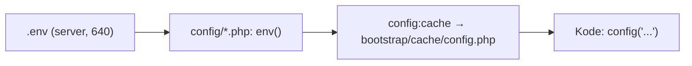

# Environment Configuration

Aplikasi yang sama berperilaku berbeda di tiap lingkungan karena konfigurasinya berbeda: database, mailer, kunci API, mode debug. Laravel membaca konfigurasi dari variabel lingkungan (`.env`). Sub bab ini mengajarkan cara mengelolanya di produksi dengan aman: berkas `.env` di server, izin, enkripsi, `config:cache`, dan rotasi rahasia.

!!! danger "Belum teruji penulis"
    Perintah diturunkan dari dokumentasi Laravel 13.x (Configuration). Penulis belum menjalankan pada server nyata. **Jangan** menempelkan rahasia asli ke chat, tiket, atau repositori.

## Tujuan Pembelajaran

- [ ] Menjelaskan peran `.env`, `config/*.php`, dan `config()` vs `env()`.
- [ ] Membuat `.env` produksi yang aman dan memberi izin yang tepat.
- [ ] Membuat dan melindungi `APP_KEY`.
- [ ] Mengenkripsi berkas lingkungan (`env:encrypt`/`env:decrypt`) untuk penyimpanan di repositori (opsional).
- [ ] Memakai `config:cache` dan menghindari jebakan `env()`.
- [ ] Merotasi rahasia yang bocor.

## Prasyarat

- [Production Environment](10-01-production-environment.md), [MySQL Production Configuration](10-06-mysql-production-configuration.md).

## Pengantar

Tim menempelkan isi `.env` ke grup chat agar rekan bisa deploy. Sejak itu kredensial database ada di riwayat chat. Cara yang benar membuat rahasia tidak pernah berpindah lewat kanal tak aman.

## Penjelasan Konsep

### `.env`, `config/`, dan `config()`

| Elemen | Peran |
|---|---|
| `.env` | Nilai khusus lingkungan dan rahasia (tidak di Git) |
| `config/*.php` | Struktur konfigurasi; membaca nilai dengan `env('NAMA', 'default')` |
| `config('app.name')` | Cara kode aplikasi membaca konfigurasi |

Aturan: `env()` **hanya** di berkas `config/`. Di tempat lain gunakan `config()`. Setelah `config:cache`, `.env` tidak dimuat lagi, jadi `env()` di luar `config/` mengembalikan `null` (09.02).

### `.env.example`

Repositori menyertakan `.env.example` berisi nama variabel dan nilai aman/contoh (tanpa rahasia). Server membuat `.env` dari sana lalu mengisi nilai nyata.

### `.env` produksi

```text
APP_NAME="CMS Artikel"
APP_ENV=production
APP_KEY=
APP_DEBUG=false
APP_URL=https://contoh.com

LOG_CHANNEL=stack
LOG_STACK=daily
LOG_LEVEL=warning

DB_CONNECTION=mysql
DB_HOST=127.0.0.1
DB_PORT=3306
DB_DATABASE=cms_artikel
DB_USERNAME=cms_app
DB_PASSWORD=

SESSION_DRIVER=database
SESSION_SECURE_COOKIE=true
CACHE_STORE=database
QUEUE_CONNECTION=database
MAIL_MAILER=smtp
```

`APP_KEY` dikosongkan di contoh; diisi saat pertama kali.

### `APP_KEY`

```bash
php artisan key:generate --show      # menampilkan kunci tanpa menulis
php artisan key:generate             # menulis ke .env
```

Dokumentasi menekankan `APP_KEY` dipakai enkripsi (cookie, `Crypt`, sesi terenkripsi). **Jangan ganti sembarangan** setelah ada data terenkripsi/cookie aktif: semuanya tidak terbaca. Simpan salinan aman. Bila memutar kunci, Laravel mendukung `APP_PREVIOUS_KEYS` (daftar kunci lama dipisah koma) untuk dekripsi data lama selama masa transisi; lihat dokumentasi Encryption.

### Izin berkas

```bash
sudo chown deploy:www-data .env
sudo chmod 640 .env
```

Pemilik (pengguna deploy) membaca-menulis; grup web membaca; lainnya tidak. Lihat 10.09.

### Enkripsi berkas lingkungan (opsional)

Menurut dokumentasi, `env:encrypt` mengenkripsi `.env` menjadi `.env.encrypted` yang dapat disimpan di repositori, dan `env:decrypt` membukanya dengan kunci:

```bash
php artisan env:encrypt                      # kunci dibuat dan ditampilkan sekali
php artisan env:decrypt --key=KUNCI          # atau via LARAVEL_ENV_ENCRYPTION_KEY
```

Kunci enkripsi adalah rahasia baru yang harus dikelola (jangan di repositori). Bermanfaat bagi tim agar konfigurasi terversi tanpa rahasia terbuka; tambah kompleksitas. Alternatif: secret manager atau variabel rahasia di CI/server.

### `config:cache`

```bash
php artisan config:cache
php artisan config:clear
```

Jalankan pada setiap deploy setelah `.env` final. Jika kamu mengubah `.env`, jalankan `config:cache` ulang (atau `optimize`) agar berlaku.

### Rotasi

Rahasia yang pernah terlihat orang lain atau tersimpan di tempat tak aman dianggap bocor: buat yang baru, perbarui server, cabut yang lama. Catat tanggal rotasi.

### Keamanan

- Jangan commit `.env`; periksa `.gitignore`.
- Jangan log nilai `.env`; `php artisan about` tidak menampilkan rahasia, tetapi `phpinfo()` dan `dd(config())` bisa.
- Batasi siapa yang memegang `.env` produksi.
- Gunakan kredensial berbeda per lingkungan.

## Cara Kerja



## Contoh Praktik

Kamu membuat `.env` produksi di server uji, mengisi `APP_KEY`, mengatur izin, menjalankan `config:cache`, dan memverifikasi bahwa `.env` tidak terbaca dari web.

## Penjelasan Kode

Verifikasi perilaku cache konfigurasi:

```bash
php artisan tinker --execute="echo config('app.env');"
php artisan config:cache
sed -i 's/APP_ENV=production/APP_ENV=staging/' .env
php artisan tinker --execute="echo config('app.env');"     # masih production (dari cache)
php artisan config:clear
php artisan tinker --execute="echo config('app.env');"     # sekarang staging
```

Kembalikan `.env` ke nilai semula setelah percobaan.

## Implementasi Langkah demi Langkah

### Langkah 1: buat `.env`

```bash
cp .env.example .env
php artisan key:generate
```

### Langkah 2: isi nilai produksi

Gunakan editor di server; sandi dari pengelola sandi, bukan dari chat.

### Langkah 3: atur izin

```bash
sudo chown deploy:www-data .env
sudo chmod 640 .env
ls -l .env
```

### Langkah 4: cache konfigurasi

```bash
php artisan config:cache
```

### Langkah 5: uji perilaku cache

Jalankan skenario di bagian "Penjelasan Kode".

### Langkah 6: verifikasi dari web

```bash
curl -i https://contoh.com/.env      # harus bukan isi berkas
```

### Langkah 7: audit repositori

```bash
git ls-files | grep -E "^\.env$" || echo "OK: .env tidak dilacak"
```

## Eksekusi dan Verifikasi

| Langkah | Hasil yang diharapkan |
|---|---|
| 3 | `-rw-r-----` pada `.env` |
| 5 | Nilai berubah hanya setelah `config:clear` |
| 6 | `/.env` tidak membocorkan isi |
| 7 | `OK: .env tidak dilacak` |

## Daftar periksa verifikasi

- [ ] `APP_DEBUG=false`, `APP_ENV=production`.
- [ ] `APP_KEY` terisi dan disimpan aman.
- [ ] `.env` izin 640, tidak di Git.
- [ ] Tidak ada `env()` di luar `config/`.
- [ ] Prosedur rotasi rahasia ditulis.

## Hasil yang Diharapkan

Diturunkan dari dokumentasi; belum diuji penulis.

## Kesalahan Umum dan Pemecahan Masalah

| Gejala | Penyebab | Cara mengenali | Solusi | Pencegahan |
|---|---|---|---|---|
| Perubahan `.env` tak berlaku | Konfigurasi ter-cache | Nilai lama | `config:clear` lalu `config:cache` | Bagian dari deploy |
| `No application encryption key` | `APP_KEY` kosong | Galat 500 | `key:generate` | Langkah awal |
| Sesi/cookie tidak valid setelah deploy | `APP_KEY` berubah | Semua pengguna keluar | Pulihkan kunci | Simpan kunci |
| `.env` terbaca publik | Nginx salah root | `curl /.env` berisi | Perbaiki (10.04) | Uji |
| `env()` null di kode | Dipanggil di luar config | Nilai kosong | `config()` | Review |
| Rahasia di riwayat Git | Pernah commit | `git log` | Rotasi + bersihkan riwayat | Pemindaian rahasia |

## Latihan Praktik

### Latihan dasar

**D1. `env()` atau `config()`?**
- *Masalah:* memilih fungsi.
- *Persyaratan:* tentukan untuk (a) berkas `config/services.php`, (b) controller.
- *Perilaku yang diharapkan:* (a) `env()`, (b) `config()`.
- *Tujuan belajar:* aturan konfigurasi.

### Latihan implementasi

**I1. `.env.example`**
- *Masalah:* anggota baru bingung variabel.
- *Persyaratan:* lengkapi `.env.example` dengan semua variabel yang dipakai (tanpa rahasia) dan komentar singkat.
- *Perilaku yang diharapkan:* `cp .env.example .env` cukup untuk mulai.
- *Tujuan belajar:* dokumentasi konfigurasi.

**I2. Enkripsi env**
- *Masalah:* ingin menyimpan konfigurasi terenkripsi di Git.
- *Persyaratan:* gunakan `env:encrypt`, simpan kunci di tempat terpisah, dan uji `env:decrypt` di lingkungan bersih.
- *Perilaku yang diharapkan:* `.env` pulih.
- *Tujuan belajar:* alur env terenkripsi.

### Latihan tantangan

**T1. Insiden kebocoran**
- *Masalah:* kunci API ter-commit ke repositori publik.
- *Persyaratan:* tulis langkah tanggap insiden (cabut, putar, audit pemakaian, bersihkan riwayat, pencegahan).
- *Perilaku yang diharapkan:* prosedur lengkap.
- *Tujuan belajar:* respons insiden.
- *Catatan:* kerjakan mandiri; tidak ada kunci jawaban.

## Uji Pemahaman

1. Mengapa `env()` hanya di `config/`?
2. Mengapa `APP_KEY` tidak boleh sembarang diganti?
3. Apa izin `.env` yang disarankan?
4. Kapan konfigurasi perlu di-cache ulang?

??? success "Kunci jawaban singkat"
    1. Setelah `config:cache`, `.env` tidak dibaca lagi.
    2. Data/cookie terenkripsi menjadi tak terbaca.
    3. `640` dengan pemilik deploy dan grup web.
    4. Setiap `.env` atau konfigurasi berubah.

## Ringkasan

- Konfigurasi di lingkungan; rahasia di luar Git dan kanal tak aman.
- Lindungi `APP_KEY`, atur izin `.env`, gunakan `config()` dan `config:cache`.
- Rencanakan rotasi dan tanggap insiden kebocoran.

Selanjutnya: *Laravel Deployment*.

## Referensi Resmi

- [Laravel: Configuration](https://laravel.com/docs/13.x/configuration)
- [Laravel: Encryption](https://laravel.com/docs/13.x/encryption)
