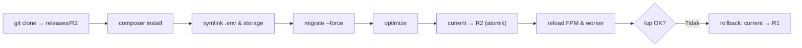

# Laravel Deployment

Deploy manual (`git pull` di server produksi) rawan: ada jeda saat kode setengah baru, kesalahan langkah, dan sulit dibatalkan. Sub bab ini menyusun deploy yang **berulang, cepat, dan bisa dibatalkan** dengan pola direktori rilis (`releases/`, `shared/`, tautan `current`) dan skrip Bash sederhana.

!!! danger "Belum teruji penulis"
    Skrip dan urutan langkah diturunkan dari dokumentasi Laravel 13.x dan praktik umum, belum dijalankan penulis pada server nyata. Uji pertama kali di server staging, jangan di produksi, dan baca skrip sebelum menjalankannya.

## Tujuan Pembelajaran

- [ ] Menjelaskan alur deploy: ambil kode → dependensi → build aset → migrasi → optimasi → alihkan → reload.
- [ ] Menyusun direktori `releases/`, `shared/`, dan tautan `current`.
- [ ] Menulis skrip deploy yang berhenti saat gagal (`set -euo pipefail`).
- [ ] Menjalankan migrasi produksi dengan aman (`--force`) dan memahami risikonya.
- [ ] Memuat ulang PHP-FPM, worker, dan layanan panjang (`php artisan reload`).
- [ ] Melakukan pemeriksaan kesehatan (`/up`) dan rollback.

## Prasyarat

- [Environment Configuration](10-07-environment-configuration.md), [PHP-FPM](10-05-php-fpm.md), [Nginx Configuration](10-04-nginx-configuration.md).
- Repositori Git yang dapat diakses server (deploy key baca-saja).

## Pengantar

Rilis jam 10 pagi. `git pull` memakan 5 detik; selama itu pengguna melihat kode setengah lama dan `composer install` belum selesai: galat acak. Dengan rilis baru disiapkan di folder terpisah lalu "diputar" dengan satu perintah atomik, tidak ada jeda rusak.

## Penjelasan Konsep

### Struktur direktori

```text
/var/www/contoh.com/
  releases/
    20261107-101500/     ← rilis (kode, vendor, build)
    20261107-094000/
  shared/
    .env
    storage/             ← log, unggahan, cache (dipertahankan antar rilis)
  current -> releases/20261107-101500   ← tautan simbolik aktif
```

Nginx `root` menunjuk `/var/www/contoh.com/current/public` (10.04). `.env` dan `storage/` ada di `shared/` dan di-*symlink* ke tiap rilis.

### Urutan deploy

| Langkah | Alasan |
|---|---|
| 1. Buat rilis baru dari kode | Tidak mengganggu rilis berjalan |
| 2. `composer install --no-dev --optimize-autoloader` | Dependensi produksi |
| 3. Aset frontend: build di CI atau `npm ci && npm run build` | Vite menghasilkan aset ber-hash |
| 4. Tautkan `.env` dan `storage` dari `shared/` | Konfigurasi dan data persisten |
| 5. `php artisan migrate --force` | Skema database terbaru |
| 6. `php artisan optimize` | Cache config/route/view/event |
| 7. Alihkan `current` (atomik) | Pengguna langsung melihat rilis baru |
| 8. Reload PHP-FPM dan layanan panjang | OPcache segar; worker memakai kode baru |
| 9. Cek `/up` | Pastikan aplikasi sehat |
| 10. Bersihkan rilis lama (simpan 3–5) | Hemat disk, tetap bisa rollback |

### Migrasi dan kompatibilitas

Migrasi berjalan sementara rilis lama masih melayani sebelum tautan dialihkan. Tulis migrasi yang **kompatibel mundur** (menambah kolom nullable dulu; menghapus kolom di rilis berikutnya) agar rilis lama tidak rusak sesaat. Migrasi destruktif (drop kolom) pada deploy yang sama dengan kode yang berhenti memakainya adalah sumber insiden umum. Pada produksi, flag `--force` diperlukan agar tidak diminta konfirmasi; **backup dulu** (10.18) untuk perubahan besar.

### Reload layanan

Menurut dokumentasi deployment, setelah deploy layanan panjang seperti queue worker, Reverb, atau Octane harus dimuat ulang; Laravel menyediakan `php artisan reload` untuk itu, dan kamu tetap memerlukan pengelola proses (Supervisor, 10.10) yang menghidupkan ulang prosesnya. Untuk PHP-FPM: `sudo systemctl reload php8.3-fpm`. Pastikan pengguna deploy boleh menjalankan reload tersebut (aturan `sudoers` spesifik, bukan `sudo` bebas).

### Skrip deploy

File: `deploy.sh` (di server, mis. `/home/deploy/deploy.sh`)

```bash
#!/usr/bin/env bash
set -euo pipefail

APP_DIR="/var/www/contoh.com"
REPO="git@github.com:ORG/cms-artikel.git"
BRANCH="${1:-main}"
RELEASE="$(date +%Y%m%d-%H%M%S)"
RELEASE_DIR="$APP_DIR/releases/$RELEASE"

echo ">> Rilis $RELEASE dari $BRANCH"
git clone --depth 1 --branch "$BRANCH" "$REPO" "$RELEASE_DIR"
cd "$RELEASE_DIR"

composer install --no-dev --optimize-autoloader --no-interaction

# Aset: lebih baik dibangun di CI lalu disalin. Jika dibangun di server:
# npm ci && npm run build

ln -sfn "$APP_DIR/shared/.env" "$RELEASE_DIR/.env"
rm -rf "$RELEASE_DIR/storage"
ln -sfn "$APP_DIR/shared/storage" "$RELEASE_DIR/storage"

php artisan migrate --force
php artisan optimize

ln -sfn "$RELEASE_DIR" "$APP_DIR/current.tmp"
mv -Tf "$APP_DIR/current.tmp" "$APP_DIR/current"

sudo systemctl reload php8.3-fpm
php artisan reload || php artisan queue:restart

curl -fsS http://127.0.0.1/up > /dev/null && echo ">> Sehat" || { echo ">> GAGAL pemeriksaan kesehatan"; exit 1; }

# Simpan 5 rilis terakhir
ls -1dt "$APP_DIR"/releases/* | tail -n +6 | xargs -r rm -rf
```

| Bagian | Fungsi |
|---|---|
| `set -euo pipefail` | Berhenti saat ada perintah gagal, variabel kosong, atau pipa gagal |
| `git clone --depth 1` | Hanya rilis terbaru (cepat) |
| `ln -sfn` + `mv -Tf` | Mengalihkan `current` secara atomik |
| `curl /up` | Pemeriksaan kesehatan (route bawaan Laravel) |
| Pembersihan | Menyimpan lima rilis terakhir untuk rollback |

Catatan: `curl http://127.0.0.1/up` hanya cocok jika Nginx menjawab untuk host itu; sesuaikan dengan `Host` header domain (`curl -H 'Host: contoh.com' ...`). Perintah `php artisan reload` ada di dokumentasi Laravel 13.x; `|| queue:restart` hanya cadangan sederhana bila perintah itu tak tersedia.

### Rollback

```bash
cd /var/www/contoh.com
ls -1dt releases/*                       # pilih rilis sebelumnya
ln -sfn "$PWD/releases/20261107-094000" current.tmp && mv -Tf current.tmp current
sudo systemctl reload php8.3-fpm
php artisan reload
```

Kode kembali, tetapi **migrasi tidak otomatis mundur**. Karena itu migrasi harus kompatibel; rollback skema adalah keputusan terpisah (`migrate:rollback` berisiko pada data).

### Mode pemeliharaan

Untuk perubahan besar: `php artisan down --retry=60` sebelum dan `php artisan up` sesudah. Dokumentasi mencatat bahwa memakai `down` saat deploy dapat membuat pengguna sempat melihat galat antara aplikasi turun dan dinaikkan; sebaiknya deploy atomik seperti di atas lebih disukai.

### Keamanan

- Kunci deploy server: **deploy key baca-saja** untuk repositori, bukan kunci pribadimu.
- Skrip tidak memuat rahasia; `.env` ada di `shared/`.
- Batasi `sudo` hanya untuk perintah reload yang dibutuhkan.
- Jangan menjalankan `composer install` sebagai root.

## Cara Kerja



## Contoh Praktik

Kamu menyiapkan struktur direktori di server staging, menaruh `.env` di `shared`, menjalankan `deploy.sh` dua kali, dan mempraktikkan rollback.

## Penjelasan Kode

Atomisitas: `ln -sfn` ke nama sementara lalu `mv -Tf` mengganti tautan dalam satu operasi sistem berkas, sehingga tidak ada saat `current` tidak ada.

## Implementasi Langkah demi Langkah

### Langkah 1: siapkan struktur

```bash
sudo mkdir -p /var/www/contoh.com/{releases,shared/storage}
sudo chown -R deploy:www-data /var/www/contoh.com
```

### Langkah 2: siapkan `shared`

Salin kerangka `storage` (`app/public`, `framework/{cache,sessions,views}`, `logs`) dan taruh `.env` produksi di `shared/.env` (izin 640).

### Langkah 3: deploy key

Buat kunci SSH baca-saja khusus server dan daftarkan sebagai *deploy key* di repositori.

### Langkah 4: jalankan skrip

```bash
chmod +x ~/deploy.sh
~/deploy.sh main
```

### Langkah 5: verifikasi

```bash
curl -i -H 'Host: contoh.com' http://127.0.0.1/up
readlink /var/www/contoh.com/current
```

### Langkah 6: deploy kedua

Ubah sesuatu kecil, push, jalankan lagi, dan pastikan `current` berubah.

### Langkah 7: rollback

Lakukan rollback manual dan verifikasi aplikasi kembali ke rilis lama.

### Langkah 8: catat

Dokumentasikan prosedur di `docs-deploy.md`.

## Eksekusi dan Verifikasi

| Langkah | Hasil yang diharapkan |
|---|---|
| 4 | Skrip selesai; ">> Sehat" tercetak |
| 5 | `/up` → 200; `current` menunjuk rilis terbaru |
| 7 | `current` kembali ke rilis lama; situs tetap berfungsi |

## Daftar periksa verifikasi

- [ ] Situs menyajikan rilis dari `current/public`.
- [ ] `.env` dan `storage` berasal dari `shared`.
- [ ] Deploy berhenti bila langkah gagal.
- [ ] Rollback dipraktikkan dan berhasil.
- [ ] Migrasi kompatibel mundur.
- [ ] Tidak ada rahasia di skrip/repo.

## Hasil yang Diharapkan

Bergantung server dan repositori; belum diuji penulis.

## Kesalahan Umum dan Pemecahan Masalah

| Gejala | Penyebab | Cara mengenali | Solusi | Pencegahan |
|---|---|---|---|---|
| 500 setelah deploy | `.env`/`storage` tak tertaut | Log: galat tulis/APP_KEY | Perbaiki symlink | Skrip & uji staging |
| Kode lama tampil | FPM tidak di-reload (OPcache) | Perubahan tak muncul | `systemctl reload php8.3-fpm` | Bagian skrip |
| Worker pakai kode lama | Tidak di-restart | Perilaku lama | `php artisan reload`/Supervisor restart | Bagian skrip |
| Migrasi merusak rilis lama | Migrasi tidak kompatibel | Galat sesaat | Pola dua tahap | Review migrasi |
| `composer: command not found` | Tidak terpasang untuk pengguna | Galat | Pasang Composer (10.05) | Prasyarat |
| `Permission denied` clone | Deploy key belum terdaftar | Galat git | Daftarkan key | Langkah 3 |
| Disk penuh oleh rilis | Tak dibersihkan | `df -h` | Pembersihan rilis | Bagian skrip |

## Latihan Praktik

### Latihan dasar

**D1. Urutan**
- *Masalah:* mengurutkan langkah.
- *Persyaratan:* urutkan: alihkan tautan, `composer install`, clone, `migrate`, reload FPM.
- *Perilaku yang diharapkan:* clone → composer → migrate → alihkan → reload.
- *Tujuan belajar:* alur deploy.

### Latihan implementasi

**I1. Pemeriksaan kesehatan yang lebih ketat**
- *Masalah:* `/up` hanya memeriksa boot.
- *Persyaratan:* gunakan event `DiagnosingHealth` untuk memeriksa koneksi database dan tulis uji dari skrip deploy.
- *Perilaku yang diharapkan:* `/up` gagal bila DB mati.
- *Tujuan belajar:* health check bermakna.

**I2. Migrasi dua tahap**
- *Masalah:* mengganti nama kolom `title` menjadi `headline` tanpa downtime.
- *Persyaratan:* rancang 3 rilis (tambah kolom + tulis ganda, pindah baca, hapus lama).
- *Perilaku yang diharapkan:* rencana aman.
- *Tujuan belajar:* migrasi kompatibel.

### Latihan tantangan

**T1. Deploy tanpa SSH ke server**
- *Masalah:* ingin deploy lewat CI.
- *Persyaratan:* rancang bagaimana CI menjalankan deploy (kunci terbatas, perintah terbatas), dan risikonya. (Implementasi di 10.17.)
- *Perilaku yang diharapkan:* rancangan aman.
- *Tujuan belajar:* otomatisasi aman.
- *Catatan:* kerjakan mandiri; tidak ada kunci jawaban.

## Uji Pemahaman

1. Mengapa memakai tautan `current`?
2. Mengapa `.env` dan `storage` di `shared`?
3. Mengapa reload FPM setelah deploy?
4. Apakah rollback kode membatalkan migrasi?

??? success "Kunci jawaban singkat"
    1. Peralihan atomik tanpa jeda rusak dan rollback mudah.
    2. Agar tetap ada dan sama antar rilis.
    3. OPcache perlu dikosongkan agar kode baru terbaca.
    4. Tidak; migrasi harus dikelola terpisah.

## Ringkasan

- Deploy berulang dengan direktori rilis, `shared`, dan `current`.
- Skrip berhenti saat gagal, migrasi kompatibel, reload layanan, cek `/up`.
- Rollback harus dilatih; rahasia di luar skrip dan repositori.

Selanjutnya: *File Permissions*.

## Referensi Resmi

- [Laravel: Deployment](https://laravel.com/docs/13.x/deployment)
- [Laravel: Maintenance Mode](https://laravel.com/docs/13.x/configuration#maintenance-mode)
- [Laravel: Migrations, Running Migrations in Production](https://laravel.com/docs/13.x/migrations#forcing-migrations-to-run-in-production)
